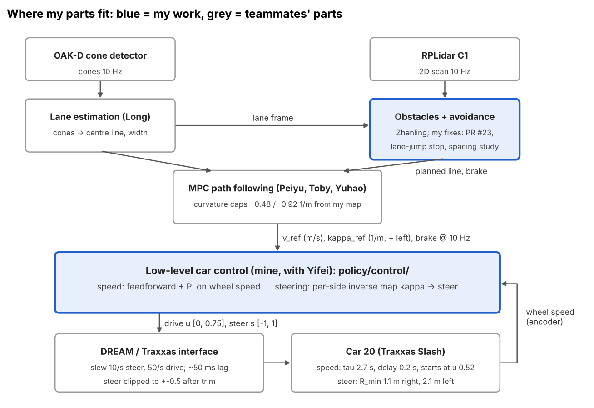
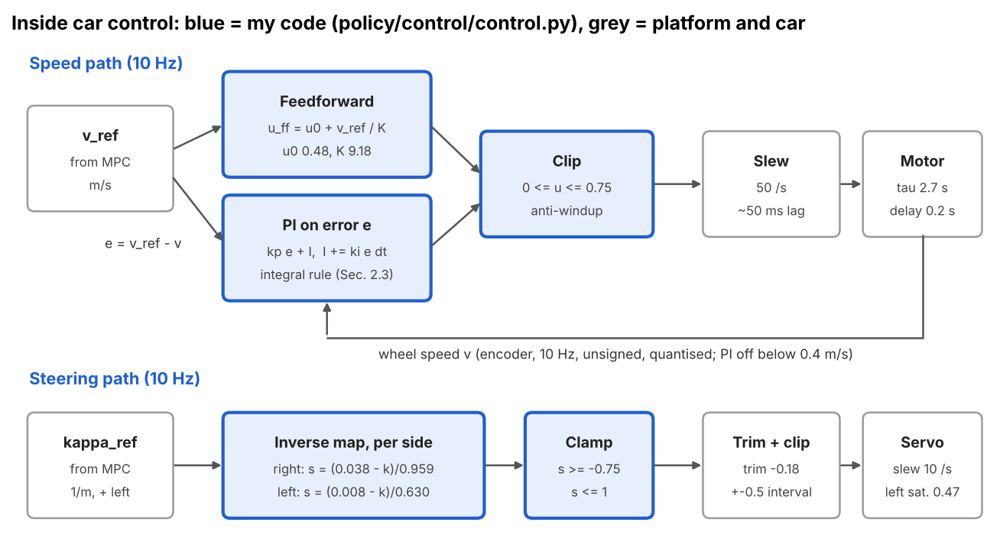
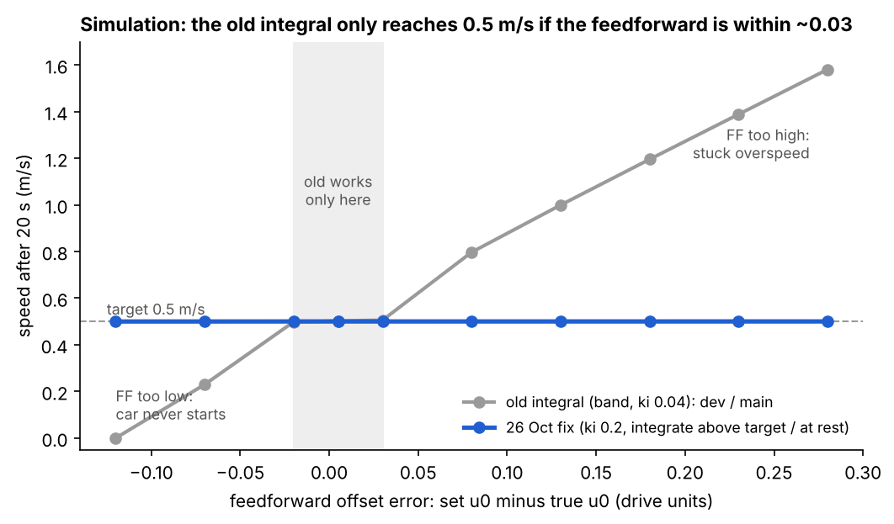
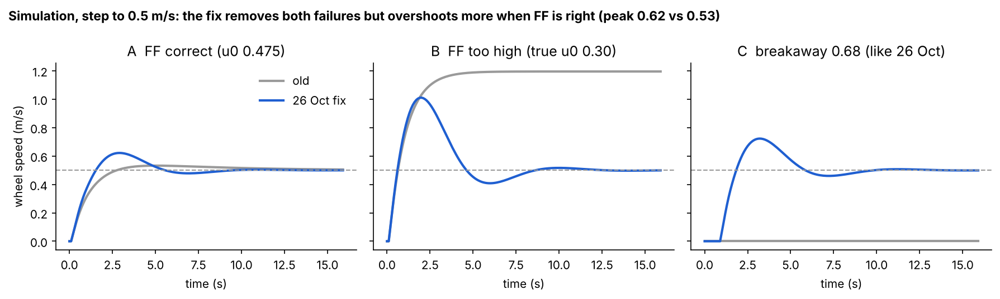
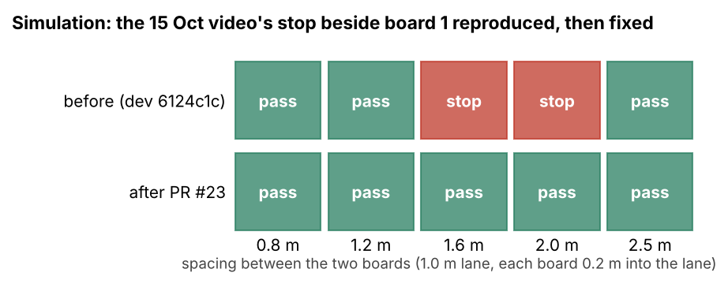
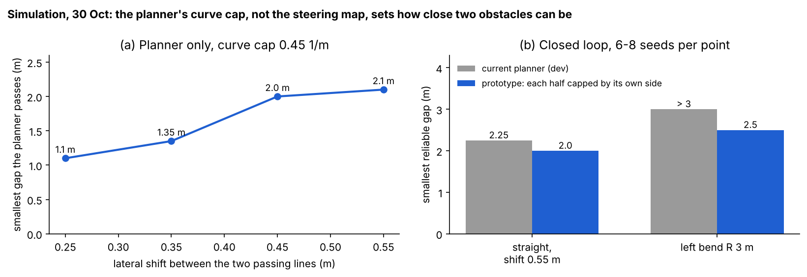
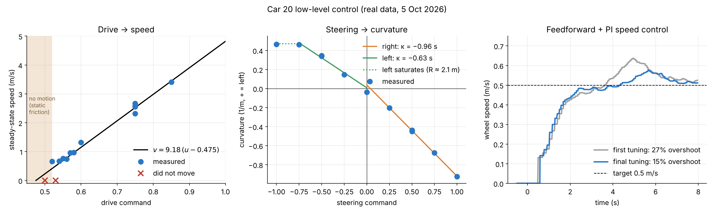

# Chris (Chuhan Wang): car control sub-team, system ID, speed control and avoidance validation

[Back to the team logbook](README.md)

| | |
| --- | --- |
| Role | Car control sub-team with Yifei. System ID experiments and analysis on the real car, the low-level controller (speed and steering), then on-car validation of speed and obstacle stops |
| PRs | #17 (`CarController`: FF + PI speed, per-side steering map, car 20 defaults, `tools/sysid_analyze.py`), #23 (two-obstacle stop fixes), all merged into `dev` |
| Open work | `fix/speed-overspeed-integral` (26 Oct speed fix, tested on car 20, pushed, no PR yet). `test/steering-limit` (±0.8 interval; Toby's turn work uses it). Lane-jump stop fix and asymmetric avoidance prototype: local only |
| Built on teammates' work | Yifei: steering map runs, motor calibration. Peiyu: MPC framework, car models (#16, #18). Toby: MPC calibration that uses my curvature limits (#15). Zhenling: obstacle detection and avoidance (#19, #21). Long: lane estimation. Ciaran: repo, CI, upload script |
| Figures | `chris/figures/`, made by `python3 docs/logbook/chris/make_figures.py`. `03_car20_maps_pi.png` is from `plot_speed_map.py` on the 5 Oct `c20_*` bags |

**Summary: four pieces of work, in order** (the same as my slide):
1. **System ID on the real car.** Drive → speed and steering → curvature on car 8 and car 20. The numbers differ a lot
   between cars, so I wrote a 15-minute recalibration procedure (Sections 2.1, 4.1, 4.2).
2. **Low-level controller.** Feedforward + PI on wheel speed, and a per-side inverse steering map, so the MPC can
   command m/s and 1/m. Merged as #17 (Sections 1, 2.2, 4.3).
3. **Speed fault fix (26 Oct).** The integral rule left the car at 0.87 m/s for a 0.5 m/s target, or unable to start.
   Diagnosed in code, tested in simulation, fixed and checked on car 20 (Sections 2.3, 3.1, 4.4).
4. **Obstacle avoidance validation.** Two planner bugs found in simulation (#23), a lane-jump false stop found on the
   car, and a simulation study of how close two obstacles can be (Sections 3.2, 3.3, 4.5).

On real cars: system ID (cars 8 and 20), PI tuning, the speed fix (car 20) and the avoidance runs (car 20). Sections
3.2 (prototype) and 3.3 are simulation only.

## Timeline

| Week | What I did | Evidence |
| --- | --- | --- |
| 0 (27-29 Sep) | System ID test sequencer with safety stops; first speed map and PI on car 8 | `tools/sysid_analyze.py`, `car-calibration` procedure |
| 1 (5 Oct) | Car 20: dead-band, speed map, steering map (with Yifei), PI v1 → v2, battery check | bags `c20_*`, Fig. 03 |
| 2 (12-13 Oct) | `CarController` merged; Progress Assessment | PR #17, `docs/control/` |
| 3 (17-19 Oct) | Two-obstacle stop: reproduced in sim, 2 bugs fixed; car 20 runs found the lane-jump stop | PR #23, bags `two_obstacles_2/3`, `~/policy_logs` |
| 4 (26 Oct) | Speed fault taken over from Zhenling: fixed, 3 runs on car 20 | `fix/speed-overspeed-integral` (`7377b30`, `f48252e`, `4a5a051`) |
| 5 (30 Oct) | Avoidance spacing study (sim); steering-limit stand test (car 20) | `test/steering-limit` (`da109a1`, `bb2a61c`), bag `steer_stand_08` |

---

## 1. Where my parts fit (Standard 1)

*Blue boxes are mine. Everything above car control works in m/s and 1/m, so it can be tuned in simulation and moved
between cars; car control is the one block that knows the car's physics.*

| Interface | Direction | What it carries | Assumption or constraint |
| --- | --- | --- | --- |
| `DriveCommand` from the MPC | in | speed (m/s), curvature (1/m, + = left), brake flag, 10 Hz | Curvature within the car's limits: car 20 +0.48 / −0.92 1/m |
| Wheel speed | in | m/s, 10 Hz | Unsigned, quantised at low speed, holds its last value 3-4 s after stopping |
| drive, steer to the vehicle interface | out | normalised; drive capped at 0.75 | Platform slew 10/s steer, 50/s drive; steer clipped to ±0.5 after trim |
| Curvature limits to the MPC and avoidance | design value | +0.48 / −0.92 1/m | Measured on car 20 at ±0.5; used in #15 |

**Design goals and the choices they forced:**
- **Track 0.5 m/s with little overshoot** despite ~0.2 s dead time and τ ≈ 2.7 s → feedforward for the fast part,
  low-gain PI for the rest.
- **Work on any car and battery** → the feedforward is only a starting point; the integral has to absorb map errors
  (it didn't before 26 Oct, Section 2.3).
- **Turn any feasible curvature into the right steer on each side** → separate fits per side, clamped where more steer
  does nothing.
- **System-level consequence:** car 20's left limit (R ≈ 2.1 m) caps the MPC and the avoidance planner. It explains
  why left 90° turns failed (Toby, Section 3.4 of his section) and limits how close two obstacles can be (Section 3.3).

## 2. How it works (Standard 2)

### 2.1 Car model from system ID

$$v(t) = v_{ss}\left(1 - e^{-(t - t_0 - \theta)/\tau}\right), \qquad v_{ss} = K\,(u - u_0)$$

| Quantity | Meaning | Car 8 (29 Sep) | Car 20 (5 Oct) |
| --- | --- | --- | --- |
| $K$ | speed per unit drive (m/s) | 3.97 | 9.18 (±10%) |
| $u_0$ | drive offset of the map | 0.697 | 0.475 |
| $\tau$ | time constant (s) | 1.1 | 2.7 |
| $\theta$ | dead time (s) | 0.5 | 0.2 |
| breakaway | drive at which the car starts to move | not swept | 0.52-0.53 (≈ 0.68 on 26 Oct) |

- Steering, car 20 (κ = yaw rate / wheel speed): right $\kappa = -0.959\,s + 0.038$ (RMS 0.006), left
  $\kappa = -0.630\,s + 0.008$ (RMS 0.019), saturating at κ ≈ 0.47 1/m beyond $s = -0.75$. Positive steer turns right.

### 2.2 Controller (`policy/control/control.py`)

$$u_{ff} = u_0 + \frac{v_{ref}}{K}, \quad e = v_{ref} - v, \quad I_k = \mathrm{clip}(I_{k-1} + k_i e \Delta t, \pm I_{max}), \quad u = \mathrm{clip}(u_{ff} + k_p e + I_k,\ 0,\ 0.75)$$

$$s(\kappa) = \begin{cases} (0.038 - \kappa)/0.959 & \kappa < 0 \\ \max\big((0.008 - \kappa)/0.630,\ -0.75\big) & \kappa \ge 0 \end{cases}$$

| Key parameter | Car 20 value | Why it matters on the real car |
| --- | --- | --- |
| $u_0$, $K$ | 0.48, 9.18 | Wrong by more than ~0.03 and the old controller fails (Section 3.1). Changes with car and battery |
| $k_p$ | 0.15 | With 0.2 s delay and τ 2.7 s, higher gain overshoots |
| $k_i$, $I_{max}$ | 0.04, 0.2 (fix: 0.2, 0.3) | How fast a map error is removed; too high overshoots at the start |
| `speed_i_band` | 0.2 m/s | Stops windup during the climb from rest |
| `speed_feedback_min` | 0.4 m/s | Wheel speed is unreliable below this, so PI is off |
| drive cap | 0.75 | Safety: 0.75 reaches 1.5 m/s in 3 s on car 20 |

- **Why feedforward + PI, no D:** the map gives the right drive at once; PI removes the residual. Wheel speed is
  quantised (staircase in Fig. 03c), so a derivative would amplify the steps.
- **Anti-windup:** no integration while the output is clipped and the error pushes further; integral reset at a 0
  target. A brake request bypasses the PI.

### 2.3 The integral rule, before and after 26 Oct

| | Integrates when | Effect |
| --- | --- | --- |
| Before (`dev`, `main`) | $\lvert e \rvert$ < band | An overspeed > 0.2 m/s or a car standing still (e = 0.5) freezes the integral; only P acts |
| After (`fix/speed-overspeed-integral`) | e < band, or the car is above the target, or wheels < 0.05 m/s | Overspeed always pulled down; a car that hasn't started always pushed up; windup during the climb still limited |

## 3. Simulation (Standard 3)

### 3.1 For which feedforward errors does the speed controller still work? (26 Oct, re-run 5 Nov)

- **Question:** the 26 Oct fault came from a feedforward that no longer matched the car. How large a map error can each
  integral rule handle, and what does the fix cost?
- **Method:** `chris/sim_speed_integral.py`. Car 20's model from Section 2.1 plus a breakaway threshold (true $u_0$ +
  0.045, from 5 Oct), running a copy of `SpeedController` at 10 Hz. Uncertainty included: the map offset (true $u_0$
  0.20-0.60 with the feedforward fixed at 0.48), and breakaway up to 0.68 as seen on 26 Oct.

- **Result:** the old rule reaches 0.5 m/s only for a feedforward error of −0.02 to +0.03; the fix reaches it across
  −0.12 to +0.28, settling in 3.5-7.6 s. The 26 Oct breakaway case (C): old never starts, fix settles in 5.3 s.
- **Trade-off:** with a correct feedforward the fix overshoots more (peak 0.62 vs 0.53 m/s). The car showed the same
  (peaks 0.57-0.62, Section 4.4).
- **Choices made from it:** $k_i$ 0.2 with $I_{max}$ 0.3 (0.3 undershot); feedforward back to 0.48.
- **Can't conclude:** no stick-slip randomness, no battery drift within a run, no encoder hold after stopping; τ and
  delay fixed at the 5 Oct values (not swept). It is a copy of the controller, not the repo code itself.

### 3.2 Why did the car stop beside the first of two boards? (17-18 Oct)

- **Question:** in the 15 Oct video the car stopped beside board 1 though board 2 left a clear centre line.
- **Method:** the repo's closed-loop avoidance test (car follows the MPC curvature exactly, 0.5 m/s), 1.0 m lane,
  boards 0.2 m into the lane, spacing 0.8-2.5 m.

- **Bug 1** `policy_runner._obstacle_distance_m`: the check band was widened on both sides by the car's 0.064 m offset
  from the new line, so it touched board 1. Fix: widen only on the car's side.
- **Bug 2** `avoidance._group`: after locking, the line re-centred on board 1's gap. Fix: keep the current line while
  it clears both boards.
- **Result:** all spacings pass with ≥ 0.11 m clearance; a regression test fails before and passes after (PR #23).
- **Earlier sweep (17 Oct, staggered boards, 0.8 m lane):** defaults need 3.5 m; raising only the ramp cap to 0.40
  made even one board stop (the MPC looks only 0.3 m ahead); ramp 0.48 + look-ahead 0.6 + pass 0.1 → 2.75 m.

### 3.3 How close can two obstacles be, and would a sharper left limit help? (30 Oct)

- **Method:** `obstacle-avoidance/spacing-study/` sweeps on `tests/policy/obstacle_simulation.py`, mirrored boards,
  6-8 seeds per point (results are noisy near the threshold).

- **Result:** the key variable is the lateral shift between the two passing lines. Raising the car's left limit
  0.47 → 0.93 alone changes nothing on a straight, because the planner's symmetric 0.45 cap binds first. Left bends are
  worst (R 3 m: about 3 m needed, vs 1.6 m right, 1.2 m straight).
- **Prototype:** each half of a move capped by its own side's room: 2.25 → 2.0 m (straight, shift 0.55),
  > 3 → 2.5 m (left bend). No gain at shift 0.25 (unexplained). Not merged.
- **Failure case found:** an obstacle inside stopping distance but not yet confirmed, plus lane loss in the same step,
  latches a lane-loss stop that only coasts; the car hits the board in sim.
- **Can't conclude:** perfect perception, no steering lag or slew; car width (0.25 m) is a guess.

## 4. On the car (Standard 4)

### 4.1 Drive → speed (car 8 on 29 Sep, car 20 on 5 Oct)

- **Question:** which drive gives which speed, how fast, from where does the car move?
- **Method:** one drive level held per run, steer 0, 7-8 m straight, all topics bagged. Dead-band sweep 0.50-0.60 in
  0.02 steps, 8 s holds at 0.53-0.57, short runs at 0.75 / 0.85. Safety stops in code: 1.5 m/s, max distance, stall
  0.6 s, IMU impact > 3.5 m/s².
- **Controlled variables:** same straight and direction, car turned between runs, trim fixed, battery checked by
  repeating 0.75 at the start and end (speed at 2 s: 1.19 vs 1.14 m/s).
- **Change of plan:** 0.80-1.00 dropped (0.85 hit 1.5 m/s in 1.8 s). Runs too short to settle, so each rise was fitted
  with τ fixed.
- **Result:** Fig. 03a and Section 2.1. Breakaway is stick-slip and inconsistent (0.52 moved once, 0.53 didn't).

*(a) drive → speed: shaded = no motion; line above 0.6 is the model. (b) steer → curvature per side. (c) step to
0.5 m/s, PI v1 vs v2.*

### 4.2 Steer → curvature (car 20, 5 Oct, with Yifei)

- PI held 0.5 m/s; one steer level per run (±0.25 to ±1.0); κ averaged over the last 3 s. Trim set to −0.18 first
  (before: a 3 m right circle at steer 0). ±0.5 repeated after a reboot: within 3%. Sign checked by eye.

### 4.3 PI tuning (car 20, 5 Oct)

| Version | $k_p$ | $k_i$ | Overshoot | Steady error at 0.5 m/s |
| --- | --- | --- | --- | --- |
| v1 | 0.10 | 0.07 | 27% | – |
| v2 (#17) | 0.15 | 0.04 | 15% | ≈ 0.013 m/s |

- Car 8 (kp 0.2, ki 0.15): 0.6 m/s with ~0 error, 15-19% overshoot at 0.9 m/s. Only 0.5 m/s was validated on car 20.

### 4.4 Speed fix on the car (car 20, 26 Oct)

- **Question:** does the fix remove the 0.87 m/s overspeed without losing the start?
- **Before:** 0.87 m/s steady at a 0.5 target; with Zhenling's feedforward 0.15 the car didn't move (drive 0.28, the car
  needed ~0.60-0.68 that day). One frame without a lane at standstill also latched LANE_LOSS (plan length = measured
  speed × step = 0); fixed with plan length ≥ target speed.

| Run | Moving after | Reached 0.5 | Peak (m/s) | Before stop (m/s) |
| --- | --- | --- | --- | --- |
| 15:20:27 | 0.8 s | 1.9 s | 0.62 | 0.50 |
| 15:21:42 | 0.4 s | 3.2 s | 0.57 | 0.54 |
| 15:23:01 | 0.9 s | 1.8 s | 0.60 | 0.52 |

- **Limits:** 3 runs on one day; ~20% start overshoot; if the encoder fails while moving the standstill integral could
  push drive to 0.75 (needs a time limit). The battery as the cause of the breakaway shift is not verified.

### 4.5 Avoidance on car 20 (19 Oct) and the steering limit (30 Oct)

- **19 Oct question:** does PR #23 pass two real boards? 3 runs, then replay of the logs through old and new code.
- **Finding:** still braked beside board 1. As the nearest blue cone left the camera view the lane estimate jumped
  0.35 m in 40 ms and put board 1 in the path; in the raw lidar frame it was 0.19 m clear. Fix (local): within 0.6 m
  of the front, block only if both the lane frame and the lidar frame agree. Replay: runs 1 and 3 false-stop on old
  code, pass on new. Run 2: no left move (lane estimate 0.15-0.2 m off in the left bend, left steer near saturation).
- **Ruled out:** dropped commands. All 2145 commands reached the Traxxas, ~50 ms lag.
- **Measured:** lidar 0.30 m and front 0.40 m ahead of the rear axle (config had front 0.30). Boards along the lane
  gave 36 → 4 lidar points as the car approached; a 20 cm board facing the car gave 16-36 and was avoided from 2.5-3 m.
- **30 Oct question:** is the left saturation mechanical? RC (not limited by the interval) turned ~2× further. Stand
  test with the interval at ±0.8: applied = trim −0.25 + 0.8 s, clipped at −0.8; left travel +60%. Ground re-map not
  done (car needed by teammates), so the 0.91 1/m left limit used in Toby's turns is unmeasured.

## 5. Lessons and limits

- A feedforward tuned on one day is not a car property: breakaway moved from 0.52 to ~0.68 in three weeks. Feedback
  must absorb that, and the 5 Oct integral rule could not.
- My controller is not in the team simulator's loop (it simulates a first-order speed response, not `CarControl`);
  Section 3.1 is a separate model.
- Not measured: braking (`brake_action` 0.3, stop distance 0.6 s × v are estimates), PI at other speeds, car width,
  the left limit at ±0.8.
- Next: PR the speed fix; replay the 26 Oct runs through the model (sim vs real); time-limit the standstill integral;
  measure stopping distance.
