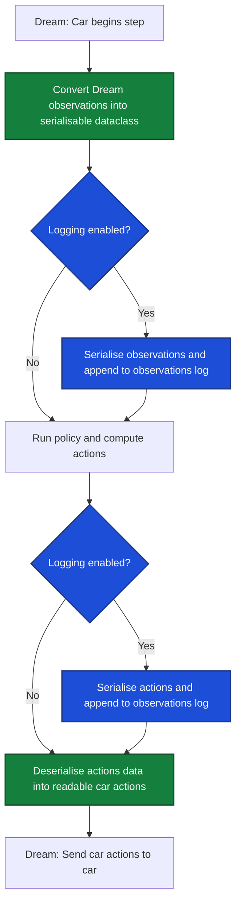
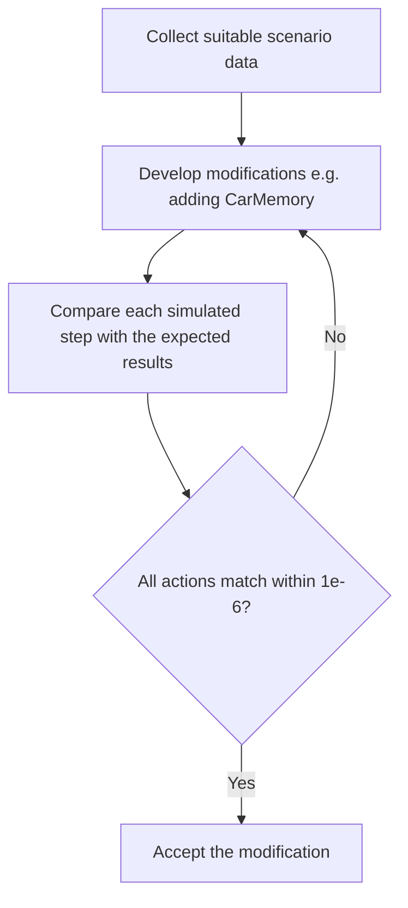
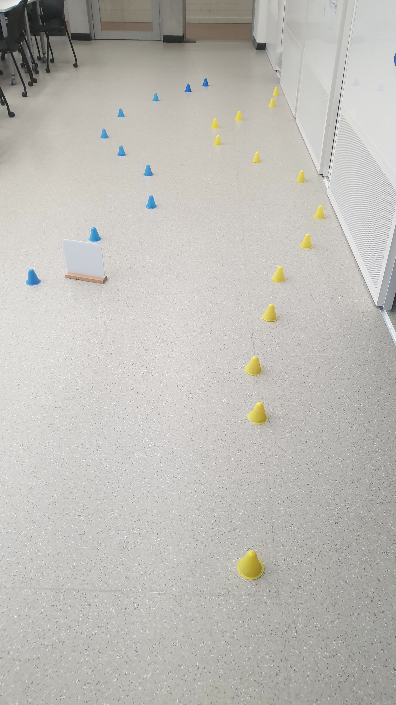
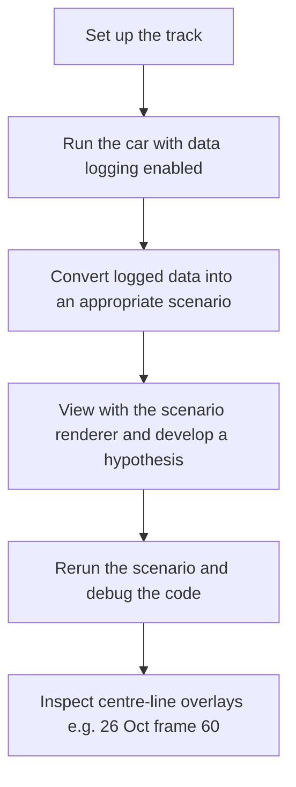
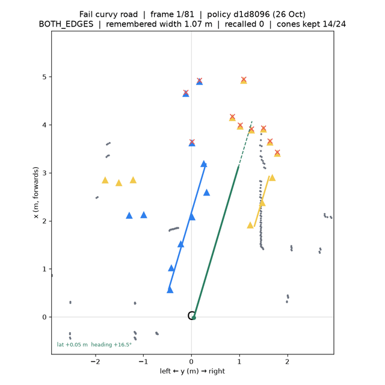
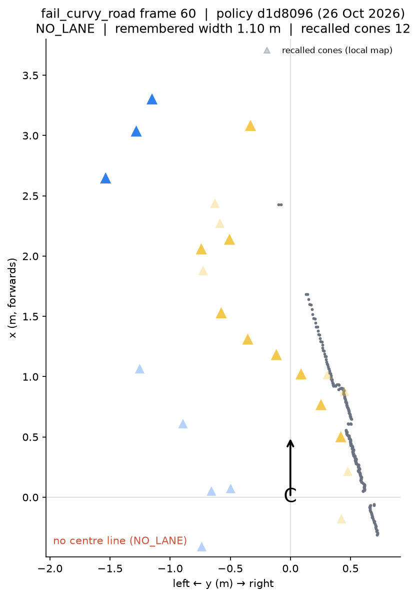

# Ciaran Gruber: interfaces, observation model and simulation framework

[Back to the team logbook](README.md)

| | |
| --- | --- |
| Role | Interfaces between policy components; observation and configuration data model; logged-data simulation and visualisation. Also the repository set-up, CI and the car upload script that every teammate used |
| PRs | #3 and #7 (DREAM v0.3.0 update and the missing observations), #4 (car upload script), #5 (CI running the policy tests), #13 (data logging, scenario creation and the renderer), #20 (new scenarios with lidar, moved to Git LFS), #22 (`CarMemory`, structured memory for the car). All merged into `dev` |
| Used by teammates | The four recorded drives of 6 Oct (`straight_even`, `messy_cone`, `outlier_cone`, `long_track`) that Toby (his 4.1) and Thanh Long (his 4.1–4.4) analysed; `CarMemory`, which holds the lane side, the marker command, the stops and Zhenling's local map; the data logs every car run writes |
| Figures | `ciaran/figures/`. The overall block diagram is also the team's whole-system diagram (Team overview, 0.3) |

## Timeline

| Date | What I did | Evidence |
| --- | --- | --- |
| 29 Sep | Repository boilerplate, codebase documentation and the AI rules (`docs/ai_rules/`) | `3d10d33`, `dcf6612` |
| 5–6 Oct | Car upload script; CI that runs the policy tests, then a compilation check; the DREAM v0.3.0 update and its missing observations | PR #4 (`0b43f6a`), PR #5 (`833613d`), PR #3, PR #7 (`2294f7a`) |
| 7–8 Oct | Data logging of every step's observations and actions; scenario creation from the logs (`scripts/data_converter.py`) and the scenario renderer (`scripts/scenario_renderer.py`), with the four recorded 6 Oct drives | PR #13 (`b88ba24`, `b6ce342`, `238fe38`) |
| 13 Oct | Scenarios with lidar detections and a curvy road; real scenarios moved to Git LFS | PR #20 (`7885512`, `9172290`, `c902436`) |
| 18–19 Oct | `CarMemory`: memory kept between steps and written to the data logs | PR #22 (`cbc59a5`, `9a31408`) |
| 26 Oct | Why the car veered into the cones on curves: replay of `fail_curvy_road` (Section 4) | `ciaran/figures/` |

---

## 1. Where my parts fit (Standard 1: Overall subsystem)

My overall block diagram of the robotic system is the team's whole-system diagram, so it is shown once, in the team
overview (0.3). My contributions lie on the interface between the DREAM input/output and the policy nodes: the
"Dream Input" and "Dream Output" blocks with their logging parameters, the observation and action data model they
convert to, and `CarMemory`, which carries state between steps.

---

## 2. How it works (Standard 2: Theory / Algorithms)

### Logging

The diagram below shows the process of logging while the car is performing various steps

### Concurrent policy actions

Attempted design for concurrent camera panning with separate algorithm tracks.

*Figure: Modified block diagram designed for concurrent execution of policy nodes.*

---

## 3. Use of single-step simulation to aid in architectural design (Standard 3)

### Design objective

To modify the architecture of the project to improve extensibility in future development without affecting car output in a meaningful manner.

### How simulation was used

Car actions were allowed to differ by at most $1 \times 10^{-6}$. That keeps the commanded output consistent with the baseline while ignoring floating-point noise that does not change behaviour. This provided for quick development without requiring testing with a controlled and consistent environment.

---

## 4. Solving an issue with the car veering into cones (Standard 4: Real-world experimentation)

### Engineering question

Why, on curves, was the car veering into cones?

Simulation and unit tests showed the car successfully navigating the course, so the failure only showed up on the real track.

*Figure: The track that the car failed on (note: the obstacle was moved aside for the experimentation).*

### Identifying core influential variables

Influential variables included:

- **Curvature of the course** — courses with no curvature showed no issues.
- **Size of gaps in the cones** — the car expected a certain gap between cones.
- **Presence of obstacles** — in some circumstances an obstacle could obscure cones (to minimise bias, that obstacle was removed for the investigation).

### Running the experiment

`fail_curvy_road` replayed with the 26 Oct 2026 policy (`d1d8096`) and that day's `ai4r_policy.yaml`. The scenario renderer is unchanged aside from overlaying the lane edges and centre line that `MovementPolicy` produced after the cone filter and local map.

*Figure: Real-time* `fail_curvy_road` *scenario replay with the centre-line overlay.*

*Figure: frame 60 of the failing track scenario, where the detector reports* `NO_LANE`*.*

### Resolution

The car was unable to identify a proper centre line because blue cones far in the distance conflicted with the yellow cones nearby.

Long and other members then adjusted the lane-keeping code so that, in situations like this where a blue cone line was missing, it would still follow the yellow line — improving performance.

Additionally using less severe track curvatures was found to improve performance helping understand the car limitations.
