<!-- Generated by docs/logbook/submission/build.py from the part files beside it. Edit those. -->

# AI4R System Project: team logbook

Ciaran Gruber, Thanh Long Nguyen, Zhenling Zhang, Peiyu Wang, Toby Lee, Yuhao Liu, Chris (Chuhan) Wang, Yifei Xia

## Contents

- [Part 0: Team overview](#part-0)
  - [0.1 Goals and requirements](#s0-1)
  - [0.2 What ran on real cars](#s0-2)
  - [0.3 The system and who built it](#s0-3)
  - [0.4 Facts every part uses](#s0-4)
- [Part 1: Interfaces](#part-1)
  - [1.1 Ciaran Gruber — data model, logging and replay](#s1-1)
- [Part 2: Perception](#part-2)
  - [2.1 Shared: from sensors to the lane and the obstacles](#s2-1)
  - [2.2 Thanh Long Nguyen — lane estimation, camera pan and the car simulator](#s2-2)
  - [2.3 Zhenling Zhang — cone filter, obstacles, avoidance and local map](#s2-3)
- [Part 3: Movement policy (MPC)](#part-3)
  - [3.1 Shared: the MPC all three members build on](#s3-1)
  - [3.2 Peiyu Wang — MPC design, MPC vs RL, lane end and car bring-up](#s3-2)
  - [3.3 Toby Lee — car 20 tuning, lane side, marker actions and intersection turns](#s3-3)
  - [3.4 Yuhao Liu — measured-speed MPC, turn preparation and stopping](#s3-4)
- [Part 4: Car control](#part-4)
  - [4.1 Shared: the car model, controller and limits everyone uses](#s4-1)
  - [4.2 Chris (Chuhan) Wang — system ID, speed fix and avoidance validation](#s4-2)
  - [4.3 Yifei Xia — control tests, marker recognition and camera pan](#s4-3)

---

## Part 0: Team overview

Parts follow the sub-teams in pipeline order: 1 interfaces, 2 perception, 3 movement policy (MPC), 4 car control.
Each part opens with what its members share, then one section per person: **S1** where it fits, **S2** how it
works, **S3** simulation, **S4** real car. Results are labelled **car**, **recording** or **sim**. The full
per-person sections are in `docs/logbook/<name>.md`.

### 0.1 Goals and requirements

The policy runs once per cone batch (≈ 10 Hz) on a 1/10 car on DREAM: cones, lidar, wheel speed, IMU and ArUco
markers in; speed, curvature and camera-pan set-points out. It never enables the vehicle.

- **Stage 1:** follow a straight cone lane, hold 0.5 m/s, stop at the lane end and when the lane is lost. MPC and RL
  were compared before choosing the MPC (milestone M1, 3.2).
- **Stage 2:** curves and other widths, obstacles, markers that set the lane side, turns at intersections.

| Id | Requirement (`tests/policy/stage1_scenarios.py`) | Pass if |
| --- | --- | --- |
| R1a / R1b | Body inside the cone rows / distance from centre at the last pair | 0.0 m / ≤ 0.10 m |
| R2 | Cones touched | 0 |
| R3 | Mean speed error (1 m after start to 1 m before end) | ≤ 0.10 m/s |
| R4 | RMS rate of change of requested curvature | ≤ 1.0 1/(m s) |
| R5 | Stop position past the last cone pair | 0.0–0.5 m |
| R6 | p99 step time on the car / solver failures | ≤ 20 ms / 0 |
| R7 | Lane lost → stop request | ≤ 0.6 s |

### 0.2 What ran on real cars

| Behaviour | Car, date | Result | See |
| --- | --- | --- | --- |
| Speed control at 0.5 m/s | 20, 5 Oct | Feedforward + PI: 15% overshoot, ≈ 0.013 m/s steady error | 4.2 |
| MPC inside the time budget | 20, 6 Oct | 0.46 ms median solve against 20 ms | 3.2 |
| Lost-lane stop | 22, 12 Oct | Stopped 0.8 s after losing the lane | 3.2 |
| Keep to the left of the lane | 20, 20 Oct | Kept left (by eye, no log) | 3.3 |
| Obstacle stops | 22 and 26 Oct | 5 stops, 0.21–0.33 m short of the box | 2.3 |
| Passing obstacles | 20, 26 Oct | Passed a box right, a box left, stopped 0.23 m short of a blocking box | 2.3 |
| Speed fault fix | 20, 26 Oct | 3 runs settled at 0.50–0.54 m/s (before: 0.87 m/s or no start) | 4.2 |
| Marker IDs from the live detector | 19 Oct | `ids=[2]` once the camera image reached the detector | 4.3 |
| Marker command | 13, 27 Oct | "Marker 14: KEEP_RIGHT", 6 times | 3.3 |
| Left turn at an intersection | 20, 30 Oct | Marker read after a detector reload; turn refused as geometrically infeasible | 3.4 |

**Simulation only:** a complete intersection turn. **Videos (real cars):** best video, 26 Oct obstacle drive (2.3);
also the 15 Oct two-board stop (4.2). **AI use:** members used AI tools for code, figures and drafting, as the FEIT
policy allows for the logbook; every result comes from the named commits, logs and runs.

### 0.3 The system and who built it

*The policy (grey) runs once per cone batch; each block's parameters come from `config/`. Sensors and wheels each add
a delay; the wheels hold the last command (ZOH).*

| Block (sub-team) | Person | Built |
| --- | --- | --- |
| Dream input/output (interfaces) | Ciaran Gruber | Data model, logging, replay, `CarMemory`, repo, CI |
| Environment detection (perception) | Thanh Long Nguyen | Lane estimation, pan hold, whole-system simulator |
| | Zhenling Zhang | Cone filter, lidar obstacles, avoidance planner, obstacle stop, local map |
| MPC and pathing (movement policy) | Peiyu Wang | MPC framework, Stage 1 design (MPC vs RL), lane end, car debugging, Foxglove |
| | Toby Lee | Test cases, car 20 tuning, lane side, marker actions, intersection turner |
| | Yuhao Liu | Measured-speed MPC, marker IDs and turn preparation, stop latch, car 20 diagnosis |
| Control (car control) | Chris (Chuhan) Wang | System ID, `CarController`, speed fix, avoidance validation |
| | Yifei Xia | Control tests with Chris, ArUco ID tests, camera pan calibration and simulation |

### 0.4 Facts every part uses

| Topic | Fact |
| --- | --- |
| Frames | `base_link`: +x forwards, +y left; lateral error, heading error and curvature positive to the left |
| Cone detections | ≈ 10 per second, ≈ 0.2 s old (0.197 s measured on car 20) |
| Car 20 steering reach | +0.48 1/m left, −0.92 1/m right at ±0.5 steering (5 Oct). Left limit 0.91 1/m at ±0.8 is not ground-measured |
| Marker IDs (`dev`) | 1–4 turn left, 5–6 turn right, 7–8 straight, other IDs stop; keep-side IDs used 23–27 Oct |
| Camera pan | Held at 0 since 10 Oct (2.2) |
| Stops | Obstacle stop brakes (drive −0.3, ≤ 1 s); lane-end stop plans a coast; roll-out not measured |

---

## Part 1: Interfaces

### 1.1 Ciaran Gruber — data model, logging and replay

**Built:** the observation/action data model between DREAM and the policy, data logging, scenarios from logs and
their renderer, `CarMemory` (state carried between steps: lane side, marker command, stops, local map), the repo, CI
and the car upload script. **PRs** #3 #4 #5 #7 #13 #20 #22.

**Standard 1**: Explanation to be done in interactive discussion with block diagram in [0.3 The system and who built it](#03-the-system-and-who-built-it).

**Standard 2.**: Most evidence for this is observed through the design of the overall policy architecture.

_Figure: The algorithm used for managing logging in the car_

_Figure: Modification of program architecture designed for concurrent execution of policy nodes._

**Standard 3. Using single-step simulation to ensure consistent behaviour during architectural redesigns**

_Figure: The process followed when making significant architectural changes involving single-step simulation to ensure every action matches within $10^{-6}$._

**Standard 4: Resolving issues with car movement**

**Engineering question**: Why does the car veer into the cones on curved tracks? (See figure below)

Unit tests and simulation passed, but on the curvy track the car hit cones. Logged the run, converted it to a scenario (`fail_curvy_road`), replayed it with that day's policy (`d1d8096`) and config, and overlaid the lane the policy produced. Obstacle seen in the below figure was removed to isolate curvature.

<table style="width:100%; border-collapse:collapse; table-layout:fixed; margin:6pt 0;">
  <tr>
    <td style="width:33.33%; border:none; padding:0 4pt; text-align:center; vertical-align:bottom;">
      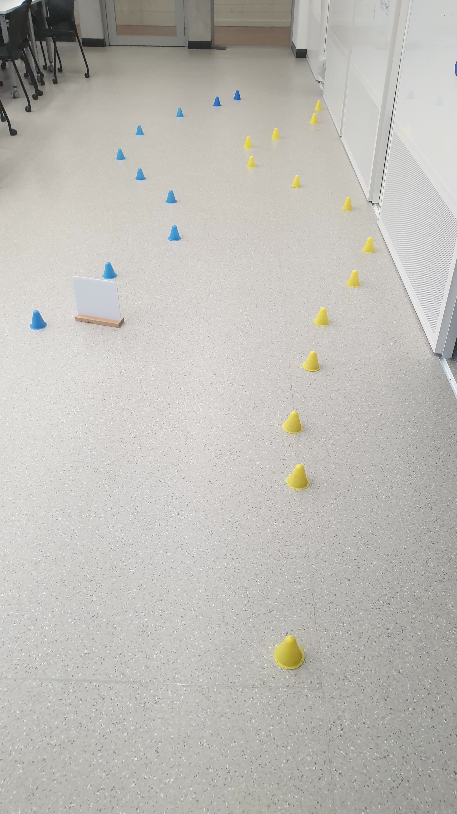
      

        Track (obstacle later removed)
      

    </td>
    <td style="width:33.33%; border:none; padding:0 4pt; text-align:center; vertical-align:bottom;">
      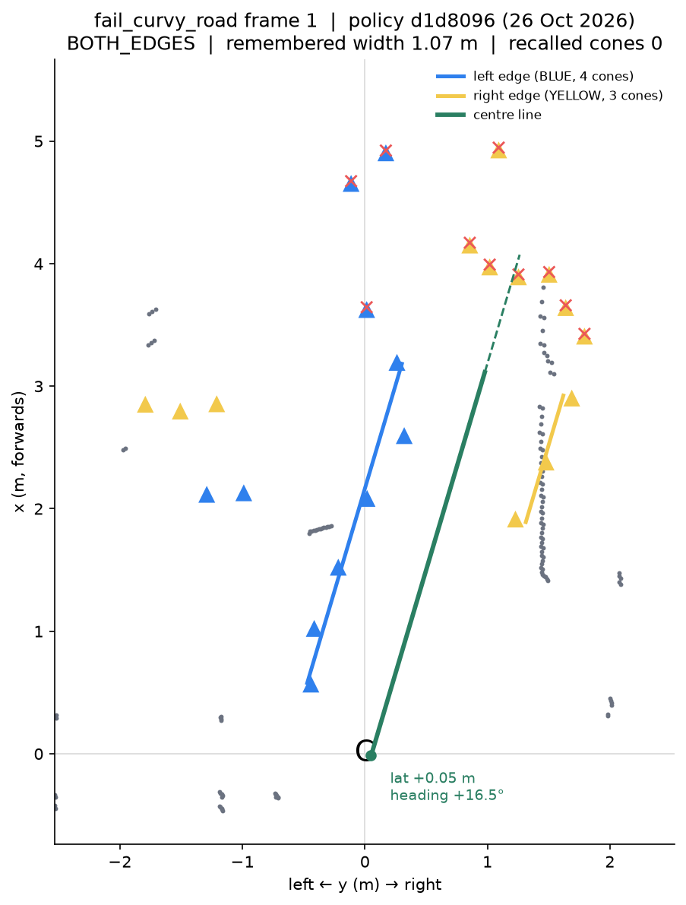
      

        Frame 1
      

    </td>
    <td style="width:33.33%; border:none; padding:0 4pt; text-align:center; vertical-align:bottom;">
      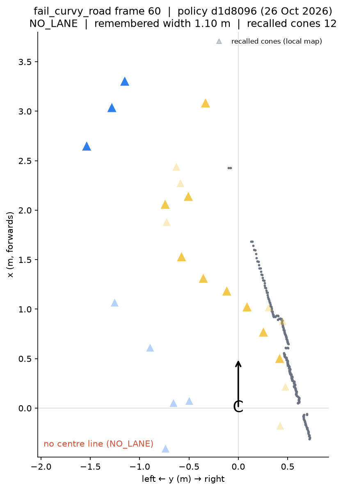
      

        Frame 60: <code>NO_LANE</code>
      

    </td>
  </tr>
</table>

*Far blue cones conflict with the near yellow row at frame 60 and the detector reports `NO_LANE`.*

→ Lane keeping now follows the yellow row when the blue row is missing (2.2); gentler curvature also helped.

---

## Part 2: Perception

### 2.1 Shared: from sensors to the lane and the obstacles

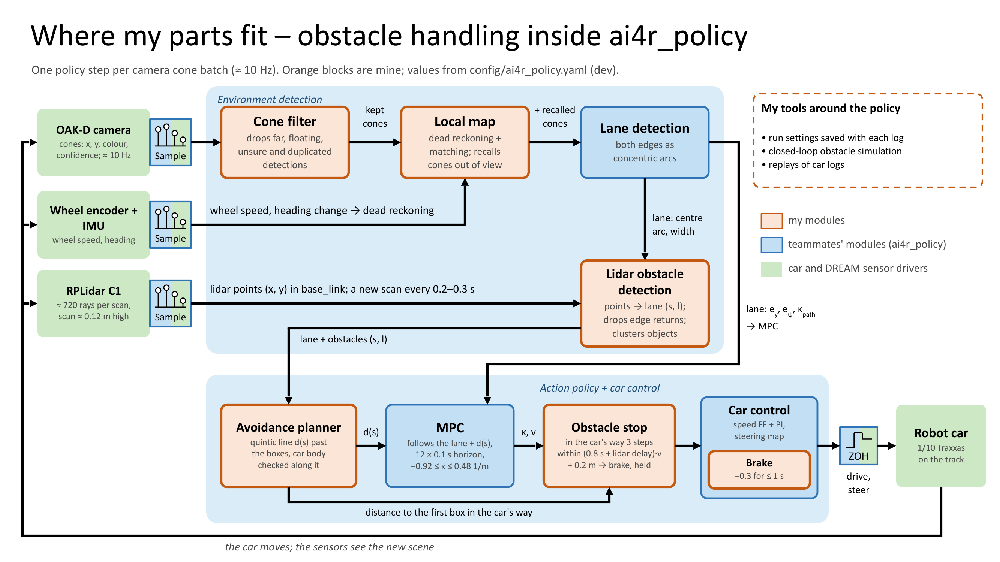

*One step per cone batch. Cones → filter (2.3) → lane estimate (2.2) → MPC (3.1). Lidar points become obstacles only
once the lane is fitted (2.3); every output reaches the car through the MPC and car control.*

| Interface | Carries | Constraint |
| --- | --- | --- |
| Cones in | (x, y) in `base_link`, colour, confidence | ≈ 10 Hz, 0.2 s old; duplicates, floating detections |
| Lidar in | points in `base_link` | New scan every 0.2–0.3 s; plane ≈ 0.12 m up, so it hits cones |
| `LaneDetection` → MPC, obstacles, turner | $e_y$ (m), $e_\psi$ (rad), $\kappa_c$ (1/m), width, centre arc | `NO_LANE` stops the car; camera must point straight ahead |
| `LanePath` → MPC | offset $d(s)$ from the centre to follow | Continuous curvature |
| Obstacle distance → stop | m from the car's front | Front taken 0.30 m ahead of `base_link` |

**Shared consequence:** the lane estimate is the frame everything else uses. A 0.35 m jump in it moved an obstacle
into the path and stopped car 20 (4.2); a camera yaw δ shifts the car ≈ 1.2 cm per degree and breaks turns (2.2).

### 2.2 Thanh Long Nguyen — lane estimation, camera pan and the car simulator

**Built:** `LaneDetector` and its `LaneDetection` output, AUTO colour sides and width memory, the pan hold, and a
whole-system simulator. Commits `8b71f8b` `f96ee66` `f49333d` `3319051` (#19). Car 20 drove on it 9 Oct; in every run
since 14 Oct.

**S2: model and fit.**

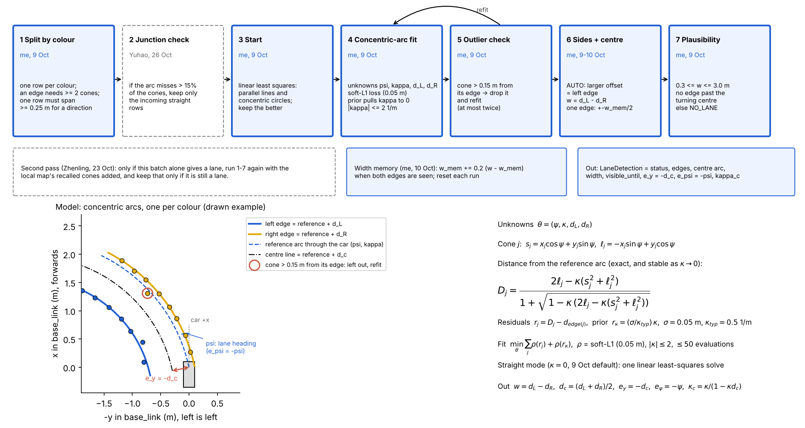

*Steps of `LaneDetector.detect` (top) and the model for a lane curving left (bottom).*

- Both edges are concentric arcs about one reference arc (heading ψ, curvature κ) at offsets $d_L$, $d_R$; signed
  distance of cone j, with $s_j = x_j\cos\psi + y_j\sin\psi$, $\ell_j = -x_j\sin\psi + y_j\cos\psi$:

$$D_j = \frac{2\ell_j - \kappa(s_j^2 + \ell_j^2)}{1 + \sqrt{1 - \kappa\,(2\ell_j - \kappa(s_j^2 + \ell_j^2))}}, \qquad \min_\theta \sum_j \rho\big(D_j - d_{edge(j)}\big) + \rho\big((\sigma/\kappa_{typ})\,\kappa\big)$$

- θ = (ψ, κ, $d_L$, $d_R$); soft-L1 loss ρ (0.05 m); curvature prior σ = 0.05 m, κ_typ = 0.5 1/m. Cones > 0.15 m off
  their edge are dropped and refitted (≤ 2 times).
- Outputs $w = d_L - d_R$, $e_y = -(d_L+d_R)/2$, $e_\psi = -\psi$; `NO_LANE` unless 0.3 ≤ w ≤ 3.0 m.
- **AUTO + width memory:** the edge further left is the left edge, whatever its colour; $w_{mem} \leftarrow w_{mem} + 0.2(w - w_{mem})$, so one edge still gives the centre.
- **Camera pan:** the TF assumes zero pan, so a camera turned by δ gives $e_{\psi,meas} = e_{\psi,true} + \delta$ → hold the pan at 0.

**S3: is fitting the edges together better? How accurate is it?** 3 cm noise, 200 seeds: with a 3-cone row,
0.69° vs 3.03° heading RMS (equal at 12 cones). Curved mode: $e_y$ 1.9–3.4 cm for radius ≥ 1.5 m (R1b allows 10 cm).

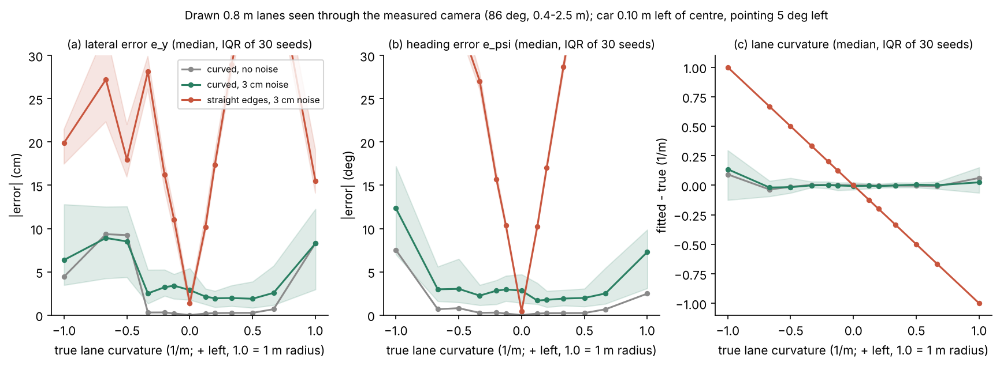

*Drawn 0.8 m lanes, 30 seeds: straight mode (red) fails on any curve; curved mode (green) stays low until the
tightest bends → straight for Stage 1, curved for curved roads.*

- **Simulator (27 Oct):** real `MovementPolicy` + car 20's maps, camera 86°, 0.4–2.5 m, 3 cm noise, 0.2 s. 76/90 runs
  pass on six tracks, no contacts; junctions least robust (17/25 with 20% missed cones). Uncorrected yaw ±4° fails a
  whole turn direction → **the pan hold is a precondition for turns**. Camera optimistic (20 vs 14 real cones per
  step) → pass rates are an upper bound.

**S4: why did the lane look turned on real drives? (recordings, 6 Oct)** Steering was 0, yet every drive read
$e_\psi$ = +6° to +11°. A real heading would make the car drift; rotated cones wouldn't.

| Drive | Median $e_\psi$ | Drift if real | Measured drift |
| --- | --- | --- | --- |
| straight_even | +9.6° | +0.16 m | −0.05 m |
| messy_cone | +10.9° | +0.19 m | −0.03 m |
| outlier_cone | +8.0° | +0.38 m | −0.01 m |
| long_track | +6.5° | +0.32 m | −0.07 m |

→ the camera was turned, not the car (pan never commanded). **Pan held at 0 from 10 Oct.** Same drives: width
0.74–0.84 m, edge RMS 2.8–4.5 cm, lane seen to ≈ 2 m → cone range cut to 2.5 m. **Limits:** one arc can't fit an
S-bend; a wrong-colour cone in a short row can stop the car; no ground-truth $e_y$ on the car.

### 2.3 Zhenling Zhang — cone filter, obstacles, avoidance and local map

**Built:** cone filter, lidar obstacle detection in lane coordinates, obstacle stop and brake, avoidance planner,
local map, closed-loop obstacle simulation. **PRs** #11 #19 #21 #28 #33 #34. All five ran on cars; the 26 Oct drive
is the best video.

**S2.**
- **Cone filter:** keep $0 < x$, $|y| \le 2.0$ m, range ≤ 3.5 m, $-0.15 \le z \le 0.25$ m, confidence ≥ 0.5; merge
  same-colour cones < 0.10 m apart.
- **Obstacles in lane coordinates:** each lidar point gets $s$ along the centre arc and $l$ across it; keep
  $0 < s \le 3.5$ m, $|l| < w/2 - 0.15$ m; clusters ≥ 3 returns. A bend becomes straight, so a box on a bend is still
  "in the lane".
- **Obstacle stop:** seen 3 steps in a row, within

$$d_{stop} = (t_b + t_{scan})\,\max(v_{target}, v_{measured}) + m, \qquad t_b = 0.8\ \text{s},\ m = 0.2\ \text{m}\ \ (0.70\ \text{m at } 0.5\ \text{m/s})$$

- **Avoidance planner:** body keeps 0.10 m from boxes and 0.05 m from cones; held offsets joined by quintics that match
  offset, slope and curvature:

$$d(u) = D\,(10u^3 - 15u^4 + 6u^5),\ u = s/L, \qquad \max|d''| = \frac{10}{\sqrt3}\frac{D}{L^2} \le \kappa_{max}$$

  Ranked by obstacles passed, then room for the next, then $J = \Delta s \sum [(d - d_{usual})^2 + \kappa_{add}^2 + (d - d_{prev})^2]$.

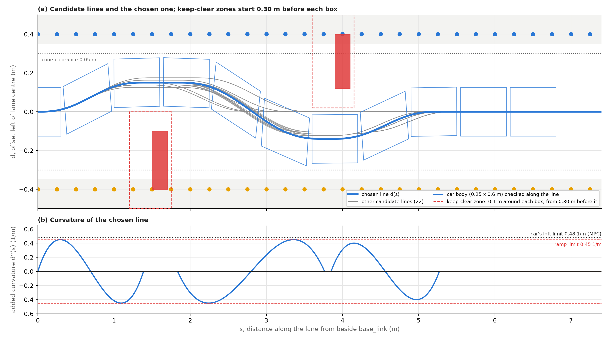

*Real planner, 0.8 m lane, box right then left. (a) Grey: 22 candidates; blue: chosen line, body checked along it.
(b) Curvature continuous, inside 0.45 1/m (car's left limit 0.48).*

- **Local map:** dead-reckoned pose, nearest-cone matching (0.12 m), half a rigid fit per step; recalled cones only
  added once the batch already gives a lane.

**S3: retune against needless stops and hits (21 Oct).** Closed loop, 10 seeds per case, braking 0.6 s per m/s.
Narrower corridor (0.175 m), wider edge margin (0.15 m), 3 confirmations, braking travel in $d_{stop}$:

| Case | Previous | Retuned |
| --- | --- | --- |
| Box right, 0.5 m gap | 3/10 (7 needless stops) | 10/10 |
| Box in the middle (must stop) | **0/10: hit every time** | 10/10, 0.19 m short |
| Slalom, 2 boxes 2.5 m apart | 3/10 | 10/10 |

**S4: braking measured from the lidar (22, 26 Oct).** Correcting for scan age,
$t_b = \big((d_{scan} - v\,t_{scan}) - d_{final}\big)/v$.

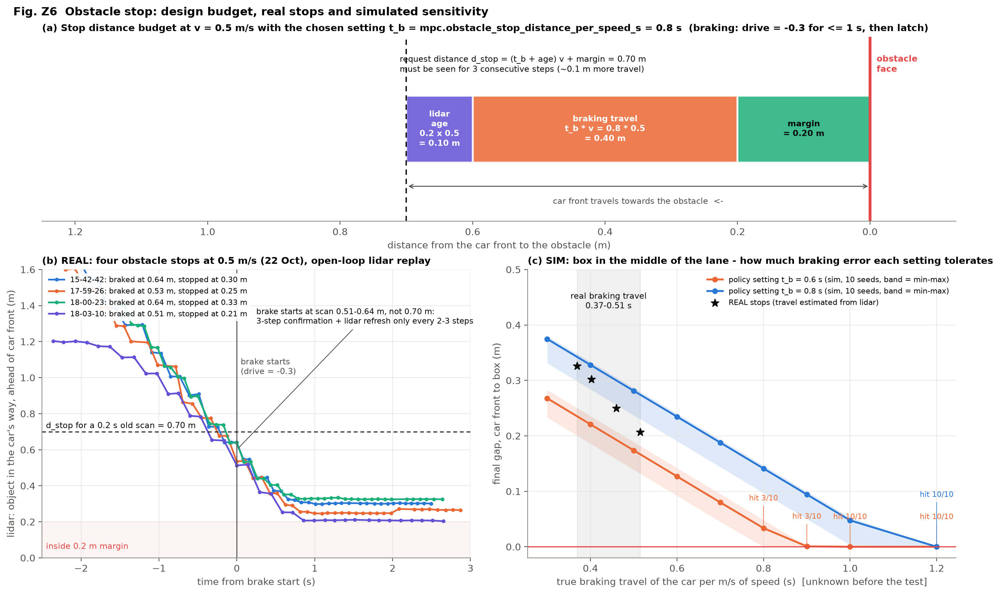

*(a) Stop distance at 0.5 m/s = scan age + braking + margin = 0.70 m. (b) 5 real stops: braked at 0.51–0.64 m
readings, stopped 0.21–0.33 m short. (c) Simulated tolerance per setting; stars are the real stops.*

- Real $t_b$ 0.37–0.53 s < the cautious 0.8 s → always kept 0.21–0.33 m. Odometry claimed 1.1 m of braking; the
  lidar showed 0.32 m (wheel speed holds its last value).
- **26 Oct (best video):** passed a box right, then left (1.4 m apart), then stopped for a middle box whose gaps (0.31,
  0.12 m) were under the 0.40 m needed: braked at 0.69 m, stopped 0.23 m short.
- S-bend (20 Oct): curvature flipped sign in 18/28 steps → 0/28 with the 3.5 m range. Local map halved the p95 lane
  jump in all four 22 Oct drives. **Limits:** static obstacles only; car size not measured.

---

## Part 3: Movement policy (MPC)

### 3.1 Shared: the MPC all three members build on

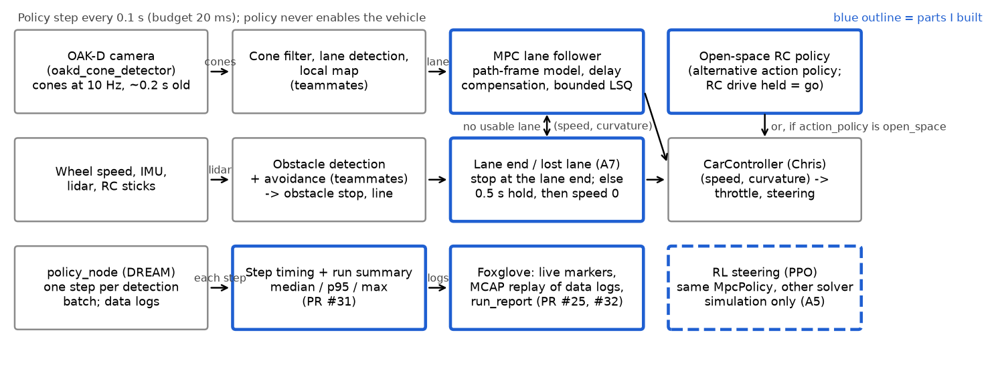

*Lane (2.2) in, (speed, curvature) to car control (4.1) out, once per cone batch within 20 ms. Markers (3.3) and the
turner (3.3, 3.4) switch what the MPC tracks.*

**Model** (Peiyu). Lateral error $e$, heading error ψ, curvature κ; the car moves $d = v\Delta t$ per step,
Δt = 0.1 s:

$$e_{k+1} = e_k + d\,\psi_k + \tfrac{d^2}{2}(\kappa_k - \kappa^{path}_k), \qquad \psi_{k+1} = \psi_k + d\,(\kappa_k - \kappa^{path}_k)$$

$$\min_{\kappa_0..\kappa_{N-1}} \sum_k q_e\,(e_k - e^{line}_k)^2 + q_\psi\,\psi_k^2 + q_\kappa(\kappa_k - \kappa^{path}_k)^2 + q_\Delta(\kappa_k - \kappa_{k-1})^2 \quad\text{s.t.}\quad \kappa_{min} \le \kappa_k \le \kappa_{max}$$

- **Delay compensation:** predict forward by $d_0 = v\cdot\text{age}$ (≈ 0.2 s) with the previous command; send only
  the first curvature.
- **Bounded least squares:** stacking gives $\lVert Mu - c\rVert^2$; $M$ depends only on settings (built once), each
  step only changes $c$. `lsq_linear(method="bvls")`, ≤ 4N iterations → bounded time (R6).

| Setting | Stage 1 design (3.2) | Car 20, `dev` (3.3) |
| --- | --- | --- |
| N | 20 (1 m at 0.5 m/s) | 12 |
| $q_e / q_\psi / q_\kappa / q_\Delta$ | 3 / 1 / 0.1 / 3 | 10 / 1 / 0.1 / 2 |
| κ bounds | ±3.0 1/m | −0.92 to +0.48 1/m (measured, 4.1) |
| $e^{line}$ | 0 (centre) | lane side offset (3.3) |
| $v$ in $d$ | target | measured wheel speed (3.4) |

| Constraint | Handled as | Why |
| --- | --- | --- |
| Curvature limit | hard bound | the real steering limit; bounds always feasible for `bvls` |
| Steering rate | cost $q_\Delta$ | a rate limit needs a general QP; the cost keeps R4 at 0.16 |
| Lane edges | left out | a hard state limit is infeasible when noise puts the car near an edge |
| Speed | not a variable | would make the model bilinear; car control holds speed |

### 3.2 Peiyu Wang — MPC design, MPC vs RL, lane end and car bring-up

**Built:** the MPC framework and first car run, the Stage 1 design (pure pursuit, MPC grid, RL, milestone M1), lane-end
and lost-lane stops, car models, Foxglove export, car debugging. **PRs** #1 #8 #16 #25.

**S2: lane end and lost lane.** No lane and the farthest cone ≤ 1.5 m ahead → the rows ended: follow the last plan,
request the stop at roll-out distance (`stop_distance_per_speed_s` × v) from 0.25 m past that cone. No lane otherwise →
half speed ≤ 0.5 s, then a latched stop (R7: 0.6 s with the 0.2 s age). **RL:** PPO replaces only the solver; bounded
penalties $P(x,s) = 1 - e^{-(x/s)^2}$, reward $r = 1 - aP(y,0.1) - bP(\psi,0.1) - cP(\dot\kappa,1.0)$.

**S3: which MPC, and does it beat pure pursuit? (6 Oct)** 324 settings × 24 runs (12 cases, ± 0.03 m noise).

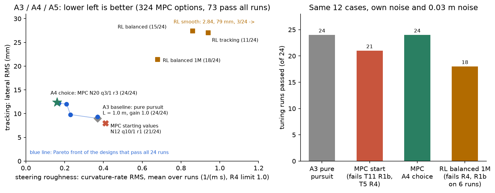

*Tracking against roughness; Pareto front of passing settings; star = chosen (N 20, 3/1/0.1/3): the smoothest
passing. Pure pursuit tracks 3 mm better but steers 2.3× rougher.*

**M1: MPC or RL? (unseen cases U1–U3, opened once).** RL failed R4 on U1 (1.51) and U2 (1.59); the MPC passed all
(U2: 0.51 vs 0.80) → **MPC chosen**. RL's first reward was exploited (unbounded penalties made leaving the lane best).
**Lane end:** before, the car stopped 0.38–0.91 m short (the last pair leaves the 80° view ≈ 0.6 m early); with the
rule, 0.21–0.24 m past (R5).

**S4.**
- **Time budget (car 20, 6 Oct):** batches every 0.1 s, latency 0.197 s → 20 ms per step allowed. Solve N = 20:
  0.46 ms median, 0.53 ms p99; N = 60 still 5.96 ms → the horizon is limited by camera range, not CPU.
- **Car 22 (12 Oct):** car 20's settings drove 1.4 m/s for 0.5 → one setting checked on every car model (#18).
  Lost-lane stop 0.8 s after losing the lane. Steering stayed biased (unsolved).
- **Keeping the cars running:** cone detector crashed under OpenCV 5 (`KeyError 16`) → `publish_rgb_image: false`
  (#24); OAK-D dropping off USB; DREAM processes at 70–80% CPU; a flat battery. Checked read-only first.
- **Foxglove:** any logged step drawn with cones, lane and MPC plan; used to debug the car runs.

### 3.3 Toby Lee — car 20 tuning, lane side, marker actions and intersection turns

**Built:** Stage 1 test cases (#6 #10), car 20 MPC calibration (#15), lane side (#27 #30), marker actions and the
intersection turner (#35), marker simulation; four car sessions (cars 20, 21, 13, 14).

**S2.**
- **Lane side:** $e^{line}$ sits `edge_clearance_m` (c) in from the chosen edge, so the shift available is $w/2 - c$;
  it changes ≤ 0.3 m per metre driven.
- **Markers → actions:** only the nearest marker within 2 m, seen 2 steps in a row, counts. IDs as in 0.4.
- **Intersection turn: APPROACH → ARC → EXIT.** Entry placed 1 m before the marker; move to the outside of the lane;
  drive an arc at 0.3 m/s; hand back to the MPC after 60° once the exit lane lines up, or stop. The arc start $s$ must
  clear the inside corner and the far row (half width $b$, front $f$, cone radius $r_c$, margin $m$, shift $a$):

$$-\sqrt{(R-b-r_c-m)^2 - (R-a-w/2)^2} \;\le\; s \;\le\; w_{cross} - r_c - m - \sqrt{f^2+(R+b)^2}$$

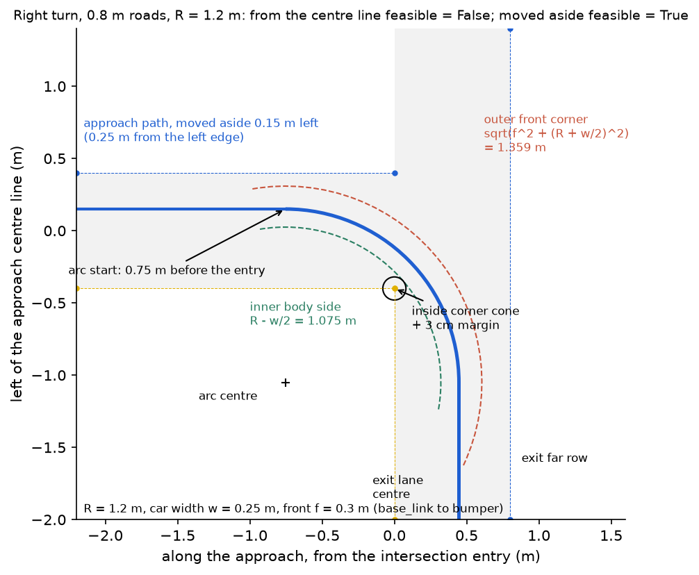

*Right turn, 0.8 m roads, R = 1.2 m: from the centre no start clears both; after moving 0.15 m outside, one does.*

**S3.**
- **MPC for car 20 (12 Oct):** 84 runs per setting (curves, S-bend, ±3° yaw, measured noise and delay). Measured
  asymmetric limits (0.48 L / 0.92 R) and change weight 2: 84/84, steering activity 0.71 → 0.20 1/(m s).
- **Lane side (26 Oct):** c = 0.40 m left 0 cm of shift in a 0.8 m lane → c = 0.28 m: 40/40, side error ≤ 0.017 m.
- **Why do left turns fail on car 20? (1–2 Nov)** At 0.48 1/m, R = 2.08 m leaves ≈ 2 cm in a 1 m crossing.

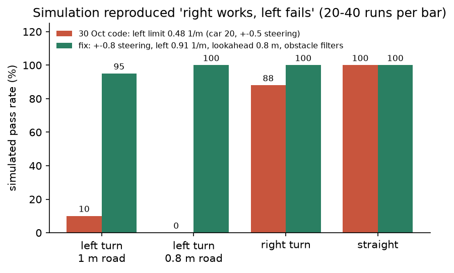

*Same pattern as the car: left 2/40, right 35/40. Fix (±0.8 steering, left 0.91 1/m, phantom-obstacle filters):
all cases 57% → 99%. The 0.91 1/m left limit is not yet measured on the ground (4.2).*

- **Sensitivity:** ±4° camera yaw costs a whole turn direction; robust to doubled latency (92%) and 25% dropout (96%).

**S4.**

| Quantity (from 4 recorded drives, 12 Oct) | Assumed | Measured | Used in sim |
| --- | --- | --- | --- |
| Lane width / cone noise | 1.0 m / 0.01 m | 0.77 m / 0.040 m | 0.8 m / 0.03 m |
| Latency / range | 0 s / 4 m | 0.21 s / 2.54 m | 0.2 s / 2.5 m |

| Link in the marker chain | Result |
| --- | --- |
| Lane side (car 20, 20 Oct) | `lane_side` LEFT only changed: car kept left (by eye) |
| Camera image to detector | 0 marker batches in 9 runs → `car_management.sh --aruco` |
| Command (car 13, 27 Oct) | "Marker 14: KEEP_RIGHT", 6 times |
| Phantom obstacles (car 13) | marker stands planned 16 avoidance lines with no box → filters: 29% → 4% in sim |
| Full turn (2 Nov) | not shown: wrong branch, then no `--aruco`; time ran out |

### 3.4 Yuhao Liu — measured-speed MPC, turn preparation and stopping

**Built:** measured-speed prediction and solver-failure stops (#14), grouped marker IDs, earlier and tangent-aware turn
preparation, persistent stop latch (#35 #36), offline lane-end and junction experiments, car 20 diagnosis.

**S2.** Rebuild the motion matrices each step with measured speed in $d = v\Delta t$; delay projection $d_\tau = v\tau$.
A failed solve requests a stop. Turns: prepare on the outside straight after confirmation; admit an arc tangent to the
**actual** heading ($R = 1/0.48 = 2.083$ m); reject an infeasible start rather than relax clearance; keep the stop
reason outside the turn's lifetime.

**S3: does measured speed help?** 3 scenarios × 2 inputs × 5 seeds, 0.2 s delay; distance-weighted
$e_{RMS} = \sqrt{L^{-1}\int_0^L e(s)^2 ds}$:

| Scenario | Nominal speed | Measured speed | Reduction |
| --- | --- | --- | --- |
| Acceleration | 0.07158 m | 0.07072 m | 1.2% |
| Half achieved speed | 0.08314 m | 0.08173 m | 1.7% |
| Slow with dropouts | 0.07532 m | 0.07265 m | 3.5% |

- **Final-pair lane end (offline):** 20/20 when the pair is visible, but a hidden pair gives false ends → kept offline.
- **Stop latch (sim):** at 0.48 1/m, 6/6 runs on 1.0 m roads stop without contact; 6/6 on 1.5 m complete the left
  exit. Suite at `488ec30`: 837 passed.

**S4: why did ID 1 never request a turn? (car 20, 30 Oct)**

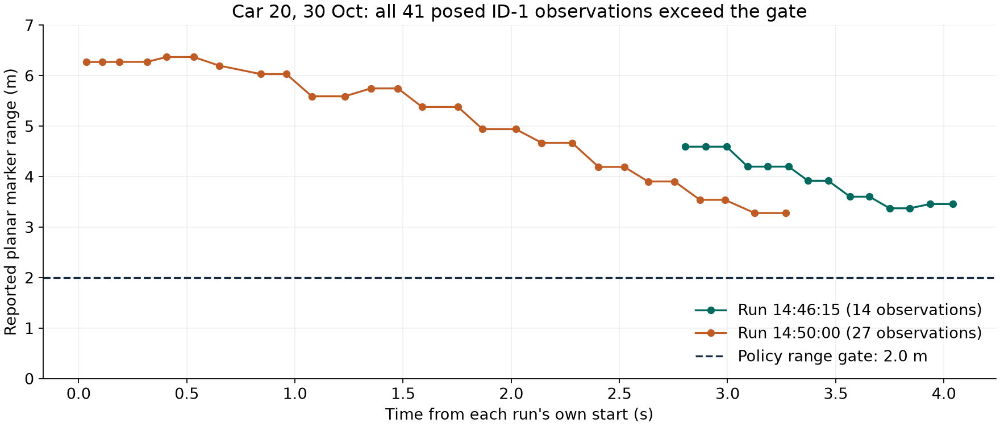

*All 41 posed ID-1 observations were 3.3–6.4 m away, outside the 2 m gate. The running detector used a 0.250 m marker
size though the print was 0.081 m (range ×3.09); restarting the policy hadn't reloaded it.*

- After restarting only the detector: ID 1 confirmed at 3.0 s, then a **geometry stop** at 5.4 s: 0.174 m outside
  vs 0.182 m needed, heading 4.6° outward. → prepare earlier, tangent admission; limits not relaxed. A zero command
  isn't a physical stop (wheels still at 0.50 m/s).

---

## Part 4: Car control

### 4.1 Shared: the car model, controller and limits everyone uses

Everything above car control works in m/s and 1/m; car control is the one block that knows the car (Chris's
`CarController`, `policy/control/control.py`, #17).

| Interface | Carries | Constraint |
| --- | --- | --- |
| (speed, curvature) from the MPC | m/s, 1/m (+ left), brake; 10 Hz | curvature within car 20's +0.48 / −0.92 1/m |
| Wheel speed | m/s, 10 Hz | unsigned, quantised at low speed, holds its last value 3–4 s after stopping |
| drive, steer → vehicle | normalised; drive ≤ 0.75 | platform slew limits; steer ±0.5 after trim |

**Car model from system ID** (first order plus dead time):

$$v(t) = v_{ss}\left(1 - e^{-(t - t_0 - \theta)/\tau}\right), \qquad v_{ss} = K\,(u - u_0)$$

| Quantity | Car 8 (29 Sep) | Car 20 (5 Oct) |
| --- | --- | --- |
| $K$ (m/s per unit drive) | 3.97 | 9.18 (±10%) |
| $u_0$ (drive offset) | 0.697 | 0.475 |
| τ / θ | 1.1 s / 0.5 s | 2.7 s / 0.2 s |

**Controller:** feedforward for the fast part, low-gain PI for the rest; per-side inverse steering map.

$$u = \mathrm{clip}\Big(u_0 + \frac{v_{ref}}{K} + k_p e + I_k,\ 0,\ 0.75\Big), \quad I_k = \mathrm{clip}(I_{k-1} + k_i e \Delta t, \pm I_{max}), \quad e = v_{ref} - v$$

$$s(\kappa) = \begin{cases} (0.038 - \kappa)/0.959 & \kappa < 0 \text{ (right)} \\ \max\big((0.008 - \kappa)/0.630,\ -0.75\big) & \kappa \ge 0 \text{ (left, saturates} \approx 0.47\text{ 1/m)} \end{cases}$$

- Car 20: $k_p$ 0.15, $k_i$ 0.04 (0.2 after the fix), PI off below 0.4 m/s. **No D term:** quantised wheel speed would
  be amplified. Anti-windup: no integration while clipped; brake bypasses the PI.
- **System consequence:** the left limit (R ≈ 2.1 m) caps the MPC and avoidance: it explains the failed left turns
  (3.3) and how close two obstacles can be (4.2).

### 4.2 Chris (Chuhan) Wang — system ID, speed fix and avoidance validation

**Built:** system ID on cars 8 and 20, `CarController` (#17), two-obstacle fixes (#23), the 26 Oct speed fix, avoidance
validation on car 20.

**S4: system ID (car 20, 5 Oct, with Yifei).** One drive level per run, steer 0, 7–8 m straight, bagged; dead-band
sweep 0.50–0.60. Battery checked by repeating 0.75 at start and end (1.19 vs 1.14 m/s at 2 s). Steering: PI at
0.5 m/s, κ = yaw rate / speed over the last 3 s; ±0.5 repeated after a reboot within 3%.

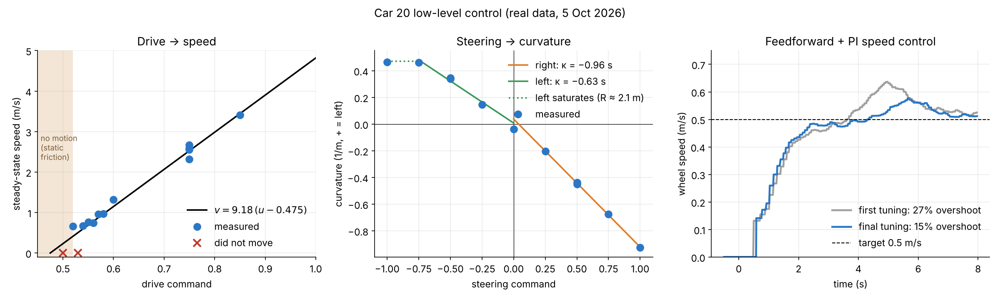

*(a) drive → speed (shaded: no motion). (b) steer → curvature per side. (c) step to 0.5 m/s: PI v1 27% overshoot,
v2 (#17) 15%, ≈ 0.013 m/s steady error.*

**S3 + S4: the 26 Oct speed fault.** The car held 0.87 m/s for a 0.5 target, then (feedforward 0.15) didn't start.
Cause: the integral only ran for $|e| < 0.2$ m/s, so a large error froze it.

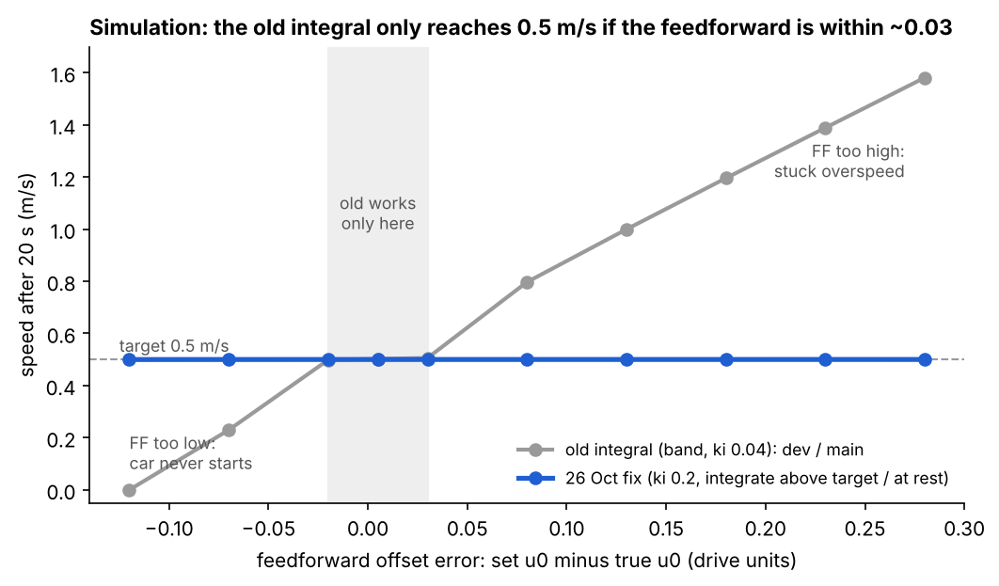

*Sim, true $u_0$ swept with feedforward fixed at 0.48: old rule reaches 0.5 m/s only for errors −0.02 to +0.03; new
rule (integrate when above target or not moving) across −0.12 to +0.28. Trade-off: more overshoot (0.62 vs 0.53 m/s).*

| Car 20, 26 Oct, fixed | Moving after | Reached 0.5 m/s | Peak | Before stop |
| --- | --- | --- | --- | --- |
| 15:20:27 | 0.8 s | 1.9 s | 0.62 m/s | 0.50 m/s |
| 15:21:42 | 0.4 s | 3.2 s | 0.57 m/s | 0.54 m/s |
| 15:23:01 | 0.9 s | 1.8 s | 0.60 m/s | 0.52 m/s |

**Avoidance validation.**
- **Sim (15 Oct video, car stopped beside the first of two boards):** two planner bugs (check band widened on both
  sides; line re-centred on board 1's gap) → all spacings pass with ≥ 0.11 m clearance (#23).
- **Car 20 (19 Oct):** still braked: the lane estimate jumped 0.35 m in 40 ms as a near cone left view (2.1), putting
  board 1 in the path → block within 0.6 m only if lane and lidar frames agree.
- **How close can two boxes be? (sim, 30 Oct):** left bends worst (≈ 3 m needed at 3 m radius vs 1.2 m straight).
- **Stand test (30 Oct):** RC steered ≈ 2× further than autonomous; ±0.8 gives +60% left travel. The ground re-map
  (0.91 1/m) wasn't done.

### 4.3 Yifei Xia — control tests, marker recognition and camera pan

**Built:** speed and steering tests with Chris (results in 4.1–4.2), ArUco ID test tools (#26), camera pan
calibration and a compensation simulation, battery-monitoring study.

**S2: heading compensation.** With vehicle heading $\psi_v$ and target camera heading $\psi_t$, wrap $w$ to the shortest
angle:

$$\theta_d = w(\psi_t - \psi_v), \qquad u_d = c + g\,\theta_d, \qquad c = 0.32,\ g = -0.43\ \text{per rad}$$

Range ±0.15 about centre (exceeding latches a fault), rate ≤ 0.1 per s, stale IMU (> 0.5 s) → hold.

**S3.** Interactive simulation (servo τ 0.15 s assumed, delayed heading, 20 s run, CSV export); 11 controller checks
pass, no comparative results yet. Offline ArUco decode of stored images: IDs 0, 2, 5, 8 (examples, not accuracy).

**S4.**
- **Live ArUco (19 Oct):** the detector ran but its image topic had zero publishers. Once the image pipeline ran:
  `ids=[2]`, `TARGET_SEEN_POSE_OK` (same root cause as 3.3's `--aruco`).
- **Camera pan calibration (30 Oct – 2 Nov):**

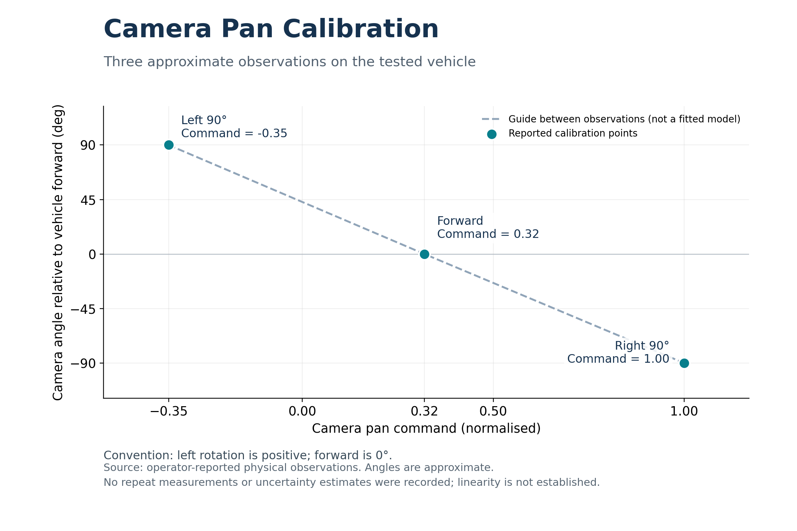

*Left ≈ +90° at −0.35, forward at 0.32, right ≈ −90° at 1.00: a normalised command is not an angle. No repeats.*

- **Battery:** motor 8.4 V NiMH and computer power bank are separate; no voltage source without modification →
  not implemented; wheel-speed feedback (4.1) absorbs the change instead.

---
