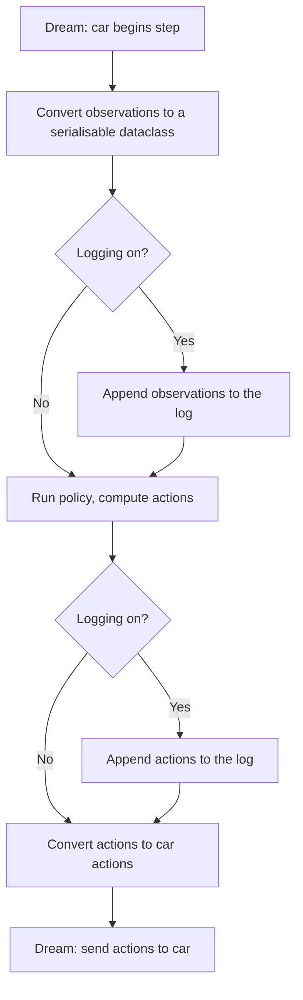
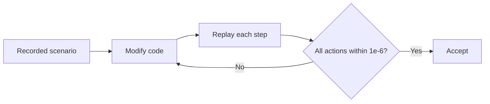

<!-- Generated by docs/logbook/submission/build.py from the part files beside it. Edit those. -->

# AI4R System Project: team logbook

Ciaran Gruber, Thanh Long Nguyen, Zhenling Zhang, Peiyu Wang, Toby Lee, Yuhao Liu, Chris (Chuhan) Wang, Yifei Xia

## Contents

- [Part 0: Team overview](#part-0)
  - [0.1 Goals and requirements](#s0-1)
  - [0.2 What ran on real cars](#s0-2)
  - [0.3 The whole system and who built it](#s0-3)
  - [0.4 Timeline](#s0-4)
  - [0.5 Facts every part uses](#s0-5)
  - [0.6 Experiments still needed (shared, method ready)](#s0-6)
- [Part 1: Ciaran Gruber — interfaces, observation model and logged-data simulation](#part-1)
  - [1.1 Where it fits (S1)](#s1-1)
  - [1.2 How it works (S2)](#s1-2)
  - [1.3 Simulation: changing the architecture without changing the car's output (S3)](#s1-3)
  - [1.4 On the car: why did the car veer into cones on curves? (S4, 26 Oct)](#s1-4)
- [Part 2: Thanh Long Nguyen — lane estimation, the camera pan and the car simulator](#part-2)
  - [2.1 Where it fits (S1)](#s2-1)
  - [2.2 How it works (S2)](#s2-2)
  - [2.3 Simulation (S3)](#s2-3)
  - [2.4 On the car and in real recordings (S4)](#s2-4)
- [Part 3: Zhenling Zhang — cone filter, obstacles, avoidance and local map](#part-3)
  - [3.1 Where it fits (S1)](#s3-1)
  - [3.2 How it works (S2)](#s3-2)
  - [3.3 Simulation: retuning against needless stops and hits (S3, 21 Oct)](#s3-3)
  - [3.4 On the car (S4)](#s3-4)
- [Part 4: Peiyu Wang — MPC framework, Stage 1 design and tools to check car runs](#part-4)
  - [4.1 Where it fits (S1)](#s4-1)
  - [4.2 How it works (S2)](#s4-2)
  - [4.3 Simulation (S3)](#s4-3)
  - [4.4 On the car (S4)](#s4-4)
- [Part 5: Toby Lee — MPC tuning, lane shifting, marker actions and intersection turns](#part-5)
  - [5.1 Where it fits (S1)](#s5-1)
  - [5.2 How it works (S2)](#s5-2)
  - [5.3 Simulation (S3)](#s5-3)
  - [5.4 On the car (S4)](#s5-4)
- [Part 6: Yuhao Liu — measured-speed MPC, cone memory and intersection stopping](#part-6)
  - [6.1 Where it fits (S1)](#s6-1)
  - [6.2 How it works (S2)](#s6-2)
  - [6.3 Simulation (S3)](#s6-3)
  - [6.4 On the car (S4)](#s6-4)
- [Part 7: Chris (Chuhan) Wang — system ID, speed control and avoidance validation](#part-7)
  - [7.1 Where it fits (S1)](#s7-1)
  - [7.2 How it works (S2)](#s7-2)
  - [7.3 Simulation (S3)](#s7-3)
  - [7.4 On the car (S4)](#s7-4)
- [Part 8: Yifei Xia — car control testing, marker recognition and camera pan](#part-8)
  - [8.1 Where it fits (S1)](#s8-1)
  - [8.2 How it works (S2)](#s8-2)
  - [8.3 Simulation and offline tests (S3)](#s8-3)
  - [8.4 On the car (S4)](#s8-4)

---

## Part 0: Team overview

**How to use this logbook.** It supports the oral, so it's made of diagrams, equations, plots, tables and short
bullets. Part 0 is the team. Parts 1–8 are the individuals, in pipeline order (interfaces, perception, movement
policy, car control). Each part follows the five standards: where it fits (S1), how it works (S2), simulation (S3),
on the car (S4); figures and captions (S5) are throughout. "See 5.3" means Part 5, Section 3. Results are labelled
**car**, **recording** or **sim**. A shared model, table or figure appears once, in its owner's part.

### 0.1 Goals and requirements

The policy runs on a 1/10 Traxxas car on the DREAM platform. Each step (one per cone batch, about 10 Hz) it takes the
cones, lidar, wheel speed, IMU and ArUco markers, and returns speed, steering and camera-pan set-points. It never
enables the vehicle.

- **Stage 1:** follow a straight lane of cones, hold the speed, stop at the lane end, stop safely if the lane is lost.
  An MPC and an RL policy were compared on the same tests before the MPC was chosen (milestone M1, 4.3).
- **Stage 2:** curves and other lane widths, obstacles in the lane, markers that set the lane side, and turns at
  intersections chosen by markers.

| Id | Requirement (scored by `tests/policy/stage1_scenarios.py`) | Pass if |
| --- | --- | --- |
| R1a / R1b | Body stays inside the cone rows / distance from centre at the last pair | 0.0 m / ≤ 0.10 m |
| R2 | Cones touched | 0 |
| R3 | Mean speed error, 1 m after the start to 1 m before the end | ≤ 0.10 m/s |
| R4 | RMS rate of change of requested curvature | ≤ 1.0 1/(m s) |
| R5 | Stop position past the last cone pair | 0.0–0.5 m |
| R6a / R6b | 99th-percentile step time on the car computer / solver failures | ≤ 20 ms / 0 |
| R7 | Lane lost → stop request | ≤ 0.6 s from the first batch without lane |

### 0.2 What ran on real cars

| Behaviour | Car, date | Result | Part |
| --- | --- | --- | --- |
| Speed control at 0.5 m/s | 20, 5 Oct | Feedforward + PI, 15% overshoot, ≈ 0.013 m/s steady error | 7.4 |
| MPC within the time budget | 20, 6 Oct | 0.46 ms median solve against 20 ms | 4.4 |
| Lane following on the lane estimate | 20, 9 Oct | Driven; no log kept | 2.4 |
| Lost-lane stop | 22, 12 Oct | Stopped 0.8 s after losing the lane | 4.4 |
| Keep to the left of the lane | 20, 20 Oct | Kept left, judged by eye, no log | 5.4 |
| Obstacle stops | 22 and 26 Oct | 5 stops, 0.21–0.33 m short of the box every time | 3.4 |
| Passing obstacles | 26 Oct | Passed a box on the right, one on the left, stopped 0.23 m short of a blocking box | 3.4 |
| Speed fault fix | 20, 26 Oct | 3 runs reached 0.5 m/s in 1.8–3.2 s (before: 0.87 m/s or no start) | 7.4 |
| Marker IDs from the live detector | 19 Oct | `ids=[2]` once the camera image reached the detector | 8.4 |
| Marker command | 13, 27 Oct | "Marker 14: KEEP_RIGHT, lane side RIGHT", logged 6 times | 5.4 |
| Left turn at an intersection | 20, 30 Oct | Marker recognised after a detector reload; turn refused as geometrically infeasible | 6.4 |

**Not shown on a car before access ended on 2 Nov:** a complete turn at an intersection. Intersection results are
simulation only (2.3, 5.3, 6.3).

**Videos (real cars only).** Proposed best video: the 26 Oct obstacle drive (3.4). Also: the 15 Oct two-board stop
(7.3). _Team to confirm the files and add any others._

**AI use.** As the FEIT policy allows for the logbook, members used AI tools to help with code, figures and drafting.
Each part's results come from the named commits, logs and runs.

### 0.3 The whole system and who built it

*Ciaran's block diagram. The policy (grey) runs once per cone batch; each block's parameters come from `config/`.
The sensors and the wheels each add a delay, and the wheels hold the last command (ZOH).*

| Block | What is in it | Who | Part |
| --- | --- | --- | --- |
| Dream input/output | Observation and action data model, data logging, `CarMemory`; repo, CI, upload script | Ciaran Gruber | 1 |
| Environment detection | Lane estimation, AUTO colour sides, width memory, camera pan hold; whole-system simulator | Thanh Long Nguyen | 2 |
| | Cone filter, lidar obstacles in lane coordinates, local map; obstacle stop and avoidance planner | Zhenling Zhang | 3 |
| MPC and pathing | MPC framework, Stage 1 design (MPC vs RL), lane end and lost lane, car models, Foxglove tools | Peiyu Wang | 4 |
| | Stage 1 tests, car 20 MPC tuning, lane side, marker actions, intersection turner, marker simulation | Toby Lee | 5 |
| | Measured-speed prediction, final-pair and cone-memory experiments, junction navigator, grouped IDs, stop persistence | Yuhao Liu | 6 |
| Control | System ID, `CarController` (feedforward + PI, per-side steering map), speed fix, avoidance validation | Chris (Chuhan) Wang | 7 |
| | Speed and steering tests with Chris, ArUco ID tests, camera pan calibration and simulation | Yifei Xia | 8 |

Sub-teams: interfaces (Ciaran); perception (Thanh Long, Zhenling); movement policy / MPC (Peiyu, Toby, Yuhao); car
control (Chris, Yifei).

### 0.4 Timeline

| Week | Merged into `dev` | On the cars |
| --- | --- | --- |
| 0 (27 Sep) | Repo, AI rules; Stage 1 task cards | Car 8: system ID, first PI |
| 1 (5–11 Oct) | MPC framework #1, upload script #4, CI #5, test cases #6 #10, cone filter #11, data logging #13 | Car 20: speed/steering maps, PI; time budget; recorded drives; first drive on the lane estimate |
| 2 (12–18 Oct) | First car run #8, MPC evaluation #14, car 20 calibration #15, Stage 1 MPC #16, `CarController` #17, obstacle detection #19, avoidance #21, `CarMemory` #22, two-obstacle fix #23 | Car 22: floor run, lost-lane stop, OpenCV 5 crash. Two-board video |
| 3 (19–25 Oct) | Foxglove #25, ArUco tools #26, lane side #27 #30, multi-obstacle planner #28, local map #33 | Car 20: avoidance, lane side, S-bend. Car 21: markers. Obstacle stops |
| 4 (26 Oct – 1 Nov) | Parameters #34 | Final obstacle drive and speed fix (car 20). Car 13: marker commands. Car 20: left-turn diagnosis, steering stand test |
| 5 (2–8 Nov) | Marker actions and intersections #35, intersection stopping #36; `dev` → `main` #38 | Car 14 session. Car access ended 2 Nov |

### 0.5 Facts every part uses

| Topic | The fact |
| --- | --- |
| Frames and signs | `base_link`: +x forwards, +y left. Lateral error, heading error and curvature are positive to the left |
| Cone detections | About 10 per second, about 0.2 s old when the policy gets them (0.197 s measured on car 20) |
| Car 20 steering reach | 0.48 1/m left, 0.92 1/m right at ±0.5 steering (measured 5 Oct). At ±0.8 the left limit is set to 0.91 1/m, not measured on the ground |
| MPC weights | Stage 1 design: N = 20, weights 3/1/0.1/3, \|κ\| ≤ 3.0. `dev` (car 20, #15): N = 12, 10/1/0.1/2, −0.92 ≤ κ ≤ 0.48. Results say which |
| Marker IDs on `dev` | 1–4 turn left, 5–6 turn right, 7–8 straight, any other ID stops. Keep-side IDs were used 23–27 Oct; 26 Oct simulations used 3/4/5 |
| Camera pan | Held at 0 since 10 Oct. Set to 0.3 once for a car test on 30 Oct, back to 0 in #36 |
| Speed feedforward offset | 0.48 (car 20, 6 Oct) → 0.25 (car 22, #16) → 0.15 (#34, 26 Oct) → 0.48 since 30 Oct |
| Stops | Obstacle stop brakes (drive −0.3, ≤ 1 s). Lane-end stop plans a coast: 0.6 s per m/s in sim, 2.1 s on `dev`; neither measured |

### 0.6 Experiments still needed (shared, method ready)

| Question | Method | Decision it feeds | Who |
| --- | --- | --- | --- |
| Car 20's steering reach at ±0.8 | Full lock at 0.3 m/s on the floor, measure the circle, 3 runs each way | `max_curvature_per_m`; a radius over 1.8 m means left turns can't fit lab crossings | Chris, Toby, Yuhao |
| Camera yaw with the pan at 0 | Cone 2 m ahead on the centre line (1° ≈ 3.5 cm); car on a tape-centred lane, compare $e_\psi$ with 0 | `camera_yaw_offset_deg` | Thanh Long, Toby, Yuhao, Peiyu |
| Roll-out after a stop request | Stop request at a tape mark at 0.5 m/s and other speeds, 3 runs | `stop_distance_per_speed_s`, brake settings | Peiyu, Yuhao, Zhenling, Chris |
| Left turn on the car against simulation | 1 m crossing, marker exactly 1 m before, 5 runs, Foxglove path vs simulated | Whether the turner works on a car | Toby, Yuhao |

---

## Part 1: Ciaran Gruber — interfaces, observation model and logged-data simulation

**Role.** The interface between DREAM and the policy: the observation/action data model, data logging, scenarios
from logs and their renderer, and `CarMemory`. Also the repo, CI and the car upload script everyone used.
**PRs** #3 #7 (DREAM v0.3.0), #4 (upload), #5 (CI), #13 (logging, scenarios, renderer), #20 (lidar scenarios, Git
LFS), #22 (`CarMemory`). **Used by:** the four recorded 6 Oct drives (2.4, 5.4) and every car log.

### 1.1 Where it fits (S1)

- My blocks are "Dream Input" and "Dream Output" in the team diagram (0.3), the data model they convert to, and
  `CarMemory`, which carries state between steps (lane side, marker command, stops, local map).
- **Design goal:** every step's observations and actions are serialisable, so any car run can be logged, turned into
  a scenario and replayed off the car.

### 1.2 How it works (S2)

**Logging in each step.**

**Concurrent policy design (attempted).** Separate tracks so camera panning could run beside the main algorithm.

*Modified block diagram for concurrent execution of policy nodes.*

### 1.3 Simulation: changing the architecture without changing the car's output (S3)

- **Objective:** restructure the code for later features (e.g. adding `CarMemory`) without changing what the car does.
- **Method:** replay recorded scenarios step by step through the modified code and compare every action with the
  baseline. Accept only if all actions match within $1\times10^{-6}$ (floating-point noise, no behaviour change).

- **Why:** fast, repeatable checks without needing a controlled physical track for every refactor.

### 1.4 On the car: why did the car veer into cones on curves? (S4, 26 Oct)

- **Question:** simulation and unit tests passed, but on the real curvy track the car veered into the cones.
- **Variables:** course curvature (straight courses had no issue), gaps between cones, obstacles hiding cones (the
  obstacle was removed for this experiment to remove that factor).
- **Method:** drive with logging on → convert the log to a scenario → replay `fail_curvy_road` with the 26 Oct policy
  (`d1d8096`) and that day's config → overlay the lane edges and centre line `MovementPolicy` produced.

*Frame 60 of the failing run: distant blue cones conflict with the near yellow row and the detector reports
`NO_LANE`.*

- **Result:** the lane fit couldn't find a centre line when far blue cones conflicted with near yellow ones.
- **Decision:** Thanh Long and others made lane keeping follow the yellow row when the blue row is missing (2.2);
  gentler curvature also helped, which showed the car's limits.

---

## Part 2: Thanh Long Nguyen — lane estimation, the camera pan and the car simulator

**Role.** Road detection owner: the block that turns cones into the lane, and its output `LaneDetection`, used by the
MPC, obstacle avoidance and the intersection turns. Then the whole-system simulator and live 3D viewer.
**Commits** `8b71f8b`, `f96ee66` (9 Oct), `f49333d`, `3319051` (10 Oct), in `dev` via #19; `6c4cd17` on
`feature/car-simulator` (no PR). **On cars:** car 20 drove on it 9 Oct; on `dev` in every team run since 14 Oct.

### 2.1 Where it fits (S1)

*Blue: what I built (lane estimation, overlay node, pan hold, and the simulator band that replaces every grey box).
Three blocks steer the car from the same lane.*

| Interface | Carries (units) | Constraint |
| --- | --- | --- |
| Filtered cones in (3.2) | (x, y) in `base_link` (m), colour; 10 Hz, ≈ 0.2 s old | Camera must point straight ahead (pan 0) |
| `LaneDetection` → MPC (4.2) | $e_y$ (m), $e_\psi$ (rad), $\kappa_c$ (1/m), + = left | Constant curvature over the view; `NO_LANE` makes the MPC stop |
| → obstacles, avoidance (3.2) | centre arc, width, `visible_until_m` | Obstacles are placed on my arc, so a jump in it moves them |
| → intersection turner (5.2) | lane while approaching | The cross road bends one arc; the turner keeps only approach cones |
| Camera pan set-point | 0.0 | DREAM's camera TF is fixed at zero pan |

**How my errors reach the system:**
- A camera yaw δ becomes a lane offset: the MPC zeroes the measured $e_\psi$, so the car settles about 1.2 cm per
  degree off centre, and turns are planned from the wrong place (2.3).
- A curvature error δκ becomes a heading error ≈ δκ · s̄ (s̄ ≈ 1–1.5 m, the mean cone distance).
- A jump in the estimate moves every obstacle: a 0.35 m jump made a board look in-path and stopped car 20 (7.4).
- `NO_LANE` stops the car: a doubtful lane is a stop, not a guess.

### 2.2 How it works (S2)

*Top: the steps of `LaneDetector.detect` (blue = mine, dashed = teammates' later additions); step 5 loops back to 4 to
drop outliers and refit. Bottom: the model for a lane curving left.*

- **Model:** a reference arc from the car with heading ψ and curvature κ; each edge is the concentric arc offset $d$,
  curvature κ/(1 − κd). Straight is κ = 0, not a separate model.
- **Signed distance of cone j** (exact as κ → 0), with $s_j = x_j\cos\psi + y_j\sin\psi$,
  $\ell_j = -x_j\sin\psi + y_j\cos\psi$:

$$D_j = \frac{2\ell_j - \kappa(s_j^2 + \ell_j^2)}{1 + \sqrt{1 - \kappa\,(2\ell_j - \kappa(s_j^2 + \ell_j^2))}}$$

- **Fit** over θ = (ψ, κ, $d_L$, $d_R$), soft-L1 loss ρ (scale 0.05 m), with a curvature prior (σ = 0.05 m,
  κ_typ = 0.5 1/m) so noise alone can't bend a straight lane:

$$\min_\theta \sum_j \rho\big(D_j - d_{edge(j)}\big) + \rho\big((\sigma/\kappa_{typ})\,\kappa\big)$$

- Started from the better of two linear fits; at most 50 evaluations; cones > 0.15 m from their edge are dropped and
  the fit repeated (≤ 2 times). Straight mode (κ = 0) is one linear solve.
- **Outputs:** $w = d_L - d_R$, $d_c = (d_L+d_R)/2$, $e_y = -d_c$, $e_\psi = -\psi$, $\kappa_c = \kappa/(1-\kappa d_c)$.
  `NO_LANE` unless 0.3 ≤ w ≤ 3.0 m, edges not crossed and κd < 0.9.
- **AUTO sides and width memory (10 Oct):** the edge further left is the left edge, whatever its colour. While both
  edges are seen, $w_{mem} \leftarrow w_{mem} + 0.2(w - w_{mem})$; with one edge, the centre is $w_{mem}/2$ from it.
- **Lever arm:** $\psi(0) = \psi(\bar s) - \kappa\bar s$, so a false bend of 0.16 1/m at s̄ = 1.1 m predicts +10.1° of
  heading error (+10.8° observed, 2.4).
- **Camera pan:** with the TF fixed at zero pan, a camera turned by δ gives $e_{\psi,meas} = e_{\psi,true} + \delta$ and
  almost no change in $e_y$ (rotation is about the camera, 0.10 m behind `base_link`). So the policy holds the pan at
  0 (`f49333d`).

| Decision | Alternative | Why | Cost |
| --- | --- | --- | --- |
| Fit both edges together | Each row its own line (the MPC's old fit) | Short row borrows the long row's direction; one edge still gives an offset | Iterative solve in curved mode |
| Straight edges for Stage 1 | Curvature free | Free curvature added 4–11° on straight lab lanes | Curves need a setting (switched 15 Oct) |
| Robust loss, drop > 0.15 m, refit | RANSAC (tried by Zhenling 19 Oct, reverted) | Only 3–6 cones per row; refit keeps good cones | Fails when wrong cones are a large share of a short row |
| Stateless, one batch at a time | Track the lane | Deterministic, testable, bounded time | Jumps when cones leave view; local map added (3.2) |
| Hold the pan at 0 | Measure and correct yaw | Bias changed drive to drive; DREAM assumes zero pan | Servo must be mounted centred |

**Simulator (27 Oct).** Runs the real `MovementPolicy` from `config/ai4r_policy.yaml` with the node's start/stop rules,
a kinematic car with car 20's measured drive and steering maps, camera cones (86°, 0.4–2.5 m, 3 cm noise, 0.2 s
old), lidar, wheel speed, gyro, markers, and a browser 3D view. Trade-off: decoded detections, not pixels, so it is
fast but the camera is optimistic (2.3).

### 2.3 Simulation (S3)

**Is fitting the edges together better than per row?** Drawn straight lane, 3 cm noise, 200 seeds, right row 2–12
cones. With a 3-cone row: 0.69° vs 3.03° heading RMS; equal (0.51°) at 12 cones each. On the even real drives,
jitter was about the same. **Decision:** the joint fit pays off where rows are short (lane ends, turns, hidden cones).

*Drawn 0.8 m lanes through the measured camera, 30 seeds, car 0.10 m left and 5° left. Red (straight mode) leaves
the plot on any curve; green (curved mode with noise) stays low until the tightest bends.*

- **Accuracy, curved mode:** $e_y$ within 1.9–3.4 cm and $e_\psi$ 1.7–3.0° for radius ≥ 1.5 m left / ≥ 3 m right — well
  inside R1b's 0.10 m. At 1 m radius only 6–8 cones are seen and $e_\psi$ is 7–12° out.
- **Straight mode:** best on straights (1.4 cm, 0.4°) but 10 cm and 10° out at 8 m radius. → straight for Stage 1,
  curved for curved roads.
- **One edge, narrower lane:** a fixed 1.0 m width put the centre 20 cm off in a 0.6 m lane; width memory 1.9 cm. A
  fixed `"BLUE"` found no lane with yellow on the left; AUTO 100%. → AUTO and width memory (10 Oct).

*Failure case: one yellow cone in the blue row. Green cells: the wrong cone is left out from that many cones per
row. Red: false lanes, with the false heading.*

- Straight mode rejects it from 4 cones per row; curved mode only from 7–9, and can give a false lane turned 59–78°.
  Rows are short exactly where this matters (lane ends, turns). Proposed fix (not built): treat a lone cone of one
  colour inside the other row as unknown.

**Does the whole policy drive six tracks?** Car-20 model, 5 seeds, every cone seen and with 20% missed.

| Track | Seed 0 | 5 seeds | 20% missed |
| --- | --- | --- | --- |
| lab_straight (3.2 m) | stops 0.39 m past the last pair | 5/5 | 5/5 |
| curvy_road (11.6 m) | drives it all | 5/5 | 5/5 |
| obstacle_lane | passes the box on the left | 3/5 | 4/5 |
| aruco_lane (keep left, keep centre) | 0.3 m left, then back | 5/5 | 5/5 |
| cross: left / right / straight | +89.5°, −89.0°, +0.4° | 5/5, 4/5, 4/5 | 3/5 each |
| T: left / straight into the closed arm | +91.3° / stops "exit closed" | 4/5, 5/5 | 4/5, 4/5 |

- 76/90 seeded runs pass; **no run touched a cone or box** (every failure is a stop). Junctions are least robust
  (22/25 → 17/25 with missed cones), matching the car (no full turn shown).

*Uncorrected camera yaw −8° to +8° (policy not told), 3 seeds. Both turns pass only near 0°; the shaded band is the
yaw the real 6 Oct drives had.*

- lab_straight passes at every yaw but settles ≈ 1.2 cm/° off centre. curvy_road fails all runs at +8°. Left turns
  pass only 0 to +4°, right only −4 to 0. → **the pan hold is a precondition for turns.**
- **Sim vs real camera (2.4 drives):** real 14 cones per step vs 20 simulated, farthest 1.92 vs 2.34 m, residual
  3.4 vs 2.6 cm. The simulated camera is optimistic: pass rates are an upper bound.
- **Can't conclude:** car pass rates (no pixels, no tyre slip, ideal tracks); built on the 26 Oct policy.

### 2.4 On the car and in real recordings (S4)

**What does the estimate measure on real drives?** Ciaran's four 6 Oct straight drives: drive fixed at 0.55,
steering 0, pan never commanded.

| Drive | Both edges | Width (mean ± sd) | Worse-edge RMS | Seen to | $e_y$ step change (median / p95) |
| --- | --- | --- | --- | --- | --- |
| straight_even | 67% | 0.82 ± 0.02 m | 2.8 cm | 1.8 m | 1.3 / 5.3 cm |
| messy_cone | 72% | 0.84 ± 0.03 m | 4.5 cm | 1.8 m | 1.6 / 4.3 cm |
| outlier_cone | 63% | 0.80 ± 0.02 m | 2.8 cm | 1.7 m | 2.6 / 7.2 cm |
| long_track | 84% | 0.74 ± 0.03 m | 3.6 cm | 2.6 m | 1.3 / 5.4 cm |

→ noise well inside R1b; lane seen to ≈ 2 m, not 4 m, so the cone range was cut to 2.5 m for car 20. Limit: widths
weren't tape-measured.

**Why did the lane look turned? (hypothesis test)** Every drive read $e_\psi$ = +6° to +11°. With steering at 0 the
real heading can't change: a real heading would make the car drift distance × sin(heading); rotated cones wouldn't.

| Drive | Median $e_\psi$ | Drift if real | Measured drift |
| --- | --- | --- | --- |
| straight_even | +9.6° | +0.16 m | −0.05 m |
| messy_cone | +10.9° | +0.19 m | −0.03 m |
| outlier_cone | +8.0° | +0.38 m | −0.01 m |
| long_track | +6.5° | +0.32 m | −0.07 m |

- The cones were rotated, not the car; the pan was never commanded. **Decision (10 Oct):** hold the pan at 0, with a
  test. After the fix (13 Oct, hand-placed car), heading at rest −5.0° to +2.8° — consistent, not a controlled test.
  It came back once: the 30 Oct car test set pan 0.3 (`bf5e08c`; the test flagged it), restored in #36.

**Straight or curved for Stage 1?** With curvature free, the straight drives read a 6–12 m bend in 92–97% of steps.
The lever arm predicts the extra heading error within 1°:

| Drive | False κ | s̄ | Predicted κ·s̄ | Observed |
| --- | --- | --- | --- | --- |
| straight_even | 0.162 1/m | 1.09 m | +10.1° | +10.8° |
| outlier_cone | 0.158 1/m | 1.08 m | +9.8° | +9.1° |
| long_track | 0.080 1/m | 1.50 m | +6.9° | +6.9° |

**First lane following (car 20, 9 Oct).** MPC followed `LaneDetection` at 0.5 m/s, curvature limited to 0.5 1/m.
The fit measured a 0.65 m floor lane, which led to AUTO and width memory the next day. No log or video was kept.
Step time on recorded drives: 0.4 ms straight, 4.3 ms curved at p99 (laptop).

**What later team runs showed about my block:**

| Date, car | Seen | Cause | Done |
| --- | --- | --- | --- |
| 19 Oct, car 20 | Estimate jumped 0.35 m in 40 ms; false obstacle stop | One batch at a time; near cone left the view | Lane and lidar frames must agree (7.4) |
| 20 Oct, S-bend | Curvature flipped left/right | One arc can't fit an S | 3.5 m cone range (3.2) |
| 22 Oct, 4 drives | $e_y$ jumps up to 0.57 m | As on 19 Oct | Local map recalled cones; p95 jump halved (3.4) |

**Limits:** one arc can't fit an S-bend; short rows can't reject a wrong-colour cone; no ground-truth $e_y$ on the car;
the simulator hasn't been compared with a logged car run.

---

## Part 3: Zhenling Zhang — cone filter, obstacles, avoidance and local map

**Role.** Everything between the sensors and the MPC that keeps the car from hitting things: cone filter, lidar
obstacle detection in the lane, obstacle stop and brake, avoidance planner, local map; plus a closed-loop obstacle
simulation and each run's settings saved with its log. **PRs** #11, #19, #21, #28, #33, #34. **On cars:** all five
parts ran; in the final drive (26 Oct) the car passed boxes on the right and left and stopped for one in the middle.

### 3.1 Where it fits (S1)

*One step per cone batch (≈ 10 Hz). Green: car and sensors; blue: teammates; orange: mine. Lidar points become
obstacles only once the lane is fitted, and every output reaches the car through the MPC and car control.*

| Interface | Carries | Constraint |
| --- | --- | --- |
| Cones in | position, colour, confidence | ≈ 10 Hz, 0.2 s late; duplicates and floating detections happen |
| Lidar in | points in `base_link` | New scan only every 0.2–0.3 s, 0.15–0.3 s old; plane ≈ 0.12 m up, so it hits cones |
| `LaneDetection` in (2.2) | centre arc, width | Estimate jumps ≈ 0.1 m step to step |
| `LanePath` d(s) → MPC | line to follow as offset from centre | Chain of quintics: continuous curvature |
| Obstacle distance → MPC stop | m from the car's front | Front taken 0.30 m ahead of `base_link` (not measured) |
| Brake → `CarController` | drive −0.3, ≤ 1 s | Only straight after forward drive |

**Tools.** `tests/policy/obstacle_simulation.py` runs the whole `MovementPolicy` closed loop: the measured lab car,
camera view with boxes hiding cones, 2D lidar (0.5° beams, 1 cm noise, 0.2 s old) and braking travel as a setting;
12 cases × N seeds. On the car, every run logs its exact settings (`_config.json`), so it can be replayed through
any policy version, and the lidar measures the stop gap directly.

### 3.2 How it works (S2)

**Cone filter.** Keep $0 < x$, $|y| \le 2.0$ m, $\sqrt{x^2+y^2} \le 3.5$ m, $-0.15 \le z \le 0.25$ m, confidence ≥ 0.5;
merge same-colour cones closer than 0.10 m.

**Obstacle detection in lane coordinates.** Each lidar point gets $s$ (along the centre arc from the car's front) and
$l$ (offset from the centre line). Keep $0 < s \le 3.5$ m and $|l| < w/2 - 0.15$ m (the margin covers the cone radius
plus ≈ 0.1 m edge-fit error). Cluster returns < 0.15 m apart; ≥ 3 returns per object.

**Obstacle stop.** Stop when an object is in the car's way within

$$d_{stop} = (t_b + t_{scan})\,\max(v_{target}, v_{measured}) + m, \qquad t_b = 0.8\ \text{s},\ m = 0.2\ \text{m}$$

so 0.70 m for a 0.2 s old scan at 0.5 m/s. It must be seen 3 steps in a row (the lane jumps ≈ 0.1 m per step). The stop
latches: only a person restarts the car, since the lidar sees the box poorly when close.

**Avoidance planner** (in the lane's Frenet frame):
1. Each obstacle gets a keep-clear stretch; inside it the body keeps 0.10 m from the obstacle and 0.05 m from the cones.
2. Candidate held offsets in each free gap; overlapping obstacles are passed on one offset.
3. Holds are joined by quintic moves that match offset, slope and curvature at both ends:

$$d(u) = D\,(10u^3 - 15u^4 + 6u^5),\quad u = s/L,\qquad \max|d''| = \frac{10}{\sqrt3}\frac{D}{L^2}\ \Rightarrow\ L = \sqrt{\frac{10}{\sqrt3}\frac{D}{\kappa_{max}}}$$

   v1's half-cosine ramp had curvature $D\pi^2/(2L^2)$ at its ends, so steering jumped at every join; the quintic
   doesn't.
4. Rank: obstacles passed (nearest first), then room for the next, then the lowest cost

$$J = \Delta s \sum \Big[(d - d_{usual})^2 + \kappa_{add}^2 + (d - d_{prev})^2\Big] - 5\cdot\text{room}$$

*Real planner and config, 0.8 m lane, box right then left. (a) Grey: 22 other candidates; blue: the chosen line with
the body (0.25 × 0.60 m) checked along it. (b) Its curvature is continuous and inside the 0.45 1/m ramp limit, below
the car's 0.48 1/m left limit.*

**Local map.** Dead-reckon the pose from wheel speed; match each new cone to the nearest remembered cone of its colour
within 0.12 m; with ≥ 3 confirmed matches, apply half of a least-squares rigid fit each step (capped 0.05 m, 3°).
Recall confirmed cones that left the view; forget 0.5 m behind or after 4 s unseen. Lane detection fits the batch
first and adds recalled cones only if that already gives a lane, so a lane is never made from memory alone.

### 3.3 Simulation: retuning against needless stops and hits (S3, 21 Oct)

- **Problem:** the previous settings stopped needlessly and had no braking travel in the stop distance.
- **Method:** previous vs retuned, 10 noise seeds per case, braking 0.6 s per m/s.

| Setting | Before → after | Problem it fixes |
| --- | --- | --- |
| `corridor_half_width_m` | 0.20 → 0.175 m | lane jumps put passable boxes in the way |
| `lane_edge_margin_m` | 0.10 → 0.15 m | cone returns near a jumping edge counted as objects |
| `obstacle_confirm_steps` | 2 → 3 | two jumpy steps were enough to stop |
| `cone_clearance_m` | 0.10 → 0.05 m | free gap needed beside a box 0.45 → 0.40 m |
| `obstacle_stop_distance_per_speed_s` | 0.0 → 0.8 s | stop distance had no braking travel |

| Case | Previous | Retuned |
| --- | --- | --- |
| Box on the right, 0.5 m gap | 3/10 (7 needless stops) | 10/10 passed |
| Box on the left | 7/10 | 10/10 |
| Box in the middle (must stop) | **0/10: hit the box every time** | 10/10, stopped 0.19 m short |
| Slalom, 2 boxes 2.5 m apart | 3/10 | 10/10 |

*Each panel one case from above: orange previous, green retuned, × stop requested. `straight_centre`: previous hit the
box 10/10; retuned stopped 0.19 m short.*

- **Can't conclude:** absolute gaps or pass rates (kinematic car, ideal lidar, car size and braking not measured). So
  the stops were checked on real data (3.4).

### 3.4 On the car (S4)

**E1: S-bend lane fit flips (20 Oct).** On the S-bend the fitted curvature jumped between left and right and the car
ran off. Replaying the 28 steps with cone range ∞ / 3.0 / 3.5 m: wrong-sign curvature in 18/28 steps with no limit,
0/28 with 3.5 m. 3.0 m gave 1/28 but only ≈ 12 cones per step and a false stop next to a box. → range limit 3.5 m.

**E2: braking travel, measured from the lidar.** Correcting for the scan's age,

$$t_b = \frac{d_{brake}}{v} = \frac{(d_{scan} - v\,t_{scan}) - d_{final}}{v}$$

| Drive | $v$ | $d_{scan}$ | $t_{scan}$ | $d_{final}$ | $t_b$ |
| --- | --- | --- | --- | --- | --- |
| 22 Oct 15-42-42 | 0.50 m/s | 0.64 m | 0.27 s | 0.30 m | 0.40 s |
| 22 Oct 17-59-26 | 0.50 m/s | 0.53 m | 0.11 s | 0.25 m | 0.46 s |
| 22 Oct 18-00-23 | 0.50 m/s | 0.64 m | 0.26 s | 0.33 m | 0.37 s |
| 22 Oct 18-03-10 | 0.45 m/s | 0.51 m | 0.17 s | 0.21 m | 0.51 s |
| 26 Oct 14-10-54 | 0.60 m/s | 0.69 m | 0.23 s | 0.23 m | 0.53 s |

*(a) Stop distance at 0.5 m/s: scan age + braking + margin = 0.70 m. (b) Real stops: brake at 0.51–0.64 m readings,
stopped 0.21–0.33 m short. (c) Simulated braking-error tolerance per setting; stars are the real stops.*

- Real $t_b$ = 0.37–0.53 s, below the cautious 0.8 s, so the car always kept 0.21–0.33 m. The brake came late (3
  confirmations, lidar updating about every second step), worth 0.1–0.2 m, absorbed by the margin. Ignoring scan age
  would have counted sensor lag as braking (0.77 instead of 0.53 s on 26 Oct). Odometry claimed 1.1–1.25 m of braking;
  the lidar showed 0.32 m — wheel speed holds its last value near standstill.

**E3: passing boxes (26 Oct, run `2026-10-26_14-10-54`, video).** Passed a box on the right then one on the left
(1.4 m apart) without stopping, then stopped for a middle box whose gaps (0.31 m, 0.12 m) were both under the 0.40 m
needed: braked at a 0.69 m reading, stopped 0.23 m short.

**E4: the local map steadies the lane estimate (22 Oct drives).**

*(b) Lateral error from the batch alone (orange) jumps up to 0.57 m; with recalled cones (blue) it is steady. (c) The
95th-percentile jump falls by half or more in all four drives.*

**Limits:** car size, steering after the trim change and braking on a stand aren't measured; static obstacles only;
two boxes on opposite sides < ≈ 1.2 m apart in a 0.8–1.1 m lane need more curvature than the car has, so it stops.

---

## Part 4: Peiyu Wang — MPC framework, Stage 1 design and tools to check car runs

**Role.** MPC sub-team. Stage 1 task list, the MPC framework and first car run, the Stage 1 design (pure pursuit
baseline, MPC grid, RL, milestone M1), lane-end and lost-lane stops, measured car models, Foxglove export and run
timing. **PRs** #1, #8, #16, #25 merged; #18, #24, #31, #32 open. **On cars:** time budget and solve time (car 20);
speed and lost-lane stop (car 22); traced the car 22 detector crash. Lane following itself wasn't shown in my
sessions (car 22's steering failed); M1 and the lane-end stop are simulation.

### 4.1 Where it fits (S1)

*Blue: my parts; grey: teammates'; dashed: simulation only. Runs once per cone batch within 20 ms.*

| Interface | Carries | Constraint |
| --- | --- | --- |
| `LaneDetection` in (2.2) | $e$, $\psi$, κ_path, width | ≈ 0.2 s old; the MPC predicts forward by that age |
| Wheel speed in | m/s, unsigned, 44 Hz | Gaps up to 0.32 s; lost-lane distance uses max(wheel, requested) so a stuck reading stops early |
| (speed, curvature) → `CarController` (7.2) | m/s ≥ 0, 1/m left + | One command per batch |
| Data logs, Foxglove markers | every step's inputs, outputs, plans | Replay runs today's code |

- **One command per batch, well inside 20 ms:** batches every 0.1 s, command timeout 0.5 s → a small bounded
  least-squares problem with an iteration cap, not a general solver.
- **Never move on a guess:** wait stopped for the first usable lane; a lost lane gets a short bridge, then a latched
  stop.
- **Compare designs on one harness:** baseline, MPC and RL all run inside `MpcPolicy` with the same filter, reference
  and lane-end rule; only the steering differs.
- **System consequence:** the lane-end stop depends on the car's roll-out (`stop_distance_per_speed_s`), a car
  control property not yet measured (0.6).

### 4.2 How it works (S2)

**MPC (shared; also used in 5.2 and 6.2).** Lateral error $e$, heading error ψ, curvature κ; the car drives
$d = v\Delta t$ per step, Δt = 0.1 s, N = 20 (1 m at 0.5 m/s):

$$e_{k+1} = e_k + d\,\psi_k + \tfrac{d^2}{2}(\kappa_k - \kappa^{path}_k), \qquad \psi_{k+1} = \psi_k + d\,(\kappa_k - \kappa^{path}_k)$$

$$\min_{\kappa_0..\kappa_{N-1}} \sum_k 3\,e_k^2 + \psi_k^2 + 0.1\,(\kappa_k - \kappa^{path}_k)^2 + 3\,(\kappa_k - \kappa_{k-1})^2 \quad\text{s.t.}\quad |\kappa_k| \le 3.0$$

- **Delay compensation:** predict forward by $d_0 = v\cdot\text{age}$ with the previous command:
  $e \leftarrow e + d_0\psi + \tfrac{d_0^2}{2}(\kappa_{prev} - \kappa^{path})$, $\psi \leftarrow \psi + d_0(\kappa_{prev} - \kappa^{path})$.
  Only the first curvature is sent.
- **As least squares:** stack $x = Fx_0 + G(u - \kappa^{path}\mathbf 1)$; the cost is $\lVert Mu - c\rVert^2$ with

$$M = \begin{bmatrix} W^{1/2} G \\ \sqrt{0.1}\, I \\ \sqrt{3}\, D \end{bmatrix}, \qquad c = \begin{bmatrix} -W^{1/2}\,(F x_0 - G\,\kappa^{path}\mathbf{1}) \\ \sqrt{0.1}\,\kappa^{path}\mathbf{1} \\ \sqrt{3}\,\kappa_{prev}\,e_1 \end{bmatrix}$$

  $M$ depends only on settings (built once); each step only changes $c$. Solved with `lsq_linear(method="bvls")`,
  at most 4N iterations (caps time, R6a).
- **Weights:** only ratios matter. 0.1 m off centre costs 3 × 0.1² = 0.03, the same as ≈ 10° of heading or a
  0.1 1/m curvature change between steps.

| Constraint | Handled as | Why |
| --- | --- | --- |
| Curvature limit | hard bound | The steering can't turn further; bounds are all `bvls` takes, and the problem always has a solution |
| Steering rate | cost (change weight) | A rate limit constrains differences, needing a general QP; the cost keeps R4 at 0.16 mean |
| Lane edges | left out | A hard state limit becomes infeasible when a noisy observation already puts the car near an edge |
| Speed | not a variable | Speed × heading would make the model bilinear; car control holds speed |

| Assumption | Where it breaks |
| --- | --- |
| Small heading error | Large errors after a lost lane |
| Constant speed = target | Car 22 drove 1.4 m/s for 0.5 (4.4); later predicted with measured speed (6.2) |
| No slip | T11 wet floor: 6° sideslip leaves the car 0.25 m off centre |
| Constant path curvature over horizon | A curve's start isn't anticipated |

**Lane end and lost lane (A7).** One row visible: keep going, centre half a width from it. No lane and the farthest
cone was ≤ 1.5 m ahead: the rows ended — follow the last plan and request the stop at roll-out distance
(`stop_distance_per_speed_s` × v) from 0.25 m past that cone (mid R5 zone). No lane otherwise: follow the plan at half
speed for ≤ 0.5 s, then stop (latched). Stop request on the 5th empty batch → 0.6 s with the 0.2 s age (R7).

**RL (A5).** PPO replaces only the solver. Observation: $e$, ψ, lane usable, last two curvatures, age, speed. Reward
with bounded penalty $P(x,s) = 1 - e^{-(x/s)^2}$: $r = 1 - aP(y,0.1) - bP(\psi,0.1) - cP(\dot\kappa,1.0)$, −20 for a
cone, +10 at the end. Domain randomisation over width, spacing, start, speed, noise, delay, mass and floor.

### 4.3 Simulation (S3)

**A3/A4: which MPC settings, and does it beat pure pursuit? (6 Oct)** Baseline:
$\kappa = g\,\frac{2y_L}{L^2 + y_L^2} + \kappa^{path}$, L = 1.0 m, g = 1.0. MPC grid: 324 options (horizon 12/20/30,
lateral 3/10/30, heading 0.3/1/3, change 0.3/1/3/10, limit 3/1/0.5), each on 12 tuning cases with and without
0.03 m noise (24 runs); 73 pass all 24.

*Left: tracking (lateral RMS) against roughness (curvature-rate RMS), mean of 24 runs; lower left is better. Blue line:
Pareto front of passing MPC options; star: the A4 choice, the smoothest on it. Right: runs passed of 24.*

- The starting weights failed T11 (R1b) and, with noise, T5 (R4 1.02). Chosen: N = 20, 3/1/0.1/3 — R4 0.16 mean,
  0.45 worst, no fallbacks. Pure pursuit tracks 3 mm better but steers 2.3× rougher.
- Lateral weight 30 never passes (amplifies noise); 12 steps can touch cones on T11.
- **Judgement that reversed:** I expected the MPC to win as it was; it lost until the lateral weight came down and the
  change weight went up.

**A5: RL.** Iteration 1 found a reward exploit: unbounded penalties made leaving the lane the best return (episodes
lasted 9 steps). Bounded penalties fixed it. Best policy: 18/24 tuning runs; it still weaves (fails R4).

**M1: MPC or RL? (unseen cases U1–U3, opened only here).** A design is eligible only if it passes every unseen case.

*U2 (15° start, two missed cones, one wrong colour): both pass, MPC smoother (R4 0.51 vs 0.80). Right: R4 per case;
RL is above 1.0 on U1 (1.51) and U2 (1.59).*

→ **MPC chosen for Stage 1.** Re-run at `47f8838` for this logbook: every value matches `docs/stage1-design.md`.

**Lane end: why did the car stop short? (A7)** The last cone pair leaves the 80° view ≈ 0.6 m before the car reaches
it, so the lane counted as lost early.

*Left: T1–T10 stop positions before (red) and with (green) the A7 rule; shaded is R5. Right: T12, camera covered at
3 m: stop request 0.60 s later; the car rolls to a stop inside the lane.*

- Before: 0.38–0.91 m short; with the rule and 0.2 s age: 0.21–0.24 m past. **Reversed judgement:** a constant-decel
  ramp rolled 0.64–0.75 m past (controller lag); requesting the stop at the roll-out distance fixed it.

**Car models (12 Oct).** First-order speed and inverted steering maps for car20 and two fits of car 22. With car 20's
values, the car 22 models drive 1.4–1.5 m/s for 0.5 (as car 22 did); with `dev`'s car-22 values the car20 model
passes 0/12. The #18 setting passes 10, 11, 11 of 12 → one shared setting, checked against every model (#18, open).

**Camera-pan prototype (20 Oct).** On a 1.5 m loop the fixed camera lost the lane after 8.6 s; the ideal pan kept it,
but a naive pan (latest command, not the angle at image time) lost the lane on the oval. → panning helps only with
the angle at image time known; the team kept pan 0.

**Can't conclude:** car results (dream-gym tyres not scaled for 1:10, roll-out not measured, one calibration per model,
RL one seed).

### 4.4 On the car (S4)

**Time budget (car 20, 6 Oct).** Cone batches 10.0 per second (gaps 0.09–0.11 s), detector latency 0.197 s, command
timeout 0.5 s → **20 ms at p99** allowed per step.

*Left: 300 solves per horizon on car 20's computer. Right: run summary of a 22 Oct log.*

- N = 20: 0.46 ms median, 0.53 ms p99; even N = 60 is 5.96 ms at p99 → horizon is limited by camera range, not CPU.
- 22 Oct logs (another branch, with avoidance): steps 57 ms apart median, up to 368 ms; avoidance 10–30× costlier
  than lane following (laptop replay).

**Car 22 on the floor (12 Oct).**

| What | Result | Decision |
| --- | --- | --- |
| Speed | car 20 values: ≈ 1.4 m/s (up to 1.7) for 0.5; car 22 settings: 0.46–0.49 m/s | car models, one setting (#18) |
| Lost-lane stop | stopped 0.8 s after losing the lane | A7 works on a car |
| Steering | MPC asked for more right (+0.06 → +0.36) but heading stayed ≈ +0.22 rad; lost the lane after 3.4 s | unsolved: inverted steering, offset centre or camera yaw (0.6) |

**Detector crash (car 22).** The cone detector exited ≈ 13 s after every start: OpenCV 5 in the venv changed
`CV_8UC3`, so publishing the RGB image raised `KeyError 16`. Fix: `publish_rgb_image: false` (#24). Cost: the ArUco
detector then gets no image (conflicts with 5.4's `--aruco`) until the venv has OpenCV 4.

**Foxglove replay (car 20, 19–20 Oct).** Any logged step can be drawn with the cones, lane and MPC path. Limit: a replay
runs today's code (other actions on 181 of 183 steps), so judge runs from logged actions.

| Sim vs car | Simulation | Car | Meaning |
| --- | --- | --- | --- |
| Speed, car 20 values | 1.4–1.5 m/s | 1.4 m/s, up to 1.7 | agree (but models were fitted to car 22) |
| Lost-lane stop | 0.60 s (T12) | 0.8 s | rule works; car has no known cover moment |
| Step interval | 0.1 s | 57 ms median, up to 368 ms | budget needs re-measuring with avoidance |
| Roll-out after stop | 0.6 s | not measured | lane-end distances unproven on a car |

**Keeping the cars running.** Faults were checked read-only first (`dream runtime status/logs`, `top`, USB events,
`ros2 topic hz`): OpenCV 5 crash (above); OAK-D dropping off USB (restart only the detector); DREAM `runtime_runner`
using 70–80% CPU each (reported upstream); wrong `left_colour` giving no lane; a flat motor battery. Also resolved
the 12 Oct merge of four branches into `dev` (#8, #15, #16, #17).

---

## Part 5: Toby Lee — MPC tuning, lane shifting, marker actions and intersection turns

**Role.** MPC sub-team. Card 2 test cases and harness, MPC tuning for car 20, lane-side following, mapping ArUco
markers to policy actions, the intersection turner and marker simulation, then real-robot testing. **PRs** #6 #10
(Stage 1 tests), #15 (car 20 calibration), #27 #30 (lane side), #35 (markers and intersections); open:
`fix/left-turn-steering-and-obstacles`. **On cars:** lane side (car 20) and marker commands (car 13). A full
intersection turn wasn't shown on a car, so turn results are simulation.

### 5.1 Where it fits (S1)

*Blue: parts I built or tuned; grey: teammates' parts mine depend on. Policy step every 0.1 s within 20 ms.*

| Interface | Carries | Constraint |
| --- | --- | --- |
| `FiducialBatch` in | marker id, pose in `base_link` | Needs the RGB image (`--aruco`); distance right only if `default_marker_size_m` = printed 0.081 m |
| `LaneDetection` in (2.2) | centre line, width | Cross-road cones bend the fit near a junction, so the turner keeps only approach-corridor cones |
| Local map pose | car relative to planned entry | Dead reckoning drifts, but a turn is only ≈ 3 m |
| Lidar obstacles (3.2) | points ahead | Marker stands and lane cones appear as obstacles (car 13) |
| (speed, curvature) → `CarController` (7.2) | command | Must stay within car 20's 0.48 / 0.92 1/m |

- **Only the nearest marker counts** (≤ 2 m, 2 steps in a row): a marker further on must not take over; one noisy frame
  must not give a command.
- **The turn is a separate manoeuvre, not another MPC:** inside a junction there's no lane to follow, so the turner
  drives a planned arc and hands back when it sees the exit lane. The obstacle stop stays on throughout.
- **System consequence:** the car's steering reach decides whether turns work. 0.48 1/m means R = 2.08 m, which can't
  fit a 1 m crossing — a control-team value decides whether my subsystem works.

### 5.2 How it works (S2)

**Car 20 MPC with lane side** (model and least-squares form in 4.2): N = 12 (≈ 0.6 m at 0.5 m/s),

$$\min_{\kappa} \sum_k 10\,(e_k - e^{line}_k)^2 + \psi_k^2 + 0.1\,(\kappa_k - \kappa^{path}_k)^2 + 2\,(\kappa_k - \kappa_{k-1})^2 \quad\text{s.t.}\quad -0.92 \le \kappa_k \le 0.48$$

- Bounds are the only constraints because they are the car's real limit; a soft lane-edge constraint isn't needed
  because the cost tracks a line inside the lane.
- **Lane side:** $e^{line}$ is `edge_clearance_m` (c) in from the chosen edge, so the offset available is $w/2 - c$; it
  moves at most `offset_change_per_m` per metre driven.

| Marker ID (`dev`) | Command | Effect |
| --- | --- | --- |
| 1–4 | `TURN_LEFT` | left turn at the junction the marker stands at |
| 5–6 | `TURN_RIGHT` | right turn |
| 7–8 | `STRAIGHT` | hold the approach line across |
| (23–27 Oct mapping) | `KEEP_LEFT/RIGHT/CENTRE` | set `lane_side` until another side marker |
| other | stop | stop the run |

**Intersection turn: APPROACH → ARC → EXIT.**

*Right turn, 0.8 m roads, R = 1.2 m. From the lane centre no start point clears both the inside corner and the far
row; after moving 0.15 m to the outside (a hook turn), one does.*

1. **APPROACH:** the entry is placed from the marker (1 m before it) and the car's pose; the MPC moves to the outside
   of the lane, then holds the approach heading at 0.3 m/s.
2. **ARC:** pure pursuit along the arc, curvature capped at 1.2/R. The start $s$ is clamped into the window where the
   body clears both obstacles ($b$ half width 0.125 m, $f$ front 0.30 m, $r_c$ cone radius, $m$ margin 0.03 m, $a$ move
   aside); empty window → stop ("no clear start"):

$$-\sqrt{(R-b-r_c-m)^2 - (R-a-w/2)^2} \;\le\; s \;\le\; w_{cross} - r_c - m - \sqrt{f^2+(R+b)^2}$$

3. **EXIT:** lane following resumes after 60° of turn once a lane lines up; no exit lane within 1.5 m → stop.

### 5.3 Simulation (S3)

**Which MPC settings suit car 20? (12 Oct)** `curved_lanes.py`: 1.5–3 m curves and an S bend, −3 to +3° camera yaw,
measured noise and delay, 4 seeds → 84 runs per setting.

*Curved-edge lanes kept and steering activity per setting. The dev-defaults bar scores 84 only because the simulator
clips its impossible 3.0 1/m command.*

- Car 20's run settings (0.5 both ways, heading 5): 12/84 with straight lane edges, 73/84 with curved. Chosen
  (0.48 L / 0.92 R, change weight 2): 84/84, steering activity 0.71 → 0.20 1/m per s.
- **Reversed judgement:** a smaller sweep pointed to the heading weight; the larger one showed the missing right limit
  was losing curves.

**Why wasn't the lane change visible? (26 Oct)** Offset available = $w/2 - c$: with c = 0.40 m, 0 cm in a 0.8 m lane,
10 cm in 1 m. Full-policy sweep of c ∈ {0.40, 0.28, 0.25}, rate 0.2/0.3 per m → chose 0.28 m at 0.3: 40/40 runs,
worst side error 0.017 m, body ≥ 0.13 m inside the lane (0.25 m left only 0.10 m margin).

**Does the whole policy turn correctly? (27 Oct)** `marker_simulation.py` runs the real `MovementPolicy` with a lagged
kinematic car; cones and markers seen 0.3–2.5 m, 3 cm noise, 10% missed, 0.2 s delay. Changes made before car time:
marker 1 m before the entry, move aside before turning, corner clearance 0.03 m (59/60 vs 53/60 at 0.05). Result:
1 m roads 100/100, 0.8 m roads 97/100.

**Reproducing "right works, left fails" (1–2 Nov).** Yuhao's exact commit `bf5e08c` with car 20's left reach,
10 cases × 10 seeds: left 2/40, right 35/40 — the car's pattern. Cause: R = 2.08 m has ≈ 2 cm of room in a 1 m
crossing and none in 0.8 m.

- **Fix** (7 variant branches, 10 seeds × 10 cases): ±0.8 steering with left limit 0.91 1/m, lookahead 0.8 m,
  phantom-obstacle filters. All cases 57% → 99%, left turns 2/40 → 39/40.

**What must the car's setup match? (2 Nov)**

*Left: left-turn pass rate against the car's real left reach. Right: what the config must match; green = measured
value set in config.*

- If the config says 0.91 but the car reaches 0.55–0.7 1/m, every left turn fails. ±4° of camera yaw costs a whole turn
  direction (+4° → left 0%, right 100%, the car's pattern). Marker 1.5 m early: 20%, 100% once configured. Robust to
  doubled latency (92%), 25% dropout (96%); sensitive to 3 cm cone jitter (68%).
- **Can't conclude:** car pass rates (no slip or servo nonlinearity, guessed marker noise, reach set directly, ideal
  crossings). **Can:** reproduce a failure mechanism and rank which calibrations matter.

### 5.4 On the car (S4)

**Simulator parameters from real recordings (12 Oct).** `real_car_measurements.py` on Ciaran's four drives:

| Quantity | Assumed | Measured | Used in sim |
| --- | --- | --- | --- |
| Lane width | 1.0 m | 0.77 m | 0.8 m |
| Cone noise | 0.01 m | 0.040 m | 0.03 m |
| Latency | 0 s | 0.21 s | 0.2 s |
| Range (95%) / nearest | 4 m / 0 | 2.54 m / 0.41 m | 2.5 / 0.4 m |
| Camera yaw | 0° | 7.3° left (pan never commanded) | held at 0, swept ±3° |

**Lane shifting (20 Oct car 20; 21 Oct car 21).** Changed only `lane_side` (CENTRE → LEFT), same track and speed:
the car kept left (by eye, no log). On car 21 the shift was hard to see → the clearance analysis above. Next test: log
the offset in Foxglove against the simulated ±0.12 m (0.8 m lane).

**Is each link of the marker chain working?** Tested bottom up, one variable at a time:

| Link | Check | Result | Decision |
| --- | --- | --- | --- |
| Camera image | runtime status, image topic | 21 Oct: 0 marker batches in 9 runs; GPU detector publishes no RGB | `car_management.sh --aruco` |
| Distance | marker 1.5 m ahead, echo detections | size must match the print (0.081 m); 30 Oct detector still had 0.25 m (6.4) | fixed in config |
| Command | policy logs | 27 Oct car 13: "Marker 14: KEEP_RIGHT", 6 times | works on a car |
| Manoeuvre | Foxglove turn plan | 2 Nov: wrong branch uploaded, then no `--aruco`; time ran out | not shown |

**Phantom obstacles: turns with obstacle detection (27 Oct, car 13).**

*One run with no obstacle on the track: avoidance planned 16 lines, flipping between −0.44 and +0.28 m.*

- With marker stands added to the simulated lidar, phantom avoidance appeared in 29% of runs, mostly from the lane's
  own cones. Fix: ignore returns within 0.15 m of a seen marker, require 3 sightings in 5 steps, ignore known cones
  while turning → 4%, real-box cases still 12/12. Not yet tested on a car.

**Lessons:** measure before tuning (the 0.48/0.92 asymmetry recorded on 12 Oct explained the 1 Nov failure);
reproduce the car's failure in simulation first; check branch, `CAR_NUM` and `--aruco` before every upload.

---

## Part 6: Yuhao Liu — measured-speed MPC, cone memory and intersection stopping

**Role.** MPC sub-team. Measured-speed prediction and solver-failure handling, final-pair stopping and cone-memory
experiments, an experimental junction navigator, grouped marker IDs, left-turn diagnosis on car 20 and stop
persistence. **Changes:** #14, `32723db`, `e908d73`/`fd01806`, `d59e812`, #35, #36. **Status:** measured speed and
marker/stop changes are integrated; final-pair and U-turn work are offline experiments; the junction navigator is
disabled by default; no physical left turn completed.

### 6.1 Where it fits (S1)

*Where prediction, route selection and stop decisions sit. Blue boxes contain my contributions within shared
components. The default marker turner (5.2) and the experimental junction route are alternative paths; dashed =
offline.*

| Interface | Used / produced | Constraint |
| --- | --- | --- |
| Cones and observation age | positions, colour, acquisition time | Old measurements describe an earlier pose |
| Wheel speed, IMU | m/s (unsigned), heading | Prediction assumes forward travel; memory drifts and needs expiry |
| Posed ArUco detections | id, position, freshness | Pose scale depends on the detector's admitted marker size; editing the YAML doesn't reload a running component |
| `CarMemory` | plan, pending command, phase, stop reason | Losing a manoeuvre object must not erase a stop |

- Track within the car's steering reach: a curve outside the measured limits isn't made feasible by a weight.
- Obey the requested exit: a closed or unsupported left exit must not silently become straight travel.
- Keep stopping separate from success: a guarded stop can be correct fault handling while failing the task.

### 6.2 How it works (S2)

- **Measured-speed MPC.** The model is 4.2's; I rebuild the motion matrices each step with the fresh measured speed in
  $d = v\Delta t$ (constant over the horizon), and the delay projection uses $d_\tau = v\tau$ with the previous
  curvature. A failed solve (non-finite input, bad status, shape or bounds) requests a stop; a cached plan stops at
  exhaustion instead of repeating its last steering.
- **Final-pair stopping (offline).** Both rows ≥ 2 cones, farthest cones agree within 0.15 m and within 2.5 m,
  confirmed across 3 increasing acquisition times; then cap speed at 0.5 m/s and enforce the assumed envelope

$$v\,t_r + \frac{v^2}{2a} \le d_{usable}, \qquad t_r = 0.3\ \text{s},\ a = 0.5\ \text{m/s}^2$$

- **Cone memory and geometric steering.** Cones are moved into a remembered frame with wheel/gyro odometry and
  propagated when a row is briefly lost; steering to a lookahead target $(x_L, y_L)$ in the body frame is
  $\kappa = 2y_L/(x_L^2 + y_L^2)$. No learning; memory age and travel are bounded.
- **Junction navigator (26 Oct, disabled by default).** Needs positive outgoing-row support; an interior closing row
  vetoes the exit; an unknown exit allows only a finite approach that stops before the junction mouth.
- **Contributions to the default turner (#35/#36):** grouped IDs (table in 5.2); prepare on the outside immediately
  after confirmation; admit an arc tangent to the **actual** heading ($R = 1/|\kappa_{max}| = 2.083$ m at 0.48 1/m);
  reject an infeasible start rather than relax clearance; keep the stop reason outside the turn object's lifetime and
  request the bounded brake.

### 6.3 Simulation (S3)

**Could weight tuning fix the early stop?** 60 tuning runs (baseline, longer horizon, smoother) + 10 validation runs:
all candidates 0/20 completion — all stopped before the 6 m finish as rows left the view. Smoother: curvature-rate RMS
−32%, lateral RMS +12%. → not a weight problem; investigate lane-end evidence.

**Does measured speed improve prediction?** 3 scenarios × 2 speed inputs × 5 seeds = 30 runs; 0.2 s delay, 0.01 m
noise; distance-weighted $e_{RMS} = \sqrt{L^{-1}\int_0^L e(s)^2ds}$ over the first 4.5 m (so slow travel can't flatter
the score).

| Scenario | Nominal speed RMS | Measured speed RMS | Reduction |
| --- | --- | --- | --- |
| Acceleration | 0.07158 m | 0.07072 m | 1.2% |
| Half achieved speed | 0.08314 m | 0.08173 m | 1.7% |
| Slow with dropouts | 0.07532 m | 0.07265 m | 3.5% |

*Seed 200, lateral position against distance; orange measured speed, blue nominal.*

→ small, consistent benefit, no fallbacks. Limit: uncalibrated longitudinal dynamics, no `CarController`.

**Can a final cone pair identify the finish?** 7 scenarios × baseline/prototype × 5 seeds = 70 runs.

| Scenario | Baseline | Prototype | Meaning |
| --- | --- | --- | --- |
| Final pair becomes visible (4 cases) | 0/20 | 20/20 | stops in the 6.0–6.5 m gate |
| Final pair hidden | 0/5 | 0/5 | 5/5 false endpoints at 5.583 m |
| All cones from 4 m hidden | 0/5 | 0/5 | 5/5 false endpoints at 3.583 m |
| Detection stream fails at 5 s | 0/5 | 0/5 | expected fault aborts |

*Speed against distance, seed 300; green prototype, blue baseline, dashed the true finish. A previous visible pair can
look like the end.*

→ temporal agreement can't prove hidden cones don't continue the lane: **kept offline**, not claimed as lane-end
detection.

**Cone-memory U-turn.** 12 varied layouts: 10/12 complete, 2 guarded stops, 0 contacts. **Critical assumption:**
2.2 1/m left capability, far tighter than car 20's — so this can't establish a physical U-turn.

**Does positive exit evidence select the requested road? (26 Oct, IDs 3/4/5)**

| Experiment | Outcome |
| --- | --- |
| Cross, 0.2/0.4 m spacing | 20/22 completed (2 noisy approaches stopped) |
| Dense T, exit available | 22/24 completed |
| Dense T, exit closed | 6/6 stopped |
| Sparse T, 0.5/0.6 m spacing | 18/18 stopped (approach lane lost before the junction) |

**Does stopping survive a rejected turn?** At the 0.48 1/m left limit: 6/6 at 1.0 m width stop without contact; 6/6
at 1.5 m complete the left exit. Policy suite at `488ec30`: 837 passed, 5 skipped, 1 expected failure.

### 6.4 On the car (S4)

**Why did ID 1 never request a turn? (30 Oct, car 20)** Compared two recordings, settings, installed hashes and the
detector's **active runtime snapshot**, without widening the 2 m gate.

| Run | Policy steps | Posed ID-1 observations | Reported range | Within 2 m | Turn states |
| --- | --- | --- | --- | --- | --- |
| 14:46:15 | 157 | 14 | 3.373–4.594 m | 0 | 0 |
| 14:50:00 | 62 | 27 | 3.279–6.369 m | 0 | 0 |

*All 41 posed ID-1 observations are beyond the unchanged 2 m gate.*

- **Finding:** the running detector used 0.250 m although the print and YAML were 0.081 m (restarting the policy hadn't
  reloaded it): an expected range scale of 0.250/0.081 = 3.09. **Intervention:** with the car stationary, restart only
  the detector and verify 0.081 m in both snapshot and live readback.

**Why did the left turn still stop after the reload? (15:02:43 run, 705 aligned records)**

| Event | Time | Evidence |
| --- | --- | --- |
| ID 1 confirmed | 3.025 s | `TURN_LEFT`, entry 2.483 m ahead, lane width 1.013 m |
| Geometry stop | 5.438 s | stop latch, left radius 2.083 m; drive zero, wheel speed still 0.503 m/s |
| `ARC` phase | 6.017 s | stop and zero drive remain — a phase name doesn't mean the arc was driven |

*Wheel speed and normalised drive/steering for the first 10 s; vertical lines at confirmation and the geometry stop.*

- At rejection: outside offset 0.1738 m vs 0.1823 m required, heading 4.61° outward, 26.5 mm past the latest clear
  start. **Decision:** prepare immediately, tangent admission, exit search from the arc end; don't relax limits.
- **Limits:** not a matched trial; no external pose ground truth; the log has a 0.3 pan command against a zero-pan TF
  (restored in #36).

| Assumption | Car evidence | Decision |
| --- | --- | --- |
| A posed marker in the log reaches the command selector | every range outside the gate (stale snapshot) | verify admitted runtime settings before changing logic |
| An aligned feasible arc is enough | arrived late and 4.61° outward | actual-heading tangent admission, earlier preparation |
| A zero command is a stop metric | residual wheel speed after zero drive | keep software stop separate from physical stopping |

---

## Part 7: Chris (Chuhan) Wang — system ID, speed control and avoidance validation

**Role.** Car control sub-team with Yifei: system ID on the real cars, the low-level `CarController` (speed and
steering), the 26 Oct speed fix, and validation of obstacle avoidance. **PRs** #17 (`CarController`), #23
(two-obstacle fixes); open: `fix/speed-overspeed-integral` (tested on car 20), `test/steering-limit` (±0.8).
**On cars:** system ID (cars 8, 20), PI tuning, speed fix and avoidance runs (car 20). 7.3's prototype and spacing
study are simulation.

### 7.1 Where it fits (S1)

*Blue: mine. Everything above car control works in m/s and 1/m, so it can be tuned in simulation and moved between
cars; car control is the one block that knows the car's physics.*

| Interface | Carries | Constraint |
| --- | --- | --- |
| `DriveCommand` from the MPC | speed (m/s), curvature (1/m, + left), brake, 10 Hz | Curvature within car 20's +0.48 / −0.92 1/m |
| Wheel speed | m/s, 10 Hz | Unsigned, quantised at low speed, holds its last value 3–4 s after stopping |
| drive, steer → vehicle | normalised; drive ≤ 0.75 | Platform slew 10/s steer, 50/s drive; steer ±0.5 after trim |
| Curvature limits → MPC, avoidance | +0.48 / −0.92 1/m | Measured on car 20 at ±0.5; used in #15 (5.2) |

- Track 0.5 m/s with little overshoot despite ≈ 0.2 s dead time and τ ≈ 2.7 s → feedforward for the fast part,
  low-gain PI for the rest.
- Work on any car and battery → feedforward is only a start; the integral must absorb map errors.
- **System consequence:** car 20's left limit (R ≈ 2.1 m) caps the MPC and avoidance: it explains the failed left turns
  (5.3) and limits how close two obstacles can be (7.3).

### 7.2 How it works (S2)

**Car model from system ID:**

$$v(t) = v_{ss}\left(1 - e^{-(t - t_0 - \theta)/\tau}\right), \qquad v_{ss} = K\,(u - u_0)$$

| Quantity | Meaning | Car 8 (29 Sep) | Car 20 (5 Oct) |
| --- | --- | --- | --- |
| $K$ | speed per unit drive (m/s) | 3.97 | 9.18 (±10%) |
| $u_0$ | drive offset | 0.697 | 0.475 |
| τ | time constant | 1.1 s | 2.7 s |
| θ | dead time | 0.5 s | 0.2 s |
| breakaway | drive at which the car moves | — | 0.52–0.53 (≈ 0.68 on 26 Oct) |

Steering (κ = yaw rate / wheel speed, positive steer turns right): right $\kappa = -0.959s + 0.038$, left
$\kappa = -0.630s + 0.008$, saturating at κ ≈ 0.47 1/m beyond $s = -0.75$.

**Controller** (`policy/control/control.py`):

$$u_{ff} = u_0 + \frac{v_{ref}}{K}, \quad e = v_{ref} - v, \quad I_k = \mathrm{clip}(I_{k-1} + k_i e \Delta t, \pm I_{max}), \quad u = \mathrm{clip}(u_{ff} + k_p e + I_k,\ 0,\ 0.75)$$

$$s(\kappa) = \begin{cases} (0.038 - \kappa)/0.959 & \kappa < 0 \\ \max\big((0.008 - \kappa)/0.630,\ -0.75\big) & \kappa \ge 0 \end{cases}$$

| Parameter | Car 20 | Why |
| --- | --- | --- |
| $u_0$, $K$ | 0.48, 9.18 | Off by > ≈ 0.03 and the old controller fails (7.3); changes with car and battery |
| $k_p$ | 0.15 | 0.2 s delay and τ 2.7 s: more gain overshoots |
| $k_i$, $I_{max}$ | 0.04, 0.2 (fix: 0.2, 0.3) | How fast a map error is removed |
| `speed_feedback_min` | 0.4 m/s | Wheel speed unreliable below this, so PI is off |

- **No D term:** wheel speed is quantised (a staircase), so a derivative would amplify the steps. Anti-windup: no
  integration while clipped; reset at a 0 target; a brake request bypasses the PI.

| Integral rule | Integrates when | Effect |
| --- | --- | --- |
| Before (`dev`) | $\lvert e\rvert$ < 0.2 m/s | An overspeed > 0.2 or a car standing still (e = 0.5) freezes the integral; only P acts |
| After the fix | e < band, or above target, or wheels < 0.05 m/s | Overspeed always pulled down; a car that hasn't started always pushed up |

### 7.3 Simulation (S3)

**For which feedforward errors does the speed controller still work? (26 Oct, re-run 5 Nov)** `sim_speed_integral.py`:
car 20's model plus a breakaway threshold, a copy of the controller at 10 Hz; true $u_0$ swept 0.20–0.60 with the
feedforward fixed at 0.48.

- Old rule reaches 0.5 m/s only for errors −0.02 to +0.03; the fix across −0.12 to +0.28 (settles 3.5–7.6 s). 26 Oct
  breakaway case: old never starts, fix settles in 5.3 s. **Trade-off:** with a correct feedforward the fix overshoots
  more (0.62 vs 0.53 m/s), as the car did. → $k_i$ 0.2, $I_{max}$ 0.3, feedforward back to 0.48.
- **Can't conclude:** no stick-slip randomness or battery drift; τ and delay not swept; a copy of the code.

**Why did the car stop beside the first of two boards? (15 Oct video)** Repo closed-loop avoidance test, 1.0 m lane,
boards 0.2 m in, spacing 0.8–2.5 m.

- Bug 1: the obstacle check band was widened on both sides by the car's 0.064 m offset, so it touched board 1 → widen
  only on the car's side. Bug 2: after locking, the line re-centred on board 1's gap → keep the current line while it
  clears both. All spacings pass with ≥ 0.11 m clearance; regression test fails before, passes after (#23).

**How close can two obstacles be? (30 Oct)** Sweeps on `obstacle_simulation.py`, mirrored boards, 6–8 seeds per point.

- The key variable is the lateral shift between the passing lines. Raising the left limit 0.47 → 0.93 alone changes
  nothing on a straight, because the planner's symmetric 0.45 cap binds first. Left bends are worst (3 m radius:
  ≈ 3 m needed vs 1.6 m right, 1.2 m straight). Per-side caps (prototype, not merged): 2.25 → 2.0 m straight.
- **Failure found:** an unconfirmed obstacle inside stopping distance plus lane loss in the same step latches a
  coasting lane-loss stop; the car hits the board in sim.

### 7.4 On the car (S4)

**Drive → speed and steer → curvature (car 8 29 Sep; car 20 5 Oct, with Yifei).** One drive level per run, steer 0,
7–8 m straight, everything bagged; dead-band sweep 0.50–0.60 in 0.02 steps. Safety stops: 1.5 m/s, max distance,
stall 0.6 s, IMU > 3.5 m/s². Controlled: same straight and direction, trim fixed, battery checked by repeating 0.75 at
start and end (1.19 vs 1.14 m/s at 2 s). 0.80–1.00 dropped (0.85 hit 1.5 m/s in 1.8 s). Steering: PI at 0.5 m/s, one
level per run, κ averaged over the last 3 s; trim −0.18 first; ±0.5 repeated after a reboot within 3%.

*(a) drive → speed (shaded: no motion; line: model). (b) steer → curvature per side. (c) step to 0.5 m/s, PI v1 vs v2.*

| PI version | $k_p$ | $k_i$ | Overshoot | Steady error at 0.5 m/s |
| --- | --- | --- | --- | --- |
| v1 | 0.10 | 0.07 | 27% | – |
| v2 (#17) | 0.15 | 0.04 | 15% | ≈ 0.013 m/s |

**Speed fix (car 20, 26 Oct).** Before: 0.87 m/s steady for a 0.5 target; with feedforward 0.15 the car didn't move
(drive 0.28; it needed ≈ 0.60–0.68 that day). One no-lane frame at standstill also latched LANE_LOSS (plan length =
measured speed × step = 0) → plan length ≥ target speed.

| Run | Moving after | Reached 0.5 m/s | Peak | Before stop |
| --- | --- | --- | --- | --- |
| 15:20:27 | 0.8 s | 1.9 s | 0.62 m/s | 0.50 m/s |
| 15:21:42 | 0.4 s | 3.2 s | 0.57 m/s | 0.54 m/s |
| 15:23:01 | 0.9 s | 1.8 s | 0.60 m/s | 0.52 m/s |

Limits: 3 runs on one day; if the encoder fails while moving, the standstill integral could push drive to 0.75
(needs a time limit).

**Avoidance on car 20 (19 Oct).** Still braked beside board 1: as the nearest blue cone left the view the lane estimate
jumped 0.35 m in 40 ms (2.4), putting board 1 in the path; in the raw lidar frame it was 0.19 m clear. Fix (local):
within 0.6 m of the front, block only if lane and lidar frames agree; replay: runs 1 and 3 false-stop on old code,
pass on new. Ruled out dropped commands (2145 reached the Traxxas, ≈ 50 ms lag). Measured: lidar 0.30 m and front
0.40 m ahead of the rear axle (config had 0.30).

**Is the left saturation mechanical? (30 Oct stand test).** RC turned ≈ 2× further than autonomous. With the interval
at ±0.8, applied = trim −0.25 + 0.8 s, clipped at −0.8: left travel +60%. The ground re-map wasn't done, so the 0.91
1/m left limit used for turns (5.3) is unmeasured (0.6).

**Lessons:** a feedforward tuned on one day isn't a car property (breakaway 0.52 → ≈ 0.68 in three weeks), so feedback
must absorb it. Not measured: braking, PI at other speeds, car width, the left limit at ±0.8.

---

## Part 8: Yifei Xia — car control testing, marker recognition and camera pan

**Role.** Car control sub-team with Chris: speed and steering tests on car 20 (results and controller in 7.2–7.4).
Own work: ArUco ID testing and diagnosis, camera pan calibration and a compensation simulation, and a battery-monitoring
feasibility study. **PR** #26: `scripts/aruco_detection_test.py` (read-only ID subscriber) and
`scripts/camera_pan_test.py` (manual pan test, dry-run unless `--live`), with notes and tests.

### 8.1 Where it fits (S1)

| Subsystem | Input → output | Constraint |
| --- | --- | --- |
| Speed and steering tests (with Chris) | drive / steer commands → measured speed and curvature | A fixed drive is not a fixed speed; steering angle ≠ curvature |
| ArUco detection test | `/car/fiducial_detections` (or a stored image) → marker IDs | Detector needs an image source and `DICT_4X4_50` |
| Camera compensation | vehicle heading, target direction → pan command | Calibration is per car; IMU freshness, command range and rate limits |
| Battery monitoring | motor battery → charge estimate | No hardware modification allowed |

- My marker output was the recognised ID; mapping IDs to manoeuvres was 5.2.
- Physically panning the camera breaks the fixed zero-pan camera TF, so a moving camera needs a measured dynamic
  transform (why the team held pan 0, 2.2).

### 8.2 How it works (S2)

**Marker IDs.** The printed markers are ArUco (`DICT_4X4_50`), not QR codes. On the car, the test subscribes to the
existing detector's results; offline, OpenCV's ArUco detector returns IDs and saves outlines. An ID is an input to
decision logic, not a command.

**Heading compensation.** With vehicle heading $\psi_v$, target camera heading $\psi_t$ (left positive), wrap $w$ to the
shortest signed angle:

$$\theta_d = w(\psi_t - \psi_v), \qquad u_d = c + g\,\theta_d$$

| Parameter | Value | Basis |
| --- | --- | --- |
| Centre command $c$ | 0.32 | measured forward alignment (8.4) |
| Gain $g$ | −0.43 per rad | from the left / forward / right observations |
| Range about centre | ±0.15 (≈ ±20°) | exceeding it latches a fault rather than clipping |
| Rate limit | 0.1 per s | restricts command changes |
| Servo time constant (sim) | 0.15 s | assumed, not measured |
| IMU stale threshold (sim) | 0.5 s | stale input → latched hold |

### 8.3 Simulation and offline tests (S3)

**How does the camera hold a world direction?** Interactive camera lab: ideal, none, and the project controller with a
first-order servo and delayed heading; fixed trajectory $\psi_v(t) = 15\sin(2\pi t/10)$° for 20 s, CSV export. 11
controller checks passed; GUI checks covered mode changes, range faults and reset. **No comparative error results yet**
— planned: compare the three modes, then vary IMU delay 0–0.2 s. Can't show physical stabilisation (assumed servo, no
ROS/TF pipeline).

**Can stored images be decoded without car access?**

*Four stored-image inputs returned IDs 0, 2, 5 and 8, one marker each. Examples, not an accuracy benchmark.*

### 8.4 On the car (S4)

**Live ArUco detection (19 Oct).** Read-only subscriber, markers shown to the camera. **Failure found:** the detector
was running but its image topic had zero publishers — an upstream image problem, not decoding. Once the image
pipeline ran: `ids=[2]` and `TARGET_SEEN_POSE_OK`, other IDs too. (Same root cause as 5.4's `--aruco`.) Lesson:
switching camera services affects every component that shares the camera.

**Camera pan calibration (30 Oct – 2 Nov).** Commanded the pan and compared its direction with the car's forward, left
and right.

| Direction | Angle | Pan command |
| --- | --- | --- |
| Left | ≈ +90° | −0.35 |
| Forward | ≈ 0° | 0.32 |
| Right | ≈ −90° | 1.00 |

- The forward command is 0.32, not 0: a normalised command is not an angle. The camera centred but didn't visibly
  compensate when the body turned (sensor freshness, controller state, limits investigated). No repeat measurements or
  servo dynamics; car access ended before more testing.

**Battery monitoring (30 Oct).** Motor: 8.4 V 5000 mAh NiMH; computer: a separate 5 V power bank, so computer-supply data
says nothing about the motor battery. No accessible voltage/current source, and the battery can't go straight to a
GPIO pin; a sensing module and ADC would be needed, which the no-modification rule forbids. → not implemented; wheel-
speed feedback (7.2) handles changing response without a charge estimate.

**Lessons:** calibrate before interpreting; diagnose the whole data path (a running detector without an image does
nothing); keep evidence levels separate (four decoded images aren't an accuracy result).

---
