<!-- Generated by docs/logbook/build_logbook.py from overview.md and the <name>.md files. Edit those. -->

# AI4R System Project: team logbook

Ciaran Gruber, Thanh Long Nguyen, Zhenling Zhang, Peiyu Wang, Toby Lee, Yuhao Liu, Chris (Chuhan) Wang, Yifei Xia

## Contents

- [Part 0: Team overview](#overview)
  - [0.1 Goals and requirements](#overview-1)
  - [0.2 What ran on real cars](#overview-2)
  - [0.3 The whole system](#overview-3)
  - [0.4 Who did what](#overview-4)
  - [0.5 Timeline](#overview-5)
  - [0.6 Facts every part uses](#overview-6)
  - [0.7 Experiments still needed (shared)](#overview-7)
- [Part 1: Ciaran Gruber: interfaces, observation model and simulation framework](#ciaran)
  - [Timeline](#ciaran-1)
  - [1. Where my parts fit (Standard 1: Overall subsystem)](#ciaran-2)
  - [2. How it works (Standard 2: Theory / Algorithms)](#ciaran-3)
  - [3. Use of single-step simulation to aid in architectural design (Standard 3)](#ciaran-4)
  - [4. Solving an issue with the car veering into cones (Standard 4: Real-world experimentation)](#ciaran-5)
- [Part 2: Thanh Long Nguyen: lane estimation, the camera pan and the car simulator](#long)
  - [Timeline](#long-1)
  - [1. Where my parts fit (Standard 1)](#long-2)
  - [2. How it works (Standard 2)](#long-3)
  - [3. Simulation (Standard 3)](#long-4)
  - [4. On the car and in real recordings (Standard 4)](#long-5)
  - [5. Lessons and limits](#long-6)
- [Part 3: Zhenling Zhang: obstacle handling, cone filter and local map](#zhenling)
  - [Timeline](#zhenling-1)
  - [1. My parts in the system (Standard 1)](#zhenling-2)
  - [2. Test methods (Standards 3 and 4)](#zhenling-3)
  - [3. Working principles and experiments](#zhenling-4)
  - [4. Lessons and limits](#zhenling-5)
- [Part 4: Peiyu Wang: MPC sub-team, Stage 1 design and the tools to check car runs](#peiyu)
  - [Timeline](#peiyu-1)
  - [1. Where my parts fit (Standard 1)](#peiyu-2)
  - [2. How it works (Standard 2)](#peiyu-3)
  - [3. Simulation (Standard 3)](#peiyu-4)
  - [4. On the car (Standard 4)](#peiyu-5)
  - [5. Keeping the cars running and the branches merged (Standards 1 and 4)](#peiyu-6)
  - [6. Lessons and limits](#peiyu-7)
- [Part 5: Toby Lee: MPC sub-team, marker commands and intersection turns](#toby)
  - [Timeline](#toby-1)
  - [1. Where my parts fit (Standard 1)](#toby-2)
  - [2. How it works (Standard 2)](#toby-3)
  - [3. Simulation (Standard 3)](#toby-4)
  - [4. On the car (Standard 4)](#toby-5)
  - [5. Lessons and limits](#toby-6)
- [Part 6: Yuhao Liu: measured-speed MPC, cone memory and intersection stopping](#yuhao)
  - [Timeline](#yuhao-1)
  - [1. Where my parts fit (Standard 1)](#yuhao-2)
  - [2. How it works (Standard 2)](#yuhao-3)
  - [3. Simulation (Standard 3)](#yuhao-4)
  - [4. On the car (Standard 4)](#yuhao-5)
  - [5. Figures and evidence (Standard 5)](#yuhao-6)
- [Part 7: Chris (Chuhan Wang): car control sub-team, system ID, speed control and avoidance validation](#chris)
  - [Timeline](#chris-1)
  - [1. Where my parts fit (Standard 1)](#chris-2)
  - [2. How it works (Standard 2)](#chris-3)
  - [3. Simulation (Standard 3)](#chris-4)
  - [4. On the car (Standard 4)](#chris-5)
  - [5. Lessons and limits](#chris-6)
- [Part 8: Yifei Xia: car control testing, marker recognition and camera investigations](#yifei)
  - [Timeline](#yifei-1)
  - [1. Where my parts fit (Standard 1)](#yifei-2)
  - [2. How it works (Standard 2)](#yifei-3)
  - [3. Simulation and offline investigation (Standard 3)](#yifei-4)
  - [4. On the car (Standard 4)](#yifei-5)
  - [5. Lessons and limits](#yifei-6)

---

<a id="overview"></a>

## Part 0: Team overview

This logbook supports the interactive oral. It uses diagrams, plots, tables and short bullets rather than report
prose, and each person moves through their own part while answering questions.

**How to read it.**
- Part 0 is the team: goals, what ran on real cars, the whole-system diagram, who did what, the timeline, the facts
  every part shares, and the experiments still needed.
- Parts 1–8 are the individuals, in the order of the pipeline: data and interfaces, then perception, the movement
  policy and car control. Each follows the five standards: where it fits (1), how it works (2), simulation (3), on
  the car (4), and figures with captions (5).
- Section numbers inside a part refer to that part. "Toby's Section 3.4" or "his 3.4" means Section 3.4 of Toby's
  part.
- Claims name a commit, PR, log or result file where one exists. Simulation results are marked as simulation, with whether
  they were checked on a car.
- A shared model, table or figure appears once, in its owner's part. Other parts point to it.

<a id="overview-1"></a>

### 0.1 Goals and requirements

The policy runs on a 1/10 Traxxas car on the DREAM platform. Each step it takes the cones, lidar, wheel speed, IMU
and ArUco markers, and returns drive, steering and camera-pan set-points. It never enables the vehicle.

- **Stage 1** (`docs/movement-policy-tasks.md`): follow a straight lane of evenly spaced cones, hold the speed, stop
  at the lane end, and stop safely when the lane is lost. Both an MPC and an RL policy were developed and compared
  on the same tests before one was chosen (milestone M1, Peiyu 3.4).
- **Later stages:** curves and other lane widths, obstacles in the lane, markers that set the lane side, and turns
  at intersections chosen by markers.

**Stage 1 requirements** (`docs/stage1-approach.md` 1.1; scored by the harness in `tests/policy/stage1_scenarios.py`):

| Id | Requirement | Metric | Pass if |
| --- | --- | --- | --- |
| R1a | Stay in lane | Largest distance any body corner goes past a cone row while beside the cones | 0.0 m |
| R1b | Follow the lane centre | Distance from the lane centre at the last cone pair, or where the car stopped before it | at most 0.10 m |
| R2 | No cone touched | Cones within a cone base radius (0.05 m) of the car body | 0 |
| R3 | Hold speed | Mean absolute speed error from 1 m after the start to 1 m before the end | at most 0.10 m/s |
| R4 | Smooth | RMS rate of change of the requested curvature | at most 1.0 1/(m s) |
| R5 | Stop at the lane end | Car centre's stop position past the last cone pair | 0.0 to 0.5 m |
| R6a | Real time | 99th-percentile calculation time per policy step, on the car computer | at most 20 ms |
| R6b | Always a usable command | Steps where the solver didn't converge | 0 |
| R7 | Safe stop when the lane is lost | First detection batch without the lane to the stop request | at most 0.6 s (0.8 s from the camera, with the 0.2 s detection age) |

<a id="overview-2"></a>

### 0.2 What ran on real cars

| Behaviour | Car and date | Result | Where |
| --- | --- | --- | --- |
| Speed control at 0.5 m/s | Car 20, 5 Oct | Feedforward + PI held 0.5 m/s, 15% overshoot, about 0.013 m/s steady error | Chris 4.3 |
| Speed fault fix | Car 20, 26 Oct | 3 runs reached 0.5 m/s in 1.8–3.2 s, peaks 0.57–0.62 m/s (was 0.87 m/s, or no start) | Chris 4.4 |
| MPC within the time budget | Car 20, 6 Oct | 0.46 ms median MPC solve, against a 20 ms budget | Peiyu 4.1 |
| Lane following with the lane estimate | Car 20, 9 Oct | Driven with the branch; no log was kept | Thanh Long 4.5 |
| Lost-lane stop | Car 22, 12 Oct | Stopped 0.8 s after losing the lane | Peiyu 4.2 |
| Keep to the left side of the lane | Car 20, 20 Oct | Kept left, judged by eye, no log | Toby 4.2 |
| Obstacle stops | 22 and 26 Oct, 5 stops | Stopped 0.21–0.33 m short of the box every time | Zhenling E2 |
| Passing obstacles | 26 Oct, run `2026-10-26_14-10-54` | Passed a box on the right and one on the left, then stopped 0.23 m short of a blocking box | Zhenling E3 |
| Marker IDs from the live detector | 19 Oct | `ids=[2]` once the camera image reached the detector | Yifei 4.2 |
| Marker command | Car 13, 27 Oct | "Marker 14: KEEP_RIGHT, lane side RIGHT", 6 times | Toby 4.3 |
| Left turn at an intersection | Car 20, 30 Oct | Marker recognised after a detector reload, then the turn was refused as geometrically infeasible | Yuhao 4.1–4.2 |

**Not shown on a car before access ended on 2 Nov:** a complete turn at an intersection. The intersection results
are simulation only (Toby 3.3–3.5, Yuhao 3.5–3.6, Thanh Long 3.5).

**Videos.** Zhenling's demo video of the 26 Oct obstacle drive (her E3), and the 15 Oct two-board video (Chris 3.2).
_Team to fill in: the submitted video files and which one is the "best" video._

<a id="overview-3"></a>

### 0.3 The whole system


*Ciaran's block diagram of the whole system. The policy (grey box) runs once per new cone batch. Each block's
parameters come from `config/`. The sensors and the wheels each add a delay, and the wheels hold the last command
(ZOH). The table below names who built each block.*

| Block in the diagram | What is in it | Who | Part |
| --- | --- | --- | --- |
| Dream Input and Output | Observation and action data model, data logging, `CarMemory` | Ciaran | 1 |
| Environment detection | Lane estimation from the cones, AUTO colour sides, width memory, camera pan hold | Thanh Long | 2 |
| | Cone filter, lidar obstacles in lane coordinates, local map | Zhenling | 3 |
| | ArUco marker reader | Toby (reader), Yifei (test tools) | 5, 8 |
| MPC algorithm and pathing | MPC framework, Stage 1 design (MPC or RL), lane end and lost lane | Peiyu | 4 |
| | Car 20 tuning, lane side, marker actions, intersection turner | Toby | 5 |
| | Measured-speed prediction, junction navigator, stop persistence | Yuhao | 6 |
| | Obstacle stop and avoidance planner | Zhenling | 3 |
| Control (PID) | `CarController`: feedforward + PI speed control, per-side steering map, brake | Chris (Yifei on the tests; Zhenling added the brake) | 7, 8 |
| Tools beside the loop | Scenario renderer (Ciaran), whole-system simulator and lane overlay (Thanh Long), obstacle simulation (Zhenling), Foxglove export and run report (Peiyu), Stage 1 harness and marker simulation (Toby), car models (Peiyu), camera simulation (Yifei) | | |

<a id="overview-4"></a>

### 0.4 Who did what

| Sub-team | Person | Main work | PRs | Part |
| --- | --- | --- | --- | --- |
| Data and interfaces | Ciaran Gruber | Repository, CI, upload script; observation data model, data logging, scenarios and renderer, `CarMemory`; the curve veering investigation | #3, #4, #5, #7, #13, #20, #22 | [1](#ciaran) |
| Road detection | Thanh Long Nguyen | Lane estimation and `LaneDetection`; camera pan bias and hold; AUTO sides and width memory; whole-system simulator and live viewer | commits in #19; `feature/car-simulator` | [2](#long) |
| Obstacles | Zhenling Zhang | Cone filter, lidar obstacle detection, obstacle stop and brake, avoidance planner, local map, obstacle simulation | #11, #19, #21, #28, #33, #34 | [3](#zhenling) |
| Movement policy (MPC) | Peiyu Wang | Stage 1 task list, MPC framework and first car run, Stage 1 design (baseline, MPC, RL, M1), lane end and lost lane, car models, Foxglove and run timing; car fault-finding and the merge conflicts of 12 Oct | #1, #8, #16, #25; open #18, #24, #31, #32 | [4](#peiyu) |
| Movement policy (MPC) | Toby Lee | Stage 1 test cases and harness, car 20 MPC tuning, lane side, marker actions, intersection turns, marker simulation | #6, #10, #15, #27, #30, #35 | [5](#toby) |
| Movement policy (MPC) | Yuhao Liu | Measured-speed MPC, final-pair and cone-memory experiments, junction navigator, grouped marker IDs, left-turn diagnosis and stop persistence | #14, #35, #36 | [6](#yuhao) |
| Car control | Chris (Chuhan) Wang | System ID (cars 8 and 20), `CarController`, the 26 Oct speed fix, obstacle-avoidance validation | #17, #23 | [7](#chris) |
| Car control | Yifei Xia | Speed and steering tests with Chris, ArUco ID tests, camera pan calibration and simulation, battery-monitoring feasibility | #26 | [8](#yifei) |

<a id="overview-5"></a>

### 0.5 Timeline

Weeks run Monday to Sunday; week 1 is the week of 5 Oct. Merge dates are from GitHub.

| Week | Merged into `dev` | On the cars |
| --- | --- | --- |
| 0 (27 Sep – 4 Oct) | Repository set-up and AI rules (Ciaran). Stage 1 task cards (Peiyu, 27 Sep) | Car 8: system ID and first PI (Chris, 29 Sep) |
| 1 (5–11 Oct) | MPC framework #1, v0.3.0 update #3 #7, upload script #4, CI #5 (5 Oct). Test cases #6 #10, cone filter #11 (6 Oct). Data logging and scenarios #13 (7 Oct) | Car 20: speed and steering maps, PI (Chris and Yifei, 5 Oct); time budget and stand tests (Peiyu, 6 Oct); the four recorded drives (Ciaran, 6 Oct); first drive with the lane estimate (9 Oct) |
| 2 (12–18 Oct) | First car run #8, MPC evaluation #14, car 20 MPC calibration #15, Stage 1 MPC with car control #16, `CarController` #17 (12 Oct). Scenarios with lidar #20 (13 Oct). Obstacle detection with the lane estimate #19 (14 Oct). Avoidance v1 #21 (16 Oct). `CarMemory` #22, two-obstacle fix #23 (18 Oct) | Car 22: floor run, lost-lane stop, OpenCV 5 crash (Peiyu, 12 Oct). Two-board video (15 Oct) |
| 3 (19–25 Oct) | Foxglove #25, ArUco test tools #26 (19 Oct). Lane side #27 #30, multi-obstacle planner #28 (20 Oct). Local map #33 (23 Oct) | Car 20: avoidance runs (Chris, 19 Oct) and lane side (Toby, 20 Oct). S-bend drive (Zhenling, 20 Oct). Car 21: markers (21 Oct). Obstacle stops (22 Oct) |
| 4 (26 Oct – 1 Nov) | Parameters #34 (26 Oct) | Final obstacle drive (Zhenling) and speed fix on car 20 (Chris), 26 Oct. Car 13: marker commands (27 Oct). Car 20: left-turn diagnosis and steering-limit stand test (30 Oct) |
| 5 (2–8 Nov) | Marker actions and intersections #35, intersection stopping and CI #36 (2 Nov). `dev` into `main` #38 (7 Nov) | Car 14 session (Toby, 2 Nov). Car access ended on 2 Nov |
| 6 (9–15 Nov) | This logbook | |

<a id="overview-6"></a>

### 0.6 Facts every part uses

These are stated once here. When a part quotes one of them, it should agree with this table.

| Topic | The fact | Source |
| --- | --- | --- |
| Frames and signs | `base_link`: +x forwards, +y left. Lateral error, heading error and curvature are positive to the left | `docs/lane-detection-interface.md` |
| Cone detections | About 10 per second, about 0.2 s old when the policy gets them (0.197 s on car 20, 6 Oct; 0.21 s in the 6 Oct recordings) | Peiyu 4.1, Toby 4.1 |
| Car 20 steering reach | 0.48 1/m left and 0.92 1/m right at ±0.5 steering, measured 5 Oct. With the ±0.8 interval the left limit is set to 0.91 1/m, which hasn't been measured on the ground | Chris 2.1, 4.5 |
| MPC weights | Two versions. Stage 1 design (A4): N = 20, weights 3/1/0.1/3, \|κ\| ≤ 3.0 1/m. `dev` (car 20 calibration, #15): N = 12, weights 10/1/0.1/2, limits 0.48 / 0.92 1/m. Each result says which it used | Peiyu 3.2, Toby 2.1 |
| Marker IDs | `dev`: 1–4 turn left, 5–6 turn right, 7–8 straight, any other ID stops the run. The 26 Oct simulations used 3/4/5. Keep-side commands were used from 23 to 27 Oct | Toby 2.2, Yuhao 2.4 |
| Camera pan | Held at 0 by the policy since 10 Oct (`f49333d`). Set to 0.3 once for a car test on 30 Oct (`bf5e08c`), back to 0 in #36 | Thanh Long 2.3, 4.2 |
| Speed feedforward offset on `dev` | 0.48 (car 20, 6 Oct), then 0.25 (car 22, #16), 0.15 (#34, 26 Oct), and 0.48 again since `bf5e08c` (30 Oct) | Chris 2.2, Zhenling timeline, `config/ai4r_policy.yaml` |
| Stops | An obstacle stop brakes (`brake_action` 0.3 for at most 1 s), and since #36 so does a stop after a refused turn. The lane-end stop is planned for a coast: `stop_distance_per_speed_s` is 0.6 s in simulation and 2.1 s on `dev` (car 22's coast), neither measured on a car | Zhenling 3.3, Yuhao 3.6, Peiyu 2.3 |

<a id="overview-7"></a>

### 0.7 Experiments still needed (shared)

These came up in more than one person's work. Each row keeps every owner's method. Experiments that only one person
needs are in that person's part.

| Question | Method | Controlled | Decision it feeds | Who |
| --- | --- | --- | --- | --- |
| How far can car 20 steer at the ±0.8 interval, left and right? | Full lock at 0.3 m/s on the floor, measure the circle's diameter, 3 runs each way (Toby). Repeat at each admitted setting (Yuhao). Re-map steer → curvature on the ground after the 30 Oct stand test (Chris) | speed, floor, battery | `max_curvature_per_m` = 1/R. A radius over 1.8 m means left turns can't fit the lab crossings | Chris, Toby, Yuhao |
| Is the camera yaw zero with the pan held at 0? | A cone 2 m ahead on the centre line: each degree moves it 3.5 cm sideways (Toby, Peiyu). The car on a tape-centred straight lane, compare $e_\psi$ with 0 (Thanh Long). Surveyed targets at several ranges, again after a component restart (Yuhao) | pan 0, the car's pose by tape | `camera_yaw_offset_deg`. Whether car 22's steady +0.22 rad heading was camera yaw | Thanh Long, Toby, Yuhao, Peiyu |
| Car 22's steering direction and centre | On a stand with the car left of the lane centre, the wheels must turn right; then the camera-yaw test above | the car's pose, pan 0 | Steering sign and trim before car 22 drives a lane | Peiyu, Chris |
| How far does the car roll after a stop request? | Drive at 0.5 m/s, request a stop at a tape mark, measure the distance, 3 runs (Peiyu). Several speeds, same surface and battery (Yuhao). Zhenling's lidar method (her E2) already measures braked stops | speed, floor, battery | `stop_distance_per_speed_s` (lane-end stop in 0–0.5 m), `obstacle_stop_distance_per_speed_s` and the brake settings | Peiyu, Yuhao, Zhenling, Chris |
| Does a left turn at an intersection work on the car, and does it match simulation? | A left turn in a 1 m crossing with the marker exactly 1 m before the entry, 5 runs (Toby). Fix the road width, marker distance and start pose; compare the old and new preparation (Yuhao) | marker distance, speed, start pose | Recognition distance, tangent start, body clearance, exit and stop distance; the path in Foxglove against the simulated path | Toby, Yuhao |

---

<a id="ciaran"></a>

## Part 1: Ciaran Gruber: interfaces, observation model and simulation framework


| | |
| --- | --- |
| Role | Interfaces between policy components; observation and configuration data model; logged-data simulation and visualisation. Also the repository set-up, CI and the car upload script that every teammate used |
| PRs | #3 and #7 (DREAM v0.3.0 update and the missing observations), #4 (car upload script), #5 (CI running the policy tests), #13 (data logging, scenario creation and the renderer), #20 (new scenarios with lidar, moved to Git LFS), #22 (`CarMemory`, structured memory for the car). All merged into `dev` |
| Used by teammates | The four recorded drives of 6 Oct (`straight_even`, `messy_cone`, `outlier_cone`, `long_track`) that Toby (his 4.1) and Thanh Long (his 4.1–4.4) analysed; `CarMemory`, which holds the lane side, the marker command, the stops and Zhenling's local map; the data logs every car run writes |
| Figures | `ciaran/figures/`. The overall block diagram is also the team's whole-system diagram (Team overview, 0.3) |

<a id="ciaran-1"></a>

### Timeline

| Date | What I did | Evidence |
| --- | --- | --- |
| 29 Sep | Repository boilerplate, codebase documentation and the AI rules (`docs/ai_rules/`) | `3d10d33`, `dcf6612` |
| 5–6 Oct | Car upload script; CI that runs the policy tests, then a compilation check; the DREAM v0.3.0 update and its missing observations | PR #4 (`0b43f6a`), PR #5 (`833613d`), PR #3, PR #7 (`2294f7a`) |
| 7–8 Oct | Data logging of every step's observations and actions; scenario creation from the logs (`scripts/data_converter.py`) and the scenario renderer (`scripts/scenario_renderer.py`), with the four recorded 6 Oct drives | PR #13 (`b88ba24`, `b6ce342`, `238fe38`) |
| 13 Oct | Scenarios with lidar detections and a curvy road; real scenarios moved to Git LFS | PR #20 (`7885512`, `9172290`, `c902436`) |
| 18–19 Oct | `CarMemory`: memory kept between steps and written to the data logs | PR #22 (`cbc59a5`, `9a31408`) |
| 26 Oct | Why the car veered into the cones on curves: replay of `fail_curvy_road` (Section 4) | `ciaran/figures/` |

---

<a id="ciaran-2"></a>

### 1. Where my parts fit (Standard 1: Overall subsystem)

My overall block diagram of the robotic system is the team's whole-system diagram, so it is shown once, in the team
overview (0.3). My contributions lie on the interface between the DREAM input/output and the policy nodes: the
"Dream Input" and "Dream Output" blocks with their logging parameters, the observation and action data model they
convert to, and `CarMemory`, which carries state between steps.

---

<a id="ciaran-3"></a>

### 2. How it works (Standard 2: Theory / Algorithms)

#### Logging

The diagram below shows the process of logging while the car is performing various steps

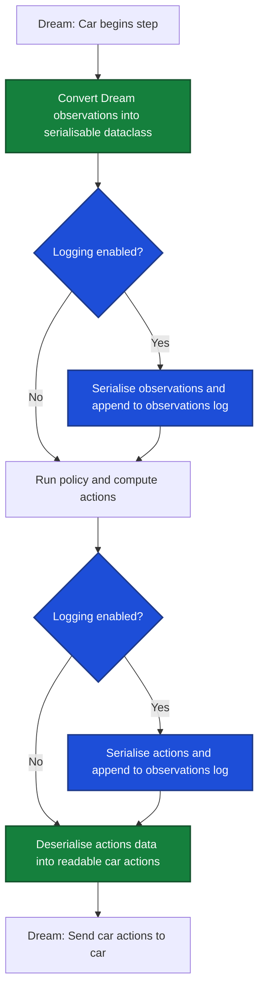

#### Concurrent policy actions

Attempted design for concurrent camera panning with separate algorithm tracks.


*Figure: Modified block diagram designed for concurrent execution of policy nodes.*

---

<a id="ciaran-4"></a>

### 3. Use of single-step simulation to aid in architectural design (Standard 3)

#### Design objective

To modify the architecture of the project to improve extensibility in future development without affecting car output in a meaningful manner.

#### How simulation was used

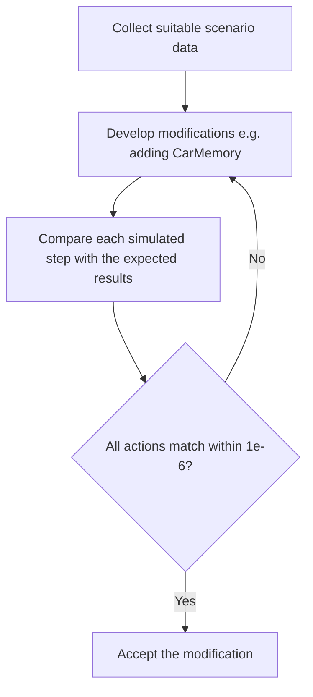

Car actions were allowed to differ by at most $1 \times 10^{-6}$. That keeps the commanded output consistent with the baseline while ignoring floating-point noise that does not change behaviour. This provided for quick development without requiring testing with a controlled and consistent environment.

---

<a id="ciaran-5"></a>

### 4. Solving an issue with the car veering into cones (Standard 4: Real-world experimentation)

#### Engineering question

Why, on curves, was the car veering into cones?

Simulation and unit tests showed the car successfully navigating the course, so the failure only showed up on the real track.

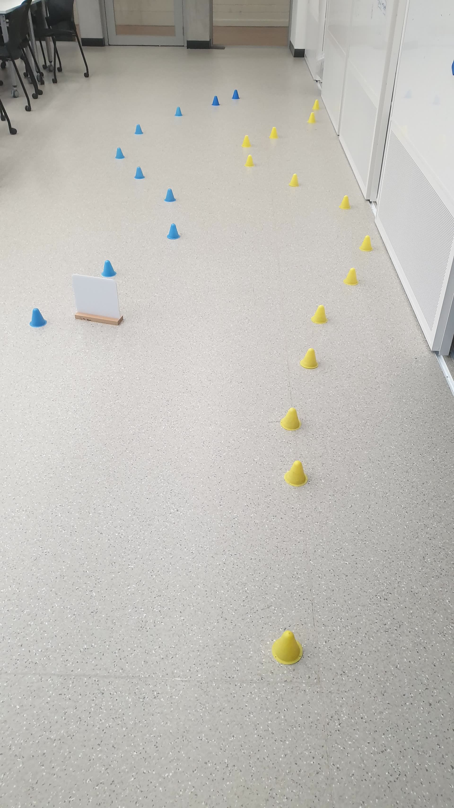

*Figure: The track that the car failed on (note: the obstacle was moved aside for the experimentation).*

#### Identifying core influential variables

Influential variables included:

- **Curvature of the course** — courses with no curvature showed no issues.
- **Size of gaps in the cones** — the car expected a certain gap between cones.
- **Presence of obstacles** — in some circumstances an obstacle could obscure cones (to minimise bias, that obstacle was removed for the investigation).

#### Running the experiment

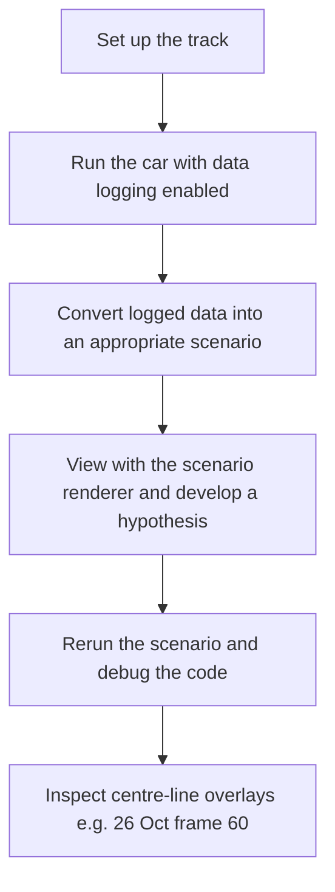

`fail_curvy_road` replayed with the 26 Oct 2026 policy (`d1d8096`) and that day's `ai4r_policy.yaml`. The scenario renderer is unchanged aside from overlaying the lane edges and centre line that `MovementPolicy` produced after the cone filter and local map.

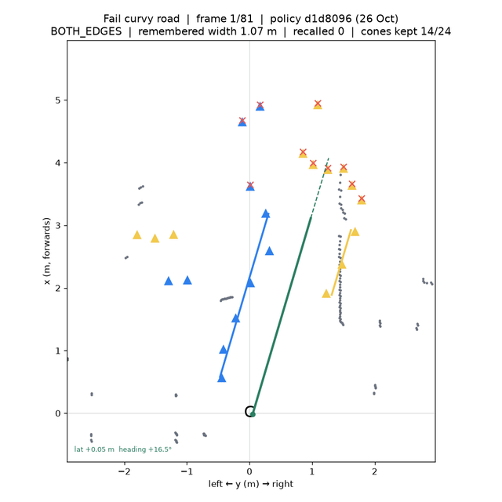

*Figure: Real-time* `fail_curvy_road` *scenario replay with the centre-line overlay.*

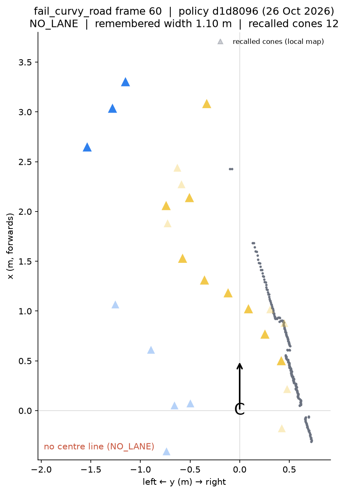

*Figure: frame 60 of the failing track scenario, where the detector reports* `NO_LANE`*.*

#### Resolution

The car was unable to identify a proper centre line because blue cones far in the distance conflicted with the yellow cones nearby.

Long and other members then adjusted the lane-keeping code so that, in situations like this where a blue cone line was missing, it would still follow the yellow line — improving performance.

Additionally using less severe track curvatures was found to improve performance helping understand the car limitations.

---

<a id="long"></a>

## Part 2: Thanh Long Nguyen: lane estimation, the camera pan and the car simulator


| | |
| --- | --- |
| Role | Road Detection owner (named in `docs/movement-policy-tasks.md` and `docs/stage1-approach.md`): lane estimation from the cones. Then whole-system testing: the car simulator and live 3D viewer |
| Commits | `8b71f8b`, `f96ee66` (9 Oct) and `f49333d`, `3319051` (10 Oct) on `test/lane-following-car20`, which reached `dev` through PR #19 (14 Oct). `6c4cd17` (27 Oct) on `feature/car-simulator` |
| Open work | `feature/car-simulator`: pushed, no PR yet. It is built on `d1d8096` (26 Oct), so it uses the marker IDs of that day (3 left, 4 right, 5 straight), not `dev`'s grouped IDs |
| Built on teammates' work | Ciaran: repo, CI, upload script and the recorded drives. Zhenling: the cone filter before my block; later the recalled cones and the 3.5 m range limit around it; the lidar and camera visibility model (`obstacle_simulation.py`) the simulator reuses. Peiyu: the MPC framework my output feeds, and `reference_from_cones`, the fit mine replaced. Chris: car 20's speed and steering maps (the car run and the simulator use them). Toby: the measured camera model (`LAB_CAR`) and `curved_lanes.py`, which the simulator reuses. Yuhao: the junction check inside my fit, and the intersection navigator and cross model the simulator drives |
| Figures | `long/figures/`, made by `python3 docs/logbook/long/make_figures.py` (needs `git lfs pull`; add `--sim-repo <checkout of origin/feature/car-simulator>` to re-run the simulator, about 10 minutes). Every number below is in `long/data/*.json`. Slide: `long/slide/`, made by `make_slide.py` |

**Summary: four pieces of work, in order** (the same as my slide):
1. **Lane estimation.** Before 9 Oct, `detect_lanes` was an empty stub. I wrote the block that turns the cones into
   the lane edges, the centre line and the car's place in the lane, and defined its output, `LaneDetection`, which
   the MPC, the obstacle avoidance and the intersection turns all use (Sections 1, 2.1, 3.1, 3.2 and 4.1).
2. **The camera pan bias.** Every recorded drive read the lane as turned 6–11°, yet the car went straight. I showed
   the cones were rotated, not the car, traced it to the camera pan never being commanded, and made the policy hold
   it at zero (Sections 2.3, 3.6 and 4.2).
3. **Making it work on the lab floor.** Either colour may be on the left (AUTO), the lane width is learned so one
   edge is enough, misplaced cones are left out, and straight edges were the default until curves were needed
   (Sections 2.2, 3.3, 3.4, 4.3 and 4.4).
4. **A whole-system simulator and live 3D viewer.** It runs our real `MovementPolicy` and settings on six tracks
   against the measured car-20 model, in a browser 3D view, and the same viewer can show a real car's live data
   read-only (Sections 2.4 and 3.5–3.7).

Car 20 was driven with my lane estimate on 9 Oct, and lane estimation (with AUTO sides, width memory and the pan hold)
has been on `dev`, so in the team's car runs, since 14 Oct. The pan finding comes from real recordings. The simulator
results are simulation only, and its branch isn't merged.

**Where each standard is answered:**

| Standard | Sections | Main evidence |
| --- | --- | --- |
| 1 System-level | 1 | Block diagram, requirements, interface table with units and rates, how my block's errors reach the rest of the system |
| 2 Theory | 2 | The concentric-arc model and fit, a symbol table, the pan rotation and lever-arm relations, decisions and alternatives (2.5) |
| 3 Simulation | 3 | Seven studies, each with a question, method, result, the decision it fed, and limits |
| 4 Real world | 4 | Recorded drives analysed as experiments, the first car run, and what the team's later car runs showed about my block |
| 5 Visual | all | 13 figures, each with a caption that says what to look at; units on every axis |

<a id="long-1"></a>

### Timeline

| When | What I did | Evidence |
| --- | --- | --- |
| Week 1 (5–9 Oct) | Lane estimation from cones, its interface document, the Foxglove lane overlay node and 270 lines of tests. Found the 6–10° heading bias in the 6 Oct recordings. The MPC follows my lane, with cautious first-run settings for car 20 | `8b71f8b`, `f96ee66`, `docs/lane-detection-interface.md`, `scripts/lane_overlay_node.py` |
| 9 Oct (car 20) | Car 20 driven with my branch. My fit measured the floor lane at about 0.65 m, not the 1.0 m default | `f96ee66` (config comment); `docs/mpc-lab-calibration.md`: "the branch car 20 was driven with" |
| 10 Oct | AUTO colour sides, remembered width, pan held at 0 with a test; the settings used at the track (heading weight 5, cones within 2.5 m) | `f49333d`, `3319051` |
| Week 2 (12–14 Oct) | In `dev` through PR #19. Toby measured the same camera yaw (7.3°) and left `camera_yaw_offset_deg` at 0 because the pan is held | PR #19, `docs/mpc-lab-calibration.md` section 2 |
| Weeks 1–3 (weekly reports) | At the week 11 progress assessment, argued for testing the whole system, not only units. Far cones: tried weighting cones by distance; Zhenling tested it and it didn't meet the requirements, so it wasn't committed (`dev` keeps her 3.5 m range limit). Took on Toby's wrong-colour-cone finding and raised it with the team | my weekly reports (no commit) |
| Week 4 (26–27 Oct) | The car simulator and live 3D viewer: 23 files, 6 tracks, its own tests and README | `6c4cd17` on `feature/car-simulator` |
| 9 Nov | This section: re-ran my fit on all the recordings, the drawn-lane studies and the simulator | `long/make_figures.py`, `long/data/` |

---

<a id="long-2"></a>

### 1. Where my parts fit (Standard 1)

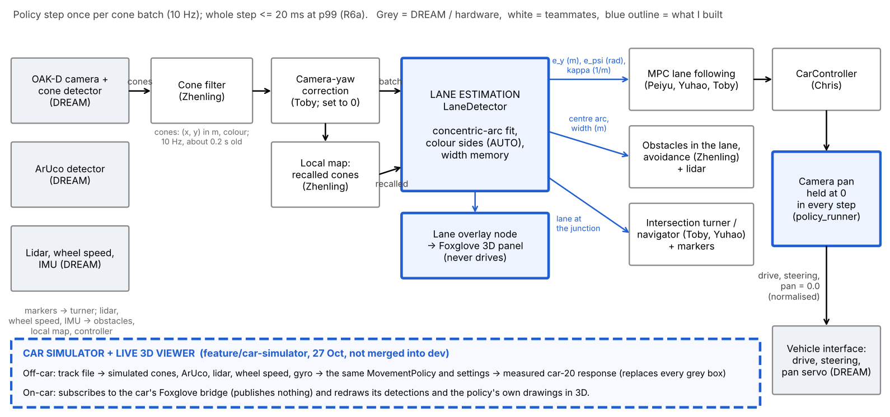

*The MovementPolicy pipeline, run once per cone batch (10 Hz). Blue outlines are what I built: lane estimation,
the lane overlay node, the camera pan hold and the simulator band at the bottom, which replaces every grey box. Look
at the three blue arrows out of lane estimation: three different blocks steer the car from the same lane.*

**Purpose in the whole system.** Everything that drives the car needs to know where the lane is. My block is the
one place where the cones become a lane, so the MPC, the obstacle avoidance and the intersection turns all see the
same lane, in the same frame and sign conventions. The simulator's purpose is different: to test the whole chain
together before car time, because each block's unit tests can pass while the combination fails.

**Requirements it had to meet** (the team's Stage 1 requirements are in `docs/stage1-approach.md`):

| Requirement | Source | What it means for lane estimation | Met? |
| --- | --- | --- | --- |
| Follow the lane centre within 0.10 m (R1b) | Stage 1 card | $e_y$ must be accurate to a few cm, so perception doesn't use up the MPC's error budget | In simulation 1.9–3.4 cm (3.2); on real drives the width holds to ±2–3 cm (4.1) |
| Whole policy step ≤ 20 ms at the 99th percentile (R6a) | Stage 1 card | My part must be small and bounded | 0.4 ms straight, 4.3 ms curved at p99 (4.5); at most 50 solver evaluations and 2 refits |
| Stop safely when the lane is lost or doubtful (R7, R2) | Stage 1 card | Report `NO_LANE` rather than guess | Width, crossed-edge and turning-centre checks (2.1) |
| Lab lanes 0.65–0.85 m wide, either colour on the left | Measured on the floor and in recordings | No fixed width or colour side | Width memory and AUTO (2.2, 3.3) |
| Curves down to a 0.5 m radius (Stage 2) | Lab tracks | Curvature in the model, not only straight lines | Curved mode, $\lvert\kappa\rvert \le 2$ 1/m (2.1, 3.2) |
| The camera transform is fixed at zero pan | DREAM (`AGENTS.md`: "its camera TF is fixed at zero pan") | The policy must hold the pan at 0 | Pan hold, `f49333d` (2.3, 4.2) |

| Interface | Direction | What it carries (units) | Rate and age | Assumption or constraint |
| --- | --- | --- | --- | --- |
| Filtered cones (Zhenling's filter, then Toby's yaw rotation, 0° on `dev`) | in | each cone's (x, y) in `base_link` (m) when detected, and its colour | 10 Hz; about 0.2 s old | The camera points straight ahead (zero pan, 2.3). Two colours, one per edge |
| Recalled cones (Zhenling's local map, from 23 Oct) | in | remembered cones this batch doesn't show (m) | every step | Added only when the batch alone already gives a lane |
| `LaneDetection` → MPC | out | $e_y$ (m), $e_\psi$ (rad), $\kappa_c$ (1/m); + = left | every step | Exactly the MPC's `PathTrackingState`. Constant curvature over the view, like the MPC's horizon. `NO_LANE` makes the MPC stop |
| `LaneDetection` → obstacles and avoidance | out | centre arc, width (m), `visible_until_m` (m) | every step | Obstacles are placed along my centre arc, so a jump in the arc moves them (4.6) |
| `LaneDetection` → intersection turner and navigator | out | the lane while approaching a junction | every step | The cross road's cones bend one arc, so the turner keeps only the approach cones (Toby) and the fit has a junction check (Yuhao) |
| Camera pan set-point | out | 0.0 (normalised) | every step | The servo must also be mounted centred |
| Lane overlay node → Foxglove | out | edges, centre line, kept and removed cones (`MarkerArray`); $e_y$, $e_\psi$, width | per cone batch | Runs the same filter and fit on the car's live cones. Never publishes actions |
| Simulator (off car) | replaces sensors, DREAM detectors and the car | detections in the real message types; the car's response to the set-points | camera 10 Hz, lidar 10 Hz, wheel 50 Hz, gyro 100 Hz | Decoded detections, not camera pixels. Measured car-20 response, no tyre slip |
| Live viewer (on car) | reads the car's Foxglove bridge | cones, markers, lidar, wheel speed, IMU, node state, the policy's drawings | as published | Subscribes only: publishes nothing, calls no service, sets no parameter |

**How my block's behaviour shows up in the whole system:**
- **A heading bias becomes a lane offset.** The MPC drives the measured $e_\psi$ to zero, so a camera turned by
  $\delta$ makes the car settle off-centre, about 1.2 cm per degree, and at junctions the turn is planned from the
  wrong place (3.6). That is why the pan hold is part of my interface.
- **A curvature error becomes a heading error.** The fitted arc is extended back to the car, so a curvature error
  $\delta\kappa$ shifts the heading at the car by about $\delta\kappa\,\bar s$, where $\bar s \approx 1$–1.5 m is the
  mean distance to the cones (2.1). This is why straight lanes were fitted straight for Stage 1 (4.3).
- **A jump in the estimate moves every obstacle.** Obstacles are placed in my lane frame, so a 0.35 m jump as a cone
  left the view made a board look like it was in the path and stopped car 20 (Chris, 19 Oct; 4.6).
- **`NO_LANE` stops the car.** A doubtful lane is a stop, not a guess. The price is that a wrong-colour cone in a
  short row can stop the car (3.4).

**Design goals and the choices they forced** (alternatives are compared in 2.5):
- **One model for both edges: concentric arcs.** A lane keeps its width, so a long row steadies a short one, an edge
  with too few cones for a direction still gives its offset, and a turn of 90° or more in view is represented.
- **Output in the MPC's own quantities,** so the MPC replaced its own cone fit in six lines (`f96ee66`).
- **Stateless and bounded.** Easy to test, replays exactly on recordings and in the simulator, and safe in the
  real-time step. The cost, found on the car, is that it jumps when cones leave the view (4.6).
- **A doubtful lane is no lane.** Safety before availability.

<a id="long-3"></a>

### 2. How it works (Standard 2)

#### 2.1 Lane estimation (`policy/lane_detection/`)

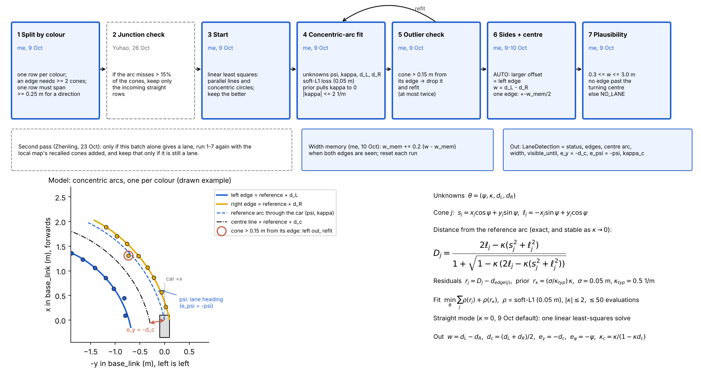

*Top: the steps of `LaneDetector.detect`, with who wrote each (blue = me; dashed = teammates' later additions). Look
at the loop from step 5 back to step 4: outliers are removed and the fit is repeated. Bottom: the model, drawn for a
lane curving left, and the equations as they are in the code.*

| Symbol | Meaning | Units |
| --- | --- | --- |
| $x_j, y_j$ | Cone $j$ in `base_link` when detected: +x forwards, +y left | m |
| $\psi$ | Lane heading beside the car, + = left of the car's +x | rad |
| $\kappa$ | Lane curvature beside the car (1/radius), + = turning left | 1/m |
| $d_L, d_R$ | Sideways offset of each edge from the reference arc, + = left | m |
| $s_j, \ell_j$ | Cone $j$ along and across the reference direction | m |
| $D_j$ | Signed distance of cone $j$ from the reference arc | m |
| $w$, $d_c$ | Lane width, and the centre line's offset | m |
| $\rho$ | Soft-L1 loss: quadratic for small residuals, linear for large ones, so a few misplaced cones count less | – |
| $\sigma$, $\kappa_{typ}$ | Cone position noise (0.05 m) and an ordinary curvature (0.5 1/m), which set the prior | m, 1/m |

- **Model:** a reference arc starts at the car with $(\psi, \kappa)$; each edge is the concentric arc $d$ to its left,
  with curvature $\kappa / (1 - \kappa d)$. Straight lanes are the case $\kappa = 0$, not a separate model.
- **Distance from the arc,** in a form that stays exact as $\kappa \to 0$ (`LaneArc.signed_distance`):

$$D_j = \frac{2\ell_j - \kappa(s_j^2 + \ell_j^2)}{1 + \sqrt{1 - \kappa\,(2\ell_j - \kappa(s_j^2 + \ell_j^2))}}, \qquad s_j = x_j\cos\psi + y_j\sin\psi, \quad \ell_j = -x_j\sin\psi + y_j\cos\psi$$

- **Fit:** $\min_\theta \sum_j \rho(D_j - d_{edge(j)}) + \rho\big((\sigma/\kappa_{typ})\,\kappa\big)$ over
  $\theta = (\psi, \kappa, d_L, d_R)$, with $\rho$'s scale 0.05 m. The second term is a prior: a curvature of
  $\kappa_{typ}$ costs as much as one cone $\sigma$ off its edge, so noise alone can't bend a straight lane.
  `scipy.optimize.least_squares` starts from the better of two linear least-squares fits (parallel lines, or
  concentric circles $x^2 + y^2 = 2ax + 2by + e_i$), at most 50 evaluations.
- **Straight mode** (`max_curvature_per_m: 0.0`, my Stage 1 default): $\kappa = 0$ and the fit is one linear
  least-squares solve.
- **Outliers:** a cone more than 0.15 m from its edge is dropped and the fit repeated, at most twice.
- **Outputs:** $w = d_L - d_R$, $d_c = (d_L + d_R)/2$, $e_y = -d_c$, $e_\psi = -\psi$, $\kappa_c = \kappa/(1-\kappa d_c)$,
  and `visible_until_m`, the distance along the centre line to beside the farthest cone used.
- **Checks:** $0.3 \le w \le 3.0$ m, edges not crossed, and no edge past the turning centre ($\kappa d < 0.9$),
  else `NO_LANE`.

**The lever arm: why a small curvature error matters.** The heading reported at the car is the heading at the cones
extended back along the arc: $\psi(0) = \psi(\bar s) - \kappa\,\bar s$. A curvature error $\delta\kappa$ therefore
shifts $e_\psi$ by about $\delta\kappa\,\bar s$. On the real drives $\bar s$ is 1.1–1.5 m, so a false 0.16 1/m bend
predicts +10.1° of extra heading error, and +10.8° was observed (4.3).

| Parameter | Value | Why it matters on the car |
| --- | --- | --- |
| `outlier_distance_m` | 0.15 m | Above the detector's position noise (0.03–0.04 m measured), well below half a lane (0.4 m) |
| `max_curvature_per_m` | 0.0 (9 Oct), 2.0 (`dev` since 15 Oct) | 0 = straight edges. On straight lab lanes, curves allowed read a false 6–12 m bend (4.3) |
| `typical_curvature_per_m` | 0.5 1/m | Smaller pulls harder towards straight: steadier straights, flatter real bends |
| `min_cones_per_edge` | 2 | With 1, a single misdetected cone could move the centre line |
| `min_lane_width_m`, `max_lane_width_m` | 0.3, 3.0 m | The car is about 0.2 m wide; lab lanes measured 0.65–0.85 m |
| `left_colour` | `"AUTO"` | The lab had blue on the left on some days and yellow on others |
| `lane_width_m` | 1.0 m | Used with one edge only until both edges have been seen (2.2) |

#### 2.2 Which colour is the left edge, and the width with one edge (10 Oct)

- **AUTO sides:** after the fit, the edge with the larger offset to the left is the left edge. A single edge is the
  left edge when $d > 0$ (it's on the car's left). `"BLUE"` or `"YELLOW"` fixes it instead.
- **Width memory:** while both edges are seen, $w_{mem} \leftarrow w_{mem} + 0.2\,(w - w_{mem})$, a low-pass filter
  with a time constant of about 5 steps (0.5 s). With one edge, the centre line is $w_{mem}/2$ from it. It resets at
  the start of each run.
- **Assumption:** with one edge only, AUTO assumes the car is inside the lane. A car that has crossed the edge gets
  the side wrong.

#### 2.3 Why the camera pan matters

The camera's transform to `base_link` is fixed at zero pan (DREAM). If the camera is really turned left by $\delta$,
every cone is placed rotated by $-\delta$ about the camera. A straight lane then reads

$$e_{\psi,\,measured} = e_{\psi,\,true} + \delta, \qquad e_{y,\,measured} \approx e_{y,\,true}$$

(the rotation is about the camera, 0.10 m behind `base_link`, so $e_y$ moves only about $0.1\,\delta$). A cone 2 m
ahead moves $2\sin\delta$ sideways, 0.24 m for 7°. The MPC sees the car pointing $\delta$ left of the lane and steers
right, and settles where its lateral and heading terms balance: along the lane but off-centre (3.6). A rotation keeps
straight rows straight, so it can't cause the false bends of 4.3; those come from the detections themselves. Holding
the pan at 0 in `MovementPolicy.step` (`f49333d`) makes the fixed transform true; the servo still has to be mounted
centred.

#### 2.4 The simulator and live viewer (`tests/policy/simulator/`, 27 Oct)

The team already had single-feature simulators (curved lanes and markers, intersections, obstacles), each driving
one part of the policy. None ran the whole `MovementPolicy` with the node's start and stop rules, the shipped
settings and the car's measured response together, so problems between parts only showed up on the car (such as the
lane jump that caused Chris's false obstacle stop, 4.6). The simulator reuses their models and adds the node, every
sensor and a 3D view.

| Part | Shared with the car or modelled | Source |
| --- | --- | --- |
| Policy | **Shared:** `MovementPolicy` built as `policy_node` builds it, from `config/ai4r_policy.yaml` | `scripts/mcap_export.build_policy` (Peiyu) |
| Node rules | Copied: one step per cone batch, stale sensors become `None`, start refused without fresh required sensors, drop to state 2 at `supervision_rate_hz` | `scripts/policy_node.py` |
| Car | Kinematic: $\dot x = v\cos\theta$, $\dot y = v\sin\theta$, $\dot\theta = v\kappa$; $v$ and $\kappa$ from car 20's measured drive and steering maps, slew limits, 0.5 s command timeout. No tyre slip | `tests/policy/car_models.py` (Chris, Peiyu), `config/traxxas_vehicle_interface.yaml` |
| Camera cones | 86° view, 0.4–2.5 m, 3 cm noise, 10 Hz, 0.2 s old; boxes hide cones; `--miss` drops cones; `--camera-yaw-deg` turns the camera without telling the policy | `real_car_measurements.LAB_CAR` (Toby) |
| ArUco | Decoded poses from the same frames once seen in 3 frames, within 60° of the sign's face | `config/aruco_detector.yaml`; the 60° is not measured |
| Lidar, wheel speed, gyro | 0.5° beams to 8 m with 1 cm noise, 10 Hz; 50 Hz; 100 Hz | `obstacle_simulation.py` (Zhenling), `config/lidar_mount.yaml` |
| Tracks | YAML: lanes from straight and arc pieces, a four-way cross or T, loose cones, signs, boxes | `track.py`, `curved_lanes.CurvedLane` (Toby) |
| Viewer | three.js scene: chase, car camera, top and orbit views; the policy's own drawing layers; drive by hand | `server.py`, `viewer/` |
| On-car mode | Reads the car's Foxglove bridge (`cone_detections`, `fiducial_detections`, `scan`, wheel speed, IMU, node state, set-points, the policy's markers, `/tf_static`) and redraws them in 3D | `live.py`, `ros2_cdr.py` |

**Trade-off chosen:** decoded detections instead of camera pixels. Runs are fast (a 34 s cross run in about 4 s
headless) and the real policy code is unchanged, but the DREAM detector's own failures (lighting, colour mistakes)
are only modelled as noise and missed cones. Section 3.7 checks how far that matters.

#### 2.5 Decisions, the alternatives I weighed, and the evidence

| Decision | Alternatives | Why this one | Trade-off accepted | Evidence |
| --- | --- | --- | --- | --- |
| Fit both edges together (concentric arcs) | Each colour its own line, slopes averaged (`reference_from_cones`, the MPC's fit before mine); a polynomial $y = f(x)$ | A short row borrows the long row's direction; one edge still gives an offset; turns past 90° can be represented | More unknowns and an iterative solve in curved mode | 3.1: 0.7° against 3.0° heading error with a 3-cone row |
| Straight edges by default for Stage 1 | Curvature always free | On the lab's straight lanes, free curvature added 4–11° of heading error | Curved roads need a setting changed (done on 15 Oct) | 3.2, 4.3 |
| Robust (soft-L1) loss, then drop cones over 0.15 m and refit | Plain least squares; RANSAC (Zhenling tried it on 19 Oct and reverted to this fit the same day) | My reasoning: with 3–6 cones per row, a consensus of random pairs has little to choose from, and a refit keeps every good cone | Fails when the wrong cones are a large share of a short row | 3.4, 4.4 |
| AUTO colour sides | A fixed `left_colour` | The lab used both ways round; a fixed side gives no lane at all | One-edge AUTO assumes the car is inside the lane | 3.3 |
| Remember the measured width | The configured width (1.0 m) | Lab lanes were 0.65–0.85 m: a fixed 1.0 m puts the centre 10–20 cm off with one edge | Needs both edges first in each run | 3.3 |
| Stateless, one batch at a time | Track the lane between steps (a filter or a map) | Deterministic, testable, replays exactly, bounded time | Jumps when cones leave the view; the team added Zhenling's local map around it | 4.6 |
| Hold the pan at 0 in the policy | Measure the yaw and correct it (`camera_yaw_offset_deg`) | DREAM's camera transform assumes zero pan, and the bias changed from drive to drive | The servo must still be mounted centred | 4.2 |
| A whole-system simulator on decoded detections | Rendering camera images; replaying recordings only | Runs the real policy fast, on any track, including junctions never recorded | Optimistic camera (3.7) | 2.4, 3.5–3.7 |

<a id="long-4"></a>

### 3. Simulation (Standard 3)

The studies in 3.1–3.4 re-run, for this logbook, the drawn-lane checks I used on 9–10 Oct (in
`tests/policy/test_lane_detection.py` and `docs/lane-detection-interface.md`), now through the camera model the team
measured on 12 Oct. 3.5–3.7 use my simulator.

#### 3.1 Is fitting the edges together better than fitting each row alone?

- **Question:** the MPC first used `reference_from_cones`, which fits each colour as its own straight line and
  averages the two slopes. Does fitting the edges together, as I did, help?
- **Method:** a drawn straight lane with 3 cm noise, the left row 12 cones, the right row 2–12 cones, 200 seeds; the
  heading error RMS of each method. Then the step-to-step change in $e_\psi$ on the four real 6 Oct drives.

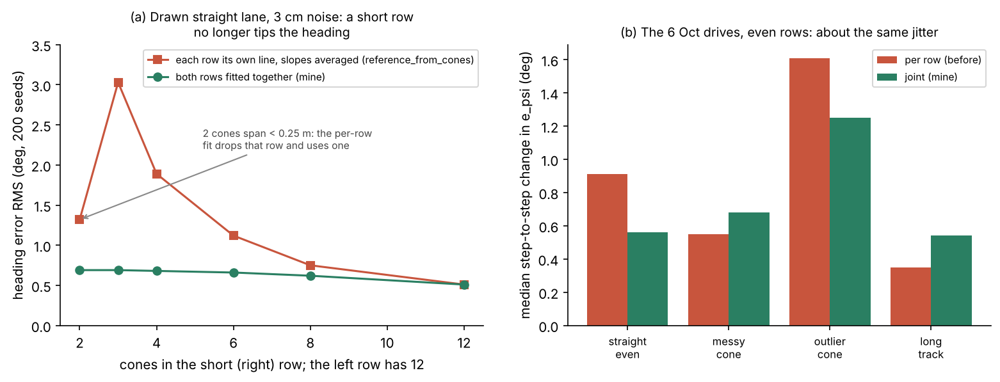

*(a) Look at the short-row end: with 3–4 cones in one row, the per-row fit's heading error is 2.8–4.4 times larger,
because a short noisy row gets the same weight as a long one. (b) On the real drives, whose rows are even, the two
have about the same jitter.*

- **Result:** with a 3-cone row, 0.69° against 3.03°; the two meet at 0.51° when both rows have 12 cones. On the real
  drives the median jitter was 0.5–1.3° (mine) against 0.4–1.6°: no clear difference with even rows.
- **Interpretation:** the joint fit pays off where the lab is hardest: near the lane end, in turns and with hidden
  cones, where one row is short. It is also what allows curves and a single edge.

#### 3.2 How accurate is the fit, and when do curves need curved mode?

- **Question:** how close are $e_y$, $e_\psi$ and $\kappa$ to the truth, and what does straight mode cost on curves?
- **Method:** drawn 0.8 m lanes with cones every 0.2 m, radius 1 m to 8 m both ways and straight, seen through the
  measured camera (86°, 0.4–2.5 m, 3 cm noise), 30 noise seeds. The car is 0.10 m left of centre, pointing 5° left.
  **Controlled:** lane width, spacing, car pose. **Varied:** curvature, noise, mode.

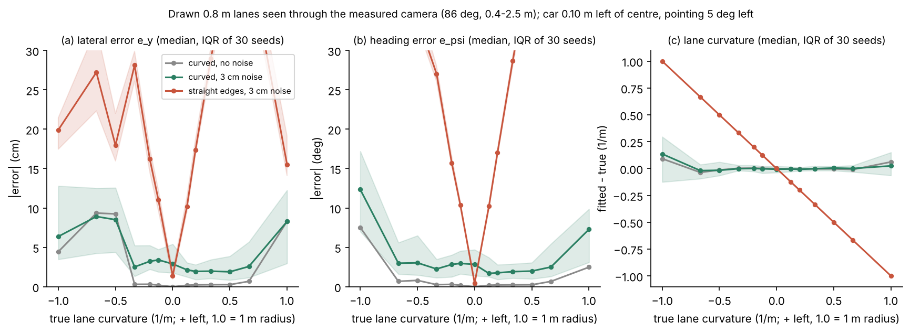

*Look at the red straight-mode curve leaving the plot on both sides of 0: on any curve, straight edges are wrong by
centimetres and degrees. Green (curved mode with noise) stays low until the tightest bends, where few cones are in
view.*

- **Result, curved mode with noise:** $e_y$ within 1.9–3.4 cm and $e_\psi$ within 1.7–3.0° (median) for radii of
  1.5 m and more turning left, and 3 m and more turning right. Curvature is unbiased down to a 1.5 m radius. That is
  well inside R1b's 0.10 m.
- **Failure cases:** right bends of 1.5–2 m radius leave the view (the car points 5° left), so only 10 cones remain,
  and $e_y$ is about 9 cm out. At a 1 m radius only 6–8 cones are seen, and $e_\psi$ is 7–12° out.
- **Straight mode:** best on straight lanes (1.4 cm, 0.4°), but 10 cm and 10° out on an 8 m radius and 29 cm and 29°
  on 3 m.
- **Decision it fed:** straight edges for the straight Stage 1 lanes, curved mode for curved roads (the team switched
  to curved on 15 Oct). Curves allowed on a straight lane cost 2.9 cm and 2.8° against 1.4 cm and 0.4°.

#### 3.3 Does one edge, and either colour on the left, still work?

- **Question:** what happens when one row disappears in a lane narrower than the configured 1.0 m, and when yellow is
  on the left?
- **Method:** a 0.6 m lane (car 20's floor lane measured about 0.65 m on 9 Oct, `f96ee66`), the car weaving ±0.08 m,
  the yellow row removed from 3 m to 6 m. Then 50 random poses in lanes with each colour on the left.

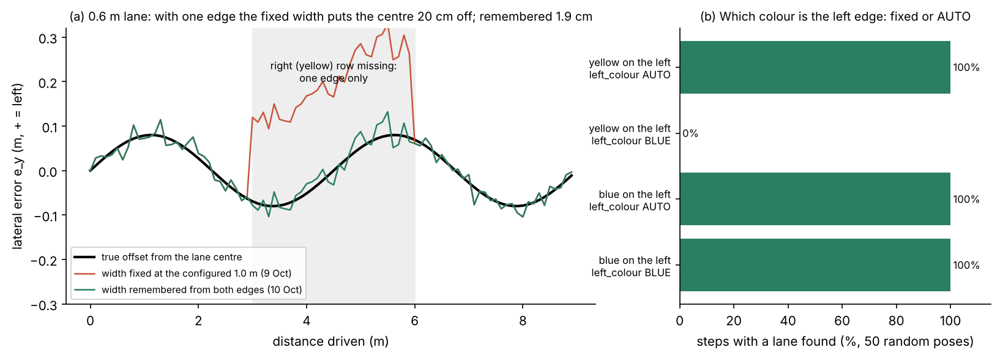

*(a) Look at the grey band, where only one edge is seen: the red line (fixed 1.0 m width) jumps 20 cm away from the
truth; green (remembered width) stays on it. (b) A fixed `"BLUE"` finds no lane at all when yellow is on the left.*

- **Result:** with one edge, the fixed 1.0 m width put the centre 20 cm off, which in a 0.6 m lane puts the car next
  to the cones; the remembered width, 1.9 cm. With yellow on the left, a fixed `"BLUE"` found no lane; AUTO found it
  100% of the time.
- **Decision it fed (10 Oct, `f49333d`):** AUTO and width memory, the day after the car 20 session found a 0.65 m
  lane.

#### 3.4 What can one wrong-colour cone do? (failure case)

- **Question:** Toby saw, while testing lane sides, that one wrong-colour cone could give a false lane. When?
- **Method:** a straight 0.8 m lane with 2 to 12 cones per row in view, and one yellow cone in the blue row, either
  0.5 m ahead (near) or just past the last cone (far). Straight and curved mode.

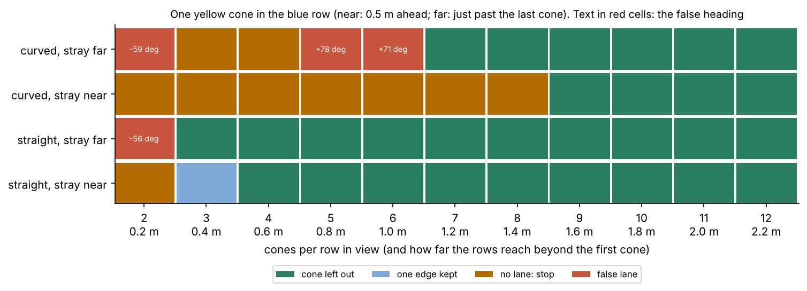

*Each cell is one case. Read along a row: green from some point onwards means the wrong cone is left out from that
many cones per row. Red cells are false lanes, with the false heading written in.*

- **Result, straight mode:** the wrong cone is left out from 4 cones per row (3 when it's far). Below that, the car
  stops, keeps only one edge, or, with 2 cones per row and the wrong cone far, gets a false lane turned 56°.
- **Result, curved mode:** much more fragile. A near wrong cone gives `NO_LANE` (the car stops) up to 8 cones per row;
  a far one can give a false lane turned 59–78°. It's left out only from 9 (near) or 7 (far) cones per row.
- **Why:** the robust loss and the outlier check work when the right cones outnumber the wrong one. In a short row
  the wrong cone pulls the fit towards itself, and with curvature free a bend can pass near all of them.
- **Meaning on the car:** rows are short near a lane end, in a turn or when cones are hidden, which is where a
  misclassified cone hurts, and curved mode is the more fragile one.
- **Proposed, not implemented:** check each cone against the row it's nearest to before splitting by colour, and
  treat a lone cone of one colour inside the other colour's row as unknown.

#### 3.5 Does the whole policy drive the six tracks?

- **Question:** do lane estimation, the MPC, obstacles, signs and junctions work together, with the node's rules and
  the car's measured response?
- **Method:** the bundled tracks, headless, car-20 model, measured noise; 5 seeds, with every cone seen and with 20%
  missed. Pass = no cone or box touched, and: lab_straight stops 0–0.6 m past the last pair; curvy_road drives at
  least 10.5 m; aruco_lane reads both signs; cross and T leave by the commanded road (heading change within 30°), or
  stop at the closed exit.

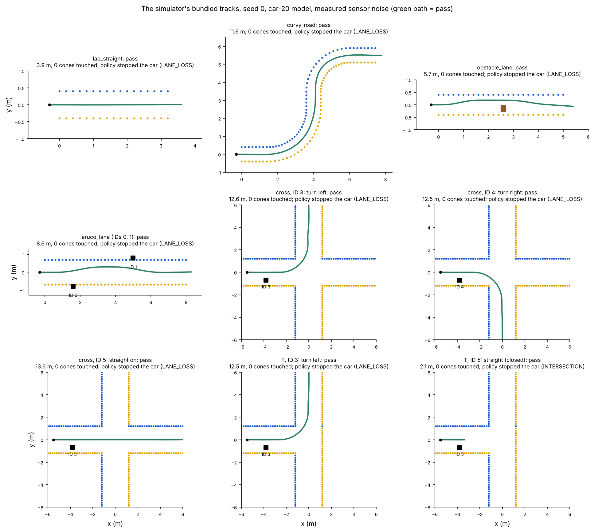

*Top-down paths of seed 0 on every track, cones to scale. Look at the cross and T: the path leaves by the arm the sign
asked for, and on the closed T it stops before the junction.*

| Track | What it tests | Seed 0 | 5 seeds | 5 seeds, 20% of cones missed |
| --- | --- | --- | --- | --- |
| lab_straight | The Stage 1 lab lane: 3.2 m, 0.8 m wide | Stops 0.39 m past the last pair | 5/5 | 5/5 |
| curvy_road | 0.8 m lane, 2.5 m left bend then 2 m right | Drives all 11.6 m | 5/5 | 5/5 |
| obstacle_lane | A box right of centre in a 5 m lane | Passes it on the left | 3/5 | 4/5 |
| aruco_lane | Keep-left (ID 0), then keep-centre (ID 1) signs | Moves 0.3 m left, then back | 5/5 | 5/5 |
| cross, ID 3 / 4 / 5 | Turn left, turn right, straight on, at a 2.4 m cross | Turns +89.5°, −89.0°, +0.4° | 5/5, 4/5, 4/5 | 3/5, 3/5, 3/5 |
| T, ID 3 / ID 5 | Turn left; straight on into the closed arm | +91.3°; stops: "requested exit is closed" | 4/5, 5/5 | 4/5, 4/5 |

- **Result:** all nine cases pass with seed 0, and 76 of the 90 seeded runs pass. No run touched a cone or a box:
  every failure is a stop. The obstacle stop fired in front of the box instead of passing it (3 runs), or the
  junction navigator refused the junction or waited until the time limit (11 runs).
- **Sensitivity:** missed cones hurt the junctions most: 22 of 25 junction runs passed with every cone seen, 17 of 25
  with 20% missed. Lane following passed every run either way.
- **What it tells the team:** the safety rules hold together (a problem ends in a stop, not a contact), and the
  junctions are the least robust part. That matches the car: no full junction turn was shown on a car before access
  ended on 2 Nov (team README).

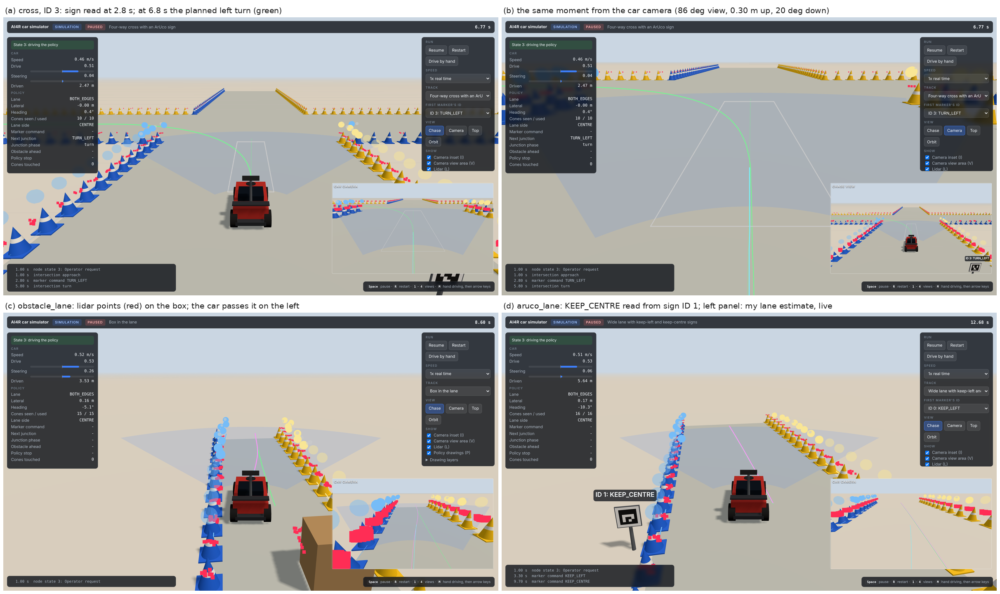

*The browser viewer during runs on the same tracks. The left panel shows the node state and my lane estimate live
(status, $e_y$, $e_\psi$, cones seen and used); (b) is what the car's camera sees, with the planned turn drawn in.*

#### 3.6 What does an uncorrected camera yaw do to the whole system?

- **Question:** the 6 Oct drives had 6–11° of camera yaw. What would it have done to a drive, if not fixed?
- **Method:** `--camera-yaw-deg` from −8° to +8° (the policy isn't told), 3 seeds, on lab_straight, curvy_road and
  the cross turning left and right.

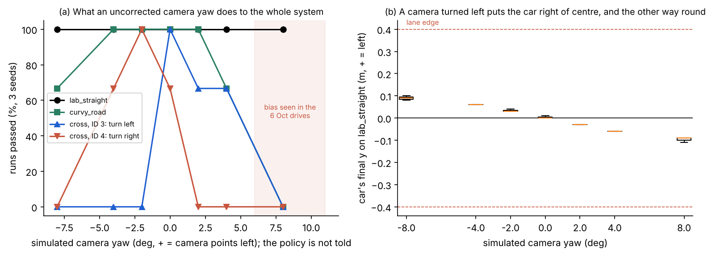

*(a) Look at how narrow the band is where both turns pass: only around 0°. The shaded band is the yaw the real drives
had. (b) On the straight lane the car still passes, but settles on the opposite side from where the camera points.*

- **Result:** lab_straight passes at every yaw, but the car settles off-centre by about 1.2 cm per degree
  (+8° → 0.09–0.11 m right), as 2.3 predicts.
- **Curves:** curvy_road fails all 3 runs at +8°: the turned lane puts the lane's own cones in the car's path, and the
  obstacle stop fires within 0.3 m. At +4° one run touched 7 cones.
- **Junctions:** turning left passes only from 0° to +4°, turning right only from −4° to 0°, and every junction run
  stops at ±8°. Toby found the same direction-dependence with his turner (his Section 3.5).
- **Answer:** with the 6–11° of the 6 Oct drives, curves and every junction would have failed. Holding the pan at 0
  is a precondition for the turns.

#### 3.7 Does the simulated camera give the fit the same input as the real one?

- **Question:** the simulator is only useful if my block sees similar cones there and on the car.
- **Method:** both through the shipped cone filter and my straight fit: the four 6 Oct recordings against the
  simulated lab_straight run.

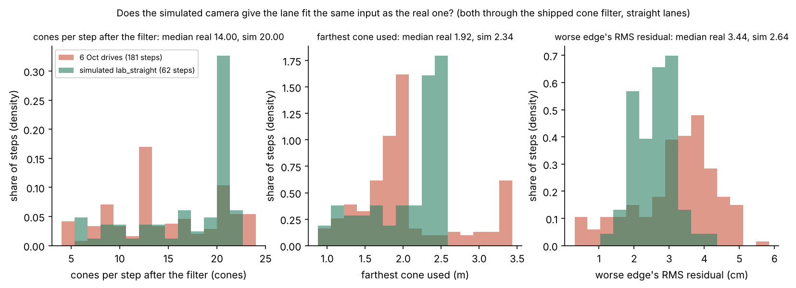

*Look at where the green (simulated) bars sit against the red (real) ones: the simulator gives more cones, further
away, with less scatter.*

- **Result:** in the real drives my fit got 14 cones per step (median) against 20 in simulation, the farthest cone
  used was 1.92 m against 2.34 m, and the worse edge's RMS residual was 3.4 cm against 2.6 cm.
- **Interpretation:** the simulated camera is optimistic, so simulated pass rates are an upper bound. The real drives
  look like a miss rate of about 30% (14 of 20) and noise nearer the 4 cm Toby measured than the 3 cm modelled.
- **Next step:** run the tracks again with `--miss 0.3` and 4 cm noise.

#### What I can and can't conclude from simulation
- **Can:** say how accurate the fit is against a known truth, compare it with the alternative, find where it breaks
  (tight bends, short rows, a wrong-colour cone), check that the whole policy and the node's rules work together on
  each track before car time, and show what a calibration error does to the whole system.
- **Can't:** predict pass rates on the car. No camera pixels (the DREAM detector isn't run), no tyre slip, battery or
  floor effects, an unmeasured braking rate and ArUco viewing angle, ideal track geometry, and a camera that is
  optimistic (3.7). It was built on the 26 Oct policy, so it doesn't include the fixes merged on 2 Nov.

<a id="long-5"></a>

### 4. On the car and in real recordings (Standard 4)

The drives in 4.1–4.4 were recorded by Ciaran on 6 and 13 Oct (the car isn't named in the files). I designed the
analyses, ran my block on every step, and treat each drive as an experiment with its conditions stated.

#### 4.1 What does lane estimation measure on real drives? (6 Oct)

- **Question:** on the real floor and detector, how stable and how far-seeing is my estimate?
- **Conditions:** four straight lab lanes, cones every 0.2 m; drive fixed at 0.55 and steering at 0 for the whole
  drive; camera pan never commanded; the cone filter's default settings; straight edges.

| Drive | Steps | Both edges found | Width (mean ± sd) | Worse edge RMS | Lane seen to | $e_y$ change step to step (median / p95) |
| --- | --- | --- | --- | --- | --- | --- |
| straight_even | 52 | 67% | 0.82 ± 0.02 m | 2.8 cm | 1.8 m | 1.3 / 5.3 cm |
| messy_cone | 53 | 72% | 0.84 ± 0.03 m | 4.5 cm | 1.8 m | 1.6 / 4.3 cm |
| outlier_cone | 102 | 63% | 0.80 ± 0.02 m | 2.8 cm | 1.7 m | 2.6 / 7.2 cm |
| long_track | 80 | 84% | 0.74 ± 0.03 m | 3.6 cm | 2.6 m | 1.3 / 5.4 cm |

- **Result:** both edges were found until only a few cones within about a metre remained, where `NO_LANE` is the right
  answer (the lane end). The width held to ±2–3 cm through each drive, and $e_y$ moved 1–3 cm between steps.
- **Interpretation:** the noise is well inside R1b's 0.10 m. The lane was seen to about 2 m, not the 4 m shared
  default, so I cut the cone range to 2.5 m for car 20 (`3319051`).
- **Limit:** no ground-truth pose: the lane widths weren't tape-measured, so 0.74–0.84 m is the estimate, not a check
  of it (4.8).

#### 4.2 Why did the lane look turned? The camera pan (6 Oct drives; fix 10 Oct)

- **Question:** in every drive my fit gave a heading error of +6° to +11°. Was the car turned, or the cones?
- **Hypothesis test:** with steering held at 0 and a fixed drive, the car's real heading can't change. If an 8°
  heading were real, the car would drift sideways by distance × sin(heading); if the cones were rotated, it wouldn't.
- **Controlled:** steering, drive, the lane. **Measured:** distance (wheel speed × time), $e_\psi$, the change in $e_y$.

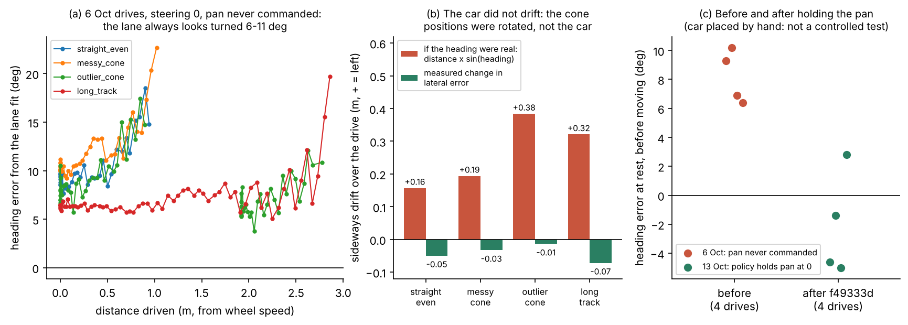

*(a) The heading error over each drive stays at 6–11° (it rises near the lane end, where only a few close cones
remain). (b) The key comparison: red is the drift a real heading would cause, green the drift measured. (c) The
heading error at rest before and after the pan hold.*

| Drive (6 Oct) | Driven with both edges | Median heading error | Drift if real | Measured drift |
| --- | --- | --- | --- | --- |
| straight_even | 0.94 m | +9.6° | +0.16 m | −0.05 m |
| messy_cone | 1.02 m | +10.9° | +0.19 m | −0.03 m |
| outlier_cone | 2.77 m | +8.0° | +0.38 m | −0.01 m |
| long_track | 2.86 m | +6.5° | +0.32 m | −0.07 m |

- **Result:** the car drifted 1–7 cm while a real heading would have moved it 16–38 cm. So the cone positions were
  rotated, not the car. The recorded actions never command the pan (`camera_pan_action` is empty in every step), so
  the servo stayed wherever it was, and the bias differed from drive to drive.
- **Decision (10 Oct, `f49333d`):** the policy holds the pan at 0 in every step, with a test that checks it
  (`tests/policy/test_lane_following.py`). I chose this over measuring and correcting the yaw because the bias changed
  between drives and DREAM's camera transform assumes zero pan. Toby measured the same yaw independently (7.3° on
  long_track) and credited this finding in `docs/mpc-lab-calibration.md`, so `camera_yaw_offset_deg` stays 0.
- **After the fix (13 Oct drives, pan 0 in every step):** the heading at rest is −5.0° to +2.8°, no longer always
  about +8°. The car was placed by hand, so this is consistent with the fix, not a controlled test.
- **It came back once:** `bf5e08c` (30 Oct) set the pan to 0.3 for a car test, and the pan test failed (the commit
  message notes it); PR #36 set it back to 0 on 2 Nov. Yuhao's 30 Oct log has the 0.3 command, so frame accuracy
  isn't established for that run (his Section 4.2).

#### 4.3 Straight or curved edges for Stage 1? (6 Oct drives)

- **Question:** should the fit allow curvature on the lab's straight lanes?
- **Method:** the same four drives, fitted with curvature allowed (max 2.0 1/m) and with straight edges; the lever-arm
  relation of 2.1 checked against the result.

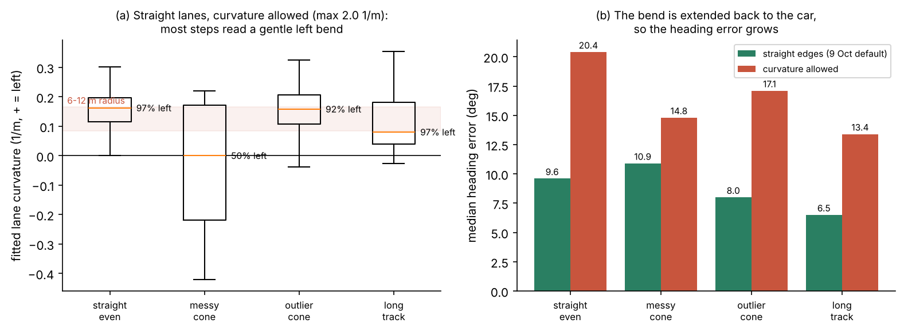

*(a) The boxes sit above zero: with curvature free, straight lanes read a gentle left bend in 92–97% of steps.
(b) The red bars show the heading error growing as that false bend is extended back to the car.*

| Drive | Median false curvature | Mean cone distance $\bar s$ | Predicted extra $e_\psi$ ($\kappa\bar s$) | Observed |
| --- | --- | --- | --- | --- |
| straight_even | 0.162 1/m | 1.09 m | +10.1° | +10.8° |
| outlier_cone | 0.158 1/m | 1.08 m | +9.8° | +9.1° |
| long_track | 0.080 1/m | 1.50 m | +6.9° | +6.9° |
| messy_cone | 0.000 1/m (bends both ways) | 1.12 m | 0° | +3.9° |

- **Result:** three drives read a 6–12 m radius bend, and the heading error grew by 4–11°. The lever arm predicts the
  growth within 1° on the three drives with a consistent bend; messy_cone's staggered cones bend both ways, so its
  median curvature is 0 and the prediction doesn't apply.
- **Decision (9 Oct):** straight edges by default for Stage 1, with curves as a setting for curved roads.
- **What happened next:** Zhenling turned curves on (2.0) on 15 Oct for curved roads. On an S-bend on 20 Oct my
  one-curvature arc flipped between left and right bends, and she added a 3.5 m range limit to the cone filter (her
  E1). One arc can't fit both halves of an S: a limit of my model.

#### 4.4 A misplaced cone in a real drive (outlier_cone, 6 Oct)

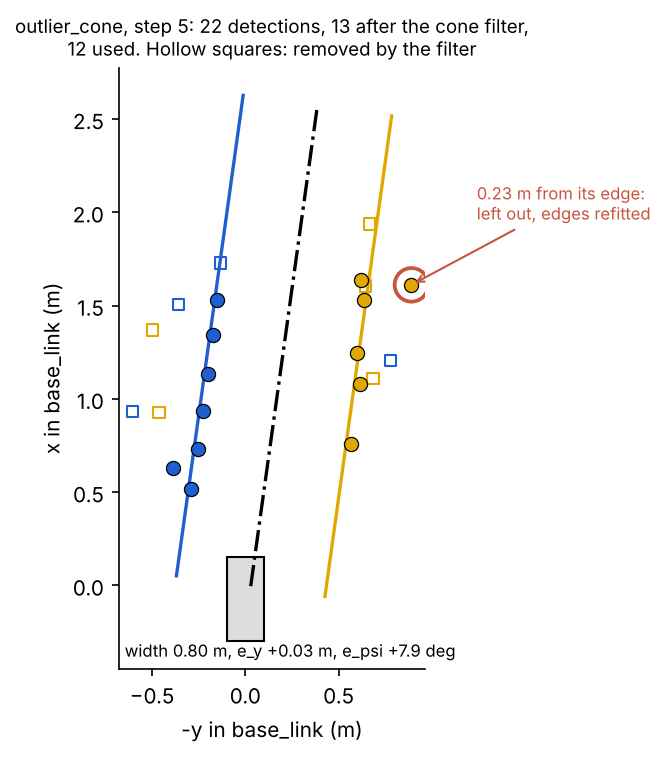

*Step 5 of outlier_cone: 22 detections, 13 after the cone filter, 12 used. Look at the circled yellow cone, 0.23 m
right of its row: it is left out and the edges refitted. The rows lean by the pan bias of 4.2.*

- **Result:** in 29 of the 64 steps with both edges, the outlier check left a cone out, and the width stayed at
  0.80 ± 0.02 m through the drive.

#### 4.5 First lane following with my output (car 20, 9 Oct)

- **Question:** can the MPC follow `LaneDetection` on a real car?
- **Method (`f96ee66`):** the MPC follows my lane instead of its own cone fit, with cautious first-run settings:
  0.5 m/s (the speed Chris tuned car 20's PI at), wheel speed required, the MPC's curvature limited to 0.5 1/m (about
  car 20's left limit), data logging on.
- **On the floor:** my fit measured the lane at about 0.65 m, not the 1.0 m default, and the lab floor had had either
  colour on the left. So AUTO and width memory went in on 10 Oct, with the settings used at the track: heading weight
  5 and cones within 2.5 m (`3319051`).
- **Result:** car 20 was driven with this branch (`docs/mpc-lab-calibration.md`, 11 Oct: "the branch car 20 was
  driven with").
- **Limits:** no log or video of these runs is in the repository (logging went to `/home/ai4r/policy_logs` on the car),
  so there is no measured lateral error and I can't show how closely it followed the lane. Toby later showed in
  simulation that this run's settings (0.5 1/m both ways, heading weight 5) kept only 12 of 84 curved runs, and
  retuned them on 12 Oct (his Section 3.1).
- **Calculation time** (R6a): on the recorded drives `detect_lanes` takes 0.16 ms per step straight and 1.6 ms curved
  (median), 0.4 ms and 4.3 ms at the 99th percentile (12 ms worst of 861 curved steps), on the computer that made
  these figures. That is within the 20 ms step budget, but it hasn't been measured on the car computer, and the
  numbers vary a little from run to run (`long/data/recorded_drives.json`).

#### 4.6 What the team's later car runs showed about my block

My block was in every team car run from 14 Oct, so teammates' sessions are also evidence about it:

| Date, car (who) | What was seen | Cause | What was done |
| --- | --- | --- | --- |
| 12 Oct, car 22 (Peiyu) | Standing still, the lane estimate flipped between two fits; while driving, the perceived heading stayed at about +0.22 rad | Not separated: camera yaw is one of the three causes she lists (car 22 ran before the pan hold reached `dev`) | Check perception against a known pose before floor runs (her 4.2) |
| 19 Oct, car 20 (Chris) | As the nearest blue cone left the camera view, the lane estimate jumped 0.35 m in 40 ms and put a board in the path: a false obstacle stop | One batch at a time: when a near cone drops out of a short row, the fit moves | The obstacle stop needs the lane frame and the lidar frame to agree (his 4.5) |
| 20 Oct, S-bend (Zhenling) | The fitted curvature flipped between left and right bends | One constant curvature can't fit an S | 3.5 m cone range limit (her E1) |
| 22 Oct, 4 drives (Zhenling) | The batch-only $e_y$ jumped by up to 0.57 m | As on 19 Oct | Recalled cones from the local map: the 95th-percentile jump halved or better (her E4) |

- **Interpretation:** these are the costs of two of my choices in 2.5: one batch at a time, and one curvature. On the
  6 Oct drives the $e_y$ jumps were small (p95 4–7 cm, 4.1), but in the team's later drives, with boxes hiding cones
  and longer, curving tracks, they reached 0.35–0.57 m.
- **What I'd change:** keep the fit stateless but check it against the previous step, so a new lane far from the
  predicted one must appear in two steps in a row before it's believed. The team added memory around my block instead
  (Zhenling's local map), which fixed the same problem from the input side.

#### 4.7 Seeing what the car sees

- **Lane overlay node** (`scripts/lane_overlay_node.py`, 9 Oct): runs the shipped filter and my fit on each live cone
  batch and draws the edges, centre line and kept and removed cones in Foxglove's 3D panel, with $e_y$, $e_\psi$ and
  the width in the Plot panel. It's in the car upload filter, so it can run beside the policy.
- **Live viewer, on-car mode** (`--car HOST:1234`, 27 Oct): written against the car's Foxglove bridge topics. There is
  no recording of it connected to a car in the repository, so it counts as not shown on a car.

#### 4.8 The experiments still needed (method ready, not run)

The camera-yaw check with the pan held at 0 is shared with Toby, Yuhao and Peiyu, so it is in the team table
(Team overview, 0.7), with my tape-centred-lane method. These are mine alone:

| Question | Method | Controlled | Decision it feeds |
| --- | --- | --- | --- |
| Is the measured width right? | Tape-measure each lane; compare with the fitted 0.74–0.84 m | the lane | `lane_width_m`, plausible width range |
| How far is $e_y$ from the truth? | Car on a stand at 0, ±0.1 and ±0.2 m from the centre, measured by tape; 20 steps each | car pose, pan 0 | Whether R1b can be met with this perception |
| A wrong-colour cone on the floor | One swapped cone in the near row, with 4, 7 and 10 cones per row in view, 5 runs each | cone spacing, speed | Whether the lone-cone rule of 3.4 is needed |
| Simulator against a logged drive | Drive the same track in simulation and on the car; compare the $e_y$ traces | track, speed | How far the simulated results can be trusted |

<a id="long-6"></a>

### 5. Lessons and limits
- **Check the frame before tuning.** One uncommanded servo put 6–11° into every drive, and in simulation that much
  yaw fails every junction. Toby's later MPC tuning could keep `camera_yaw_offset_deg` at 0 because the pan was held.
- **Write the assumption down as a test.** The pan hold was changed once for a car test; the test I added flagged it,
  and it was restored.
- **Use real recordings before choosing a default, and explain them with the model.** Allowing curves looked more
  general, but on the lab's straight lanes it added 4–11° of heading error, and the lever arm predicts how much.
- **Judgements that reversed:** straight edges by default, until curved tracks needed curves (15 Oct); stateless,
  until car runs showed jumps and the team added memory (23 Oct); my car 20 test settings, until Toby's sweep retuned
  them (12 Oct).
- **Test the whole system, not only units.** My unit tests passed while the camera, the node's rules and the car's
  response could still break a run; the simulator puts them together, though its camera is optimistic.
- **Limits:** one constant-curvature arc can't fit an S-bend; short rows can't reject a wrong-colour cone; one-edge
  AUTO assumes the car is inside the lane; no ground-truth check of $e_y$ on the car; and nothing of the simulator
  has been checked against a logged car run.

**AI assistance:** I used Claude (Claude Code) to help write the simulator (its branch has a `.claude/launch.json`)
and to draft this section and its figure scripts. I checked them by running the real policy code, the tests, the
headless runs on every track and the comparison with the recorded drives above; the oral discussion is my own
understanding.

---

<a id="zhenling"></a>

## Part 3: Zhenling Zhang: obstacle handling, cone filter and local map


|                          |                                                                                                                                                                                                                                                                                                                                                                                                                                                                                                              |
| ------------------------ | ------------------------------------------------------------------------------------------------------------------------------------------------------------------------------------------------------------------------------------------------------------------------------------------------------------------------------------------------------------------------------------------------------------------------------------------------------------------------------------------------------------ |
| Role                     | Everything between the sensors and the MPC that keeps the car from hitting things: the cone filter, lidar obstacle detection in the lane, the obstacle stop and brake, the avoidance planner and the local map. Plus the tools to test them: each run's settings saved with its log, a closed-loop obstacle simulation and replays of car logs                                                                                                                                                               |
| PRs                      | #11 (cone filter), #19 (obstacle detection, stop, brake, first avoidance, run settings in the logs), #21 (avoidance v1), #28 (multi-obstacle planner; RANSAC lane fit tried and reverted), #33 (obstacle simulation and retune, local map), #34 (26 Oct speed offset). All merged into `dev`                                                                                                                                                                                                               |
| Code                     | `policy/cone_filter/`, `policy/obstacle_detection/`, `policy/action_policy/avoidance.py` and `lane_path.py`, the obstacle-stop parts of `mpc.py`, `policy.py` and `policy/control/`, `policy/local_map/`, `tests/policy/obstacle_simulation.py`                                                                                                                                                                                                                                            |
| Built on teammates' work | Thanh Long: the lane fit (concentric arcs) that my detection and planner work in. Peiyu: the MPC framework; my planned line is its reference and my stop runs inside it. Chris: `CarController`, which I added the brake to, and PR #23, which passes two obstacles on one line. Ciaran: repo, CI, upload script and `CarMemory`, where the stop and the map are kept. Toby: `curved_lanes.py`, the measured lab-car model that my simulation drives                                                   |
| Figures                  | `zhenling/figures/`. Z1 is drawn in the style of the team's block diagrams by `logs/logbook/block_diagrams/make_block_diagrams.js` (local, not in git). Z5 is drawn by `tests/policy/obstacle_simulation.py`, Z2, Z7 and Z9 by `zhenling/make_Z2_cone_filter_real_drive.py`, `zhenling/make_Z7_avoidance_planner.py --approach-m 0.3` and `zhenling/make_Z9_local_map_flowchart.py`. Z3, Z4, Z6, Z8 and Z10 were made on 24 Oct from the same logs and code; their plotting scripts weren't kept |
| Data                     | Car logs in `scenarios/data/original_data/` (local, not in git): observations, actions, memory and `_config.json` for each run. The four drives that ran with the local map replay exactly only with `99c12ef` (PR #34), the code that drove them                                                                                                                                                                                                                                                      |

**Summary: five pieces of work, in order**:

1. **Cone filter.** Removes detections that can't belong to the lane (too far, floating, duplicated) before
   lane detection uses them (Section 3.1).
2. **Lidar obstacle detection in lane coordinates.** The lidar also hits the cones, and a straight box misses
   obstacles on bends, so each return is placed along and across the lane (Section 3.2).
3. **Avoidance planner.** One smooth path, a chain of quintics, past several boxes, checked with the car's whole body
   (Section 3.4).
4. **Obstacle stop.** When no path leaves the 0.40 m gap the car needs, the car brakes and stays stopped until a
   person restarts it (Section 3.3).
5. **Local map.** Remembers cones and boxes after they leave the sensors' view (Section 3.5).

All five ran on a real car. In the final real drive, the car passed two obstacles placed on the left and right sides
of the road, and stopped in front of one placed in the middle.

<a id="zhenling-1"></a>

### Timeline

Weeks run Monday to Sunday. Week 1 is the week of 5 Oct, as in Toby's section. The numbers in "Evidence" match the
numbered items in "What I did".

| Week                | What I did                                                                                                                                                                                                                                                                                                                                                                                                     | Evidence                                                                                                                            |
| ------------------- | -------------------------------------------------------------------------------------------------------------------------------------------------------------------------------------------------------------------------------------------------------------------------------------------------------------------------------------------------------------------------------------------------------------- | ----------------------------------------------------------------------------------------------------------------------------------- |
| 0 (28 Sep – 4 Oct) | 1. Cone filter: first version, inside `policy_node.py`: range, height and confidence limits, duplicate merging, straight-row RANSAC                                                                                                                                                                                                                                                                          | 1. `1b259a6` (branch `feature/cone-outlier-filter`)                                                                             |
| 1 (5–11 Oct)       | 1. Cone filter: moved into its own module, `policy/cone_filter/`, with unit tests<br>2. Plots of real detections before and after filtering                                                                                                                                                                                                                                                                      | 1. `0c12bce`, PR #11<br>2. `9dc1c07`                                                                                                |
| 2 (12–18 Oct)      | 1. Obstacle detection: lidar obstacles, first in a straight corridor, then in lane coordinates<br>2. Obstacle stop: stop and stay stopped; the lidar becomes a required sensor<br>3. Brake: active braking instead of coasting (13 Oct)<br>4. Avoidance: v0 moves to the nearest clear offset (12 Oct); v1 adds half-cosine ramps and obstacle memory (15 Oct)<br>5. Tools: logs named to the second, with each run's settings | 1. `fb27a2b`, `ea1c5cf`; car 9 logs (12 Oct)<br>2. `ea1c5cf`<br>3. `c9ee129`<br>4. `54a182c`, `ac70eb6`<br>5. `86e5263`<br>PR #19 and #21 |
| 3 (19–25 Oct)      | 1. Cone filter: range limit 3.5 m, and lidar timeout 0.8 s, from the 20 Oct drives<br>2. Avoidance: v2, one quintic path past several boxes (20 Oct); ramp 0.45 and look-ahead 3.5 m after the 22 Oct drives<br>3. Simulation: closed-loop obstacle simulation, 5 parameters retuned (21 Oct)<br>4. Local map: remembers cones and obstacles (23 Oct)                                                                      | 1. `a005ef9`<br>2. `9cd72c0`, `be0fa3a`, `c09de2e`<br>3. `83b53cc`<br>4. `d807929`<br>PR #28 and #33                                    |
| 4 (26 Oct – 1 Nov) | 1. Final real drive: passed the boxes on the right and left, stopped for the one in the middle (26 Oct)<br>2. Car control: car 20's speed feed-forward offset 0.48 → 0.15 (26 Oct)                                                                                                                                                                                                                                | 1. run `2026-10-26_14-10-54`<br>2. `76c157d`, PR #34                                                                                |
| 5 (2–8 Nov)        | 1. Recorded a video of the real-car demo                                                                                                                                                                                                                                                                                                                                                                       | 1. demo video                                                                                                                       |
| 6 (9–15 Nov)       | 1. This logbook section                                                                                                                                                                                                                                                                                                                                                                                        | 1. this file                                                                                                                        |

---

<a id="zhenling-2"></a>

### 1. My parts in the system (Standard 1)

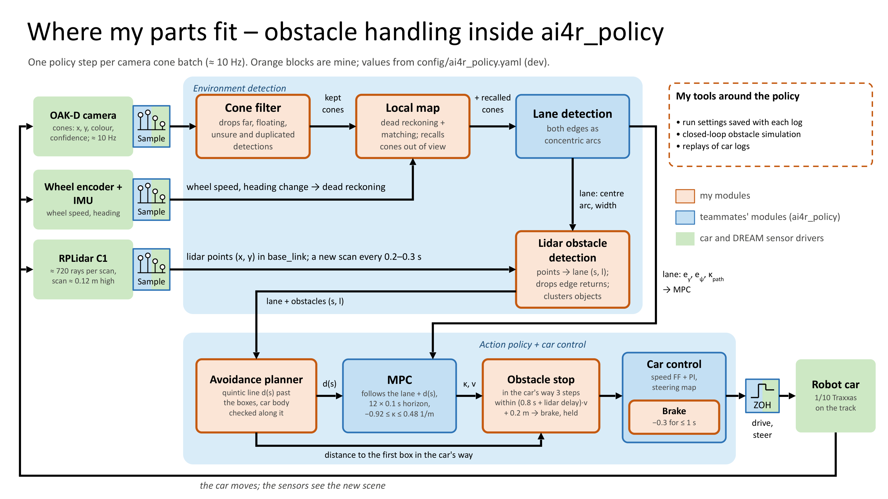

*The policy, one step per camera cone batch (about 10 Hz), drawn like the team's block diagrams: green is the car and
its sensors, blue is teammates' modules, orange is mine. Look at the lidar: its points only become obstacles once lane
detection has fitted the lane, so obstacle handling depends on a teammate's module. And every output of mine reaches
the car through the MPC and car control.*

**Purpose in the whole system.** The team's goal is to drive the cone lanes on its own and deal with obstacles in
them. Lane following (lane detection → MPC → low-level control) belongs to teammates. My job is to make sure that:

1. the lane fit only uses cones that can belong to the lane;
2. any object in the car's way is seen early;
3. the car drives around it when there's room;
4. otherwise the car stops before it, every time.

| Interface                                                  | Direction                         | What it carries                                                         | Assumption or constraint                                                                                                                                      |
| ---------------------------------------------------------- | --------------------------------- | ----------------------------------------------------------------------- | ------------------------------------------------------------------------------------------------------------------------------------------------------------- |
| `ConeBatch` from `oakd_cone_detector`                  | in                                | cone position in `base_link`, colour, confidence                      | About 10 Hz and 0.2 s late. Duplicated, floating and wrong-colour detections happen (Fig. Z2 shows the first two)                                             |
| `lidar_cartesian` (DREAM lidar TF)                       | in                                | points in `base_link`                                                 | A new scan reaches the policy only every 0.2–0.3 s and is 0.15–0.3 s old. The scan plane is about 0.12 m up, so it hits the cones and misses anything lower |
| Wheel speed                                                | in                                | m/s, for the stop distance, obstacle memory and map                     | Holds its last value near standstill, so it can't measure how far the car rolled when stopping                                                                |
| `LaneDetection` (Thanh Long; I added the recalled cones) | in                                | centre arc, width, lateral and heading error                            | Concentric arcs. The estimate jumps about 0.1 m from step to step                                                                                             |
| `LaneObstacle`                                           | between my parts                  | near and far distance $s$ along the lane, right and left offset $l$ | Lane frame. Static obstacles only                                                                                                                             |
| `LanePath` $d(s)$                                      | out, to the MPC                   | the line to follow, as an offset from the lane centre                   | A chain of quintics, so its curvature is continuous                                                                                                           |
| Obstacle distance                                          | out, to the MPC's stop logic      | metres from the car's front to the first object in its way              | The front is taken as 0.30 m ahead of `base_link` (notebook car, not measured)                                                                              |
| `DriveCommand(0, 0, brake=True)`                         | out, to `CarController` (Chris) | brake request                                                           | Drive −0.3 for at most 1 s, only straight after forward drive                                                                                                |

<a id="zhenling-3"></a>

### 2. Test methods (Standards 3 and 4)

Each module in Section 3 ends with the simulation experiments (Standard 3) and the real-car experiments (Standard 4)
that set or checked its parameters. They use the two tools below.

#### 2.1 Simulation

**The tool I built:** `tests/policy/obstacle_simulation.py` (`83b53cc`). It runs the **whole** `MovementPolicy` with
the real config, in closed loop:

- the measured lab car from `curved_lanes.py` (car 20's steering limits and trim, speed dead time and lag);
- the camera's view, noise and 0.2 s delay, with boxes hiding cones from the camera;
- a simulated 2D lidar (0.5° beams, 0.01 m noise, 0.2 s old) that hits cones and boxes;
- active braking whose travel is a setting (`--brake-s`).

12 cases, with every obstacle on a straight, and N noise seeds each. Each case is scored as pass, stop or either, and
touching a box or a cone fails it.

**Purpose:** replays of recorded drives can't show whether the policy *would have* got past, or where it would have
stopped.

**Scope of the simulation:**

- **Can:** compare settings against each other, find where the boundaries are (the 0.40 m gap, the braking
  tolerance), and catch failures before car time (a zero braking setting hit every blocking box).
- **Can't:** predict absolute gaps or pass rates. The model is kinematic (no tyre slip), the lidar is ideal (no missing
  or extra returns), and the car size and braking aren't measured. So the absolute numbers were checked on real data
  (the "On the car" parts of Section 3).

#### 2.2 On the car

**Method:** every run logs its observations, actions, memory and exact settings (`_config.json`, from my logging
change `86e5263`), so any real run can be replayed open loop through any version of the policy. The lidar measures
the distance to the box directly, so it's the measuring instrument for the stops. The obstacles were the lab's thin
sheets, at a 0.5 m/s target speed.

<a id="zhenling-4"></a>

### 3. Working principles and experiments

Each module is split the same way: working principle, then its simulation experiment (S1, Standard 3), then its
real-car experiments (E1–E4, Standard 4).

| Module                 | Simulation (Standard 3)                               | On the car (Standard 4)                                                   |
| ---------------------- | ----------------------------------------------------- | ------------------------------------------------------------------------- |
| 3.1 Cone filter        | —                                                    | E1: on an S-bend the lane fit flips between left and right bends (20 Oct) |
| 3.2 Obstacle detection | edge margin and corridor, retuned in S1 (Section 3.3) | —                                                                        |
| 3.3 Obstacle stop      | S1: retune against needless stops and hits (21 Oct)   | E2: braking travel (22 and 26 Oct)                                        |
| 3.4 Avoidance planner  | —                                                    | E3: passing boxes on the real track (26 Oct)                              |
| 3.5 Local map          | —                                                    | E4: a steadier lane estimate (22 Oct)                                     |

#### 3.1 Cone filter (no state, every batch)

##### Working principle

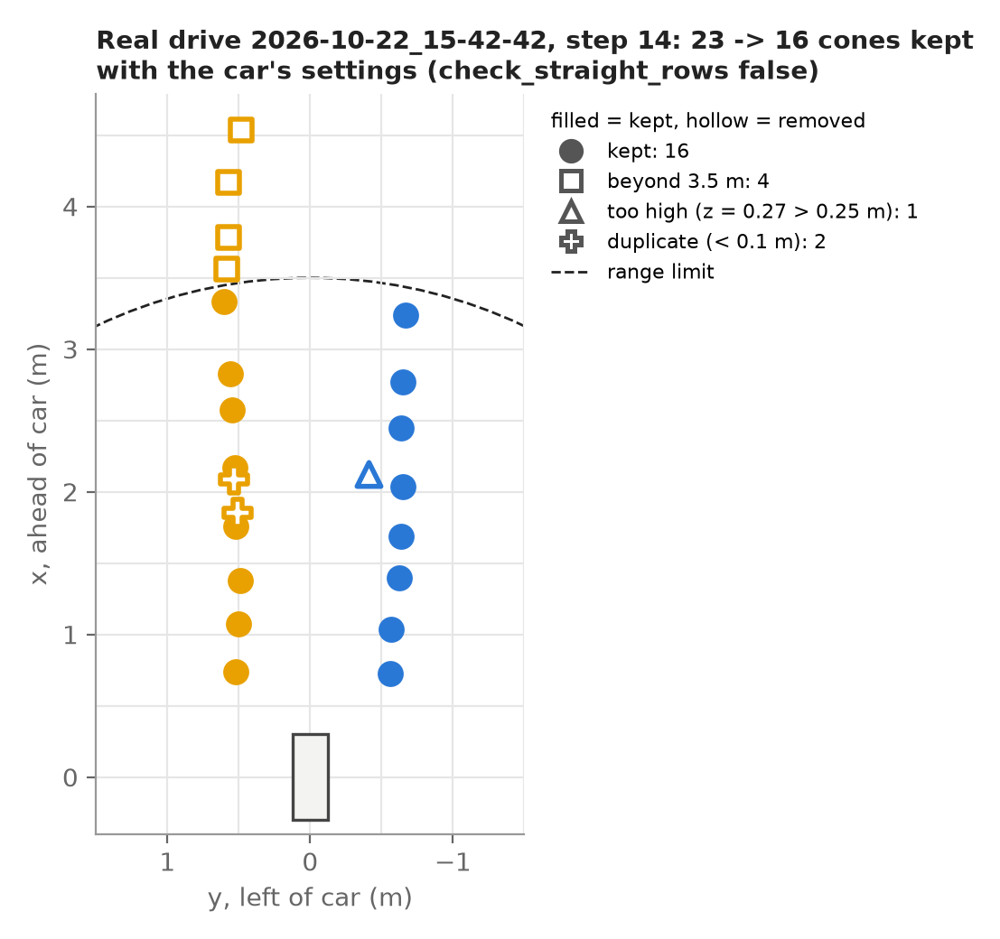

*A frame from the real drive of 22 Oct (15-42-42, step 14), filtered with the settings the car used (straight rows
off): 23 detections in, 16 kept. Hollow markers were removed: squares lie beyond the 3.5 m range limit, the triangle is
0.27 m up (above the 0.25 m height limit), and plus signs are duplicates less than 0.10 m from a kept cone.*

1. **Plausible space:** $0 < x$, $|y| \le 2.0$ m, $\sqrt{x^2+y^2} \le 3.5$ m, $-0.15 \le z \le 0.25$ m, confidence ≥ 0.5. The range limit comes from the S-bend drive
   (E1 below).
2. **Merge duplicates:** two cones of the same colour closer than 0.10 m → keep the more confident one.

##### On the car (Standard 4)

###### E1: on an S-bend the lane fit flips between left and right bends (20 Oct)

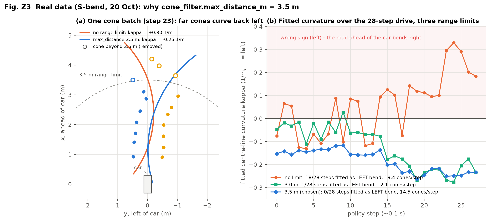

- **Problem on the car:** on the S-bend (run 14-11-49, before the cone filter had a range limit), the lane fit
  (Thanh Long's concentric arcs) jumped back and forth between a left and a right bend, and the car ran off the
  track.
- **Method:** replayed the 28 steps of that run with cone range limits of ∞, 3.0 and 3.5 m.
- **Result:** with no limit the fitted curvature has the wrong sign (left) in **18/28** steps and keeps flipping
  between left and right (Fig. Z3b); with 3.5 m in **0/28**.
  3.0 m gave 1/28 but only about 12 cones per step, and next to a box the lane fit jumped and stopped the car
  (`obstacle_track_expands`).
- **Reason:** one constant-curvature arc can't fit both halves of an S, so only the next 3.5 m or so is kept.

#### 3.2 Obstacle detection in lane coordinates

##### Working principle

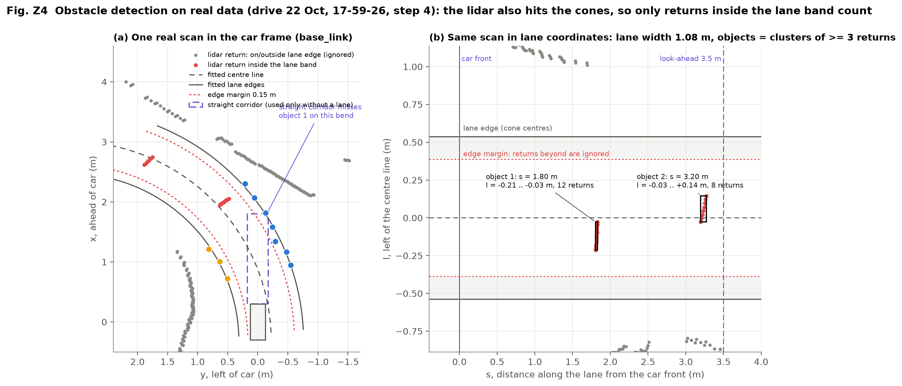

*One real scan (22 Oct, 17-59-26, step 4)*

- Each lidar point is placed on the fitted centre arc: $s$ is the distance along the lane from the car's front and $l$
  the signed offset from the centre line (closed form for concentric arcs).
- Keep $0 < s \le 3.5$ m and $|l| < w/2 - 0.15$ m. The 0.15 m edge margin covers the cone's radius at scan height plus
  about 0.1 m of edge-fit error.
- Cluster consecutive returns (in scan order) closer than 0.15 m. An object needs at least 3 returns: about 720 rays
  give about 7 returns on a 0.1 m object at 1.5 m. The first and last groups are joined, because the scan wraps
  straight ahead.
- Output for each object: near and far $s$, right and left $l$. Without a lane, a straight corridor ±0.175 m wide and
  1.5 m long is used instead, with its 3rd-nearest return.

#### 3.3 Obstacle stop

##### Working principle

A stop is requested when an object is in the car's way within

$$
d_{stop} = (t_b + t_{scan})\,\max(v_{target}, v_{measured}) + m
$$

with $t_b = 0.8$ s and $m = 0.2$ m. For a 0.2 s old scan at 0.5 m/s, that's $(0.8 + 0.2)(0.5) + 0.2 = 0.70$ m
(Fig. Z6a, E2 below).

| Term                                            | Value                    | What it covers                                        | Where the value comes from                                           |
| ----------------------------------------------- | ------------------------ | ----------------------------------------------------- | -------------------------------------------------------------------- |
| $m$, `obstacle_stop_margin_m`               | 0.2 m                    | the gap left after stopping                           | target gap. Simulation stopped 0.19 m short; real stops 0.21–0.33 m |
| $t_{scan}$                                    | each scan's age          | the car has moved $v\,t_{scan}$ since the scan      | measured: scans reached the policy only every 0.2–0.3 s (20 Oct)    |
| $\max(v_{target}, v_{measured})$              | —                       | a car going too fast still stops in time              | the 26 Oct drive reached 0.61 m/s against a 0.5 m/s target           |
| $t_b$, `obstacle_stop_distance_per_speed_s` | 0.8 s                    | braking travel per m/s of speed                       | chosen in simulation; real values vary, 0.37–0.53 s                 |
| `obstacle_confirm_steps`                      | 3                        | steps in a row the object must be inside $d_{stop}$ | the lane estimate jumps about 0.1 m per step                         |
| `brake_action`, `brake_max_s`               | drive −0.3, at most 1 s | active brake                                          | coasting needs about 1.3 m at 0.5 m/s                                |

- **The stop latches:** once the car has stopped for an obstacle, the stop is latched and the car doesn't start
  again until a person requests zero state, then state 3. Close to a box the lidar's view is poor and the box can
  drop out of it, so restarting must be a human decision.

##### Simulation (Standard 3)

###### S1: obstacle settings retuned against needless stops and hits (21 Oct)

- **Problem:** the previous settings led to early stops.
- **Method:** the previous settings against the retuned ones, 10 noise seeds per case, braking 0.6 s per m/s.
- **The five settings changed** (`83b53cc`):

| Setting                                      | Before | After   | Problem it fixes                                                                                                |
| -------------------------------------------- | ------ | ------- | --------------------------------------------------------------------------------------------------------------- |
| `obstacle_detection.corridor_half_width_m` | 0.20 m | 0.175 m | needless stops: the lane estimate jumps about 0.1 m per step, so boxes the car had room to pass entered its way |
| `obstacle_detection.lane_edge_margin_m`    | 0.10 m | 0.15 m  | needless stops: when the fitted edges jump, cone returns near an edge counted as objects in the lane            |
| `mpc.obstacle_confirm_steps`               | 2      | 3       | needless stops: two jumpy steps in a row were enough to stop the car                                            |
| `avoidance.cone_clearance_m`               | 0.10 m | 0.05 m  | needless stops: the free gap the car needs beside a box falls from 0.45 m to 0.40 m                             |
| `mpc.obstacle_stop_distance_per_speed_s`   | 0.0 s  | 0.8 s   | hitting a blocking box: the stop distance had no braking travel in it                                           |

- **Result:**

| Case (10 seeds, braking 0.6 s per m/s) | Previous                               | Retuned                     |
| -------------------------------------- | -------------------------------------- | --------------------------- |
| Box on the right, 0.5 m gap            | 3/10 OK (7 needless stops)             | 10/10 passed                |
| Box on the left, 0.5 m gap             | 7/10                                   | 10/10                       |
| Box in the middle (must stop)          | **0/10: hit the box every time** | 10/10 stopped, 0.19 m short |
| Slalom (2 boxes 2.5 m apart)           | 3/10                                   | 10/10                       |
| 1.3 m lane, box in the middle          | 4/10                                   | 10/10                       |

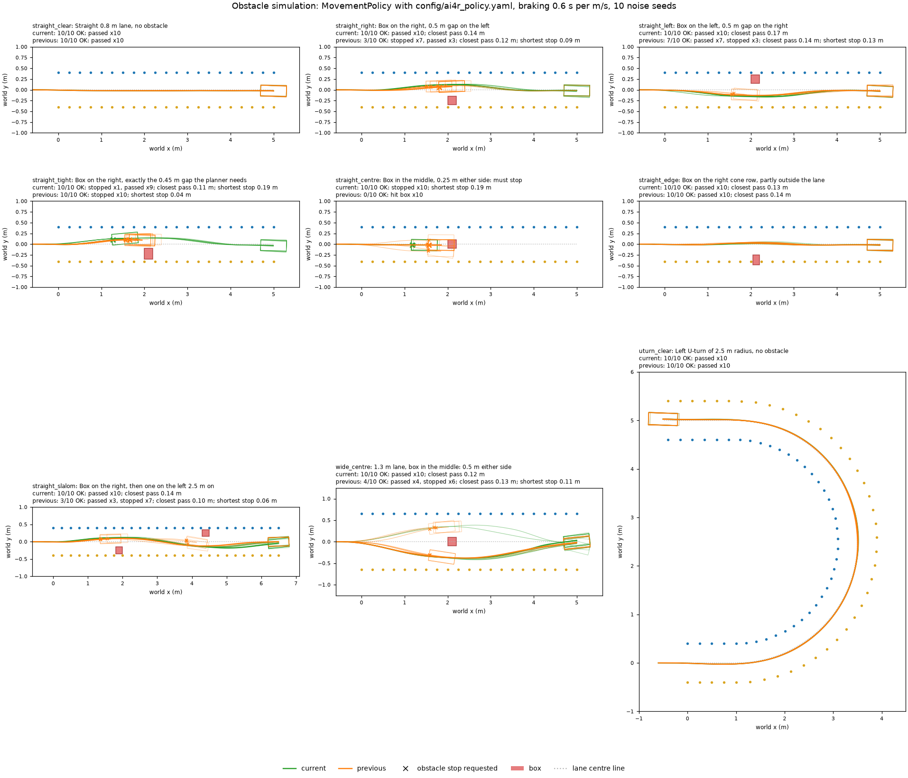

*Each panel is one case seen from above: orange = previous settings, green = retuned, × = stop requested. Look at
`straight_centre` (middle row): the previous settings hit the box in all 10 runs, and the retuned ones stopped 0.19 m
short. In `straight_right`, 7 needless stops became none.*

##### On the car (Standard 4)

###### E2: real braking travel, measured and checked

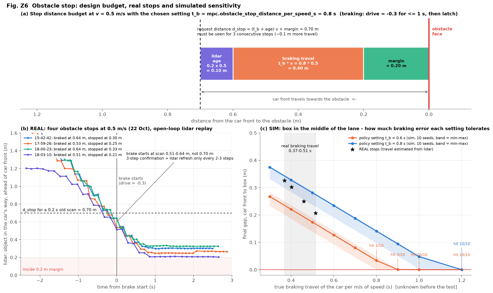

*(a) The stop distance at 0.5 m/s has three parts: the scan's age, the braking travel and the margin, 0.70 m in all.
(b) Four real stops, read from the lidar: the brake started at readings of 0.51–0.64 m, all below 0.70 m, and the car
stopped 0.21–0.33 m short. (c) Simulation, box in the middle: how much braking error each setting can take. The stars
are the real stops, on the line for the 0.8 setting.*

###### 1. Stop distance and how braking is measured

The stop distance $d_{stop}$ has three parts: the distance driven during the scan's age, the braking travel and the
margin:

$$
d_{stop} = (t_b + t_{scan})\,v + m
$$

where $v$ is the larger of the target and the measured speed (Working principle, above). With $v = 0.5$ m/s,
$t_b = 0.8$ s, a 0.2 s scan age and $m = 0.2$ m, it is 0.70 m.

To compare stops at different speeds, braking is given **per m/s of speed** (braking travel ÷ speed, in seconds, i.e.
s per m/s):

$$
t_b = \frac{d_{brake}}{v} = \frac{(d_{scan} - v\,t_{scan}) - d_{final}}{v}
$$

- **Symbols:**
  - $d_{scan}$: the lidar reading at the brake command.
  - $t_{scan}$: that scan's age (the time from the scan to the policy using it).
  - $d_{scan} - v\,t_{scan}$: the real distance from the car's front to the box, after removing the scan's age.
  - $d_{final}$: the gap between the car's front and the box once stopped.
  - $d_{brake}$: the braking travel, the difference of the two distances above.
- *Note: ignoring the scan's age (taking $d_{scan} - d_{final}$) would count the sensor's lag as braking travel.
  On 26 Oct, for example, the front was really 0.69 − 0.60 × 0.23 ≈ 0.55 m from the box and rolled
  0.55 − 0.23 = 0.32 m (0.53 s per m/s); ignoring the scan's age would give 0.77 s per m/s.*

###### 2. Measured stops

| Drive                     | Speed at the brake $v$ | Lidar reading at the brake $d_{scan}$ | Scan age $t_{scan}$ | Final gap $d_{final}$ | Measured braking per m/s $t_b$ |
| ------------------------- | ------------------------ | --------------------------------------- | --------------------- | ----------------------- | -------------------------------- |
| **22 Oct 15-42-42** | 0.50 m/s                 | 0.64 m                                  | 0.27 s                | 0.30 m                  | 0.40 s                           |
| **22 Oct 17-59-26** | 0.50 m/s                 | 0.53 m                                  | 0.11 s                | 0.25 m                  | 0.46 s                           |
| **22 Oct 18-00-23** | 0.50 m/s                 | 0.64 m                                  | 0.26 s                | 0.33 m                  | 0.37 s                           |
| **22 Oct 18-03-10** | 0.45 m/s                 | 0.51 m                                  | 0.17 s                | 0.21 m                  | 0.51 s                           |
| **26 Oct 14-10-54** | 0.60 m/s                 | 0.69 m                                  | 0.23 s                | 0.23 m (0.21–0.26)     | 0.53 s (0.48–0.56)              |

###### 3. Analysis

- **The setting checked:** all five stops measured $t_b$ = 0.37–0.53 s, well below the cautious 0.8 s, so the car
  always stopped with 0.21–0.33 m left.
- **The brake comes late:**
  - In every stop the lidar reading at the brake was below the computed threshold (on 26 Oct the threshold was about
    0.84 m, but the brake came at 0.69 m).
  - **Main cause:** the stop needs 3 policy steps in a row, and the lidar updates only about every second policy step.
    So the brake came the equivalent of 0.1–0.2 m late, which the 0.2 m margin absorbed.

###### 4. Limits and next steps

$t_b = 0.8$ s is safe for now. Later, from the real-car data, $t_b$ could come down to about 0.6 s, to cut
early stops.

#### 3.4 Avoidance planner (a local planner in the lane's Frenet frame)

##### Working principle

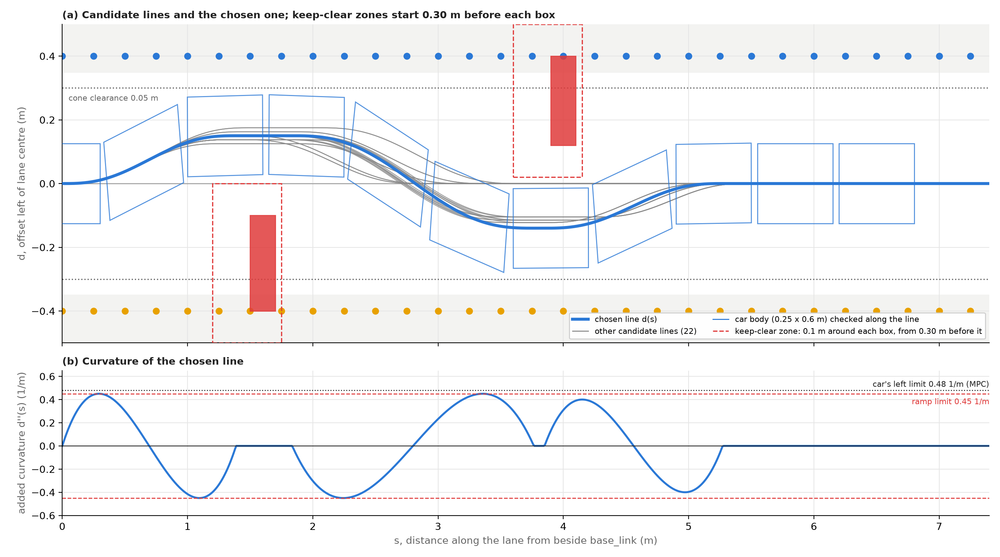

*The real planner and config in an 0.8 m lane, with a box on the right, then one on the left. (a) Grey: the 22 other
candidate lines. Blue: the chosen one, with the car's body (0.25 × 0.60 m) checked along it. Red dashes: the keep-clear
zones. (b) The chosen line's curvature is continuous and stays inside the 0.45 1/m ramp limit, below the car's 0.48 1/m
left limit.*

1. **Keep-clear stretches.** Each obstacle gets a stretch from $\max(\text{pass distance}, d_{stop})$ before it to
   0.05 m after it. Inside it, the body keeps 0.10 m from the obstacle and 0.05 m from the cones.
2. **Candidate held offsets** in each free gap: its middle, the point nearest the usual line, 5 spread points and the
   previous step's line. Obstacles whose stretches overlap are passed on one offset.
3. **Quintic moves** join the holds, matching offset, slope and curvature at both ends:

   $$
   d(u) = D\,(10u^3 - 15u^4 + 6u^5),\quad u = s/L,\qquad \max|d''| = \frac{10}{\sqrt3}\,\frac{D}{L^2}\ \Rightarrow\ L = \sqrt{\frac{10}{\sqrt3}\,\frac{D}{\kappa_{max}}}
   $$

   The half-cosine ramp of v1 had curvature $D\pi^2/(2L^2)$ at its ends, so the steering jumped at every join. The
   quintic doesn't (Fig. Z7b).
4. **Polynomial coefficients.** A move of length $L$ goes from the start state $(d_0, d_0', d_0'')$ (offset, slope,
   curvature) to the end state $(d_1, d_1', d_1'')$, with $t = s - s_i$. The six end conditions fix the six
   coefficients, and they give the one quintic that does this.
5. **Building the candidates:** each candidate is one `LanePath` of holds and quintic moves, built group by group of
   obstacles, nearest first.

   - **First group:** hold the current line, then take the shortest move to one of the candidate offsets from item 2,
     arriving just as the car's front reaches the keep-clear stretch.
   - **Each later group:** from the previous group's offset to this group's, in 4 ways: keep holding if the offset is
     the same; a compressed move for the quickest change; a move stretched over the whole gap; or back to the usual
     line and out again.
   - **After the last group:** one move back to the usual line, at the earliest point where the body already keeps
     its clearances.
6. **Ranking**, in this order: obstacles passed (nearest first) → how close it comes to passing the next one → already
   beside the obstacle before the stop distance → lowest cost

   $$
   J = \Delta s \sum \Big[w_{dev}(d - d_{usual})^2 + w_{smooth}\,\kappa_{add}^2 + w_{change}(d - d_{prev})^2\Big] - w_{clear}\cdot\text{room}
   $$

   with weights 1, 1, 1 and 5.
7. **Output: one line $d(s)$ per step, in lane coordinates.** The planner returns a `LanePath`: the usual offset, and
   the segments that leave it. Segment $i$ runs from $s_i$ to $e_i$ and is a quintic in the distance from its start
   (a hold keeps only $c_{i0}$):

   $$
   d(s) = \begin{cases} \sum_{j=0}^{5} c_{ij}\,(s - s_i)^j, & s_i \le s \le e_i \\ d_{usual}, & \text{elsewhere} \end{cases}
   $$

   $s$ runs along the centre arc from beside `base_link` and $d$ is left of the centre line, so the same $d(s)$
   describes the line on a straight or a curve, and nothing is turned back into $(x, y)$.

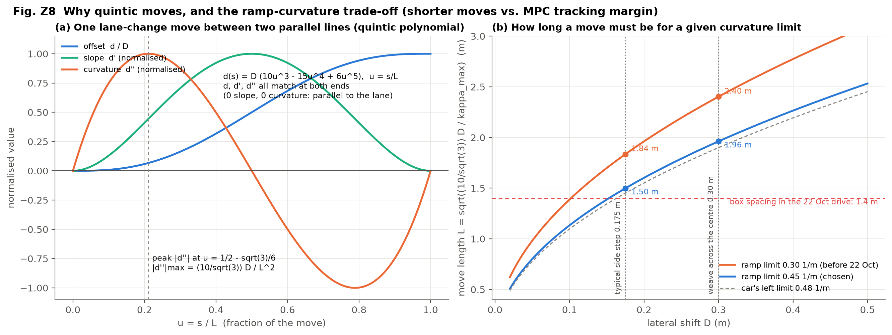

*(a) One quintic move: its curvature (orange) starts and ends at zero, so the steering doesn't jump at the joins.
(b) How long a move must be for a given curvature limit. Crossing the centre (0.30 m) takes 2.40 m at 0.30 1/m but
1.96 m at 0.45 1/m; both are longer than the 1.4 m between the boxes on 22 Oct.*

##### On the car (Standard 4)

###### E3: passing boxes on the real track (26 Oct, run `2026-10-26_14-10-54`, see the video)

- The car passed two boxes, on the right and then on the left (1.4 m apart), without stopping, then stopped for a
  third. The third box was in the middle of the lane, with free gaps of 0.31 m and 0.12 m on its two sides, both below
  the 0.40 m the car needs, so no line could pass it. The stop logic braked at a lidar reading of 0.69 m, and the car
  stopped 0.23 m short of the box (E2 in Section 3.3).

#### 3.5 Local map (memory)

##### Working principle

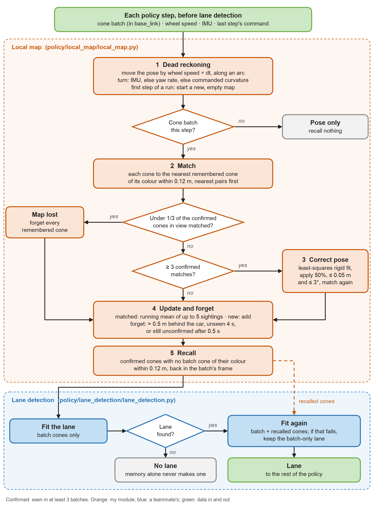

*The local map at each policy step (orange), and how lane detection uses the cones it recalls (blue). The values
are the ones in `local_map.py` and `config/ai4r_policy.yaml`.*

- **Dead reckoning:** pose += wheel speed × dt along the heading.
- **Matching:** each new cone matches the nearest remembered cone of its colour within 0.12 m (less than half the cone
  spacing).
- **Correction:** with at least 3 confirmed matches (each cone seen at least 3 times), a least-squares rigid fit
  (rotation + shift) of the batch onto the memory. Half of it is applied each step, capped at 0.05 m and 3°, so
  detector noise is averaged and odometry drift doesn't build up while cones are in view.
- **Recall and forget:** confirmed cones not in the batch (beside the car, or hidden behind boxes) are recalled for lane
  detection. A cone is forgotten 0.5 m behind the car, after 4 s unseen, or if it's still unconfirmed after 0.5 s. If
  fewer than a third of the expected cones match, the map resets.
- **Use in lane detection:** it first fits the batch alone. Only if that gives a lane does it fit again with the
  recalled cones added, and it keeps the batch's own lane if the second fit fails. So a lane is never made from memory
  alone, and the end of the cone rows is still seen. With one edge in view, recalled cones of the other colour can
  complete the second edge. An edge whose colour has never been confirmed can't be filled.

##### On the car (Standard 4)

###### E4: the local map steadies the lane estimate, and the car used it

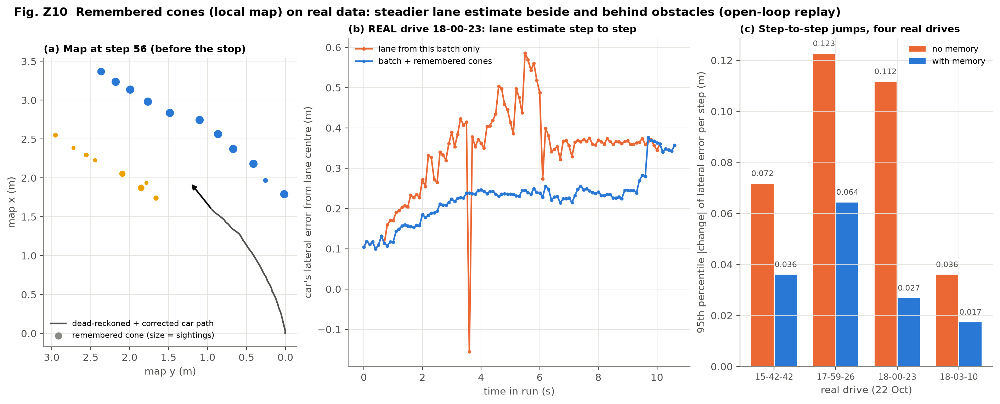

*(a) The map at step 56 of drive 18-00-23: remembered cones (size = sightings) and the dead-reckoned path. (b) The
lateral error from the batch alone (orange) jumps by up to 0.57 m; with remembered cones (blue) it's steady.
(c) The 95th-percentile step-to-step jump falls by half or more in all four 22 Oct drives.*

<a id="zhenling-5"></a>

### 4. Lessons and limits

**Lessons:**

- **Build the safe fallback first.** The stop came before avoidance, so every later feature had something safe to fall
  back on.
- **Use the sensor that measures what you need.** Wheel speed holds its last value near standstill, so odometry said
  the car travelled 1.1–1.25 m while braking. The lidar showed 0.32 m.
- **Account for the data's age.** The 26 Oct brake came at a 0.69 m lidar reading, but that scan was 0.23 s old: the
  front was really about 0.55 m from the box.
- **Replay with the code that drove.** Only `99c12ef` reproduces the October drives step for step; later `dev`
  gives different lane and obstacle values.
- **Simulate before car time.** The closed-loop simulation showed that a zero braking setting hits every blocking box
  before any car time was spent on it.

**Limits and next steps:**

- The car's size, its steering limits after the trim change, and braking on a stand are still **not measured**. →
  measure them, then re-run the simulation with the measured values.
- Static obstacles only. After an obstacle is removed, the car stays stopped until a person restarts it.
- Two boxes on opposite sides less than about 1.2 m apart in a 0.8–1.1 m lane need more curvature than the car has, so
  it stops.

---

<a id="peiyu"></a>

## Part 4: Peiyu Wang: MPC sub-team, Stage 1 design and the tools to check car runs


| | |
| --- | --- |
| Role | MPC sub-team. Stage 1 task list and Card 1, the MPC framework and the first car run, the Stage 1 design (baseline, MPC, RL, milestone M1), lane-end and lost-lane stops, car models and control settings, then tools to see and measure car runs |
| PRs | #1 (MPC framework), #8 (first car run), #16 (Stage 1 MPC with Chris's control and car models), #25 (Foxglove export and live markers), all merged into `dev` |
| Open work | #18 (one control setting for car 20 and car 22), #24 (cone detector RGB image off), #31 (step timing and run summary), #32 (`run_report`): pushed, not merged. #18, #24 and #31 need a human's recorded diff review |
| Built on teammates' work | Ciaran: repo, CI and the upload script. Toby: Card 2 test cases, the dream-gym harness and the lab calibration (#15). Chris: `CarController` and car 20's steering calibration (5 Oct). Yuhao: the MPC's measured-speed prediction and input validation. Thanh Long: lane estimation (`LaneDetection`). Zhenling: cone filter, obstacle detection and the local map |
| Figures | `peiyu/figures/`, made by `python3 docs/logbook/peiyu/make_figures.py --simulate` (see its docstring for the commits it simulates) |

**Summary: four pieces of work, in order** (the same as my slide):
1. **MPC lane follower and the first car run.** I built the first MPC and a temporary conversion to drive and
   steering. Then I measured the time budget on car 20 and the MPC's calculation time on its computer (Sections 2.1,
   2.2 and 4.1).
2. **Choosing MPC or RL for Stage 1.** I ran a pure pursuit baseline, a grid of 324 MPC options and a PPO steering
   policy on the same harness. On the unseen cases the MPC passed every case and RL didn't, so the MPC was chosen
   (Sections 2.4, 3.2–3.4).
3. **Lane end and lost lane.** The car now stops in the lane-end zone instead of short of it. If the lane is lost it
   slows for 0.5 s, then stops. I also made measured car models, so one control setting can be checked on every car
   (Sections 2.3, 3.1, 3.5 and 4.2).
4. **Seeing and measuring car runs.** Live markers and MCAP replay in Foxglove, a timing summary of every run, and
   `run_report` for each recorded drive. I also traced the cone detector crash on car 22 to OpenCV 5 (Sections 2.5,
   4.3–4.5).

On real cars: the time budget and the MPC's calculation time (car 20), and speed control and the lost-lane stop
(car 22). I also fixed the detector crash on car 22. Car 22's steering didn't work on 12 Oct, so my own car sessions
didn't show the full lane follower. The M1 choice and the lane-end stop distances are simulation only.

Alongside these, I kept the cars running through repeated crashes (detector, USB, CPU, battery) and resolved the
merge conflicts when four branches landed on `dev` together (Section 5).

<a id="peiyu-1"></a>

### Timeline

| Week | What I did | Evidence |
| --- | --- | --- |
| 0 (27 Sep) | The Stage 1 movement-policy task list: Cards 1–3, shared defaults, milestones M1 and M2 | `46dc984`, `docs/movement-policy-tasks.md` |
| 1 (5–6 Oct) | MPC framework, a temporary drive/steering conversion, the first car run, a lane-loss hold. Card 1 and the time budget measured on car 20. Stage 1 design: A2–A7 and M1. Car 20 stand tests. RC-assisted open-space policy | PR #1, PR #8, `b0230ac`, `e7fc407`, `da0fd8c`, `15df539`, `9a7f9d8`, `47f8838`, `7e30078`, `docs/stage1-design.md` |
| 2 (12 Oct) | Merged Chris's control into the Stage 1 MPC. Measured car models. Car 22 floor run. One control setting for both cars. The OpenCV 5 detector crash | PR #16, `0f02b2a`, `350fa3b`, PR #18, PR #24 |
| 3 (19–20 Oct) | Foxglove live markers and MCAP export of data logs, deployed on car 20. Each run starts at `mpc.lane_side`. Camera-pan prototype simulation, exported to Foxglove | PR #25, `31b80f1` (in PR #27), `230c75b` |
| 4 (22 Oct) | Step timing and a run summary in `policy_node`. `run_report` measured the 22 Oct car logs | PR #31, PR #32 |

---

<a id="peiyu-2"></a>

### 1. Where my parts fit (Standard 1)

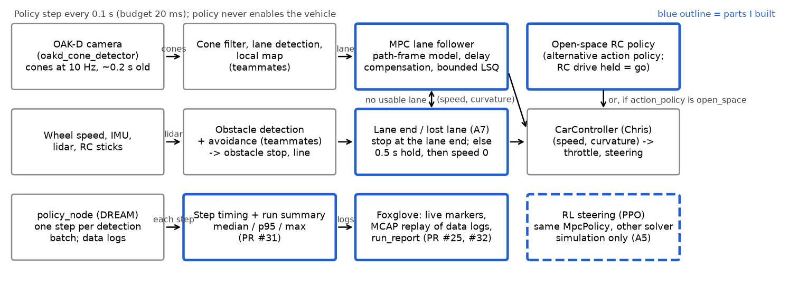

*The MovementPolicy pipeline, run once per cone detection batch within a 20 ms budget. Blue boxes are the parts I
built. Grey boxes are teammates' parts that mine depend on. The dashed box ran in simulation only.*

**Purpose in the whole system.** Stage 1 asks the car to follow a lane of cones, hold its speed and stop at the lane
end. My parts turn the lane estimate into a speed and a curvature, and decide what to do when there's no lane. They
also record and show every step, so a car run can be checked afterwards.

| Interface | Direction | What it carries | Assumption or constraint |
| --- | --- | --- | --- |
| `LaneDetection` (teammates; `reference_from_cones` before it existed) | in | lateral error, heading error, path curvature, lane width | Measured when the image was taken, about 0.2 s before the step. The MPC predicts the car forwards by that age |
| Observation age (`sensor_age`) | in | seconds since the camera image | 0.197 s detector latency, measured on car 20 on 6 Oct |
| Wheel speed | in | m/s, unsigned | Encoder estimate at 44 Hz, with gaps of up to 0.32 s (car 20). The lost-lane distance uses the larger of it and the requested speed, so a stuck reading stops the car early, never late |
| (speed, curvature) to `CarController` (Chris) | out | m/s, never negative (0 asks for a stop); 1/m, left positive | One command per detection batch. Until Chris's controller was on `dev`, my temporary `CarControl` (PR #8) converted it |
| `debug1`, `debug2` | out | lateral error (m) and heading error (rad), positive left | Lets Foxglove plot the lane estimate, also while the car is stopped on a stand |
| Data logs and `policy_visualisation/markers` | out | every step's observations, actions and settings; the policy's cones, lane and plans | The offline tools replay a log through the current code, so a replay can choose other actions than the car did |

**Requirements my parts are judged by.** The Stage 1 requirements and their thresholds are in the team overview
(0.1). This is where each one depends on my parts:

| Id | What of mine it depends on |
| --- | --- |
| R1a | MPC weights and horizon (3.2); following the last plan while the lane is lost (2.3) |
| R1b | Lateral weight and delay compensation (2.1). T11 fails it because of the tyre model (3.1) |
| R2 | Horizon: 12 steps touched cones on T11 (3.2) |
| R3 | The temporary drive conversion (2.2), then the control setting checked on every car model (3.1) |
| R4 | Curvature-change weight (3.2). RL failed it on the unseen cases (3.4) |
| R5 | Lane-end rule and the roll-out setting (2.3, 3.5) |
| R6a | Bounded least squares with an iteration cap (2.1); measured on car 20 (4.1) |
| R6b | The fallback keeps the previous curvature and is counted (2.1) |
| R7 | The lost-lane bridge, 0.5 s (2.3). Mine: at most 0.6 s from the first batch without the lane (0.8 s counting the 0.2 s age) |

**Design goals and the choices they forced:**
- **One command per detection batch, well inside 20 ms.** Batches arrive every 0.1 s and the vehicle command times
  out after 0.5 s, so a step gets a fifth of the gap. The MPC is a small bounded least-squares problem with a fixed
  iteration limit, not a general solver.
- **Never move on a guess.** The car waits, stopped, until the first usable lane of a run. A lost lane gets a short
  bridge, then a stop that only a restart clears. The temporary controller gave zero drive without a wheel speed.
- **Compare designs on the same harness.** The baseline, the MPC and the RL policy all run inside `MpcPolicy`, with
  the same cone filter, reference and lane-end rule. Only the steering differs.
- **Record first, explain later.** Any car step can be replayed into Foxglove and measured with one command, so a
  car session's failure can be studied off the car.
- **System-level consequence:** the lane-end stop depends on the car's roll-out after a stop request
  (`stop_distance_per_speed_s`). That's a Car Control property. It is 0.6 s with the simulation's stand-in control,
  and 2.1 s for car 22, taken from its model's coast time constant because stops coast. Neither has been measured on
  a car yet (team table, 0.7), so my stop is only as good as that number.

<a id="peiyu-3"></a>

### 2. How it works (Standard 2)

#### 2.1 MPC lane follower (my framework, PR #1; tuned in Task A4)

A linear path-frame model, with lateral error $e$, heading error $\psi$ and commanded curvature $\kappa$. The car
drives a distance $d = v\,\Delta t$ each step, with $\Delta t = 0.1$ s, over $N = 20$ steps (1 m at 0.5 m/s):

$$e_{k+1} = e_k + d\,\psi_k + \tfrac{d^2}{2}(\kappa_k - \kappa^{path}_k), \qquad \psi_{k+1} = \psi_k + d\,(\kappa_k - \kappa^{path}_k)$$

$$\min_{\kappa_0..\kappa_{N-1}} \sum_k 3\,e_k^2 + 1\,\psi_k^2 + 0.1\,(\kappa_k - \kappa^{path}_k)^2 + 3\,(\kappa_k - \kappa_{k-1})^2 \quad\text{s.t.}\quad |\kappa_k| \le 3.0$$

- Solved as bounded-variable least squares (`scipy.optimize.lsq_linear`, `method="bvls"`, at most $4N$ iterations).
  On car 20's computer, a solve took 0.46 ms median and 0.53 ms at the 99th percentile for $N = 20$ (Section 4.1).
- **Delay compensation:** the observation is about 0.2 s old. So the state is first predicted forwards by
  $d_0 = v \cdot \text{age}$ with the previous command:
  $e \leftarrow e + d_0\psi + \tfrac{d_0^2}{2}(\kappa_{prev} - \kappa^{path})$ and
  $\psi \leftarrow \psi + d_0(\kappa_{prev} - \kappa^{path})$.
- Only the first curvature is sent. The problem is solved again with the next batch.
- The weights above are the Task A4 choice (Section 3.2). On `dev`, Toby's lab calibration (#15) later set them to
  10/1/0.1/2, with car 20's limits of 0.48 1/m left and 0.92 1/m right, to keep curves (his Section 2.1).
- **What the weights mean.** Only their ratios matter. Being 0.1 m off centre costs 3 × 0.1² = 0.03. That is the
  same as about 10° (0.17 rad) of heading error, or a 0.1 1/m change of curvature between two steps. The small
  curvature weight (0.1) keeps the best curvatures unique.

**As a least-squares problem.** Stack the predicted states after steps 1 to N as
$x = F x_0 + G\,(u - \kappa^{path}\mathbf{1})$, with $u = (\kappa_0, \dots, \kappa_{N-1})$. Every cost term is then a
squared linear function of $u$, so the cost is $\lVert M u - c \rVert^2$:

$$M = \begin{bmatrix} W^{1/2} G \\ \sqrt{0.1}\, I \\ \sqrt{3}\, D \end{bmatrix}, \qquad c = \begin{bmatrix} -W^{1/2}\,(F x_0 - G\,\kappa^{path}\mathbf{1}) \\ \sqrt{0.1}\,\kappa^{path}\mathbf{1} \\ \sqrt{3}\,\kappa_{prev}\,e_1 \end{bmatrix}$$

- $W = \mathrm{diag}(3, 1, 3, 1, \dots)$ holds the lateral and heading weights. $D$ takes the difference of consecutive
  curvatures, and its first row compares $\kappa_0$ with the previous command $\kappa_{prev}$.
- $M$ depends only on the settings, so `MpcController` builds it once. Each step only changes $c$: the
  delay-compensated state $x_0$, the path curvature and the previous command.
- **Why `bvls`:**
  - The only constraints are bounds on each $u_k$, which bounded-variable least squares solves exactly.
  - `max_iter` = $4N$ caps the calculation time per step (R6a).
  - SciPy is already on the car's computer.
- **If it doesn't converge**, the Stage 1 policy kept the previous curvature and counted a fallback (R6b). There were
  none in any A4 run. Yuhao later made a failed solve request a stop instead (his Section 2.1).

**Model assumptions, and where they break:**

| Assumption | Why it's reasonable | Where it breaks |
| --- | --- | --- |
| Small heading error: $\sin\psi \approx \psi$, $\cos\psi \approx 1$ | At 15° (U2's start) $\sin\psi$ is 1% below $\psi$ | Large heading errors, such as after a lost lane |
| Constant speed over the horizon, equal to the target speed | Car Control holds the speed (R3) | A car faster than the target travels further than predicted. Car 22 drove 1.4 m/s for 0.5 m/s (4.2). Yuhao later predicted with the measured speed |
| No slip: the car travels where its body points (kinematic) | A 3 kg car at 1 m/s on a dry floor | T11, wet floor: a steady 6° sideslip leaves the car 0.25 m off centre (3.1) |
| Path curvature constant over the horizon | Straight lanes and constant curves | A curve's start isn't anticipated; the plan uses today's curvature for all N steps |
| Each curvature is reached within its step | The only lag modelled is the 0.2 s detection age | A slow steering servo. R4's limit is about a fifth of the simulated servo's rate limit |

**Constraints: what is in and what is left out:**

| Item | How it's handled | Reason and effect |
| --- | --- | --- |
| Curvature limit | Hard bound, $\lvert\kappa_k\rvert \le \kappa_{max}$ | The steering can't turn further. A bound on each variable is all `bvls` takes, and the problem always has a solution. The default 3.0 1/m is tan 45° / 0.335 m. #15 replaced it with car 20's measured 0.48 left and 0.92 right |
| Steering rate | Cost (curvature-change weight), not a constraint | A rate limit constrains differences of the variables. `lsq_linear` takes only bounds, so it would need a general QP solver. The cost already keeps R4 well under 1.0 (0.16 mean for the A4 choice) |
| Lane edges ($\lvert e_k \rvert$ below half the free width) | Left out; the lateral weight pulls to the centre instead | A hard state limit makes the problem infeasible when a noisy or delayed observation already puts the car near an edge, and then there's no command. Without it the problem always has a solution |
| Speed | Not a variable of the MPC | Car Control holds the speed (R3), and only the A7 rule changes it. With speed as a variable, speed × heading would make the model bilinear, not linear |

#### 2.2 From (speed, curvature) to drive and steering: the temporary conversion (PR #8)

Car Control's own conversion wasn't ready for the first car run, so `CarControl` stood in for it:

- **Steering:** a bicycle model, $\delta = \arctan(L\,\kappa)$, sent as $\delta / \delta_{max}$ clipped to $[-1, 1]$,
  with a sign setting (`positive_steering_turns_left`) to check on a stand.
- **Drive:** feedforward plus PI on the wheel speed, forwards only, capped at `max_drive_effort` (0.2 at first). It's
  zero when stopping and when the wheel speed is missing.
- On 12 Oct, Chris's measured `CarController` replaced it (PR #16). The stand tests that shaped it are in Section 4.1.

#### 2.3 Lane end and lost lane (Task A7)

When the car sees no cones or only one side, `MpcPolicy._command_without_lane` applies these rules:

1. **One row visible:** carry on at full speed, with the lane centre half a lane width from that row.
2. **No usable lane, and the farthest cone last seen was at most 1.5 m ahead** (`lane_end_distance_m`): the rows have
   ended. Keep the speed, follow the last plan, and request the stop once the car is at its roll-out distance
   (`stop_distance_per_speed_s` × speed) from a point 0.25 m past that cone (`lane_end_stop_past_m`).
3. **No usable lane otherwise:** the lane was lost unexpectedly. Follow the last plan at half speed for at most 0.5 s
   (`lane_loss_timeout_s`). If the lane comes back, carry on; otherwise request the stop.
4. After a lost-lane stop, the car stays stopped until the policy is restarted. Distances are dead-reckoned from the
   larger of the wheel speed and the requested speed.

| Setting | Value | Why this value, or what it does |
| --- | --- | --- |
| `lane_end_distance_m` | 1.5 m | It must be above about 0.6 m, where the last pair leaves the 80° view (more on wider lanes). It must also be below the range the camera reliably sees cones at (4 m shared default; Task A1), so a loss with cones far ahead still counts as unexpected. `policy_runner` refuses a cone filter range at or below it |
| `lane_end_stop_past_m` | 0.25 m | The middle of R5's 0 to 0.5 m zone, so the stop has 0.25 m of margin for roll-out error either way |
| `stop_distance_per_speed_s` | 0.6 s in simulation, 2.1 s for car 22 (#16) | Roll-out distance per m/s after a stop request. 0.6 s matches the simulation's stand-in control. 2.1 s is car 22's coast time constant from its model, since stops coast. Not measured on a car yet (team table, 0.7) |
| `lane_loss_timeout_s` | 0.5 s | It counts up by the 0.1 s step from the first batch without a lane, so the stop is requested on the fifth such batch: 0.4 s after the first. With the 0.2 s age that's 0.6 s after the loss (T12), inside R7. A starting value, kept short because the followed plan only covers the horizon |
| `lane_loss_speed_fraction` | 0.5 | Halves the distance driven on a stale plan while waiting for the lane to come back. The plan is indexed by the distance driven, so it doesn't run out faster at half speed |

**R7 (my requirement):** the time from losing the lane to the stop request is at most 0.8 s, counting the 0.2 s
detection age (0.6 s from when the policy first receives a batch without the lane).

#### 2.4 RL steering policy (Task A5)

A PPO policy (stable-baselines3) replaces only the MPC's solver inside `MpcPolicy`, so the cone filter, speed and
the A7 rule stay the same.

- **Observation:** lateral and heading error from the cones, whether the lane is usable, the last two curvature
  requests (so it can allow for the 0.2 s delay), the detection age and the requested speed. Nothing comes from the
  simulator's ground truth.
- **Action:** the curvature, up to ±1.5 1/m.
- **Reward per step** (ground truth, training only), with a bounded penalty $P(x, s) = 1 - e^{-(x/s)^2}$:
  $r = 1 - a\,P(y, 0.1) - b\,P(\psi, 0.1) - c\,P(\dot\kappa, 1.0)$. Touching a cone ends the episode with −20, and
  reaching the last pair gives +10. Since $a + b + c < 1$, every step in the lane earns a positive reward.

| Option | a (lateral) | b (heading) | c (curvature rate) |
| --- | --- | --- | --- |
| tracking | 0.6 | 0.2 | 0.05 |
| balanced | 0.5 | 0.2 | 0.2 |
| smooth | 0.35 | 0.2 | 0.4 |

- **Domain randomisation** every episode: lane width 0.8–1.2 m, cone spacing 0.5 or 0.75 m, start ±0.2 m and up to
  15°, speed 0.5–1.2 m/s, noise 0–0.03 m, extra delay 0–0.2 s, camera range 3–4 m, mass 2.5–3.6 kg, and the dynamic
  tyre model on a dry or wet floor in 2 episodes of 5.
- **Training:** two 64-unit hidden layers, 8 parallel environments, learning rate 3e-4, discount 0.98, 300,000 steps
  per option, seed 0.

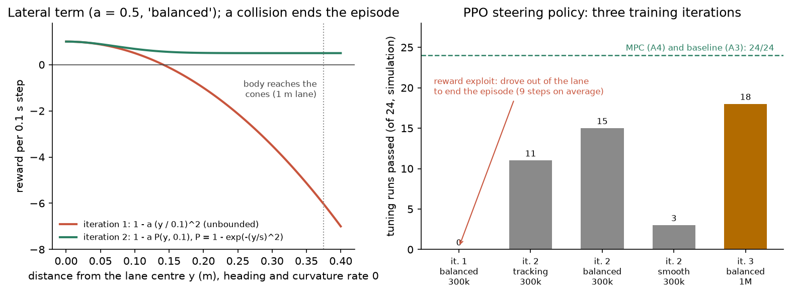

*Left: the lateral term of the reward before and after the fix. Right: tuning runs passed after each training
iteration. Numbers from `docs/stage1-design.md`, A5.*

#### 2.5 Seeing and measuring a drive (PR #25, #31 and #32)

- **One drawing for both live and replay.** `policy/visualisation.py` draws each step as plain shapes in `base_link`:
  detected and used cones, remembered cones, the lane, obstacles, the avoidance line, the MPC's predicted path,
  markers, and the car with a text summary.
  - `policy_node` publishes these shapes live on `policy_visualisation/markers`.
  - `scripts/mcap_export.py` replays a data log through a new `MovementPolicy` and writes the same layers to an MCAP
    file. It also writes `/policy/state` for plots, including the replayed and logged actions side by side.
  - The Foxglove layouts are in `docs/foxglove/`.
- **Run summary (PR #31).** `policy_node` times each step. When a run ends, it logs one line: the run's length, what
  ended it, the MPC's latched stop, and the median, p95 and max of the calculation time, the time between steps and
  the age of the triggering sample. The line is logged after the zero actions, and a failure only warns, so it
  can't delay a stop.
- **`run_report` (PR #32)** replays recorded drives and reports for each one:
  - the step interval;
  - lane errors while driving, with implausible headings and heading jumps;
  - side clearance to lidar returns beside the body;
  - whether obstacles were passed or the MPC stopped for one;
  - lane errors after the obstacles.

#### 2.6 RC-assisted open-space policy (6 Oct)

An alternative action policy (`action_policy: open_space`, `policy/action_policy/open_space.py`). The operator holds
the RC drive forwards to let the car move, and the RC steering sets the preferred heading. The policy picks the
heading with the most clearance from the cones (seen, plus those remembered from the last `cone_memory_s`) and
steers along it with pure pursuit. With no open heading, it stops. It's covered by `tests/policy/test_open_space.py`;
no car run of it is recorded in the repository.

<a id="peiyu-4"></a>

### 3. Simulation (Standard 3)

#### 3.1 Making the simulation behave like our car (Task A2, 6 and 12 Oct)

- **Question:** what must the simulation match about our cars before its results can guide car settings?
- **Detection age.** Every batch now reaches the policy 0.2 s after it was taken, as measured on car 20. The tuning
  cases still pass, and the lane-end stop became more even (0.21 to 0.24 m past the last pair).
- **T11 explained.** On the wet floor, dream-gym's tyre model settles into a steady sideslip under the MPC: the body
  is turned 6° left while the car travels straight. The kinematic MPC takes the body heading as the direction of
  travel, so it keeps steering right and ends 0.25 m off centre. A 3 kg car at 1 m/s should need almost no slip, so
  the tyre presets are probably not scaled for a 1:10 car. T11 stays `xfail` until a real car is checked.
- **Measured car models (12 Oct).** The car responds to `CarController`'s actions as a measured car does: a
  first-order speed response, and the inverted steering map with each direction's limit.
  - car20 comes from Chris's 5 Oct calibration; its time constants aren't measured.
  - car22a and car22b are two equally good fits of one car 22 run, because its speed never settled.

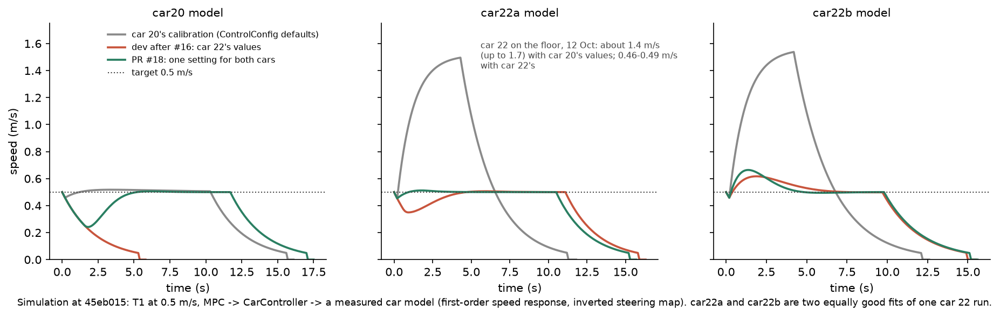

*T1 at 0.5 m/s on each car model with three control settings (simulated at `45eb015`).*

- **Results:**
  - With car 20's calibration, both car 22 models drive about 1.4–1.5 m/s for a 0.5 m/s target, as car 22 did on
    the floor.
  - With the car-22 values that `dev` got from #16, the car20 model never reaches the target: 0 of 12 cases.
  - The PR #18 setting passes 10, 11 and 11 of 12 on car20, car22a and car22b. The misses are T11 (the tyre model)
    and T9 on car20, which only needs more than the 20 s simulation limit.
- **Decision:** one shared control setting, and a test that checks the yaml against every car model (in PR #18, not
  yet merged).

#### 3.2 A3 baseline and A4 MPC: which settings? (6 Oct)

- **Question:** what are the best MPC settings, and does the MPC beat a simple tracker?
- **Baseline method:** a cone-only pure pursuit with the same reference and lane-end rule. It steers along the arc
  to the centre-line point a lookahead $L$ ahead:
  $\kappa = g\,\dfrac{2\,y_L}{L^2 + y_L^2} + \kappa^{path}$, where $y_L = -e - L\tan\psi$ is how far left of the car
  that point is, and $g$ is a gain. It ignores the detection age, as a simple tracker would. Lookahead 0.5–1.5 m,
  gain 0.5–1.5. Lookahead 1.0 m with gain 1.0 passes all 12 tuning cases, with and without 0.03 m of noise.
- **MPC method:** a grid of 324 options:
  - horizon 12, 20 or 30 steps;
  - lateral weight 3, 10 or 30;
  - heading weight 0.3, 1 or 3;
  - curvature-change weight 0.3, 1, 3 or 10;
  - curvature limit 3, 1 or 0.5 1/m.

  Each option ran the 12 tuning cases with their own noise and again with 0.03 m: 24 runs. 73 options pass all 24.

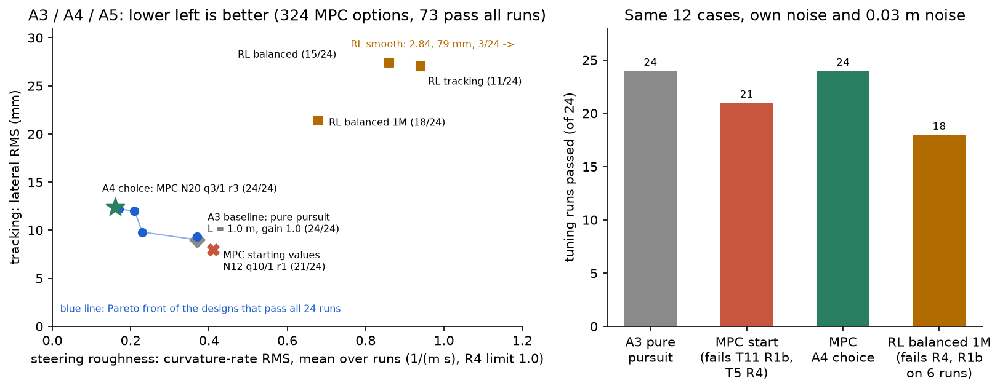

*Left: each design's tracking (lateral RMS) against its steering roughness (curvature-rate RMS), as the mean over
the 24 runs. Lower left is better. The blue line is the Pareto front of the MPC options that pass all 24 runs, and
the star is the A4 choice, the smoothest on it. The RL points are from Section 3.3. Right: tuning runs passed, of 24.*

- **Result:** the starting values failed T11 (R1b) and, with noise, T5 (R4: 1.02 against 1.0). I chose horizon 20
  and weights 3/1/0.1/3, the smoothest design on the front:
  - curvature-rate RMS 0.16 mean and 0.45 worst;
  - passes all 24 runs with no solver fallbacks.

  The baseline tracks about 3 mm better against a 375 mm margin to the cones, but steers 2.3 times more roughly.
- **What the grid showed:**
  - A lateral weight of 30 never passes: it amplifies the detector noise.
  - 12 steps can touch cones on T11; 20 and 30 behave the same.
  - The curvature limit hardly matters here (at most 0.51 1/m was used).
- **A judgement that reversed:** I expected the MPC to beat the baseline as it was. It lost on T11 and on noisy
  steering. The starting weights leaned too hard on the lateral error for a small car with noisy, delayed cones.
  Lowering it and raising the curvature-change weight fixed both.

#### 3.3 A5 RL steering: can a learned policy do better? (6 Oct)

- **Iteration 1 found a reward exploit.** With unbounded penalties, the `balanced` policy steered out of the lane on
  purpose. Training episodes lasted 9 steps on average and none reached the end, and it failed all 24 tuning runs.
  Away from the centre, a step cost more than the single collision penalty (the curvature-rate term alone reached −22
  a step), so ending the episode early gave the best return. Bounded penalties fixed it (Section 2.4, figure 02).
- **Iterations 2 and 3:** all three options now drive the lane: 35, 35 and 27 of 40 random training episodes reach
  the end. `balanced` trained for 1,000,000 steps is the best, with 18 of 24 tuning runs. It still fails R4 on T5 and
  T11, and R1b on T2, T5, T7 and T11.
- **Exploits checked:** stopping is impossible (the speed is fixed), and hugging an edge wasn't seen. Weaving remains:
  every option changes its curvature far more than the MPC, which is why they fail R4.

#### 3.4 Milestone M1: MPC or RL? (6 Oct)

- **Method:** the unseen cases U1–U3 were opened only here. They add a 0.1–0.2 s extra delay, noise, missed cones and
  a wrong colour. The Card 1.3 rule makes a design eligible only if it passes every unseen case. Among eligible
  designs, the winner must be on the Pareto front of the worst R1b, R3 and R4.

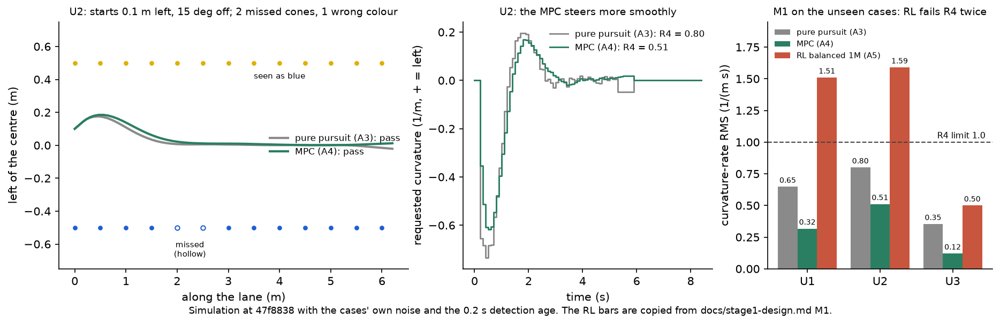

*Left and middle: U2, with a 15° start, two missed cones and one wrong colour. Both designs pass, and the MPC
steers more smoothly (R4 0.51 against 0.80). Right: R4 on each unseen case. RL is above the 1.0 limit on U1 and U2,
so it isn't eligible.*

- **Result:** the MPC passed all three, with a worst R4 of 0.51. The RL policy failed R4 on U1 (1.51) and U2 (1.59),
  so it wasn't eligible. **The MPC was chosen for Stage 1.** The baseline also passed and is on the front: it ends
  5 mm closer to the centre but steers more roughly (0.80).
- **Checked for this logbook:** I re-ran the baseline and the MPC on U1–U3 at `47f8838`. Every R4, R1b and stop value
  matches `docs/stage1-design.md` to the printed precision.

#### 3.5 Lane end and lost lane: where does the car stop? (Task A7, 6 Oct)

- **Question:** before A7, the MPC stopped short of the lane end on every case. Why, and how can it stop in the 0 to
  0.5 m zone (R5)?
- **Cause:** a row needs two cones to be fitted, and the camera's 80° view can't see a cone beside the car. So the
  last cone pair leaves the view about 0.6 m before the car reaches it, and the lane counted as "lost" early.

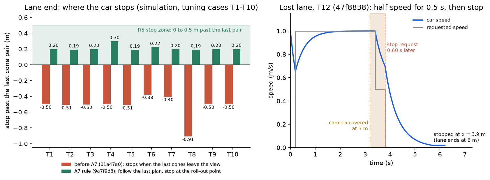

*Left: where T1–T10 stop before the A7 rule (red) and with it (green), both without the detection age. The shaded
band is R5's zone. Right: T12, camera covered at 3 m. The requested speed halves 0.2 s later (the detection age),
and the stop request (dashed) comes 0.60 s after the cover. The car then rolls to a stop inside the lane.*

- **Result:** without the detection age, T1–T10 stopped 0.38–0.91 m short before the rule (`01a47a0`), and 0.19–0.30
  m past the last pair with it (`9a7f9d8`). With the 0.2 s age (final table in `docs/stage1-design.md`), they stop
  0.21–0.24 m past.
- **T12, camera covered from 3 m:** the stop request came 0.60 s after the loss (0.2 s of it the detection age). The
  car rolled to a stop 0.9 m after the loss, inside the lane.
- **A judgement that reversed:** my first version slowed along a constant-deceleration ramp. The simulated speed
  controller lags the request, so the car rolled 0.64–0.75 m past the last pair and failed R5. Requesting the stop
  at the roll-out distance fixed it.

#### 3.6 Can panning the camera keep tight curves in view? (20 Oct, `230c75b`)

- **Question:** the camera sees 86° and 2.5 m, so on tight curves and loops the lane leaves the view. If the policy
  aims the camera along the lane, does the MPC keep the lane? And how much do the servo facts nobody has measured
  matter: the angle per unit, its speed, and the angle at the moment each image is taken?
- **Method:** `tests/policy/prototype_camera_pan.py` (a throwaway prototype), on Toby's curved lanes, kinematic car
  and measured camera. DREAM's camera TF is fixed at zero pan, so the policy turns the detected cones back by the
  angle it believes the camera had. Four modes:
  - fixed: the pan held at 0, as on `dev`;
  - ideal: the true angle at the image's time, as an encoder would give;
  - modelled: a servo model of the commands, while the real servo turns 10% further and slower;
  - naive: the latest command, not the angle at the image's time.

  `--export` writes chosen runs to MCAP with a layout, so each run can be stepped through in Foxglove.

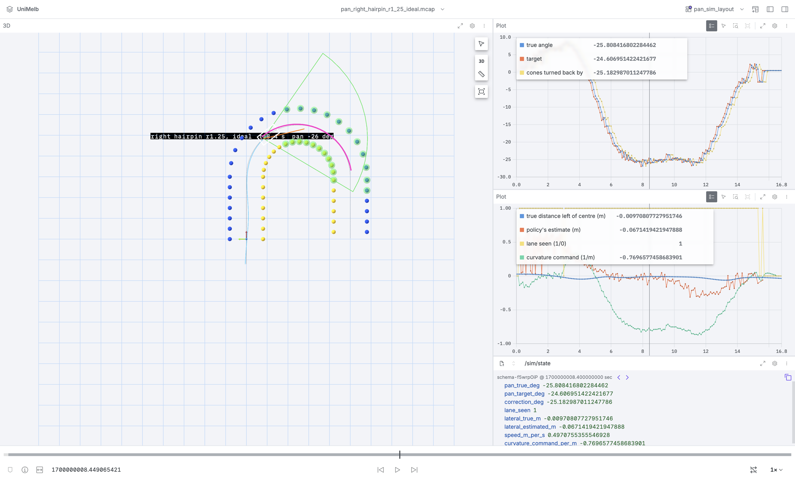

*Foxglove showing the exported hairpin run with the ideal pan, at 8.4 s. Left: the camera's view (green) has
turned into the bend, the cones it sees are ringed, the pink line is the lane centre the policy found, and the blue
line is the car's trail. Right: the pan angle over the run, and the true and estimated distance from the centre.*

- **What the exported runs show** (one seed each):
  - 1.5 m loop: with the pan fixed, the lane left the view after 8.6 s and the car stopped off the track. With the
    ideal pan, the lane stayed in view all the way round. The car still swung wide, because the loop is tighter
    than car 20's left reach: the curvature command sat at its 0.48 1/m limit.
  - Oval: the naive pan lost the lane after 11.1 s, while the fixed camera finished.
- **What I take from it:** panning helps only when the angle at the image's time is known (an encoder, or a measured
  servo model). Without it, panning can be worse than not panning. And on loops the steering reach, not the camera,
  is the next limit. The team kept the pan at 0 (Thanh Long 2.3).
- **Limit:** a prototype with assumed servo values. The rates over several seeds come from running the script; they
  aren't recorded here.

#### What I can and can't conclude from simulation
- **Can:**
  - compare designs on identical cases with identical noise;
  - find design mistakes (a reward exploit, the early lane-end stop) before car time;
  - check that a control setting works on every car model before it ships.
- **Can't:** predict the car.
  - dream-gym's tyres aren't scaled for a 1:10 car (T11).
  - The roll-out after a stop request hasn't been measured on a car. 0.6 s is the stand-in control's, and car 22's
    2.1 s comes from its model.
  - The car models come from one calibration or one run each.
  - The lanes are perfect straight rows.
  - RL was trained with one seed.

<a id="peiyu-5"></a>

### 4. On the car (Standard 4)

#### 4.1 The time budget and the first car run (car 20, 6 Oct)

- **Question:** how long may a policy step take, and does the MPC fit on the car's computer?
- **Measured on car 20:**

| Quantity | Value | Used for |
| --- | --- | --- |
| Cone detection rate | 10.0 per second, gaps 0.09–0.11 s (standard deviation 6.5 ms) | One policy step per batch |
| Detector latency | 0.197 s | The 0.2 s detection age in the harness and the MPC's delay compensation |
| Vehicle command timeout | 0.5 s, five detection gaps | |
| Allowed calculation per step | **20 ms at the 99th percentile**, a fifth of the gap | The `TIME_BUDGET_S` in the harness; R6a |
| Cone colours on the lab lane | yellow on the left, blue on the right | The harness's `LEFT_COLOUR` at the time |

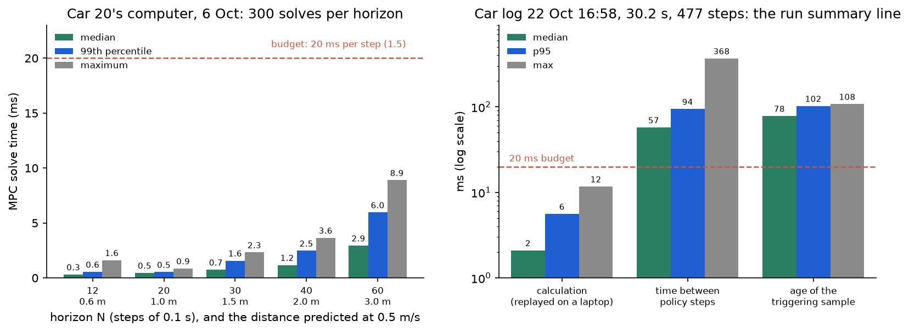

*Left: 300 solves per horizon on car 20's computer (aarch64, SciPy 1.11.4). Right: the run summary of a 22 Oct car
log (Section 4.5).*

- **Result:** every horizon up to 60 steps fits the budget with a wide margin (60 steps: 5.96 ms at the 99th
  percentile). So the horizon is limited by how far the camera sees, not by the computer.
- **Stand tests of the temporary controller (wheels off the ground):**
  - At `max_drive_effort` 0.2, the applied drive peaked at 0.168 (about 1542 µs) and the wheels didn't turn: it was
    inside the ESC's deadband. I raised it to 0.3 (the wheels still didn't turn), then the operator asked for 0.55 and
    then no limit.
  - With feedforward 0.1 and ki 0.1, the effort rose only 0.05 a second (0.47 after 8 s), so the stand tests used
    feedforward 1.0 and ki 0.3.
- **Decision:** treat the temporary controller as a stand-test tool, and use Chris's measured `CarController` for
  driving (PR #16). I added the lane state on `debug1`/`debug2` so the lane estimate could be plotted during these
  tests.

#### 4.2 Car 22 on the floor (12 Oct)

- **Question:** does the Stage 1 MPC with Chris's control drive car 22?
- **Method:** car 22 at `350fa3b`, 0.5 m/s, horizon 30, with the speed settings I chose in simulation for car 22's
  models. The results come from the policy logs.

| What | Result | Decision |
| --- | --- | --- |
| Speed | With car 20's control values, about 1.4 m/s (up to 1.7) for 0.5 m/s. With the car 22 settings, it held 0.46–0.49 m/s at a drive of about 0.33 | Car models (Section 3.1), then one setting for both cars (#18) |
| Lost-lane stop | Stopped 0.8 s after losing the lane, then coasted | The A7 rule works on a car |
| Steering | The MPC asked for more and more right steering (+0.06 to +0.36), but the perceived heading stayed at about +0.22 rad. The car drifted left and lost the lane after 3.4 s | Not solved. Three possible causes: inverted steering, an offset steering centre, or camera yaw |
| Standing still, vehicle disabled | The lane estimate flipped between two fits | Check perception with `debug1`/`debug2` against a known pose before floor runs |

- **Limit:** one session. The logs can't tell the three steering causes apart.

#### 4.3 The cone detector crash with OpenCV 5 (car 22, 12 Oct)

- **Symptom:** the cone detector exited about 13 s after every start, so there were no detections and the policy
  refused to start.
- **Cause:** OpenCV 5.0 is in car 22's DREAM venv (installed with ultralytics on 8 Oct). OpenCV 5 changed `CV_8UC3`
  from 16 to 64, so `cv_bridge.cv2_to_imgmsg` raises `KeyError 16` on the RGB image. I reproduced the traceback on
  car 22.
- **Fix:** `publish_rgb_image: false`. Car 22 drove again, with cone detections at 10 Hz (PR #24, split out of #18).
- **Cost:** the ArUco detector and RGB logging get no image until the venv has OpenCV 4. That's a DREAM environment
  fix for the teaching staff. It conflicts with the markers' `--aruco` start, which needs the RGB image (Toby's
  4.3). So on a car with OpenCV 5 in its venv, the cone detector and the markers can't both run until the venv is
  fixed.

#### 4.4 Seeing car runs in Foxglove (car 20, 19–20 Oct)

- **Question:** when a car run goes wrong, can we see off the car what the policy saw and planned at each step? And
  how far can a replay be trusted as a record of the run?
- **Method:**
  - I deployed the live markers to car 20 on 19 Oct (PR #25).
  - I replayed the data logs recorded on car 20 on 19–20 Oct into MCAP with `scripts/mcap_export.py`.
  - `/policy/state` puts the replayed actions beside the logged ones (`actions_match`).

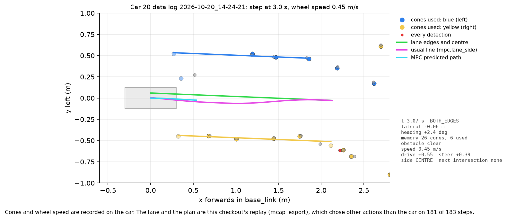

*One step (3.0 s, 0.45 m/s) of car 20's log 2026-10-20_14-24-21, replayed and drawn with the same layers as
Foxglove: the cones used, the lane, the usual line and the MPC's predicted path, beside the step's summary. The grey
box is the car.*

- **Result:** yes for the inputs. Any recorded step shows the cones the car recorded, and the lane, usual line and
  MPC path the policy computes from them, with the step's summary.
- **Limit:** a replay runs today's code. On this log it chose other actions than the car on 181 of 183 steps. So it
  shows what the current policy would do with the recorded inputs, not what the car did. The lane state recorded in
  these 20 Oct logs is noisy (median heading error 30–60° while moving in several drives), and I haven't found why,
  so I draw no conclusion about lane following from them.
- **Decision:** to judge a car run, use its logged actions, and use the replay to ask "what would the current code
  do". PR #31's run summary is logged on the car itself, so it doesn't depend on a replay.

#### 4.5 How fast does the policy really step? (22 Oct car logs)

- **Question:** does the calculation keep up with the detections on the car?
- **Method:** I replayed the two 22 Oct car logs through PR #31's run summary and PR #32's `run_report`. The car ran
  `feature/obstacle-detection` and the replay ran `dev`, so mismatches are expected.
- **Result** (figure 07, right):
  - Steps were 57.4 ms apart (median), 94.1 ms at p95 and up to 367.8 ms, while detections arrived about every 38 ms.
  - The triggering sample was 78 ms old (median).
  - Replayed on a laptop, the calculation took 2.1 ms median and 11.7 ms max, and the avoidance planner was 10–30
    times costlier than plain lane following.
- **`run_report`:**
  - 16:58 drive: lateral error median 0.05 m, RMS 0.07 m; side clearance at least 0.31 m; the MPC stopped 0.47 m
    before the obstacle.
  - 16:59 drive: passed the obstacles with at least 0.13 m side clearance; lateral RMS 0.10 m afterwards.
- **A judgement that reversed:** counting the steps after the MPC's latched stop as "driving" gave 25% of steps under
  5 cm of side clearance. Those were fixed-position returns while the wheel speed still read about 0.1 m/s near
  standstill. Excluding them gave the numbers above.
- **Limit:** the calculation times are from a laptop. PR #31 hasn't been run on a car yet.

#### 4.6 Simulation against the car

| What | Simulation | Car | What it means |
| --- | --- | --- | --- |
| Speed with car 20's control values, 0.5 m/s target | car22a and car22b models: about 1.4–1.5 m/s (3.1) | Car 22, 12 Oct: about 1.4 m/s, up to 1.7 (4.2) | They agree. But the car 22 models were fitted to a car 22 run, so this is a consistency check, not an independent test |
| Speed with the car 22 settings | Chosen in simulation to hold 0.5 m/s on car22a and car22b | Car 22 held 0.46–0.49 m/s at a drive of about 0.33 (4.2) | Settings chosen on the models held the speed on the car, within R3's 0.10 m/s |
| Lost-lane stop | T12: stop request 0.60 s after the camera was covered (3.5) | Car 22 stopped 0.8 s after losing the lane, from the policy log (4.2) | The rule works on a car. The car's time has no known cover moment, so it isn't measured the same way and doesn't check R7's timing |
| Time between policy steps | 0.1 s: one step per batch, from car 20's 10 Hz on 6 Oct (4.1) | 22 Oct logs: 57 ms median, up to 368 ms; detections about every 38 ms (4.5) | That car ran another branch with obstacle detection, so the step isn't what the harness assumes. The budget needs re-measuring for that setup |
| Steering | Car models use the measured steering map | Car 22 didn't steer as asked (4.2) | Unexplained. The models can't predict car 22's steering until its sign, centre and camera yaw are checked |
| Roll-out after a stop request | 0.6 s (stand-in control) | Not measured | The lane-end stop distances (3.5) aren't proven on a car until it is measured (team table, 0.7) |

#### 4.7 The experiments still needed (method ready, not run)

The roll-out after a stop request and car 22's steering and camera yaw are shared with Chris, Yuhao, Toby and
Thanh Long, so they are in the team table (Team overview, 0.7). These two are mine alone:

| Question | Method | Controlled | Decision it feeds |
| --- | --- | --- | --- |
| Calculation time with avoidance on the car | Upload #31, do one run, read the `Run summary` line | track, obstacle placement | Whether avoidance must get cheaper to keep a step under 20 ms |
| Lane-end stop on the car | A 6 m × 1 m lane at 0.5 m/s, 5 runs, measure the stop past the last pair | speed, lane | R5 on a car, not only in simulation |

<a id="peiyu-6"></a>

### 5. Keeping the cars running and the branches merged (Standards 1 and 4)

The cars crashed or stopped again and again, and most failures first looked like policy bugs ("cone detections
missing or stale"). Every time I checked the car read-only first: `dream runtime status` and `logs`, `top`, the
kernel's USB events and `ros2 topic hz /car/cone_detections`. Only after finding the cause did I restart or change
anything, because car 20 was shared with other teams.

#### 5.1 Car and runtime faults

| Date, car | Symptom | Cause found | What I did | Still open |
| --- | --- | --- | --- | --- |
| 5 Oct | The first car run couldn't start the policy | The installed node couldn't import `policy/`, and the v0.3.0 merge left a removed lidar variable: a `NameError` on every step | Installed the package with `ament_python_install_package`, declared numpy and scipy, passed `lidar_scan` (`27ee6fe`) | — |
| 6 Oct | `upload_to_car.sh` failed on macOS | bash 3.2 treats an empty array as unbound under `set -u` | Fixed the script, the same fix as the copy on car 20 (`db6dafc`) | — |
| 12 Oct, car 22 | The cone detector exited about 13 s after every start | OpenCV 5 in the venv: `KeyError 16` publishing the RGB image | `publish_rgb_image: false` (#24); detections back at 10 Hz (4.3) | The DREAM venv needs OpenCV 4 |
| 12–13 Oct, cars 22 and 20 | No cones; the detector dead | The OAK-D dropped off USB and stayed unbooted. The GPU detector logged "first result did not arrive", a segfault in `readCalibration`, or depthai "Device has crashed" | Restarting only the detector unit recovered it (20 Oct). A few disconnect cycles at start are normal depthai booting, so they aren't the fault | On car 22 a stop and start ended in a hard reboot; the cause is unknown and the car keeps no journal |
| 12–13 Oct, cars 22 and 20 | Almost no CPU left for the policy | Each DREAM `runtime_runner` used 70–80% CPU, polling `/proc` every 0.05 s; six of them left 1–5% idle on the 6-core Jetson | Measured with `top`; a DREAM issue, so reported, not edited | Upstream |
| 19 Oct, car 20 | Deploying the live markers could have overwritten other people's work | The car's policy folder held another team's clone with our files copied over it, plus an obstacle fix edited on the car that morning; the upload's rsync overwrites without warning | Backed up the car's source first (`~/ai4r_policy_backups/src_ai4r_policy_20261019_120724.tar.gz`), then deployed around the uncommitted fix | — |
| 20 Oct, car 20 | The policy dropped to zero actions mid-drive, twice | Once someone restarted the detector (cones stale); once `lidar_cartesian` went stale after 9 s, with CPU idle about 0.3% | Zero actions on stale sensors is the intended safety response, so no change | CPU starvation suspected, not verified |
| 20 Oct, car 20 | The policy ran but the car never moved | Yellow cones on the car's left with `left_colour: BLUE` give no lane; stray blue cones also broke the fit | Replayed the car's cone detections through the car's own `detect_lanes`; moved the cones rather than the setting | — |
| 26 Oct, car 20 | "It won't run": drive 0.61 sent, 0.59 applied, wheel speed 0 | A flat motor battery | If the applied drive is above 0 and the wheel speed is 0, the software path works: check the battery and ESC first | — |

#### 5.2 Merge conflicts I resolved

Four branches had to land on `dev` together around 12 Oct: Chris's `CarController` (#17), Toby's lab calibration
(#15), my first car run (#8) and the Stage 1 design (#16). I resolved each conflict with `dev` as the base: keep the
newer shared code, port my features onto it, then re-run the tests. Conflict hunks are where the merge result differs
from both parents (`git show --cc`).

| Date | Merge | Conflict hunks | How it was resolved |
| --- | --- | --- | --- |
| 6 Oct | `dev` into the first car run (`6032bbd`) | 7, in CMake, the yaml, `policy_runner`, `policy_node`, the control tests | Kept `CarControl`; took `dev`'s lidar handling over the branch's one-line fix; `MovementPolicy` takes the MPC, cone filter and control settings; the yaml keeps both sections |
| 12 Oct | Chris's control into the MPC policy for car 20 (`96b6030`) | 5 | The control settings and `policy_runner` wiring for both |
| 12 Oct | `dev` into #16 (`e8edafb`) | 16, in `mpc.py`, `policy.py`, `policy_runner`, the yaml and tests | `dev`'s controller (speed-scheduled prediction, strict solver checks) with the A4 defaults and A7 lane-end settings; `dev`'s `MpcPolicy` plus the A7 stop and the lane state for `debug1`/`debug2` |
| 12 Oct | `dev` again, after #15 and #8 (`fb2442b`) | 22 | Took the lab weights 10/1/0.1/2, because A4's 3/1/0.1/3 with #15's change weight left a 3 m radius curve; kept the 20-step horizon; #15's camera yaw correction and lane offset with the A7 stop. Every Stage 1 tuning case still passed except T11 |
| 12 Oct | #17 on `dev` (`a5a62b0`) | 1 | The control settings |
| 20 Oct | `dev` into Toby's lane-side branch (`010939f`) | 11 | `MpcPolicy` keeps the lane side and its rate-limited offset beside `dev`'s avoidance path; re-ran the wide-track results on the merged code. I then merged #27; Toby reverted and re-landed it the same day (#29, #30) |

- **Limit:** the faults in 5.1 come from my notes of the car sessions and the car's logs at the time; the cars keep
  no persistent journal, so most can't be shown again now.

<a id="peiyu-7"></a>

### 6. Lessons and limits
- **Measure the inputs before tuning.** The 0.2 s detection age and the 20 ms budget came from car 20's logs on 6 Oct,
  and every later design was tuned against them.
- **A simple baseline keeps the MPC honest.** The first MPC lost to pure pursuit, and that's how its weights were
  found to be wrong.
- **Check a reward for exploits before long training.** Unbounded penalties made leaving the lane the best return.
- **A setting must work on every car.** Car 22's control values reached `dev` and the car 20 model never reached
  its speed. PR #18 adds a test of the yaml against every car model.
- **Record every run.** Data logs and a replay turned "it didn't work" into numbers (timing, clearance) off the car.
- **Limits:**
  - Car 22's steering didn't work on 12 Oct, so my own car sessions show timing, speed and the lost-lane stop, but
    not lane following. Lane following on car 20 is in the team runs (Toby's section).
  - The M1 choice and the lane-end stop distances are simulation only.

---

<a id="toby"></a>

## Part 5: Toby Lee: MPC sub-team, marker commands and intersection turns


| | |
| --- | --- |
| Role | MPC sub-team. Card 2 test cases, then MPC tuning for the lab car, then ArUco marker actions and intersection turns |
| PRs | #6 and #10 (Stage 1 tests), #15 (MPC calibration), #27 and #30 (lane side), #35 (markers and intersections, merged into `dev` on 2 Nov) |
| Open work | `fix/left-turn-steering-and-obstacles`: 6 commits, pushed, no PR yet (waiting for review by Yuhao and Chris) |
| Built on teammates' work | Ciaran: repo, CI and the upload script. Peiyu: MPC framework, Foxglove export. Thanh Long: lane estimation (`LaneDetection`). Zhenling Zhang: obstacle detection and the local map. Chris: steering calibration and the ±0.8 interval. Yuhao: system ID, grouped marker IDs, left-turn preparation |
| Figures | `toby/figures/`, made by `python3 docs/logbook/toby/make_figures.py` (see its docstring for the two checkouts it simulates) |

**Summary: four pieces of work, in order** (the same as my slide):
1. **MPC lane following.** With the MPC sub-team, I helped build the first lane follower and wrote the Card 2 test
   cases it was tuned on. Then I tuned it to car 20's measured steering (Sections 2.1, 3.1 and 4.1).
2. **Lane shifting from left to right.** The MPC keeps to the left, centre or right of the lane and can shift
   mid-run. On car 20 on 20 Oct, it kept to the left lane (Sections 2.1, 3.2 and 4.2).
3. **Mapping policy actions to ArUco markers.** Markers choose keep left, right or centre, or turn left, turn right
   or go straight at the intersection the marker stands at. This includes the intersection manoeuvre (Sections 2.2,
   2.3 and 3.3).
4. **Fine-tuning and testing on the real robot.** I tuned and tested lane shifting, sharper 90° turns and their
   interaction with obstacle detection over four car sessions. Simulation was used to explain each car result
   (Sections 3.4, 3.5 and 4.3–4.5).

Lane shifting and marker commands worked on real cars. A full intersection turn wasn't shown on a car before access
ended on 2 Nov, so the turn results are simulation only.

<a id="toby-1"></a>

### Timeline

| Week | What I did | Evidence |
| --- | --- | --- |
| 1 (5–6 Oct) | Card 2 test cases T1–T11, unseen cases U1–U3, a dream-gym closed-loop harness with disturbances, and printable floor layouts | `1f7f1eb`, `eef5589`, PR #6 and #10, `docs/stage1-test-cases.md` |
| 2 (12 Oct) | Tuned the MPC to car 20: separate left and right limits, a smoother steering weight, measured simulation parameters from Ciaran's real recordings, a curved-lane simulator | `03239b1`, PR #15, `docs/mpc-lab-calibration.md` |
| 3 (16–23 Oct) | MPC lane side (LEFT/CENTRE/RIGHT); car 20 kept left on 20 Oct. First ArUco test on car 21. Marker commands mapped to policy actions | `d78289e`, `81b2105`, `docs/mpc-lane-side.md` |
| 4 (26–30 Oct) | Lane-change retune, `IntersectionTurner`, full-policy marker simulation, `car_management.sh --aruco`. Car 13 test | `3ab7ac9`, PR #35, `logs/car13/policy.log` |
| 5 (1–2 Nov) | Reproduced "left fails, right works", a robustness matrix of about 10,000 simulated runs, phantom-obstacle fixes, a car 14 session | `fix/left-turn-steering-and-obstacles`, `logs/sim-2026-11-02/RESULTS.md` |

---

<a id="toby-2"></a>

### 1. Where my parts fit (Standard 1)

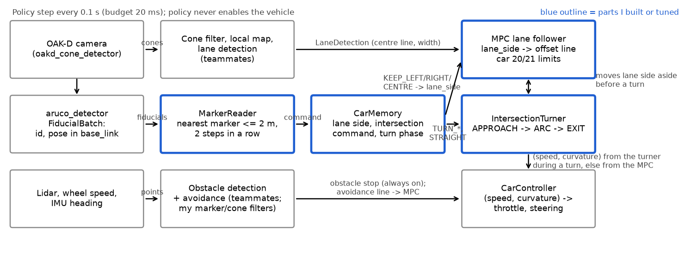

*The MovementPolicy pipeline, run every 0.1 s within a 20 ms budget. Blue boxes are the parts I built or tuned. Grey
boxes are teammates' parts that mine depend on.*

**Purpose in the whole system.** Stage 2 asks the car to obey road signs. My parts turn a printed marker into a
driving behaviour, while lane following, obstacle stopping and the safety rules keep working.

| Interface | Direction | What it carries | Assumption or constraint |
| --- | --- | --- | --- |
| `FiducialBatch` from `aruco_detector` | in | marker id, and its pose in `base_link` | Needs the RGB image, which only `oakd_cone_detector` publishes, so the runtime must start with `--aruco`. The distance is right only if `default_marker_size_m` is the printed size (0.081 m) |
| `LaneDetection` (Thanh Long) | in | the lane's centre line and width | The cross road's cones bend the fitted lane near an intersection. So during the approach, the turner keeps only the approach corridor's cones |
| Local map pose: dead reckoning with the IMU heading | in | where the car is relative to the planned entry | Drifts over metres. The turn is about 3 m long, so the drift is small |
| Lidar obstacles | in | points ahead | Marker stands and the lane's own cones show up as obstacles (seen on car 13) |
| `CarMemory` | state | lane side, intersection command, turn phase | A new run (explicit resume) clears it |
| (speed, curvature) to `CarController` (Chris) | out | the command | Curvature must stay within what the car can steer (car 20: 0.48 1/m left and 0.92 1/m right at ±0.5) |

**Design goals and the choices they forced:**
- **Only the nearest marker counts**, within 2 m and for 2 steps in a row. A marker further down the road must not
  take over, and one noisy frame must not give a command.
- **The lane side stays set until another side marker**, so the car holds the side through gaps between markers.
- **The turn is a separate manoeuvre, not a different MPC.** The MPC follows a lane, but in the middle of an
  intersection there's no lane to follow. So the turner drives a planned arc and hands back to the MPC when it sees
  the exit lane.
- **The obstacle stop always stays on**, during the turn too, and it's checked along the path the car is actually
  driving.
- **System-level consequence:** what limits a turn is the car's steering reach. A 0.48 1/m limit means a 2.08 m
  radius, and that arc can't fit a 1 m crossing at all. So the steering calibration, a control-team value, decides
  whether my subsystem works.

<a id="toby-3"></a>

### 2. How it works (Standard 2)

#### 2.1 MPC lane follower (framework by Peiyu and Yuhao; I tuned it and added the lane side)

The path-frame model, its least-squares form and the delay compensation are in Peiyu's Section 2.1. The version I
tuned for car 20 (on `dev`) predicts $N = 12$ steps of 0.1 s (about 0.6 m at 0.5 m/s) and adds the lane-side line
$e^{line}_k$:

$$\min_{\kappa_0..\kappa_{N-1}} \sum_k 10\,(e_k - e^{line}_k)^2 + 1\,\psi_k^2 + 0.1\,(\kappa_k - \kappa^{path}_k)^2 + 2\,(\kappa_k - \kappa_{k-1})^2 \quad\text{s.t.}\quad -0.92 \le \kappa_k \le 0.48$$

- Solved as bounded least squares (`scipy.optimize.lsq_linear`); a whole policy step took 5 ms median and 15 ms at the 99th percentile on a laptop. The bounds are the only constraints,
  because they're the car's real limit. A soft lane-edge constraint isn't needed, since the cost already tracks a
  line inside the lane.
- **Delay compensation:** as in Peiyu's 2.1, with the 0.2 s age measured from real recordings (Section 4.1).
- **Lane side:** $e^{line}$ is the line `edge_clearance_m` in from the chosen edge, so the offset is
  $w/2 - c$. It moves at most `offset_change_per_m` per metre driven, which keeps the change smooth.
- **My tuning (car 20):** asymmetric limits from Chris's measurement, and `curvature_change_weight` 1 → 2 (Section 3.1).

#### 2.2 From marker to action

| ID on `dev` (Yuhao's grouping) | Command | Effect |
| --- | --- | --- |
| 1–4 | `TURN_LEFT` | Plan a left turn at the intersection the marker stands at |
| 5–6 | `TURN_RIGHT` | Plan a right turn |
| 7–8 | `STRAIGHT` | Hold the approach line across the intersection |
| (27 Oct mapping) | `KEEP_LEFT/RIGHT/CENTRE` | Set the MPC `lane_side` until another side marker |
| any other | stop | Stop the run (Yuhao's safety choice) |

`MarkerReader` counts a marker when its pose is ahead, at most 2 m away, and it's the nearest marker for 2 steps in
a row. The command is given once and stored in `CarMemory`.

#### 2.3 Intersection turn: APPROACH → ARC → EXIT

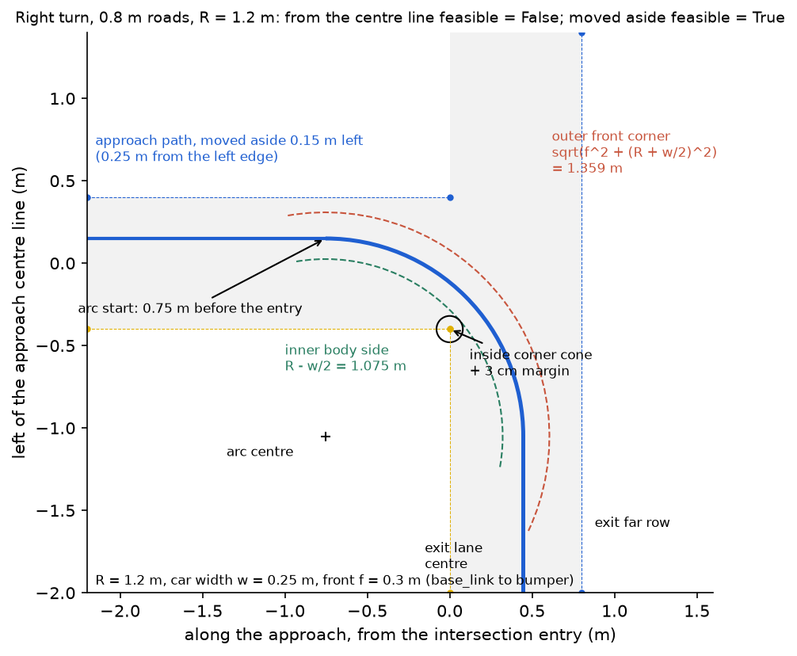

*A right turn in 0.8 m roads with R = 1.2 m. From the lane centre, no start point clears both the inside corner and
the far row. After moving 0.15 m to the outside (a hook turn), one does.*

1. **APPROACH.** The marker stands 1 m before the entry (`marker_to_entry_m`), so the entry is placed from the
   marker's pose plus the car's pose. For a turn, the MPC moves to the outside of the lane, 0.25 m from its edge.
   From 0.8 m before the entry, the car holds the approach heading at 0.3 m/s.
2. **ARC.** The arc starts at $s$ and is followed with pure pursuit, with the curvature capped at $1.2/R$. The start
   is chosen so the arc ends on the exit lane's centre ($s^* = w_{cross}/2 - R$), then clamped into the window where
   the body clears both obstacles. Here $b$ is the car's half width (0.125 m), $f$ the distance from `base_link` to
   the front bumper (0.30 m), $r_c$ the cone radius (0.05 m), $m$ the margin (0.03 m) and $a$ how far the car has
   moved aside:
   - **inside corner** (the inner side at $R-b$ from the centre): $s \ge -\sqrt{(R-b-r_c-m)^2 - (R-a-w/2)^2}$
   - **far row** (the outer front corner at $\sqrt{f^2+(R+b)^2}$): $s \le w_{cross} - r_c - m - \sqrt{f^2+(R+b)^2}$
   - if the window is empty, the car stops ("no clear start") rather than touching cones.
3. **EXIT.** Lane following takes over once the car has turned 60° and sees a lane lined up with it. If no exit lane
   appears within 1.5 m, it stops.

<a id="toby-4"></a>

### 3. Simulation (Standard 3)

#### 3.1 Which MPC settings suit car 20? (12 Oct)

- **Question:** car 20 drifted into the cones on curves. Was that the MPC settings or the car?
- **Method:** `curved_lanes.py` simulates 1.5–3 m curves and an S bend, with -3 to +3° of camera yaw, the measured
  noise and delay, and 4 seeds: 84 runs per setting.
- **Result:** the settings used on car 20 (0.5 limit both ways, heading weight 5) kept 12 of 84 curved runs with
  straight lane edges, and 73 of 84 with curved edges. The chosen settings kept 84 of 84 and steered about a quarter
  less.

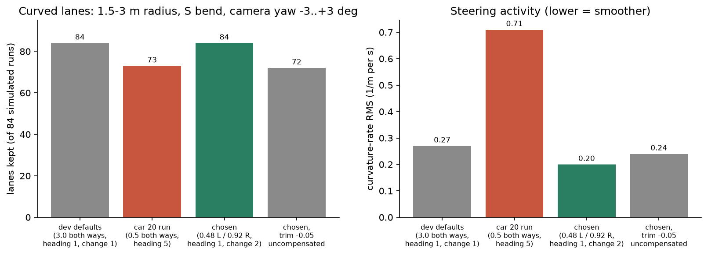

- **A judgement that reversed:** my first draft used heading 3 and change 3, chosen from a smaller sweep. The larger
  sweep showed the missing right limit, not the heading weight, was losing curves, so I changed it.
- **Limit:** the "dev defaults" bar also scores 84 only because the simulator clips its impossible 3.0 1/m command.
  The chosen settings plan within what the car can steer.

#### 3.2 Why wasn't the lane change visible? (26 Oct)

- **Question:** on car 21, "keep left" was hard to see. How much room did the settings leave?
- **Analysis:** the offset available is $w/2 - c$. With the old $c = 0.40$ m, there's 0 cm of offset in a 0.8 m
  lane and 10 cm in a 1 m lane.

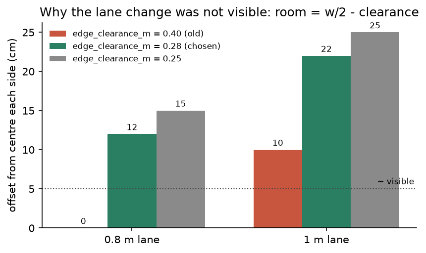

- **Sweep** in the full-policy simulation over 0.40, 0.28 and 0.25 m, at a rate of 0.2 or 0.3 per metre. I chose
  0.28 m at 0.3 per metre: 40 of 40 runs passed, with a worst side error of 0.017 m and the body at least 0.13 m
  inside the lane. 0.25 m left only 0.10 m of body margin.

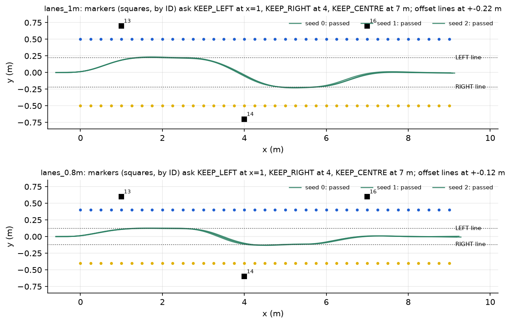

#### 3.3 The marker simulation: does the whole policy turn correctly? (27 Oct)

- `marker_simulation.py` runs the real MovementPolicy closed loop. The car is a kinematic model with lagged speed and
  steering. Cones and markers are seen only in the camera's view, 0.3–2.5 m away, with 3 cm noise, 10% missed and a
  0.2 s delay. The lidar sees the cones (and, with `--marker-stands`, the marker posts). The car also gets wheel speed
  and IMU heading.
- **A pass:** the car leaves by the commanded road, touches no cone and keeps its body on the road.
- **Tuning made in simulation before going on the car:**
  - The marker was moved 1 m before the entry. Beside the last cones it was confirmed too late.
  - Moving aside was added. Without it, right turns in 0.8 m roads were geometrically impossible.
  - Corner clearance 0.03 m passed 59 of 60 runs, against 53 of 60 at 0.05 m.
  - Curvature is capped at 1.2/R, and obstacles are checked along the arc. Both fixed false obstacle stops.
- **Result (20 seeds, with car 21's provisional 1.0 1/m left limit):** every turn and straight-on in 1 m roads
  passed, 100/100. In 0.8 m roads, 97/100 passed; the misses were right turns clipping the first cone of the far row.

#### 3.4 Reproducing the car's failure: "right turns work, left turns don't" (1–2 Nov)

- **Question:** Yuhao saw this on the car. Was it the code or the car?
- **Method:** I ran his exact commit `bf5e08c` in the marker simulation with car 20's left reach, over 10 cases and
  10 seeds. Left turns passed 2 of 40 (2 of 20 in 1 m roads, 0 of 20 in 0.8 m roads) and right turns 35 of 40, the
  same pattern as the car. With marker stands added to the lidar, left turns passed 0 of 40 and right turns 40 of 40.
- **Cause:** a 0.48 1/m left limit makes the arc 2.08 m. That has about 2 cm of room in a 1 m crossing and none in
  0.8 m, so the car either stops ("no clear start") or swings into the cones.

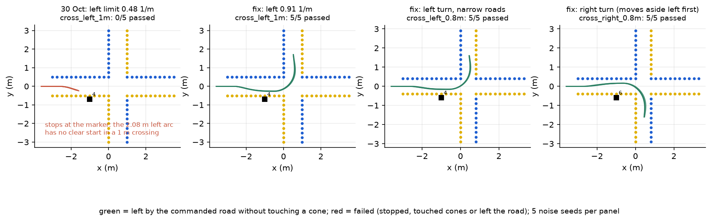

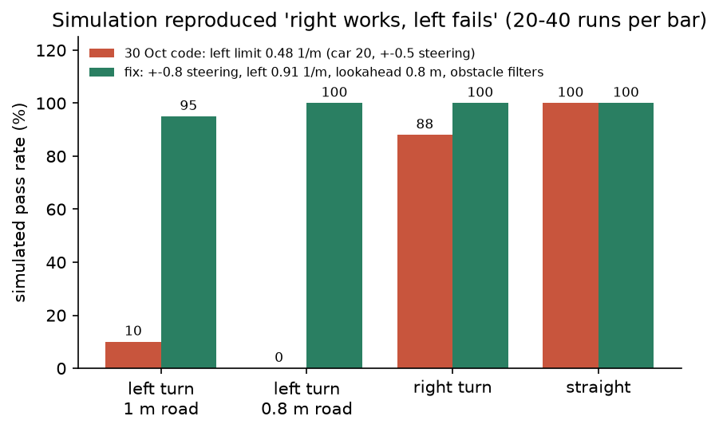

- **The fix,** tested on 7 variant branches with 10 seeds and 10 cases each:
  - Chris's ±0.8 steering interval, with the left limit set to 0.91 1/m.
  - Lookahead 0.8 m. The stronger steering made the move-aside before a right turn swing too sharply, which in turn
    made right turns clip cones.
  - Phantom-obstacle filters (Section 4.4).
- **Result:** 57% → 99% of nominal cases, and left turns 2/40 → 39/40 on the pushed branch.

#### 3.5 What must the car's setup match? (2 Nov)

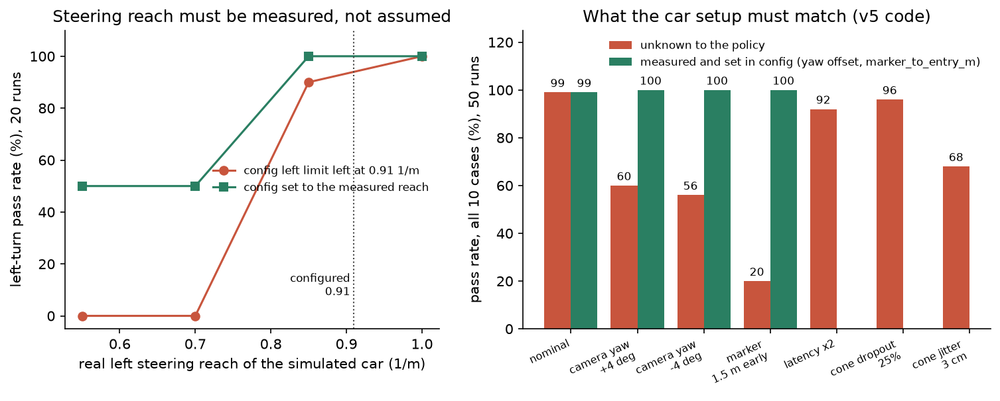

- **Steering reach.** If the config says 0.91 but the car reaches only 0.55–0.7 1/m, every left turn fails. Setting
  the config to the measured value recovers 1 m crossings, but 0.8 m crossings still fail.
- **Camera yaw.** 4° of yaw costs a whole turn direction: +4° gives left 0% and right 100%, the same pattern as on
  the car. Setting `camera_yaw_offset_deg` to the measured yaw restores 100%.
- **Marker distance.** With the marker 1.5 m before the entry when the config says 1.0 m, 20% pass. With
  `marker_to_entry_m` set to match, 100% pass.
- **Robust to:** doubled latency (92%), 25% cone dropout (96%) and a speed overshoot of ×1.3. It's sensitive to 3 cm
  of cone misplacement (68%).

#### What I can and can't conclude from simulation
- **Can:** rank settings against each other, reproduce a failure mechanism, check the geometry is feasible before
  car time, and find which calibrations matter most.
- **Can't:** predict car pass rates. The model has no tyre slip and no servo nonlinearity. The marker noise is a
  guess, not a measurement. The steering reach is set directly rather than through the servo map. The camera pan
  isn't modelled. The roads are ideal straight crossings.

<a id="toby-5"></a>

### 4. On the car (Standard 4)

#### 4.1 Measuring the simulator's parameters from real recordings (12 Oct)

- **Question:** what values should the simulated camera and car use?
- **Method:** `real_car_measurements.py` measures Ciaran's four recorded drives (fixed drive effort 0.55, steering
  centred).

| Quantity | Assumed before | Measured | Used in the simulation |
| --- | --- | --- | --- |
| Lane width | 1.0 m | 0.77 m | 0.8 m |
| Cone position noise | 0.01 m | 0.040 m (row residual) | 0.03 m |
| Detection latency | 0 s | 0.21 s | 0.2 s |
| Range / nearest detection | 4 m / 0 m | 2.54 m (95%) / 0.41 m | 2.5 / 0.4 m |
| Camera yaw | 0° | 7.3° left, with the pan never commanded | held at 0, swept ±3° |

- **Interpretation:** the cone rows looked turned 6–10°, but the car's lateral position drifted only 3 cm over
  2.5 m. So the detections were rotated, not the car, and the cause was the camera pan. The team now holds the pan
  at 0.
- **Limit:** we don't know which car Ciaran recorded with, and all the recordings are straight.

#### 4.2 Lane shifting on the car (20 Oct car 20, 21 Oct car 21)

- **Question:** does the car actually hold the side that `mpc.lane_side` asks for?
- **Method:** I changed only `lane_side` in the yaml on car 20 (CENTRE → LEFT, then
  `dream runtime restart ai4r_policy`) and kept the same track and speed.
- **Result (20 Oct, by eye, no log recorded):** the car kept to the left side of the lane.
- **21 Oct, car 21, with markers:** the shift was hard to see. The analysis in Section 3.2 showed why: the 0.40 m
  clearance left 0 cm of room in an 0.8 m lane and 10 cm in a 1 m lane. I retuned it to 0.28 m at 0.3 per metre. The
  logs that day also showed that no marker batches reached the policy (Section 4.3), so I added `--aruco`.
- **Limit:** the result was judged by eye, without a measured offset. The next test should log the offset in
  Foxglove and compare it with the simulated ±0.12 m (0.8 m lane) or ±0.22 m (1 m lane).

#### 4.3 Is each link of the marker chain working? (21 Oct car 21, 27 Oct car 13, 2 Nov car 14)

The symptom "the car doesn't turn" has several independent causes, so I tested each link from the bottom up and
controlled one variable at a time:

| Link | Check on the car | Result | Decision |
| --- | --- | --- | --- |
| Camera image | `dream runtime status`, and the `/car/camera/rgb/image_rect` topic | 21 Oct: 0 detections in 9 runs. The GPU detector publishes no RGB image | Added `car_management.sh --aruco` |
| Detection and distance | Hold the marker 1.5 m ahead; `ros2 topic echo /car/fiducial_detections` | The size must match the print (0.081 m). On 30 Oct the detector still had a 0.25 m snapshot (Yuhao) | Fixed in `aruco_detector.yaml` |
| Command | `dream runtime logs ai4r_policy` | 27 Oct, car 13: "Marker 14: KEEP_RIGHT, lane side RIGHT", 6 times | Commands work on a real car |
| Manoeuvre | Foxglove `/plan/intersection` and the turn logs | 2 Nov: the wrong branch was uploaded first, and then no `--aruco`. Time ran out | Not shown on a car |

#### 4.4 Phantom obstacles: turns combined with obstacle detection (27 Oct, car 13)

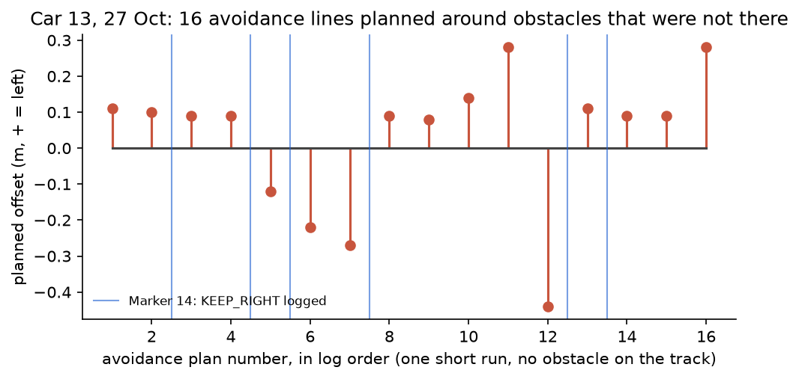

- **Observation:** in one short run with no obstacle on the track, avoidance planned 16 lines, flipping between
  -0.44 m and +0.28 m. A real box gives a steady offset, so these were marker stands and the lane's own cones.
- **Checked in simulation:** I added marker stands to the simulated lidar. Phantom avoidance appeared in 29% of runs,
  mostly from the lane's own cones.
- **Fix:**
  - ignore lidar returns within 0.15 m of a seen marker
  - plan avoidance only after 3 sightings in 5 steps
  - ignore known cones while turning
- **Result:** 29% → 4% of runs, and the obstacle simulation with real boxes still passes 12 of 12. Not yet tested on
  a car.

#### 4.5 The experiments still needed (method ready, not run)

All three are shared with teammates, so they are in the team table (Team overview, 0.7), with my methods kept:
- the real left and right steering reach at ±0.8 (with Chris and Yuhao);
- the camera yaw with the pan at 0 (with Thanh Long, Yuhao and Peiyu);
- a left turn on the car compared with simulation (with Yuhao).

<a id="toby-6"></a>

### 5. Lessons and limits
- **Measure before you tune.** The 0.48/0.92 asymmetry I recorded on 12 Oct explained the 1 Nov failure. A 10-minute
  stand test would have saved most of a car session.
- **Reproduce the car's failure in simulation first.** It turned "the code is wrong" into a measured cause.
- **Deployment discipline matters as much as code.** Check the branch, `CAR_NUM` and `--aruco` before each upload.
- **Limits:** left and right turns at an intersection haven't been shown on a car. All the pass rates above come from
  simulation.

---

<a id="yuhao"></a>

## Part 6: Yuhao Liu: measured-speed MPC, cone memory and intersection stopping


| | |
| --- | --- |
| Role | MPC sub-team. Measured-speed prediction and solver-failure handling, offline final-pair stopping, cone-memory manoeuvres, experimental junction navigation, grouped marker commands and left-turn diagnosis |
| Contribution period | 6 Oct–2 Nov 2026. Prepared for the interactive oral on 9 Nov 2026 |
| Main changes | [PR #14](https://github.com/CiaranGruber/robotic-car-ai/pull/14), integration repair `32723db`, branch experiments `e908d73` / `fd01806`, junction work `d59e812`, shared [PR #35](https://github.com/CiaranGruber/robotic-car-ai/pull/35), [PR #36](https://github.com/CiaranGruber/robotic-car-ai/pull/36) |
| Built on teammates' work | Peiyu: original MPC framework, Stage 1 design, lane-end work and Foxglove tools. Toby: test harness, car-calibrated MPC tuning, marker reader, default intersection turner and marker simulator. Chris: CarController and measured steering/control data. Ciaran: DREAM integration, repository and recorded drives. Lane, obstacle and local-map work came from the perception team |
| Status | Measured-speed and marker/stop changes integrated. Final-pair estimator and connected U-turn are separate offline experiments. The experimental junction navigator is disabled by default. No complete physical left intersection turn established by my records |
| Figures and data | [Figure index](#yuhao-6), with source hashes and small result extracts in [yuhao/data/](yuhao/data/) |
| Slides | [Presentation and discussion slides (PowerPoint)](yuhao/slide/yuhao-liu-slides.pptx). One personal summary slide and nine discussion backups, including the 10 Nov simulation rerun and matched marker-turn manoeuvre enabled/disabled comparison |

**Summary: four pieces of work, in order**

1. **Measured-speed MPC.** I changed the prediction and delayed-state propagation to use wheel speed, and kept invalid or exhausted plans from producing continued motion. Tracking error improved modestly in a controlled simulation comparison.
2. **What missing cones mean.** I investigated final-pair stopping and motion-compensated cone memory. The endpoint experiment exposed an ambiguity under persistent hiding. A separate geometric U-turn completed 10/12 varied simulated layouts, using hypothetical tighter steering.
3. **Junction routes and marker commands.** I developed the experimental route selector and T-junction evidence checks, then contributed grouped IDs, earlier preparation and heading-aware turn admission to Toby's marker-turn implementation.
4. **Diagnosis and persistent stops.** I separated a stale detector-size snapshot from a later turn-geometry failure on car 20, then fixed stop persistence after turn rejection or exit timeout.

This is discussion material. The assessed talk allows **one personal slide for 1–2 minutes**. Simulation figures below are supporting evidence, and are not real-car submission videos.

<a id="yuhao-1"></a>

### Timeline

| Date | What I changed or investigated | Evidence |
| --- | --- | --- |
| 6 Oct | Compared MPC horizons/weights, added measured-speed prediction and bounded failure behaviour, investigated final-pair stopping | [`f7052b2`](https://github.com/CiaranGruber/robotic-car-ai/commit/f7052b2), [MPC evaluation](../mpc-simulation-evaluation.md) |
| 12 Oct | Repaired integration with the calibrated MPC, preserving measured speed, asymmetric bounds and stopping behaviour | [`32723db`](https://github.com/CiaranGruber/robotic-car-ai/commit/32723db). This was integration work, not my own steering calibration |
| 20–23 Oct | Explored turn continuity and a connected U-turn using remembered cones and feedback steering | [`e908d73`](https://github.com/CiaranGruber/robotic-car-ai/commit/e908d73), [`fd01806`](https://github.com/CiaranGruber/robotic-car-ai/commit/fd01806), separate `feature/cone-memory-continuity` work |
| 26 Oct | Experimental cross/T identification, command-selected routes, cone association and finite approach while exit evidence is unknown | [`d59e812`](https://github.com/CiaranGruber/robotic-car-ai/commit/d59e812), [historical acceptance](https://github.com/CiaranGruber/robotic-car-ai/blob/d59e812/docs/acceptance.md) |
| 30 Oct | Grouped direction IDs, unsupported-ID stop, detector snapshot diagnosis, earlier outside-lane preparation and tangent admission | [`bf5e08c`](https://github.com/CiaranGruber/robotic-car-ai/commit/bf5e08c), [car investigations](#yuhao-5) |
| 2 Nov | Turn-stop persistence, bounded braking request, experimental approach speed budget and policy-suite repairs | [`488ec30`](https://github.com/CiaranGruber/robotic-car-ai/commit/488ec30), PR #36 |

<a id="yuhao-2"></a>

### 1. Where my parts fit (Standard 1)

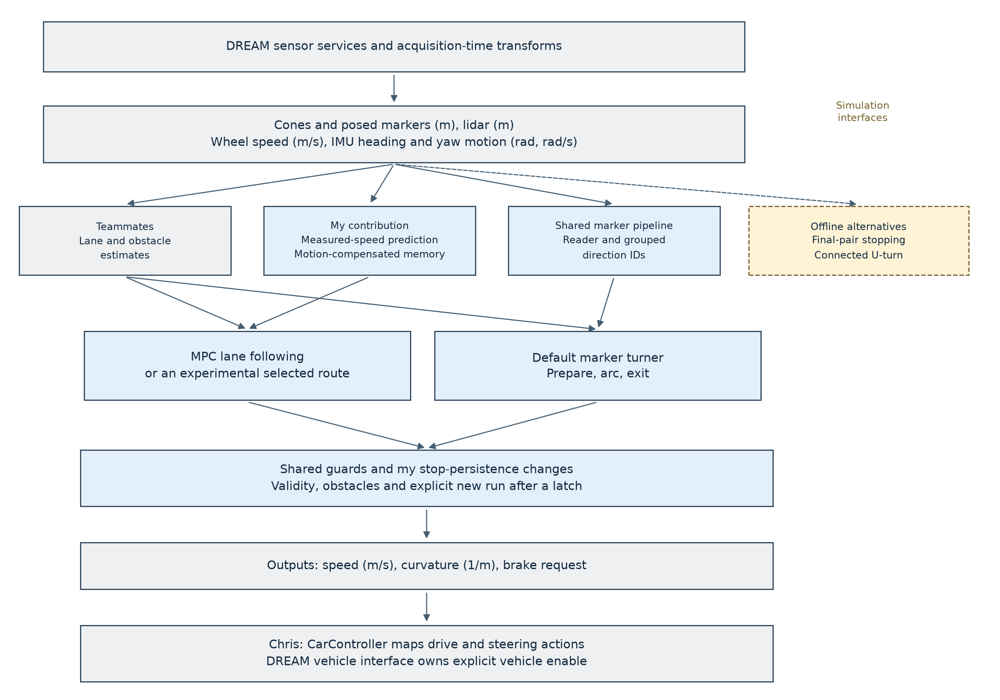

*Figure 1. Where prediction, route selection and stop decisions sit in the shared pipeline. Blue boxes contain my contributions within shared components, not exclusive ownership. The default marker turner and experimental MPC junction route are alternative paths. The dashed branch identifies offline alternatives.*

**Purpose.** Follow the observed lane, interpret the selected road sign and avoid continuing on a plan whose evidence or geometry is no longer usable.

| Interface | What I use or produce | Constraint and system consequence |
| --- | --- | --- |
| Cone rows and observation age | Positions in metres, colour and acquisition time | Old measurements describe an earlier vehicle pose. Delay and dropouts affect both tracking and route admission |
| Wheel speed and IMU | Forward speed in m/s, heading/yaw motion | Wheel speed is unsigned. Prediction assumes forward travel. Motion-compensated memory still drifts and needs expiry |
| Posed ArUco detections | ID, position and freshness | Pose scale depends on the detector's admitted marker size. A source YAML edit alone does not reload a running component |
| Lidar and boundary evidence | Current clearances, closing rows and support for an outgoing road | Missing returns mean unknown space. They cannot by themselves establish a free exit |
| `CarMemory` | Cached plan, pending command, manoeuvre phase and stop reason | An explicit new run clears relevant latched state. Losing a manoeuvre object must not erase a stop |
| `CarController` | Requested speed, signed curvature and bounded brake request | Controller limits, steering calibration and brake response belong to the control/hardware integration. A zero action is not a measured stopping distance |
| DREAM runtime | Admitted parameters, TF and vehicle services | The policy never enables the vehicle. The camera TF describes zero pan, so unmeasured physical panning invalidates frame assumptions |

**Requirements and trade-offs**

- **Track within the car's steering reach.** A requested curve outside the measured left/right limits is not made feasible by increasing an MPC weight.
- **Keep short gaps bounded.** Retaining a plan avoids an immediate discontinuity, but its usable distance, age and sensor requirements must limit continued motion.
- **Obey the requested exit.** A closed or unsupported left exit must not silently become straight travel.
- **Keep stopping separate from successful navigation.** A guarded stop can be correct fault handling while still failing the requested task.

<a id="yuhao-3"></a>

### 2. How it works (Standard 2)

#### 2.1 Measured-speed MPC

The path-frame model, the cost and its least-squares form $\|Mu-c\|^2$ (solved with SciPy's `bvls`) are in Peiyu's
Section 2.1, with the Stage 1 weights, and in Toby's Section 2.1, with `dev`'s car 20 weights and the lane side.
Only the first curvature is applied, then the policy solves again. My change is to the speed $v$ inside each
predicted step, $d = v\Delta t$. The horizon covers $Nv\Delta t$, so the speed also changes how far ahead it looks.

- **My change:** rebuild the motion matrices using fresh measured speed, holding it constant across this horizon. The delay projection also uses $d_\tau=v\tau$ and the previous requested curvature, not reconstructed motion history. The solver API uses nominal speed when feedback is omitted, while a measured zero remains zero. Required missing/stale wheel data still stops the ROS policy through its sensor checks.
- **Why:** acceleration or under-speed makes a nominal-speed model predict the wrong travelled distance. Changing the model input addresses that mismatch directly.
- **Constraints kept:** separate left/right curvature bounds. **Not represented:** tyre slip, steering slew, a complete vehicle dynamics model, or a hard lane/obstacle constraint inside the least-squares problem. Other policy guards check obstacles and stopping; the cost alone is not a containment proof.
- **Failure handling:** finite inputs, solver status, vector shape and curvature bounds must all be valid. A failed solve requests a stop. Cached-plan progress uses measured travel and stops at plan exhaustion instead of repeating its last steering indefinitely.

The **6 Oct comparison** uses $N=12$, $\Delta t=0.1$ s, target 1 m/s, symmetric 3 m⁻¹ limits and weights **10/1/0.1/1**. It does not test the later car-20 configuration: target 0.5 m/s, **0.48 left / 0.92 right m⁻¹** and curvature-change weight **2**. [Sources: evaluation](../mpc-simulation-evaluation.md), [calibration by Toby/Chris](../mpc-lab-calibration.md), [MPC code](../../policy/action_policy/mpc.py).

#### 2.2 Final-pair stopping and the visibility assumption

- Compare each colour's farthest cone on a usable straight lane. Both rows need at least two cones, final distances must agree within 0.15 m, and the candidate must be within 2.5 m.
- Confirm across three distinct increasing acquisition times, compensating for travelled distance and observation age. Repeated stamps, stale data or one-sided rows cannot add confirmation.
- Once confirmed, cap speed at 0.5 m/s and enforce the assumed envelope

$$v t_r+\frac{v^2}{2a}\leq d_{usable},\qquad t_r=0.3\ \mathrm{s},\ a=0.5\ \mathrm{m/s^2}.$$

- $d_{usable}$ is the remaining distance after the target, uncertainty and stop-tolerance allowances. The target centre is 0.15 m beyond the final pair before those deductions.
- **Decision:** retain this as an offline experiment. Temporal agreement can show a consistent visible pair, but cannot prove that hidden cones do not continue the lane. The deceleration and uncertainty growth are assumptions, not identified vehicle properties.

#### 2.3 Cone memory and geometric steering

- Convert observed cones into a remembered frame using acquisition-time wheel/gyro odometry. Propagate them into the current body frame when the camera briefly loses a row.
- Fit connected boundary geometry and choose a turn path. At commitment, retain the turn frame/path so a short occlusion does not move the target. Supported fresh return geometry can replace the return route.
- Recompute lookahead steering from the estimated current pose. For a target $(x_L,y_L)$ in the body frame,

$$\kappa=\frac{2y_L}{x_L^2+y_L^2}.$$

- **Trade-off:** memory provides continuity, but pose drift and incorrect associations can preserve a wrong path. Bound its age/travel and keep fresh lidar/braking-footprint checks.
- This is a geometric feedback controller with **no trained model or online learning**. Recomputing steering each tick is not continuous route replanning.

#### 2.4 Experimental junction navigator and shared default turner

| Design | How it chooses motion | Status |
| --- | --- | --- |
| Experimental cross/T navigator | Queue command, infer incoming frame, require positive outgoing-row support, select a centre path for MPC, hand off to a fresh exit lane | My 26 Oct experiment, disabled by default |
| Default marker turner | Prepare on the outside of the lane, admit a feasible circular arc, follow it with bounded pursuit, search from the planned arc endpoint | Toby's implementation with my grouped IDs, preparation/admission and stop contributions in PR #35/#36 |

The experimental navigator assumes equal-width perpendicular roads. Current near/far boundary evidence supports an exit; an interior closing row vetoes it. An unknown exit permits only a finite approach whose endpoint and stopping budget remain before the junction mouth. Old evidence cannot authorise an indefinitely moving endpoint.

**Grouped commands (my change in PR #35):** IDs 1–4 left, 5–6 right, 7–8 straight, and any other confirmed ID stops
the run. The full table and the marker reader's 2 m, two-step rule are in Toby's Section 2.2. The 26 Oct figures
instead use the historical **3/4/5 left/right/straight** mapping.

**Why heading-aware admission matters.** $R=1/|\kappa_{max}|$, so the 0.48 m⁻¹ left limit gives $R=2.083$ m. A left-turn arc must start tangent to the **actual** heading and clear the inside corner and far row. My change prepares earlier and rejects an infeasible start rather than relaxing clearance. These checks do not prove the entire outside-row body sweep from every heading.

*Figure 2 is Toby's right-turn geometry (his Section 2.3), R=1.2 m in 0.8 m roads, not repeated here. Moving to the outside changes the feasible start window. This explains the shared geometric constraint, not a measured car trajectory or my independent calibration.*

<a id="yuhao-4"></a>

### 3. Simulation (Standard 3)

#### 3.1 Could weight tuning solve the initial failure?

- **Question:** was the early stop caused by an MPC horizon/weight choice?
- **Method:** 60 tuning runs compared baseline, a longer horizon and smoother steering, followed by 10 separate-seed diagnostic validation runs. Score tracking, curvature-rate RMS, fallbacks, clearance and endpoint completion.
- **Result:** all tuning candidates passed **0/20 completion cases**. The smoother candidate reduced curvature-rate RMS about **32%** but increased lateral RMS about **12%**. All stopped before the 6 m finish because finite camera visibility lost usable rows.
- **Decision:** do not promote a weight setting as an endpoint solution. Investigate missing-lane evidence and final-pair inference separately. Separate seeds here are not blinded unseen final validation.

#### 3.2 Does measured speed improve prediction?

- **Question:** isolate the prediction input while holding the controller implementation fixed.
- **Method:** three scenarios × two speed inputs × five seeds (200–204) = **30 runs**. All use 0.2 s delay and 0.01 m cone noise. Illustrative speed lag is 0.5 s in S1/S2 and 0.3 s in S3; achieved-speed ratios are 1, 0.5 and 0.6. S3 drops every third detection batch.
- **Metric:** $e_{RMS}=\sqrt{L^{-1}\int_0^L e(s)^2 ds}$, with the same first **4.5 m** in every run. Distance weighting prevents slow travel or a stationary tail from improving the score artificially.

| Scenario | Nominal-speed RMS (m) | Measured-speed RMS (m) | Reduction |
| --- | ---: | ---: | ---: |
| Acceleration | 0.07158 | 0.07072 | 1.2% |
| Half achieved speed | 0.08314 | 0.08173 | 1.7% |
| Slow with dropouts | 0.07532 | 0.07265 | 3.5% |

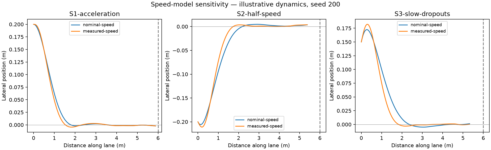

*Figure 3. Representative seed 200, lateral position against distance in metres. Orange uses measured speed and blue nominal speed. The table averages all five seeds. Both modes stop short of the dashed 6 m finish.*

- **Conclusion:** a small consistent benefit under these sensitivity conditions, with zero solver fallbacks. **Limit:** uncalibrated longitudinal dynamics and ideal curvature response, without CarController or DREAMGym. These are development cases, not physical pass-rate predictions. [Metrics](yuhao/data/mpc-speed-metrics.csv), [settings and source hashes](yuhao/data/mpc-speed-summary.json).

#### 3.3 Can a final cone pair reliably identify the finish?

- **Method:** seven scenarios × measured-speed `MpcPolicy` baseline / `EndpointMpcPolicy` prototype × five seeds (300–304) = **70 runs**. Hold settings fixed, score the finish only in the evaluator, and integrate residual speed after zero command. Here the baseline already uses measured speed, unlike the nominal-input comparator in Section 3.2.

| Scenario | Baseline passes | Prototype passes | Prototype interpretation |
| --- | ---: | ---: | --- |
| Four cases where the final pair becomes visible | 0/20 | 20/20 | Centre stops in the 6.0–6.5 m gate with the other provisional checks satisfied |
| Final pair hidden | 0/5 | 0/5 | 5/5 false endpoints, stop x=5.583 m |
| All cones from x=4 m hidden | 0/5 | 0/5 | 5/5 false endpoints, stop x=3.583 m |
| Detection stream fails at t=5 s | 0/5 | 0/5 | 5/5 aborts, expected fault handling |

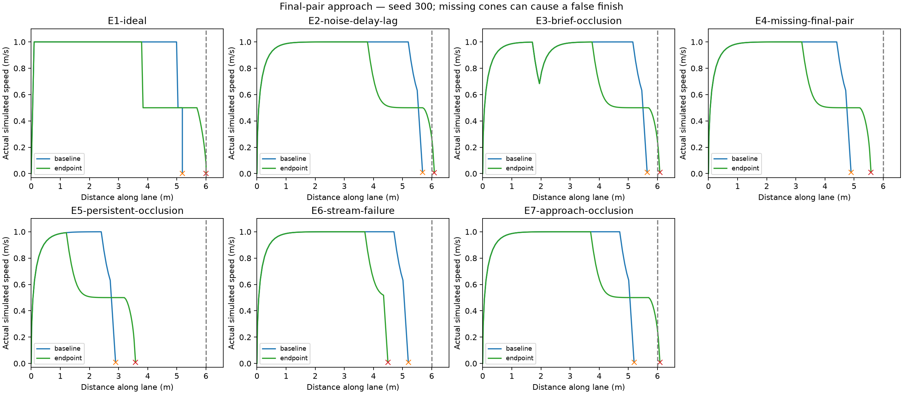

*Figure 4. Actual simulated speed (m/s) against distance (m), seed 300. Green is the prototype, blue baseline and the dashed line the true 6 m finish. E4/E5 show that a previous visible pair can look like the endpoint. All panels retain the same meaning of the scorer's finish.*

- **Judgement:** three observations reduce transient inconsistency, not persistent visibility ambiguity. Keep the prototype offline rather than claim robust lane-end detection. Noiseless seeds repeat deterministic behaviour and add no independent statistical evidence. [Metrics](yuhao/data/endpoint-metrics.csv), [settings](yuhao/data/endpoint-summary.json).

#### 3.4 Can cone memory carry a U-turn through occlusion?

- **Method:** 12 varied layouts changing row/cone spacing, jitter, initial pose and missing cones/detections. Run online geometric steering with remembered observations, lidar and braking-footprint guards.
- **Result:** **10/12** complete, **2 guarded stops**, **0 cone contacts**, **0 recorded body excursions**. A separate noncircular-cap probe is **3/4** and is not part of 10/12.


*Figure 5. Six illustrative cases from the varied-layout and separate shape-probe batches. Orange is the simulated vehicle path, dots mark cone rows and both axes are metres. The 0.9 m nominal case and compressed-cap probe show stopped paths. The headline 10/12 uses only the varied-layout batch.*

- **Critical assumption:** 0.50 m planned radius and **2.2 m⁻¹ left capability**, with 0.30/0.15 m/s approach/turn speeds. This is tighter than the measured car-20 left reach. Success here cannot establish a feasible physical U-turn.
- **Decision:** keep the experiment separate from the calibrated intersection controller. [Saved report](yuhao/data/uturn-summary.json), [historical source](https://github.com/CiaranGruber/robotic-car-ai/tree/fd01806).

#### 3.5 Does positive exit evidence select the requested junction road?


*Figure 6. The same simulated cross at t=4.9 s with historical IDs 3/4/5. Green is the centre path selected for MPC, grey the simulated approach and dotted lines local lane fits. This frame shows route selection before completion, not three completed turns.*

| 26 Oct experiment | Outcome | What the failures mean |
| --- | --- | --- |
| Cross, 0.2/0.4 m cone spacing | 20/22 completed navigation/handoff | Two noisy 0.4 m approaches stopped before route admission |
| Dense T, requested exit available | 22/24 completed navigation/handoff | Includes one correct exit without completed handoff at the scoring gate |
| Dense T, requested exit closed | 6/6 stopped | Closing-road evidence prevented the requested blocked exit |
| Sparse T, 0.5/0.6 m spacing | 18/18 stopped, 0/18 navigation passes | Approach lane loss, before T/exit admission. This does not establish blocked-exit detection |

- **Judgement:** keep an unknown exit unknown and bound the approach instead of substituting another road. Sparse incoming evidence remained a failure mode.
- **Limits:** decoded detections, idealised lidar and an equal-width orthogonal-road prior. These runs do not test image recognition, physical stopping or frame accuracy. Counts are historical, before PR #36's approach-budget repairs. [Cross report](yuhao/data/cross-summary.json), [T report](yuhao/data/t-summary.json).

#### 3.6 Does stopping survive a rejected manoeuvre?

- **Failure:** clearing a rejected turn object could allow ordinary lane following to resume. I kept the stop reason outside that object's lifetime and requested the existing bounded brake pulse.
- **Comparison at the 0.48 m⁻¹ left limit:** delayed-confirmation cross/T cases, seeds 0–2. All **6/6 at 1.0 m width** stop without contact/body departure; all **6/6 at 1.5 m** complete the left exit. Every case requires a recognised left command.
- **Interpretation:** these sampled narrow starts reject, not a proof that every possible 1 m turn is impossible. Width alone does not capture heading, start position or full body sweep.
- **Software evidence at `488ec30`:** **837 passed, 5 skipped, 1 expected failure, 6 subtests passed** on macOS/Python 3.12, pytest 9.2. The existing wet-floor expected failure remains. This is a historical local policy-suite result, not a new ROS or physical acceptance result. [Acceptance record](https://github.com/CiaranGruber/robotic-car-ai/blob/488ec30/docs/acceptance.md#pr-35-policy-test-repairs-2026-11-02).

<a id="yuhao-5"></a>

### 4. On the car (Standard 4)

#### 4.1 Why did ID 1 never request a turn? (30 Oct, car 20)

- **Question:** was the policy ignoring a recognised left marker, or did recognition fail the command gate?
- **Method:** compare the 14:46:15 and 14:50:00 recordings, policy settings, source/installed hashes and the detector's **active runtime snapshot**. Count posed ID-1 observations against the unchanged 2 m range gate and two-step confirmation requirement.
- **Controlled boundary:** diagnose the existing deployment before tuning a trajectory. Do not rescale saved poses or widen the gate to force confirmation.

| Run | Policy steps | Posed ID-1 observations | Reported range (m) | Within 2 m | New turn states |
| --- | ---: | ---: | --- | ---: | ---: |
| 14:46:15 | 157 | 14 | 3.373–4.594 | 0 | 0 |
| 14:50:00 | 62 | 27 | 3.279–6.369 | 0 | 0 |


*Figure 7. All 41 posed ID-1 observations exceed the unchanged 2 m gate. Time is relative to each run's own start. Repeated points can reuse the same detector acquisition, so 41 policy observations do not mean 41 independent camera frames.*

- **Finding:** the active 14:29:56 detector snapshot used **0.250 m**, although the printed outer black square and uploaded YAML used **0.081 m**. Restarting the policy at 14:45 had not reloaded the detector. Pose-scale reasoning predicts an approximately $0.250/0.081=3.09$ scale mismatch for the same image, but these runs have no independent ground-truth range measurement.
- **Intervention:** once the operator confirmed stationary/Policy ZERO, restart **only the detector** at 14:59:32. Verify both the new admitted snapshot and live parameter readback are **0.081 m**. Keep the policy's range gate unchanged.
- **Result:** verified the detector's effective setting. This isolates a configuration-lifecycle fault; it does not measure detection accuracy or prove that a turn will complete. [Observation extract](yuhao/data/marker-range.csv), [source record](https://github.com/CiaranGruber/robotic-car-ai/blob/bf5e08c/docs/acceptance.md#left-turn-retest-stale-aruco-size-snapshot-2026-10-30).

#### 4.2 Why did the left turn still stop after the detector reload?

- **Method:** align actions $i$ with post-step memory $i+1$ in the **15:02:43** recording. Decode complete prefix records only because the snapshot caught active log writing. **705 aligned records** are available. Separate recognition, preparation and the stop reason rather than judging only the path by eye.

| Event | Time after run start | Recorded evidence |
| --- | ---: | --- |
| ID 1 confirmed | 3.025 s | `TURN_LEFT`, `APPROACH`; entry 2.483 m ahead, estimated lane width 1.013 m |
| Geometry stop | 5.438 s | `LANE_LOSS` latch; configured left radius 2.083 m; drive action zero, wheel feedback still 0.503 m/s |
| Internal ARC state | 6.017 s | Stop latch and zero drive remain; wheel feedback is 0.310 m/s. A phase name alone does not show the planned arc was driven |


*Figure 8. Recorded wheel speed and normalised drive/steering actions during the first 10 s of the post-reload run. Vertical lines identify confirmation and the geometry stop. Motion after a zero command must be assessed from measurements; the command trace alone is not a physical stopping-distance test.*

- **Geometry at rejection:** estimated width **1.037 m**, outside offset **0.1738 m** versus **0.1823 m** required by the aligned-arc model. Heading was **4.61° outward**, and the car was **26.5 mm past** that model's latest clear start.
- **Decision:** prepare immediately after confirmation, admit a circle tangent to actual heading, and measure exit-search distance from the arc endpoint. Do not relax steering limits or clearance to turn this failed start into a pass.
- **What this establishes:** the post-reload run reaches recognition, then rejects geometry. The size-snapshot fault is no longer the immediate cause.
- **Limits of the experiment:** the two drives are not a randomised matched trial. Approach pose, cones and motion differ. No external pose/stop-distance ground truth was recorded. The old log also contains a **0.3 camera-pan command against a fixed-zero camera TF**, so frame accuracy is not established. PR #36 restores zero camera command.
- **Replay boundary:** replaying old observations checks what new code would command at those old poses. It cannot show the different physical trajectory caused by earlier preparation. Two short idealised mirrored feedback simulations reached EXIT, but physical left-turn success remains unverified. [Trace extract](yuhao/data/post-reload-trace.csv), [source record](https://github.com/CiaranGruber/robotic-car-ai/blob/bf5e08c/docs/acceptance.md#left-turn-preparation-tangent-admission-and-exit-search-2026-10-30).

#### 4.3 How the car evidence changed my engineering decisions

| Simulation assumption or proposal | Car evidence | Decision |
| --- | --- | --- |
| A posed marker in the log should reach the command selector | Every reported ID-1 range was outside the gate under the stale detector snapshot | Verify the component's admitted runtime settings before changing policy logic |
| A feasible aligned arc is enough | The later run arrived late and 4.61° outward | Use actual-heading tangent admission and earlier preparation |
| A phase transition indicates motion | `ARC` appears after the stop, while drive action remains zero | Inspect actions and stop latch alongside phase names |
| A zero command is an adequate stop metric | Wheel/pose evidence and calibrated braking are needed to assess residual motion | Keep software stop evidence separate from physical stopping acceptance |

#### 4.4 Experiments still needed (method proposed, not run)

All four are shared with teammates, so they are in the team table (Team overview, 0.7), with my methods and
measurements kept:
- the radius car 20 sustains at the widened steering interval (with Chris and Toby);
- whether the cone and marker frame is right with zero pan (with Thanh Long, Toby and Peiyu);
- whether earlier preparation improves the physical left turn (with Toby);
- whether the brake settings bound the residual travel (with Zhenling, Peiyu and Chris).

<a id="yuhao-6"></a>

### 5. Figures and evidence (Standard 5)

| Figure | What to explain during discussion | Evidence |
| --- | --- | --- |
| 1 System diagram | Which interfaces I changed, shared dependencies and which experiments stayed offline | Section 1 and linked implementation commits |
| 2 Turn geometry, Toby's figure | Why outside preparation and heading alter the feasible start | Shared attribution and geometry in Section 2.4 |
| 3 MPC trajectories | Nominal versus measured speed, distance-weighted metric and small effect size | 30 per-run metric rows and original summary |
| 4 Endpoint profiles | Completion versus false endpoint versus expected stream-failure abort | 70 per-run metric rows and original summary |
| 5 U-turn paths | Distinguish varied-layout results from separate shape probes and hypothetical steering | Preserved result/configuration/source-hash extract |
| 6 Junction selection | Path selection precedes completed handoff; historical ID mapping | Cross/T result/configuration/source-hash extracts |
| 7 Marker ranges | Runtime snapshot fault before the detector-only intervention | 41 recorded policy-observation rows, with timestamps and units |
| 8 Post-reload trace | Confirmed command, stop latch, actual wheel feedback and commands as distinct signals | 705 aligned scalar records, including old camera-pan command |

**Provenance.** [sources.json](yuhao/data/sources.json) records the original ignored-build paths and SHA-256 hashes. Figures 3–6 are preserved historical simulation plots, not reruns on today's defaults. The small saved extracts make the displayed counts and car traces available with this logbook. Raw car captures remain outside the submission. [make_figures.py](yuhao/make_figures.py) draws the system diagram and redraws Figures 7–8 from the committed CSV files without a car connection. The original simulation evaluators are named in the manifest and must be run at their matching source revision for comparison.

**Lessons and remaining limits**

- A modest tracking improvement does not solve endpoint perception. Compare the model input separately from task completion.
- A negative simulation result can reject an unsafe inference. Persistent occlusion defeated the final-pair hypothesis even after temporal confirmation.
- Keep a controller's geometric assumptions consistent with the measured actuator reach. The hypothetical U-turn is not evidence for car 20's calibrated turning capability.
- Diagnose each link before retuning the next: detector admission, command recognition, feasible preparation, actuation and measured motion.
- The team has useful software and physical diagnostic evidence. My records do not establish complete physical intersection turning, calibrated braking or frame accuracy.

**Preparation note:** AI assisted drafting and organising the linked evidence. The individual oral discussion must reflect my own understanding of these models, decisions and limitations.

---

<a id="chris"></a>

## Part 7: Chris (Chuhan Wang): car control sub-team, system ID, speed control and avoidance validation


| | |
| --- | --- |
| Role | Car control sub-team with Yifei. System ID experiments and analysis on the real car, the low-level controller (speed and steering), then on-car validation of speed and obstacle stops |
| PRs | #17 (`CarController`: FF + PI speed, per-side steering map, car 20 defaults, `tools/sysid_analyze.py`), #23 (two-obstacle stop fixes), all merged into `dev` |
| Open work | `fix/speed-overspeed-integral` (26 Oct speed fix, tested on car 20, pushed, no PR yet). `test/steering-limit` (±0.8 interval; Toby's turn work uses it). Lane-jump stop fix and asymmetric avoidance prototype: local only |
| Built on teammates' work | Yifei: steering map runs, motor calibration. Peiyu: MPC framework, car models (#16, #18). Toby: MPC calibration that uses my curvature limits (#15). Zhenling: obstacle detection and avoidance (#19, #21). Long: lane estimation. Ciaran: repo, CI, upload script |
| Figures | `chris/figures/`, made by `python3 docs/logbook/chris/make_figures.py`. `03_car20_maps_pi.png` is from `plot_speed_map.py` on the 5 Oct `c20_*` bags |

**Summary: four pieces of work, in order** (the same as my slide):
1. **System ID on the real car.** Drive → speed and steering → curvature on car 8 and car 20. The numbers differ a lot
   between cars, so I wrote a 15-minute recalibration procedure (Sections 2.1, 4.1, 4.2).
2. **Low-level controller.** Feedforward + PI on wheel speed, and a per-side inverse steering map, so the MPC can
   command m/s and 1/m. Merged as #17 (Sections 1, 2.2, 4.3).
3. **Speed fault fix (26 Oct).** The integral rule left the car at 0.87 m/s for a 0.5 m/s target, or unable to start.
   Diagnosed in code, tested in simulation, fixed and checked on car 20 (Sections 2.3, 3.1, 4.4).
4. **Obstacle avoidance validation.** Two planner bugs found in simulation (#23), a lane-jump false stop found on the
   car, and a simulation study of how close two obstacles can be (Sections 3.2, 3.3, 4.5).

On real cars: system ID (cars 8 and 20), PI tuning, the speed fix (car 20) and the avoidance runs (car 20). Sections
3.2 (prototype) and 3.3 are simulation only.

<a id="chris-1"></a>

### Timeline

| Week | What I did | Evidence |
| --- | --- | --- |
| 0 (27-29 Sep) | System ID test sequencer with safety stops; first speed map and PI on car 8 | `tools/sysid_analyze.py`, `car-calibration` procedure |
| 1 (5 Oct) | Car 20: dead-band, speed map, steering map (with Yifei), PI v1 → v2, battery check | bags `c20_*`, Fig. 03 |
| 2 (12-13 Oct) | `CarController` merged; Progress Assessment | PR #17, `docs/control/` |
| 3 (17-19 Oct) | Two-obstacle stop: reproduced in sim, 2 bugs fixed; car 20 runs found the lane-jump stop | PR #23, bags `two_obstacles_2/3`, `~/policy_logs` |
| 4 (26 Oct) | Speed fault taken over from Zhenling: fixed, 3 runs on car 20 | `fix/speed-overspeed-integral` (`7377b30`, `f48252e`, `4a5a051`) |
| 5 (30 Oct) | Avoidance spacing study (sim); steering-limit stand test (car 20) | `test/steering-limit` (`da109a1`, `bb2a61c`), bag `steer_stand_08` |

---

<a id="chris-2"></a>

### 1. Where my parts fit (Standard 1)


*Blue boxes are mine. Everything above car control works in m/s and 1/m, so it can be tuned in simulation and moved
between cars; car control is the one block that knows the car's physics.*


| Interface | Direction | What it carries | Assumption or constraint |
| --- | --- | --- | --- |
| `DriveCommand` from the MPC | in | speed (m/s), curvature (1/m, + = left), brake flag, 10 Hz | Curvature within the car's limits: car 20 +0.48 / −0.92 1/m |
| Wheel speed | in | m/s, 10 Hz | Unsigned, quantised at low speed, holds its last value 3-4 s after stopping |
| drive, steer to the vehicle interface | out | normalised; drive capped at 0.75 | Platform slew 10/s steer, 50/s drive; steer clipped to ±0.5 after trim |
| Curvature limits to the MPC and avoidance | design value | +0.48 / −0.92 1/m | Measured on car 20 at ±0.5; used in #15 |

**Design goals and the choices they forced:**
- **Track 0.5 m/s with little overshoot** despite ~0.2 s dead time and τ ≈ 2.7 s → feedforward for the fast part,
  low-gain PI for the rest.
- **Work on any car and battery** → the feedforward is only a starting point; the integral has to absorb map errors
  (it didn't before 26 Oct, Section 2.3).
- **Turn any feasible curvature into the right steer on each side** → separate fits per side, clamped where more steer
  does nothing.
- **System-level consequence:** car 20's left limit (R ≈ 2.1 m) caps the MPC and the avoidance planner. It explains
  why left 90° turns failed (Toby, Section 3.4 of his section) and limits how close two obstacles can be (Section 3.3).

<a id="chris-3"></a>

### 2. How it works (Standard 2)

#### 2.1 Car model from system ID

$$v(t) = v_{ss}\left(1 - e^{-(t - t_0 - \theta)/\tau}\right), \qquad v_{ss} = K\,(u - u_0)$$

| Quantity | Meaning | Car 8 (29 Sep) | Car 20 (5 Oct) |
| --- | --- | --- | --- |
| $K$ | speed per unit drive (m/s) | 3.97 | 9.18 (±10%) |
| $u_0$ | drive offset of the map | 0.697 | 0.475 |
| $\tau$ | time constant (s) | 1.1 | 2.7 |
| $\theta$ | dead time (s) | 0.5 | 0.2 |
| breakaway | drive at which the car starts to move | not swept | 0.52-0.53 (≈ 0.68 on 26 Oct) |

- Steering, car 20 (κ = yaw rate / wheel speed): right $\kappa = -0.959\,s + 0.038$ (RMS 0.006), left
  $\kappa = -0.630\,s + 0.008$ (RMS 0.019), saturating at κ ≈ 0.47 1/m beyond $s = -0.75$. Positive steer turns right.

#### 2.2 Controller (`policy/control/control.py`)

$$u_{ff} = u_0 + \frac{v_{ref}}{K}, \quad e = v_{ref} - v, \quad I_k = \mathrm{clip}(I_{k-1} + k_i e \Delta t, \pm I_{max}), \quad u = \mathrm{clip}(u_{ff} + k_p e + I_k,\ 0,\ 0.75)$$

$$s(\kappa) = \begin{cases} (0.038 - \kappa)/0.959 & \kappa < 0 \\ \max\big((0.008 - \kappa)/0.630,\ -0.75\big) & \kappa \ge 0 \end{cases}$$

| Key parameter | Car 20 value | Why it matters on the real car |
| --- | --- | --- |
| $u_0$, $K$ | 0.48, 9.18 | Wrong by more than ~0.03 and the old controller fails (Section 3.1). Changes with car and battery |
| $k_p$ | 0.15 | With 0.2 s delay and τ 2.7 s, higher gain overshoots |
| $k_i$, $I_{max}$ | 0.04, 0.2 (fix: 0.2, 0.3) | How fast a map error is removed; too high overshoots at the start |
| `speed_i_band` | 0.2 m/s | Stops windup during the climb from rest |
| `speed_feedback_min` | 0.4 m/s | Wheel speed is unreliable below this, so PI is off |
| drive cap | 0.75 | Safety: 0.75 reaches 1.5 m/s in 3 s on car 20 |

- **Why feedforward + PI, no D:** the map gives the right drive at once; PI removes the residual. Wheel speed is
  quantised (staircase in Fig. 03c), so a derivative would amplify the steps.
- **Anti-windup:** no integration while the output is clipped and the error pushes further; integral reset at a 0
  target. A brake request bypasses the PI.

#### 2.3 The integral rule, before and after 26 Oct

| | Integrates when | Effect |
| --- | --- | --- |
| Before (`dev`, `main`) | $\lvert e \rvert$ < band | An overspeed > 0.2 m/s or a car standing still (e = 0.5) freezes the integral; only P acts |
| After (`fix/speed-overspeed-integral`) | e < band, or the car is above the target, or wheels < 0.05 m/s | Overspeed always pulled down; a car that hasn't started always pushed up; windup during the climb still limited |

<a id="chris-4"></a>

### 3. Simulation (Standard 3)

#### 3.1 For which feedforward errors does the speed controller still work? (26 Oct, re-run 5 Nov)

- **Question:** the 26 Oct fault came from a feedforward that no longer matched the car. How large a map error can each
  integral rule handle, and what does the fix cost?
- **Method:** `chris/sim_speed_integral.py`. Car 20's model from Section 2.1 plus a breakaway threshold (true $u_0$ +
  0.045, from 5 Oct), running a copy of `SpeedController` at 10 Hz. Uncertainty included: the map offset (true $u_0$
  0.20-0.60 with the feedforward fixed at 0.48), and breakaway up to 0.68 as seen on 26 Oct.


- **Result:** the old rule reaches 0.5 m/s only for a feedforward error of −0.02 to +0.03; the fix reaches it across
  −0.12 to +0.28, settling in 3.5-7.6 s. The 26 Oct breakaway case (C): old never starts, fix settles in 5.3 s.
- **Trade-off:** with a correct feedforward the fix overshoots more (peak 0.62 vs 0.53 m/s). The car showed the same
  (peaks 0.57-0.62, Section 4.4).
- **Choices made from it:** $k_i$ 0.2 with $I_{max}$ 0.3 (0.3 undershot); feedforward back to 0.48.
- **Can't conclude:** no stick-slip randomness, no battery drift within a run, no encoder hold after stopping; τ and
  delay fixed at the 5 Oct values (not swept). It is a copy of the controller, not the repo code itself.

#### 3.2 Why did the car stop beside the first of two boards? (17-18 Oct)

- **Question:** in the 15 Oct video the car stopped beside board 1 though board 2 left a clear centre line.
- **Method:** the repo's closed-loop avoidance test (car follows the MPC curvature exactly, 0.5 m/s), 1.0 m lane,
  boards 0.2 m into the lane, spacing 0.8-2.5 m.


- **Bug 1** `policy_runner._obstacle_distance_m`: the check band was widened on both sides by the car's 0.064 m offset
  from the new line, so it touched board 1. Fix: widen only on the car's side.
- **Bug 2** `avoidance._group`: after locking, the line re-centred on board 1's gap. Fix: keep the current line while
  it clears both boards.
- **Result:** all spacings pass with ≥ 0.11 m clearance; a regression test fails before and passes after (PR #23).
- **Earlier sweep (17 Oct, staggered boards, 0.8 m lane):** defaults need 3.5 m; raising only the ramp cap to 0.40
  made even one board stop (the MPC looks only 0.3 m ahead); ramp 0.48 + look-ahead 0.6 + pass 0.1 → 2.75 m.

#### 3.3 How close can two obstacles be, and would a sharper left limit help? (30 Oct)

- **Method:** `obstacle-avoidance/spacing-study/` sweeps on `tests/policy/obstacle_simulation.py`, mirrored boards,
  6-8 seeds per point (results are noisy near the threshold).


- **Result:** the key variable is the lateral shift between the two passing lines. Raising the car's left limit
  0.47 → 0.93 alone changes nothing on a straight, because the planner's symmetric 0.45 cap binds first. Left bends are
  worst (R 3 m: about 3 m needed, vs 1.6 m right, 1.2 m straight).
- **Prototype:** each half of a move capped by its own side's room: 2.25 → 2.0 m (straight, shift 0.55),
  > 3 → 2.5 m (left bend). No gain at shift 0.25 (unexplained). Not merged.
- **Failure case found:** an obstacle inside stopping distance but not yet confirmed, plus lane loss in the same step,
  latches a lane-loss stop that only coasts; the car hits the board in sim.
- **Can't conclude:** perfect perception, no steering lag or slew; car width (0.25 m) is a guess.

<a id="chris-5"></a>

### 4. On the car (Standard 4)

#### 4.1 Drive → speed (car 8 on 29 Sep, car 20 on 5 Oct)

- **Question:** which drive gives which speed, how fast, from where does the car move?
- **Method:** one drive level held per run, steer 0, 7-8 m straight, all topics bagged. Dead-band sweep 0.50-0.60 in
  0.02 steps, 8 s holds at 0.53-0.57, short runs at 0.75 / 0.85. Safety stops in code: 1.5 m/s, max distance, stall
  0.6 s, IMU impact > 3.5 m/s².
- **Controlled variables:** same straight and direction, car turned between runs, trim fixed, battery checked by
  repeating 0.75 at the start and end (speed at 2 s: 1.19 vs 1.14 m/s).
- **Change of plan:** 0.80-1.00 dropped (0.85 hit 1.5 m/s in 1.8 s). Runs too short to settle, so each rise was fitted
  with τ fixed.
- **Result:** Fig. 03a and Section 2.1. Breakaway is stick-slip and inconsistent (0.52 moved once, 0.53 didn't).


*(a) drive → speed: shaded = no motion; line above 0.6 is the model. (b) steer → curvature per side. (c) step to
0.5 m/s, PI v1 vs v2.*

#### 4.2 Steer → curvature (car 20, 5 Oct, with Yifei)

- PI held 0.5 m/s; one steer level per run (±0.25 to ±1.0); κ averaged over the last 3 s. Trim set to −0.18 first
  (before: a 3 m right circle at steer 0). ±0.5 repeated after a reboot: within 3%. Sign checked by eye.

#### 4.3 PI tuning (car 20, 5 Oct)

| Version | $k_p$ | $k_i$ | Overshoot | Steady error at 0.5 m/s |
| --- | --- | --- | --- | --- |
| v1 | 0.10 | 0.07 | 27% | – |
| v2 (#17) | 0.15 | 0.04 | 15% | ≈ 0.013 m/s |

- Car 8 (kp 0.2, ki 0.15): 0.6 m/s with ~0 error, 15-19% overshoot at 0.9 m/s. Only 0.5 m/s was validated on car 20.

#### 4.4 Speed fix on the car (car 20, 26 Oct)

- **Question:** does the fix remove the 0.87 m/s overspeed without losing the start?
- **Before:** 0.87 m/s steady at a 0.5 target; with Zhenling's feedforward 0.15 the car didn't move (drive 0.28, the car
  needed ~0.60-0.68 that day). One frame without a lane at standstill also latched LANE_LOSS (plan length = measured
  speed × step = 0); fixed with plan length ≥ target speed.

| Run | Moving after | Reached 0.5 | Peak (m/s) | Before stop (m/s) |
| --- | --- | --- | --- | --- |
| 15:20:27 | 0.8 s | 1.9 s | 0.62 | 0.50 |
| 15:21:42 | 0.4 s | 3.2 s | 0.57 | 0.54 |
| 15:23:01 | 0.9 s | 1.8 s | 0.60 | 0.52 |

- **Limits:** 3 runs on one day; ~20% start overshoot; if the encoder fails while moving the standstill integral could
  push drive to 0.75 (needs a time limit). The battery as the cause of the breakaway shift is not verified.

#### 4.5 Avoidance on car 20 (19 Oct) and the steering limit (30 Oct)

- **19 Oct question:** does PR #23 pass two real boards? 3 runs, then replay of the logs through old and new code.
- **Finding:** still braked beside board 1. As the nearest blue cone left the camera view the lane estimate jumped
  0.35 m in 40 ms and put board 1 in the path; in the raw lidar frame it was 0.19 m clear. Fix (local): within 0.6 m
  of the front, block only if both the lane frame and the lidar frame agree. Replay: runs 1 and 3 false-stop on old
  code, pass on new. Run 2: no left move (lane estimate 0.15-0.2 m off in the left bend, left steer near saturation).
- **Ruled out:** dropped commands. All 2145 commands reached the Traxxas, ~50 ms lag.
- **Measured:** lidar 0.30 m and front 0.40 m ahead of the rear axle (config had front 0.30). Boards along the lane
  gave 36 → 4 lidar points as the car approached; a 20 cm board facing the car gave 16-36 and was avoided from 2.5-3 m.
- **30 Oct question:** is the left saturation mechanical? RC (not limited by the interval) turned ~2× further. Stand
  test with the interval at ±0.8: applied = trim −0.25 + 0.8 s, clipped at −0.8; left travel +60%. Ground re-map not
  done (car needed by teammates), so the 0.91 1/m left limit used in Toby's turns is unmeasured.

<a id="chris-6"></a>

### 5. Lessons and limits

- A feedforward tuned on one day is not a car property: breakaway moved from 0.52 to ~0.68 in three weeks. Feedback
  must absorb that, and the 5 Oct integral rule could not.
- My controller is not in the team simulator's loop (it simulates a first-order speed response, not `CarControl`);
  Section 3.1 is a separate model.
- Not measured: braking (`brake_action` 0.3, stop distance 0.6 s × v are estimates), PI at other speeds, car width,
  the left limit at ±0.8.
- Next: PR the speed fix; replay the 26 Oct runs through the model (sim vs real); time-limit the standstill integral;
  measure stopping distance.

---

<a id="yifei"></a>

## Part 8: Yifei Xia: car control testing, marker recognition and camera investigations


| | |
| --- | --- |
| Role | Car control sub-team with Chris (Chuhan Wang): speed-control testing, steering measurements and actuator calibration. Additional investigations into ArUco ID detection, battery monitoring and camera heading compensation |
| Shared work | Chris: PI speed-control loop and vehicle tests, steering-map runs and motor calibration. Chris's section records the controller implementation, fitted models and subsequent fixes; these are not claimed here as my independent work |
| Individual work | Camera pan calibration, marker-ID testing and troubleshooting, battery-monitoring feasibility investigation, and an interactive camera-compensation simulation developed with AI assistance |
| PR | #26 (`5527932`, merged into `dev` on 19 Oct): `scripts/aruco_detection_test.py`, a read-only subscriber that prints the detected marker IDs, and `scripts/camera_pan_test.py`, a manual pan test tool (dry-run unless `--live`), with notes in `docs/control/aruco-detection-test.md` and `docs/control/camera-pan-test.md` and unit tests |
| Evidence | Shared car-control results in [Chris's section](#chris); figures in `Yifei/figure/`; [camera simulation and instructions](Yifei/yifei/camera-game/README.md) |
| Status | Shared speed and steering work supported the team's vehicle control. Marker-ID output was demonstrated. Battery-charge measurement was not implemented; physical camera stabilisation was not conclusively validated. Simulation comparison results remain to be documented |

**Summary: four pieces of work**

1. **Speed and steering tests with Chris.** Helped investigate drive-to-speed behaviour, develop and test a PI speed-control loop, and measure steering response (Sections 2.1 and 4.1).
2. **ArUco marker recognition.** Tested ID output on the vehicle and from stored images, and diagnosed a missing camera-image input (Sections 2.2, 3.2 and 4.2).
3. **Camera calibration and compensation.** Recorded three camera-pan calibration points, investigated counter-rotation, and developed a simulation using the existing compensation controller (Sections 2.3, 3.1 and 4.3).
4. **Battery-monitoring feasibility.** Identified the separate power supplies and the additional sensing hardware needed under the no-modification constraint (Section 4.4).

Real-car observations and offline results are separated below. Successful software execution does not establish physical tracking accuracy or autonomous junction-turning performance.

<a id="yifei-1"></a>

### Timeline

| Date / period | My work | Evidence and qualification |
| --- | --- | --- |
| Early control work; 27–29 Sep is Chris's recorded initial phase | Worked with Chris on drive/speed testing and an initial PI control loop | Our discussion records the collaboration; Chris dates the initial car 8 system-ID/PI phase. My attendance at every individual run is not independently recorded |
| 5 Oct | Shared car 20 calibration and speed/steering testing with Chris | Chris explicitly identifies the steering-map session as work with Yifei; his Sections 4.1–4.3 document the procedure and results |
| 12–13 Oct | Shared calibration work became supporting evidence for team controller integration | Chris records PR #17 and the Progress Assessment in this period. The implementation and merge are Chris's work, not an additional personal implementation claim |
| 12 Oct | Camera pan test tool; a dry-run log of its commands | `pan-test-20261012-131532-120658.csv` in PR #26 (dry-run, so no camera movement is recorded) |
| 19 Oct | ArUco detection tests and diagnosis of the missing image stream; successful ID output. The test tools merged as PR #26 | Terminal screenshots show dated logs, including `aruco-test-20261019-131746-299125.jsonl`; the raw log is not currently attached here. PR #26 |
| 30 Oct–2 Nov | Battery-monitoring feasibility, camera-pan calibration and compensation troubleshooting | Discussion and vehicle-session context place this work in this period; exact dates for each calibration observation were not separately recorded |
| 7 Nov | Developed and checked the interactive camera-compensation simulation | Local simulation/controller checks and GUI/CSV checks; see Section 3.1 |
| 9 Nov | Organised logbook evidence, prepared the calibration figure, and ran stored-image ArUco tests | Figures below: calibration observations and terminal outputs for IDs 0, 2, 5 and 8 |

The shared speed/steering chronology follows Chris's logbook. Other dates follow the discussion and dated terminal evidence. A date range is used where the exact experiment date is not available. Chris's 26 October speed fix and later avoidance studies are not presented as my own work.

---

<a id="yifei-2"></a>

### 1. Where my parts fit (Standard 1)

My work connected vehicle-control commands to observed physical response and checked the perception outputs available to higher-level decision-making.

| Interface / subsystem | Input | Output or contribution | Assumption or constraint |
| --- | --- | --- | --- |
| Speed control, with Chris | Target speed and measured wheel speed | Adjusted normalised drive command; shared tests for calibration and tuning | Reliable feedback is needed; a fixed drive command is not a fixed speed |
| Steering calibration, with Chris | Normalised steering command | Observed steering response and shared steering-map measurements | Steering angle and path curvature are different quantities; Chris documents the curvature map used by the controller |
| ArUco detection test | `/car/fiducial_detections`, or a stored image for the separate offline tool | Detected marker IDs for handover to decision-making code | The live detector needs an active image source and the correct dictionary |
| Camera compensation experiment | Vehicle heading and a selected reference direction | Camera pan command | Calibration is vehicle-specific; IMU freshness, command range and rate are constrained |
| Battery-monitoring investigation | Motor-battery and computer-supply arrangement | Feasibility assessment | No vehicle hardware modifications permitted; no accessible battery measurement source established |

**Design choices and system consequences:**

- Wheel-speed feedback addresses changes in vehicle response without requiring a battery-charge estimate.
- My marker task was to verify ID output. Assigning IDs to manoeuvres and executing turns belonged to the team's subsequent decision and control work.
- Camera panning changes the camera-to-vehicle relationship. Perception using vehicle-frame geometry would need a measured dynamic camera transform; a fixed zero-pan transform is insufficient when the camera physically rotates.
- The compensation experiment remains separate from the final driving system; simulation success is not evidence that moving-camera perception was integrated.

<a id="yifei-3"></a>

### 2. How it works (Standard 2)

#### 2.1 Speed feedback and steering calibration with Chris

The speed controller (feedforward plus PI on wheel speed, with its limits and conditional integration) and the
steering map are written out in Chris's Section 2.2, so they aren't repeated here.

- **My contribution:** I helped Chris with the initial control loop and physical speed/steering tests. Chris documents the final feedforward-plus-PI implementation, anti-windup choices, parameter values and later integral-rule fixes in [his technical section](#chris).
- **Steering distinction:** steering angle is measured in radians, while path curvature is measured in inverse metres. For the shared car 20 steering-map tests, Chris reports curvature calculated from yaw rate divided by speed, rather than treating normalised steer as a physical angle.
- **Reasoning:** observed variation between runs and vehicles means calibration cannot be assumed transferable. We suspected battery condition as one influence, but did not measure charge sufficiently to establish it as the sole cause.

#### 2.2 Marker ID extraction

- The printed markers are **ArUco markers**, not conventional text/URL QR codes. The selected dictionary was `DICT_4X4_50`.
- On the vehicle, the read-only test subscribed to the existing detector's results and displayed IDs. It did not directly acquire the camera or command vehicle motion.
- The separate stored-image tool uses OpenCV's ArUco detector, returns the detected IDs, and saves a copy with detection outlines. Printed text such as “ID 2” is not the decoding input.
- A detected ID is an input to subsequent decision logic, not a turn command by itself. Pose output and low reprojection error also do not establish ground-truth distance accuracy.

#### 2.3 Camera calibration and heading compensation

Let $\psi_v$ be vehicle heading and $\psi_t$ the selected world-frame camera heading. Leftward rotation is positive:

```math
\theta_d = w(\psi_t - \psi_v)
```

```math
u_d = c + g\theta_d
```

The subscript $d$ denotes the desired camera angle or pan command.

Here, $w$ (the `wrap` function) selects the shortest signed angle, $c=0.32$ is the forward-facing command, and $g\approx-0.43$ is the estimated command change per radian of leftward camera rotation.

| Parameter | Value used | Basis / implication |
| --- | --- | --- |
| Centre command | 0.32 | Approximate physical forward alignment |
| Signed gain | −0.43 command units/rad | Approximation from the reported left/forward/right observations |
| Command range about centre | ±0.15 | Approximately ±20° compensation; exceeding the range latches a fault rather than continuing at a clipped target |
| Command-rate limit | 0.1 units/s | Restricts how quickly the camera command changes |
| Simulation timestep | 0.02 s | Fixed model timestep; not a measured physical loop guarantee |
| Simulated servo time constant | 0.15 s | Assumed, not measured on the vehicle |
| IMU stale-data threshold in the simulation | 0.5 s | After receiving data, stale input causes a latched hold; recovery needs explicit reset |

The simulation computes camera world heading as vehicle heading plus relative camera angle. Its project mode reuses `pan_stabilisation.step`; target selection is provided by a simulation adapter rather than an implemented absolute-heading interface on the real car.

<a id="yifei-4"></a>

### 3. Simulation and offline investigation (Standard 3)

#### 3.1 How does the camera maintain a world-frame direction?

- **Question:** under the same vehicle rotation, how do compensation, command limits, actuator response and IMU delay affect camera heading error?
- **Implementation:** the [interactive camera laboratory](Yifei/yifei/camera-game/README.md) provides ideal compensation, no compensation, and the project controller with a first-order simulated servo and delayed heading measurements.
- **Repeatable method:** the fixed-trajectory option uses $\psi_v(t)=15\sin(2\pi t/10)$ degrees with a zero-degree target for 20 simulation seconds. CSV export supports maximum absolute error, mean absolute error and time-series comparisons.
- **Verification completed:** 11 controller/model checks passed during development. GUI checks covered heading selection, mode changes, range faults and reset. The fixed trajectory paused after 20 simulation seconds and exported 1,000 samples successfully.
- **Performance evidence still missing:** no comparative error curves or measured performance improvement are claimed here. The proposed experiment compares the three modes, then changes only IMU delay from 0 to 0.2 s in project mode.
- **Can't conclude:** the assumed servo dynamics, simplified sensor model and absence of the complete ROS/TF pipeline prevent treating the simulation as proof of physical stabilisation accuracy. Software tests check implementation behaviour, not model fidelity.

#### 3.2 Can stored images be decoded without vehicle access?

- **Question:** can the image detector extract the expected IDs from existing images after access to the cars has ended?
- **Method:** run the stored-image test separately on four files, using the same `DICT_4X4_50` dictionary, and inspect the returned IDs and marker counts.


*Figure 1. Terminal results for four stored-image inputs. The detector returned IDs 0, 2, 5 and 8, with one marker in each input. These are example decoding results, not a recognition-accuracy benchmark.*

| Input shown in terminal | Returned ID | Marker count |
| --- | --- | --- |
| `ID 0_aruco.png` | 0 | 1 |
| `ID 2_aruco.png` | 2 | 1 |
| `ID 5_aruco.png` | 5 | 1 |
| `ID 8.jpg` | 8 | 1 |

- **Result:** four selected inputs produced the expected IDs.
- **Limitations:** the provenance of the first three `_aruco` files should be confirmed before describing them as unannotated originals. No systematic distance, lighting, blur or false-positive study was performed. This is offline image testing, not a vehicle-dynamics simulation or a live-camera benchmark.

<a id="yifei-5"></a>

### 4. On the car (Standard 4)

#### 4.1 Speed and steering testing with Chris (5 Oct car 20 session)

- **Question:** how do normalised drive and steering commands relate to the vehicle's measured motion, and how can speed feedback make the commanded speed more consistent?
- **My contribution:** I worked with **Chris (Chuhan Wang)** on vehicle calibration and testing, including steering-map runs, and helped with the earlier PI control-loop work. Chris's logbook explicitly credits the shared steering measurements and motor calibration.
- **Shared method:** documented in Chris's Sections 4.1–4.2 (one drive level per run; for the steering map, PI held 0.5 m/s at each steering level, curvature averaged over the last 3 s).
- **Evidence and attribution:** [Chris's Sections 4.1–4.3](#chris) contain the shared procedure and resulting calibration/PI plots. His model fits, controller implementation and quantitative tuning results remain attributed to him; they are not reproduced here as independently analysed results.
- **Observation and limitation:** fixed commands did not guarantee identical motion across testing conditions. Battery condition was a possible explanation, but no charge measurement established a causal relationship. Earlier tests on a different car also required recalibration rather than direct parameter transfer.
- **Troubleshooting contribution:** I supported team testing and investigated cases involving stale required sensors, unexpected active policy settings and multiple drive-command publishers. A controller must receive valid inputs and be the intended command source before its physical behaviour can be evaluated.

#### 4.2 Live ArUco ID detection (19 Oct)

- **Question:** can the vehicle's existing camera/detector pipeline provide usable marker IDs to the policy team?
- **Method:** use a read-only subscriber, present markers to the camera and inspect IDs and detection status. Check detector subscriptions and image publishers when results are absent.
- **Failure found:** the detector process existed, but its subscribed image topic had zero publishers. This separated an unavailable upstream image source from a failure to decode the marker.
- **Observed result:** after the image pipeline became available, the test displayed `ids=[2]` and `TARGET_SEEN_POSE_OK`; other IDs were also observed during testing. The discussion contains terminal screenshots, but the raw JSONL log is not attached to this section.
- **Integration lesson:** switching camera/cone-detection services affected the setup teammates expected. Service coordination matters when several perception components depend on the same camera.
- **Can't conclude:** these observations do not establish detection accuracy across operating conditions, ground-truth pose accuracy or successful autonomous intersection turns. My output for the team was the recognised ID; manoeuvre selection and execution were subsequent team work.

#### 4.3 Camera pan calibration and compensation attempt (30 Oct–2 Nov period)

- **Question:** which camera command points forwards, and can heading-based counter-rotation keep the camera directed towards a fixed reference?
- **Method:** command the pan actuator and compare its direction with vehicle forward, left and right. Record three approximate reference positions; then investigate heading-based compensation by turning the vehicle body.


*Figure 2. Three operator-reported calibration points. Leftward camera rotation is positive. The dashed segments guide the eye; they are not an independently validated linear model. No repeat-measurement uncertainty was recorded.*

| Observed direction | Relative angle | Pan command |
| --- | --- | --- |
| Left | Approximately +90° | −0.35 |
| Forward | Approximately 0° | 0.32 |
| Right | Approximately −90° | 1.00 |

- **Result:** the forward-facing command differed substantially from zero. The three observations supported using an approximate signed calibration for the compensation experiment.
- **Failure / unresolved behaviour:** the camera initially centred but did not visibly compensate as expected. Sensor freshness, controller state and compensation limits required investigation. Centring alone did not establish stabilisation success.
- **Limitations:** there is no dense calibration sweep, repeated-angle uncertainty estimate or measured servo dynamic response. Vehicle access ended before further physical validation; the later interactive simulation cannot replace it.

#### 4.4 Battery-monitoring feasibility (30 Oct period)

- **Question:** can remaining motor-battery charge be measured to help explain changes in speed response?
- **Hardware observation:** the motor power system used an 8.4 V, 5000 mAh NiMH battery. The onboard computer had a separate 5 V power bank, so computer-supply information would not automatically describe the motor battery.
- **Constraint:** no hardware modification was permitted. No accessible motor-battery voltage/current measurement source was established; the battery could not be connected directly to a low-voltage GPIO input for measurement.
- **Required addition:** a suitable sensing module and analogue-to-digital interface would be needed unless equivalent accessible hardware already existed. Remaining-charge estimation would require a further model or measurement method; voltage alone is not a direct charge-percentage reading.
- **Decision:** I did not implement a remaining-charge estimator because the required hardware addition was outside the permitted scope. Wheel-speed feedback remained a practical means of adjusting drive output without first estimating charge.

<a id="yifei-6"></a>

### 5. Lessons and limits

- **Calibration comes before interpretation.** A normalised command is not a physical speed, steering angle or camera orientation. The measured camera centre of 0.32 made this particularly clear.
- **Diagnose the complete data path.** A running detector without image input cannot produce useful results; missing or stale sensors and conflicting command publishers can also invalidate a control test.
- **Keep shared credit explicit.** Chris was my collaborator on the speed/steering work. His final controller, numerical analysis and later fixes are documented in his own section.
- **Keep different evidence levels separate.** Four successfully decoded images do not establish general recognition accuracy. Passing software checks do not establish physical stabilisation, and a simulation's assumed actuator response is not a measured car model.
- **Unsuccessful investigations still inform decisions.** The battery task identified a hardware constraint; the camera task identified calibration, sensor and frame-transform dependencies.
- **Remaining work:** analyse the repeatable camera simulations and attach error curves; retain original image inputs where possible; clearly label missing physical validation. Further vehicle experiments were unavailable once car access ended.

**AI assistance:** AI tools supported code development, troubleshooting, figure preparation and organisation of this logbook. Physical observations and shared-test contributions are identified separately from generated software and simulated results.

---
