# Thanh Long Nguyen: lane estimation, the camera pan and the car simulator

[Back to the team logbook](README.md)

| | |
| --- | --- |
| Role | Road Detection owner (named in `docs/movement-policy-tasks.md` and `docs/stage1-approach.md`): lane estimation from the cones. Then whole-system testing: the car simulator and live 3D viewer |
| Commits | `8b71f8b`, `f96ee66` (9 Oct) and `f49333d`, `3319051` (10 Oct) on `test/lane-following-car20`, which reached `dev` through PR #19 (14 Oct). `6c4cd17` (27 Oct) on `feature/car-simulator` |
| Open work | `feature/car-simulator`: pushed, no PR yet. It is built on `d1d8096` (26 Oct), so it uses the marker IDs of that day (3 left, 4 right, 5 straight), not `dev`'s grouped IDs |
| Built on teammates' work | Ciaran: repo, CI, upload script and the recorded drives. Zhenling: the cone filter before my block; later the recalled cones and the 3.5 m range limit around it; the lidar and camera visibility model (`obstacle_simulation.py`) the simulator reuses. Peiyu: the MPC framework my output feeds, and `reference_from_cones`, the fit mine replaced. Chris: car 20's speed and steering maps (the car run and the simulator use them). Toby: the measured camera model (`LAB_CAR`) and `curved_lanes.py`, which the simulator reuses. Yuhao: the junction check inside my fit, and the intersection navigator and cross model the simulator drives |
| Figures | `long/figures/`, made by `python3 docs/logbook/long/make_figures.py` (needs `git lfs pull`; add `--sim-repo <checkout of origin/feature/car-simulator>` to re-run the simulator, about 10 minutes). Every number below is in `long/data/*.json`. Slide: `long/slide/`, made by `make_slide.py` |

**Summary: four pieces of work, in order** (the same as my slide):
1. **Lane estimation.** Before 9 Oct, `detect_lanes` was an empty stub. I wrote the block that turns the cones into
   the lane edges, the centre line and the car's place in the lane, and defined its output, `LaneDetection`, which
   the MPC, the obstacle avoidance and the intersection turns all use (Sections 1, 2.1, 3.1, 3.2 and 4.1).
2. **The camera pan bias.** Every recorded drive read the lane as turned 6–11°, yet the car went straight. I showed
   the cones were rotated, not the car, traced it to the camera pan never being commanded, and made the policy hold
   it at zero (Sections 2.3, 3.6 and 4.2).
3. **Making it work on the lab floor.** Either colour may be on the left (AUTO), the lane width is learned so one
   edge is enough, misplaced cones are left out, and straight edges were the default until curves were needed
   (Sections 2.2, 3.3, 3.4, 4.3 and 4.4).
4. **A whole-system simulator and live 3D viewer.** It runs our real `MovementPolicy` and settings on six tracks
   against the measured car-20 model, in a browser 3D view, and the same viewer can show a real car's live data
   read-only (Sections 2.4 and 3.5–3.7).

Car 20 was driven with my lane estimate on 9 Oct, and lane estimation (with AUTO sides, width memory and the pan hold)
has been on `dev`, so in the team's car runs, since 14 Oct. The pan finding comes from real recordings. The simulator
results are simulation only, and its branch isn't merged.

**Where each standard is answered:**

| Standard | Sections | Main evidence |
| --- | --- | --- |
| 1 System-level | 1 | Block diagram, requirements, interface table with units and rates, how my block's errors reach the rest of the system |
| 2 Theory | 2 | The concentric-arc model and fit, a symbol table, the pan rotation and lever-arm relations, decisions and alternatives (2.5) |
| 3 Simulation | 3 | Seven studies, each with a question, method, result, the decision it fed, and limits |
| 4 Real world | 4 | Recorded drives analysed as experiments, the first car run, and what the team's later car runs showed about my block |
| 5 Visual | all | 13 figures, each with a caption that says what to look at; units on every axis |

## Timeline

| When | What I did | Evidence |
| --- | --- | --- |
| Week 1 (5–9 Oct) | Lane estimation from cones, its interface document, the Foxglove lane overlay node and 270 lines of tests. Found the 6–10° heading bias in the 6 Oct recordings. The MPC follows my lane, with cautious first-run settings for car 20 | `8b71f8b`, `f96ee66`, `docs/lane-detection-interface.md`, `scripts/lane_overlay_node.py` |
| 9 Oct (car 20) | Car 20 driven with my branch. My fit measured the floor lane at about 0.65 m, not the 1.0 m default | `f96ee66` (config comment); `docs/mpc-lab-calibration.md`: "the branch car 20 was driven with" |
| 10 Oct | AUTO colour sides, remembered width, pan held at 0 with a test; the settings used at the track (heading weight 5, cones within 2.5 m) | `f49333d`, `3319051` |
| Week 2 (12–14 Oct) | In `dev` through PR #19. Toby measured the same camera yaw (7.3°) and left `camera_yaw_offset_deg` at 0 because the pan is held | PR #19, `docs/mpc-lab-calibration.md` section 2 |
| Weeks 1–3 (weekly reports) | At the week 11 progress assessment, argued for testing the whole system, not only units. Far cones: tried weighting cones by distance; Zhenling tested it and it didn't meet the requirements, so it wasn't committed (`dev` keeps her 3.5 m range limit). Took on Toby's wrong-colour-cone finding and raised it with the team | my weekly reports (no commit) |
| Week 4 (26–27 Oct) | The car simulator and live 3D viewer: 23 files, 6 tracks, its own tests and README | `6c4cd17` on `feature/car-simulator` |
| 9 Nov | This section: re-ran my fit on all the recordings, the drawn-lane studies and the simulator | `long/make_figures.py`, `long/data/` |

---

## 1. Where my parts fit (Standard 1)

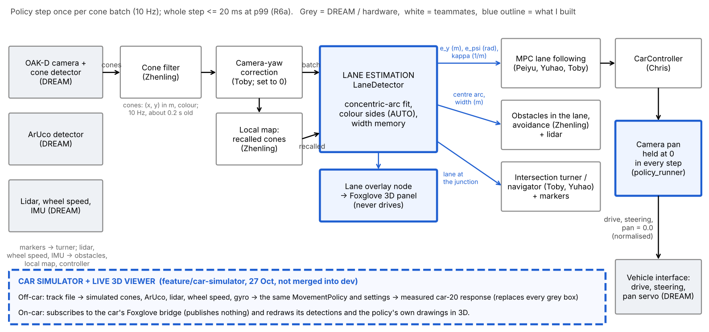

*The MovementPolicy pipeline, run once per cone batch (10 Hz). Blue outlines are what I built: lane estimation,
the lane overlay node, the camera pan hold and the simulator band at the bottom, which replaces every grey box. Look
at the three blue arrows out of lane estimation: three different blocks steer the car from the same lane.*

**Purpose in the whole system.** Everything that drives the car needs to know where the lane is. My block is the
one place where the cones become a lane, so the MPC, the obstacle avoidance and the intersection turns all see the
same lane, in the same frame and sign conventions. The simulator's purpose is different: to test the whole chain
together before car time, because each block's unit tests can pass while the combination fails.

**Requirements it had to meet** (the team's Stage 1 requirements are in `docs/stage1-approach.md`):

| Requirement | Source | What it means for lane estimation | Met? |
| --- | --- | --- | --- |
| Follow the lane centre within 0.10 m (R1b) | Stage 1 card | $e_y$ must be accurate to a few cm, so perception doesn't use up the MPC's error budget | In simulation 1.9–3.4 cm (3.2); on real drives the width holds to ±2–3 cm (4.1) |
| Whole policy step ≤ 20 ms at the 99th percentile (R6a) | Stage 1 card | My part must be small and bounded | 0.4 ms straight, 4.3 ms curved at p99 (4.5); at most 50 solver evaluations and 2 refits |
| Stop safely when the lane is lost or doubtful (R7, R2) | Stage 1 card | Report `NO_LANE` rather than guess | Width, crossed-edge and turning-centre checks (2.1) |
| Lab lanes 0.65–0.85 m wide, either colour on the left | Measured on the floor and in recordings | No fixed width or colour side | Width memory and AUTO (2.2, 3.3) |
| Curves down to a 0.5 m radius (Stage 2) | Lab tracks | Curvature in the model, not only straight lines | Curved mode, $\lvert\kappa\rvert \le 2$ 1/m (2.1, 3.2) |
| The camera transform is fixed at zero pan | DREAM (`AGENTS.md`: "its camera TF is fixed at zero pan") | The policy must hold the pan at 0 | Pan hold, `f49333d` (2.3, 4.2) |

| Interface | Direction | What it carries (units) | Rate and age | Assumption or constraint |
| --- | --- | --- | --- | --- |
| Filtered cones (Zhenling's filter, then Toby's yaw rotation, 0° on `dev`) | in | each cone's (x, y) in `base_link` (m) when detected, and its colour | 10 Hz; about 0.2 s old | The camera points straight ahead (zero pan, 2.3). Two colours, one per edge |
| Recalled cones (Zhenling's local map, from 23 Oct) | in | remembered cones this batch doesn't show (m) | every step | Added only when the batch alone already gives a lane |
| `LaneDetection` → MPC | out | $e_y$ (m), $e_\psi$ (rad), $\kappa_c$ (1/m); + = left | every step | Exactly the MPC's `PathTrackingState`. Constant curvature over the view, like the MPC's horizon. `NO_LANE` makes the MPC stop |
| `LaneDetection` → obstacles and avoidance | out | centre arc, width (m), `visible_until_m` (m) | every step | Obstacles are placed along my centre arc, so a jump in the arc moves them (4.6) |
| `LaneDetection` → intersection turner and navigator | out | the lane while approaching a junction | every step | The cross road's cones bend one arc, so the turner keeps only the approach cones (Toby) and the fit has a junction check (Yuhao) |
| Camera pan set-point | out | 0.0 (normalised) | every step | The servo must also be mounted centred |
| Lane overlay node → Foxglove | out | edges, centre line, kept and removed cones (`MarkerArray`); $e_y$, $e_\psi$, width | per cone batch | Runs the same filter and fit on the car's live cones. Never publishes actions |
| Simulator (off car) | replaces sensors, DREAM detectors and the car | detections in the real message types; the car's response to the set-points | camera 10 Hz, lidar 10 Hz, wheel 50 Hz, gyro 100 Hz | Decoded detections, not camera pixels. Measured car-20 response, no tyre slip |
| Live viewer (on car) | reads the car's Foxglove bridge | cones, markers, lidar, wheel speed, IMU, node state, the policy's drawings | as published | Subscribes only: publishes nothing, calls no service, sets no parameter |

**How my block's behaviour shows up in the whole system:**
- **A heading bias becomes a lane offset.** The MPC drives the measured $e_\psi$ to zero, so a camera turned by
  $\delta$ makes the car settle off-centre, about 1.2 cm per degree, and at junctions the turn is planned from the
  wrong place (3.6). That is why the pan hold is part of my interface.
- **A curvature error becomes a heading error.** The fitted arc is extended back to the car, so a curvature error
  $\delta\kappa$ shifts the heading at the car by about $\delta\kappa\,\bar s$, where $\bar s \approx 1$–1.5 m is the
  mean distance to the cones (2.1). This is why straight lanes were fitted straight for Stage 1 (4.3).
- **A jump in the estimate moves every obstacle.** Obstacles are placed in my lane frame, so a 0.35 m jump as a cone
  left the view made a board look like it was in the path and stopped car 20 (Chris, 19 Oct; 4.6).
- **`NO_LANE` stops the car.** A doubtful lane is a stop, not a guess. The price is that a wrong-colour cone in a
  short row can stop the car (3.4).

**Design goals and the choices they forced** (alternatives are compared in 2.5):
- **One model for both edges: concentric arcs.** A lane keeps its width, so a long row steadies a short one, an edge
  with too few cones for a direction still gives its offset, and a turn of 90° or more in view is represented.
- **Output in the MPC's own quantities,** so the MPC replaced its own cone fit in six lines (`f96ee66`).
- **Stateless and bounded.** Easy to test, replays exactly on recordings and in the simulator, and safe in the
  real-time step. The cost, found on the car, is that it jumps when cones leave the view (4.6).
- **A doubtful lane is no lane.** Safety before availability.

## 2. How it works (Standard 2)

### 2.1 Lane estimation (`policy/lane_detection/`)

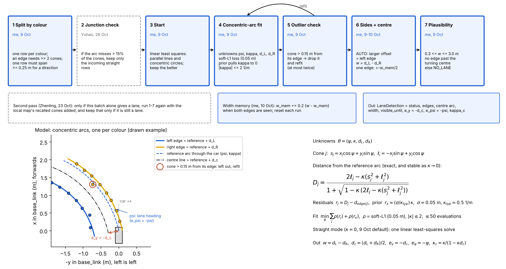

*Top: the steps of `LaneDetector.detect`, with who wrote each (blue = me; dashed = teammates' later additions). Look
at the loop from step 5 back to step 4: outliers are removed and the fit is repeated. Bottom: the model, drawn for a
lane curving left, and the equations as they are in the code.*

| Symbol | Meaning | Units |
| --- | --- | --- |
| $x_j, y_j$ | Cone $j$ in `base_link` when detected: +x forwards, +y left | m |
| $\psi$ | Lane heading beside the car, + = left of the car's +x | rad |
| $\kappa$ | Lane curvature beside the car (1/radius), + = turning left | 1/m |
| $d_L, d_R$ | Sideways offset of each edge from the reference arc, + = left | m |
| $s_j, \ell_j$ | Cone $j$ along and across the reference direction | m |
| $D_j$ | Signed distance of cone $j$ from the reference arc | m |
| $w$, $d_c$ | Lane width, and the centre line's offset | m |
| $\rho$ | Soft-L1 loss: quadratic for small residuals, linear for large ones, so a few misplaced cones count less | – |
| $\sigma$, $\kappa_{typ}$ | Cone position noise (0.05 m) and an ordinary curvature (0.5 1/m), which set the prior | m, 1/m |

- **Model:** a reference arc starts at the car with $(\psi, \kappa)$; each edge is the concentric arc $d$ to its left,
  with curvature $\kappa / (1 - \kappa d)$. Straight lanes are the case $\kappa = 0$, not a separate model.
- **Distance from the arc,** in a form that stays exact as $\kappa \to 0$ (`LaneArc.signed_distance`):

$$D_j = \frac{2\ell_j - \kappa(s_j^2 + \ell_j^2)}{1 + \sqrt{1 - \kappa\,(2\ell_j - \kappa(s_j^2 + \ell_j^2))}}, \qquad s_j = x_j\cos\psi + y_j\sin\psi, \quad \ell_j = -x_j\sin\psi + y_j\cos\psi$$

- **Fit:** $\min_\theta \sum_j \rho(D_j - d_{edge(j)}) + \rho\big((\sigma/\kappa_{typ})\,\kappa\big)$ over
  $\theta = (\psi, \kappa, d_L, d_R)$, with $\rho$'s scale 0.05 m. The second term is a prior: a curvature of
  $\kappa_{typ}$ costs as much as one cone $\sigma$ off its edge, so noise alone can't bend a straight lane.
  `scipy.optimize.least_squares` starts from the better of two linear least-squares fits (parallel lines, or
  concentric circles $x^2 + y^2 = 2ax + 2by + e_i$), at most 50 evaluations.
- **Straight mode** (`max_curvature_per_m: 0.0`, my Stage 1 default): $\kappa = 0$ and the fit is one linear
  least-squares solve.
- **Outliers:** a cone more than 0.15 m from its edge is dropped and the fit repeated, at most twice.
- **Outputs:** $w = d_L - d_R$, $d_c = (d_L + d_R)/2$, $e_y = -d_c$, $e_\psi = -\psi$, $\kappa_c = \kappa/(1-\kappa d_c)$,
  and `visible_until_m`, the distance along the centre line to beside the farthest cone used.
- **Checks:** $0.3 \le w \le 3.0$ m, edges not crossed, and no edge past the turning centre ($\kappa d < 0.9$),
  else `NO_LANE`.

**The lever arm: why a small curvature error matters.** The heading reported at the car is the heading at the cones
extended back along the arc: $\psi(0) = \psi(\bar s) - \kappa\,\bar s$. A curvature error $\delta\kappa$ therefore
shifts $e_\psi$ by about $\delta\kappa\,\bar s$. On the real drives $\bar s$ is 1.1–1.5 m, so a false 0.16 1/m bend
predicts +10.1° of extra heading error, and +10.8° was observed (4.3).

| Parameter | Value | Why it matters on the car |
| --- | --- | --- |
| `outlier_distance_m` | 0.15 m | Above the detector's position noise (0.03–0.04 m measured), well below half a lane (0.4 m) |
| `max_curvature_per_m` | 0.0 (9 Oct), 2.0 (`dev` since 15 Oct) | 0 = straight edges. On straight lab lanes, curves allowed read a false 6–12 m bend (4.3) |
| `typical_curvature_per_m` | 0.5 1/m | Smaller pulls harder towards straight: steadier straights, flatter real bends |
| `min_cones_per_edge` | 2 | With 1, a single misdetected cone could move the centre line |
| `min_lane_width_m`, `max_lane_width_m` | 0.3, 3.0 m | The car is about 0.2 m wide; lab lanes measured 0.65–0.85 m |
| `left_colour` | `"AUTO"` | The lab had blue on the left on some days and yellow on others |
| `lane_width_m` | 1.0 m | Used with one edge only until both edges have been seen (2.2) |

### 2.2 Which colour is the left edge, and the width with one edge (10 Oct)

- **AUTO sides:** after the fit, the edge with the larger offset to the left is the left edge. A single edge is the
  left edge when $d > 0$ (it's on the car's left). `"BLUE"` or `"YELLOW"` fixes it instead.
- **Width memory:** while both edges are seen, $w_{mem} \leftarrow w_{mem} + 0.2\,(w - w_{mem})$, a low-pass filter
  with a time constant of about 5 steps (0.5 s). With one edge, the centre line is $w_{mem}/2$ from it. It resets at
  the start of each run.
- **Assumption:** with one edge only, AUTO assumes the car is inside the lane. A car that has crossed the edge gets
  the side wrong.

### 2.3 Why the camera pan matters

The camera's transform to `base_link` is fixed at zero pan (DREAM). If the camera is really turned left by $\delta$,
every cone is placed rotated by $-\delta$ about the camera. A straight lane then reads

$$e_{\psi,\,measured} = e_{\psi,\,true} + \delta, \qquad e_{y,\,measured} \approx e_{y,\,true}$$

(the rotation is about the camera, 0.10 m behind `base_link`, so $e_y$ moves only about $0.1\,\delta$). A cone 2 m
ahead moves $2\sin\delta$ sideways, 0.24 m for 7°. The MPC sees the car pointing $\delta$ left of the lane and steers
right, and settles where its lateral and heading terms balance: along the lane but off-centre (3.6). A rotation keeps
straight rows straight, so it can't cause the false bends of 4.3; those come from the detections themselves. Holding
the pan at 0 in `MovementPolicy.step` (`f49333d`) makes the fixed transform true; the servo still has to be mounted
centred.

### 2.4 The simulator and live viewer (`tests/policy/simulator/`, 27 Oct)

The team already had single-feature simulators (curved lanes and markers, intersections, obstacles), each driving
one part of the policy. None ran the whole `MovementPolicy` with the node's start and stop rules, the shipped
settings and the car's measured response together, so problems between parts only showed up on the car (such as the
lane jump that caused Chris's false obstacle stop, 4.6). The simulator reuses their models and adds the node, every
sensor and a 3D view.

| Part | Shared with the car or modelled | Source |
| --- | --- | --- |
| Policy | **Shared:** `MovementPolicy` built as `policy_node` builds it, from `config/ai4r_policy.yaml` | `scripts/mcap_export.build_policy` (Peiyu) |
| Node rules | Copied: one step per cone batch, stale sensors become `None`, start refused without fresh required sensors, drop to state 2 at `supervision_rate_hz` | `scripts/policy_node.py` |
| Car | Kinematic: $\dot x = v\cos\theta$, $\dot y = v\sin\theta$, $\dot\theta = v\kappa$; $v$ and $\kappa$ from car 20's measured drive and steering maps, slew limits, 0.5 s command timeout. No tyre slip | `tests/policy/car_models.py` (Chris, Peiyu), `config/traxxas_vehicle_interface.yaml` |
| Camera cones | 86° view, 0.4–2.5 m, 3 cm noise, 10 Hz, 0.2 s old; boxes hide cones; `--miss` drops cones; `--camera-yaw-deg` turns the camera without telling the policy | `real_car_measurements.LAB_CAR` (Toby) |
| ArUco | Decoded poses from the same frames once seen in 3 frames, within 60° of the sign's face | `config/aruco_detector.yaml`; the 60° is not measured |
| Lidar, wheel speed, gyro | 0.5° beams to 8 m with 1 cm noise, 10 Hz; 50 Hz; 100 Hz | `obstacle_simulation.py` (Zhenling), `config/lidar_mount.yaml` |
| Tracks | YAML: lanes from straight and arc pieces, a four-way cross or T, loose cones, signs, boxes | `track.py`, `curved_lanes.CurvedLane` (Toby) |
| Viewer | three.js scene: chase, car camera, top and orbit views; the policy's own drawing layers; drive by hand | `server.py`, `viewer/` |
| On-car mode | Reads the car's Foxglove bridge (`cone_detections`, `fiducial_detections`, `scan`, wheel speed, IMU, node state, set-points, the policy's markers, `/tf_static`) and redraws them in 3D | `live.py`, `ros2_cdr.py` |

**Trade-off chosen:** decoded detections instead of camera pixels. Runs are fast (a 34 s cross run in about 4 s
headless) and the real policy code is unchanged, but the DREAM detector's own failures (lighting, colour mistakes)
are only modelled as noise and missed cones. Section 3.7 checks how far that matters.

### 2.5 Decisions, the alternatives I weighed, and the evidence

| Decision | Alternatives | Why this one | Trade-off accepted | Evidence |
| --- | --- | --- | --- | --- |
| Fit both edges together (concentric arcs) | Each colour its own line, slopes averaged (`reference_from_cones`, the MPC's fit before mine); a polynomial $y = f(x)$ | A short row borrows the long row's direction; one edge still gives an offset; turns past 90° can be represented | More unknowns and an iterative solve in curved mode | 3.1: 0.7° against 3.0° heading error with a 3-cone row |
| Straight edges by default for Stage 1 | Curvature always free | On the lab's straight lanes, free curvature added 4–11° of heading error | Curved roads need a setting changed (done on 15 Oct) | 3.2, 4.3 |
| Robust (soft-L1) loss, then drop cones over 0.15 m and refit | Plain least squares; RANSAC (Zhenling tried it on 19 Oct and reverted to this fit the same day) | My reasoning: with 3–6 cones per row, a consensus of random pairs has little to choose from, and a refit keeps every good cone | Fails when the wrong cones are a large share of a short row | 3.4, 4.4 |
| AUTO colour sides | A fixed `left_colour` | The lab used both ways round; a fixed side gives no lane at all | One-edge AUTO assumes the car is inside the lane | 3.3 |
| Remember the measured width | The configured width (1.0 m) | Lab lanes were 0.65–0.85 m: a fixed 1.0 m puts the centre 10–20 cm off with one edge | Needs both edges first in each run | 3.3 |
| Stateless, one batch at a time | Track the lane between steps (a filter or a map) | Deterministic, testable, replays exactly, bounded time | Jumps when cones leave the view; the team added Zhenling's local map around it | 4.6 |
| Hold the pan at 0 in the policy | Measure the yaw and correct it (`camera_yaw_offset_deg`) | DREAM's camera transform assumes zero pan, and the bias changed from drive to drive | The servo must still be mounted centred | 4.2 |
| A whole-system simulator on decoded detections | Rendering camera images; replaying recordings only | Runs the real policy fast, on any track, including junctions never recorded | Optimistic camera (3.7) | 2.4, 3.5–3.7 |

## 3. Simulation (Standard 3)

The studies in 3.1–3.4 re-run, for this logbook, the drawn-lane checks I used on 9–10 Oct (in
`tests/policy/test_lane_detection.py` and `docs/lane-detection-interface.md`), now through the camera model the team
measured on 12 Oct. 3.5–3.7 use my simulator.

### 3.1 Is fitting the edges together better than fitting each row alone?

- **Question:** the MPC first used `reference_from_cones`, which fits each colour as its own straight line and
  averages the two slopes. Does fitting the edges together, as I did, help?
- **Method:** a drawn straight lane with 3 cm noise, the left row 12 cones, the right row 2–12 cones, 200 seeds; the
  heading error RMS of each method. Then the step-to-step change in $e_\psi$ on the four real 6 Oct drives.

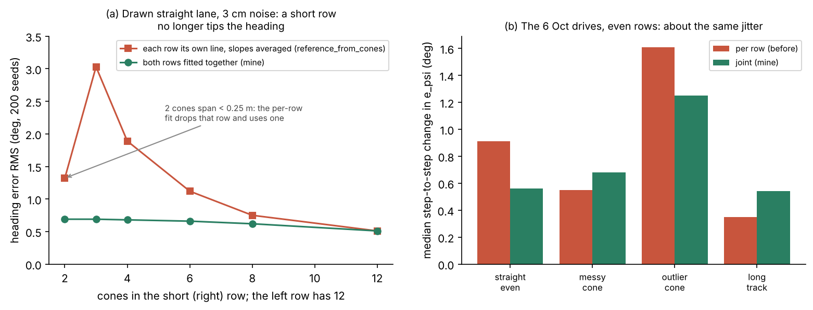

*(a) Look at the short-row end: with 3–4 cones in one row, the per-row fit's heading error is 2.8–4.4 times larger,
because a short noisy row gets the same weight as a long one. (b) On the real drives, whose rows are even, the two
have about the same jitter.*

- **Result:** with a 3-cone row, 0.69° against 3.03°; the two meet at 0.51° when both rows have 12 cones. On the real
  drives the median jitter was 0.5–1.3° (mine) against 0.4–1.6°: no clear difference with even rows.
- **Interpretation:** the joint fit pays off where the lab is hardest: near the lane end, in turns and with hidden
  cones, where one row is short. It is also what allows curves and a single edge.

### 3.2 How accurate is the fit, and when do curves need curved mode?

- **Question:** how close are $e_y$, $e_\psi$ and $\kappa$ to the truth, and what does straight mode cost on curves?
- **Method:** drawn 0.8 m lanes with cones every 0.2 m, radius 1 m to 8 m both ways and straight, seen through the
  measured camera (86°, 0.4–2.5 m, 3 cm noise), 30 noise seeds. The car is 0.10 m left of centre, pointing 5° left.
  **Controlled:** lane width, spacing, car pose. **Varied:** curvature, noise, mode.

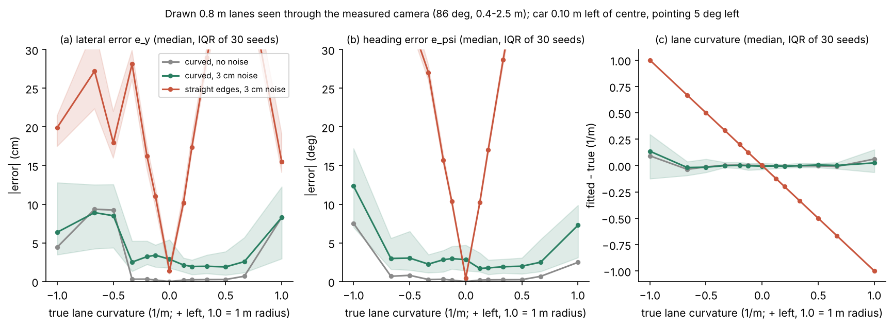

*Look at the red straight-mode curve leaving the plot on both sides of 0: on any curve, straight edges are wrong by
centimetres and degrees. Green (curved mode with noise) stays low until the tightest bends, where few cones are in
view.*

- **Result, curved mode with noise:** $e_y$ within 1.9–3.4 cm and $e_\psi$ within 1.7–3.0° (median) for radii of
  1.5 m and more turning left, and 3 m and more turning right. Curvature is unbiased down to a 1.5 m radius. That is
  well inside R1b's 0.10 m.
- **Failure cases:** right bends of 1.5–2 m radius leave the view (the car points 5° left), so only 10 cones remain,
  and $e_y$ is about 9 cm out. At a 1 m radius only 6–8 cones are seen, and $e_\psi$ is 7–12° out.
- **Straight mode:** best on straight lanes (1.4 cm, 0.4°), but 10 cm and 10° out on an 8 m radius and 29 cm and 29°
  on 3 m.
- **Decision it fed:** straight edges for the straight Stage 1 lanes, curved mode for curved roads (the team switched
  to curved on 15 Oct). Curves allowed on a straight lane cost 2.9 cm and 2.8° against 1.4 cm and 0.4°.

### 3.3 Does one edge, and either colour on the left, still work?

- **Question:** what happens when one row disappears in a lane narrower than the configured 1.0 m, and when yellow is
  on the left?
- **Method:** a 0.6 m lane (car 20's floor lane measured about 0.65 m on 9 Oct, `f96ee66`), the car weaving ±0.08 m,
  the yellow row removed from 3 m to 6 m. Then 50 random poses in lanes with each colour on the left.

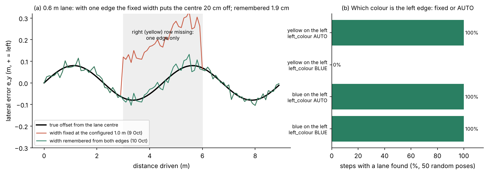

*(a) Look at the grey band, where only one edge is seen: the red line (fixed 1.0 m width) jumps 20 cm away from the
truth; green (remembered width) stays on it. (b) A fixed `"BLUE"` finds no lane at all when yellow is on the left.*

- **Result:** with one edge, the fixed 1.0 m width put the centre 20 cm off, which in a 0.6 m lane puts the car next
  to the cones; the remembered width, 1.9 cm. With yellow on the left, a fixed `"BLUE"` found no lane; AUTO found it
  100% of the time.
- **Decision it fed (10 Oct, `f49333d`):** AUTO and width memory, the day after the car 20 session found a 0.65 m
  lane.

### 3.4 What can one wrong-colour cone do? (failure case)

- **Question:** Toby saw, while testing lane sides, that one wrong-colour cone could give a false lane. When?
- **Method:** a straight 0.8 m lane with 2 to 12 cones per row in view, and one yellow cone in the blue row, either
  0.5 m ahead (near) or just past the last cone (far). Straight and curved mode.

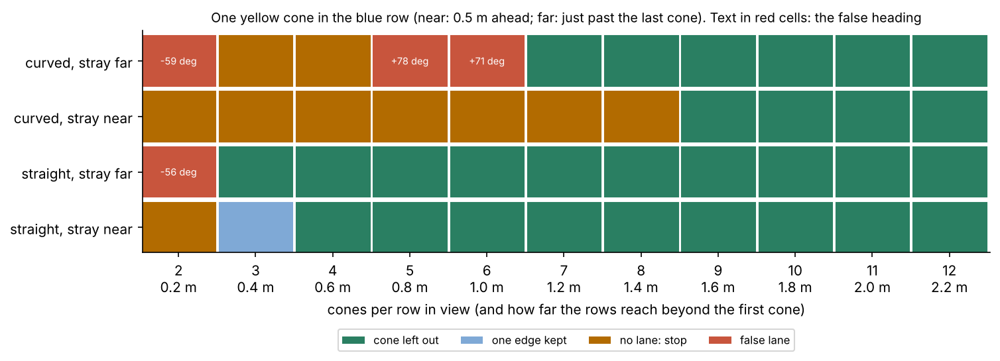

*Each cell is one case. Read along a row: green from some point onwards means the wrong cone is left out from that
many cones per row. Red cells are false lanes, with the false heading written in.*

- **Result, straight mode:** the wrong cone is left out from 4 cones per row (3 when it's far). Below that, the car
  stops, keeps only one edge, or, with 2 cones per row and the wrong cone far, gets a false lane turned 56°.
- **Result, curved mode:** much more fragile. A near wrong cone gives `NO_LANE` (the car stops) up to 8 cones per row;
  a far one can give a false lane turned 59–78°. It's left out only from 9 (near) or 7 (far) cones per row.
- **Why:** the robust loss and the outlier check work when the right cones outnumber the wrong one. In a short row
  the wrong cone pulls the fit towards itself, and with curvature free a bend can pass near all of them.
- **Meaning on the car:** rows are short near a lane end, in a turn or when cones are hidden, which is where a
  misclassified cone hurts, and curved mode is the more fragile one.
- **Proposed, not implemented:** check each cone against the row it's nearest to before splitting by colour, and
  treat a lone cone of one colour inside the other colour's row as unknown.

### 3.5 Does the whole policy drive the six tracks?

- **Question:** do lane estimation, the MPC, obstacles, signs and junctions work together, with the node's rules and
  the car's measured response?
- **Method:** the bundled tracks, headless, car-20 model, measured noise; 5 seeds, with every cone seen and with 20%
  missed. Pass = no cone or box touched, and: lab_straight stops 0–0.6 m past the last pair; curvy_road drives at
  least 10.5 m; aruco_lane reads both signs; cross and T leave by the commanded road (heading change within 30°), or
  stop at the closed exit.

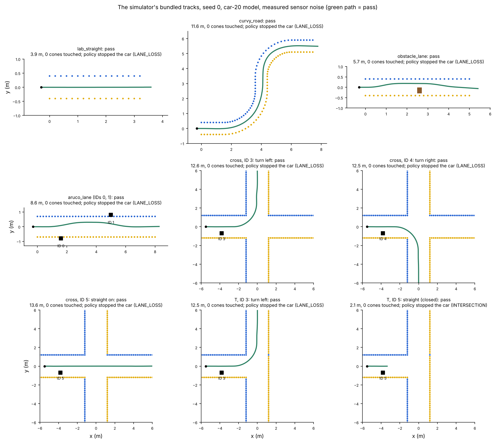

*Top-down paths of seed 0 on every track, cones to scale. Look at the cross and T: the path leaves by the arm the sign
asked for, and on the closed T it stops before the junction.*

| Track | What it tests | Seed 0 | 5 seeds | 5 seeds, 20% of cones missed |
| --- | --- | --- | --- | --- |
| lab_straight | The Stage 1 lab lane: 3.2 m, 0.8 m wide | Stops 0.39 m past the last pair | 5/5 | 5/5 |
| curvy_road | 0.8 m lane, 2.5 m left bend then 2 m right | Drives all 11.6 m | 5/5 | 5/5 |
| obstacle_lane | A box right of centre in a 5 m lane | Passes it on the left | 3/5 | 4/5 |
| aruco_lane | Keep-left (ID 0), then keep-centre (ID 1) signs | Moves 0.3 m left, then back | 5/5 | 5/5 |
| cross, ID 3 / 4 / 5 | Turn left, turn right, straight on, at a 2.4 m cross | Turns +89.5°, −89.0°, +0.4° | 5/5, 4/5, 4/5 | 3/5, 3/5, 3/5 |
| T, ID 3 / ID 5 | Turn left; straight on into the closed arm | +91.3°; stops: "requested exit is closed" | 4/5, 5/5 | 4/5, 4/5 |

- **Result:** all nine cases pass with seed 0, and 76 of the 90 seeded runs pass. No run touched a cone or a box:
  every failure is a stop. The obstacle stop fired in front of the box instead of passing it (3 runs), or the
  junction navigator refused the junction or waited until the time limit (11 runs).
- **Sensitivity:** missed cones hurt the junctions most: 22 of 25 junction runs passed with every cone seen, 17 of 25
  with 20% missed. Lane following passed every run either way.
- **What it tells the team:** the safety rules hold together (a problem ends in a stop, not a contact), and the
  junctions are the least robust part. That matches the car: no full junction turn was shown on a car before access
  ended on 2 Nov (team README).

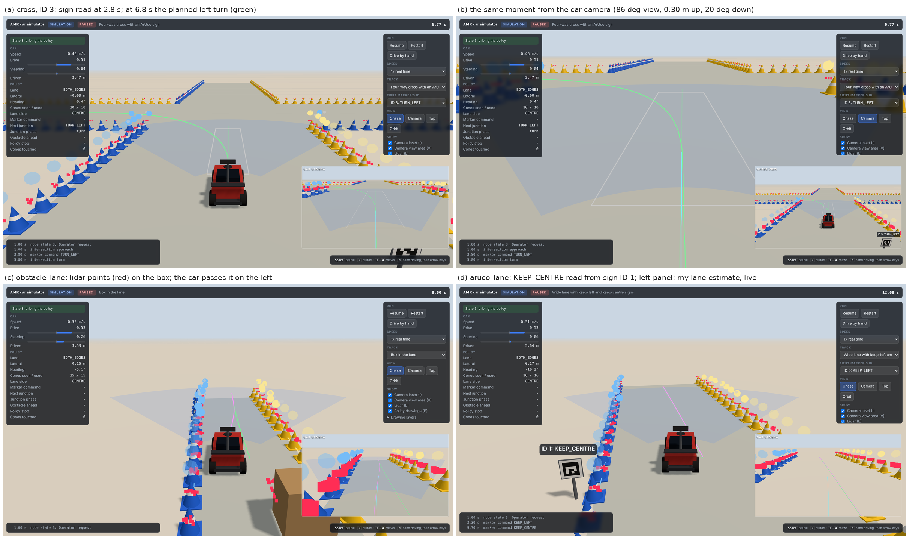

*The browser viewer during runs on the same tracks. The left panel shows the node state and my lane estimate live
(status, $e_y$, $e_\psi$, cones seen and used); (b) is what the car's camera sees, with the planned turn drawn in.*

### 3.6 What does an uncorrected camera yaw do to the whole system?

- **Question:** the 6 Oct drives had 6–11° of camera yaw. What would it have done to a drive, if not fixed?
- **Method:** `--camera-yaw-deg` from −8° to +8° (the policy isn't told), 3 seeds, on lab_straight, curvy_road and
  the cross turning left and right.

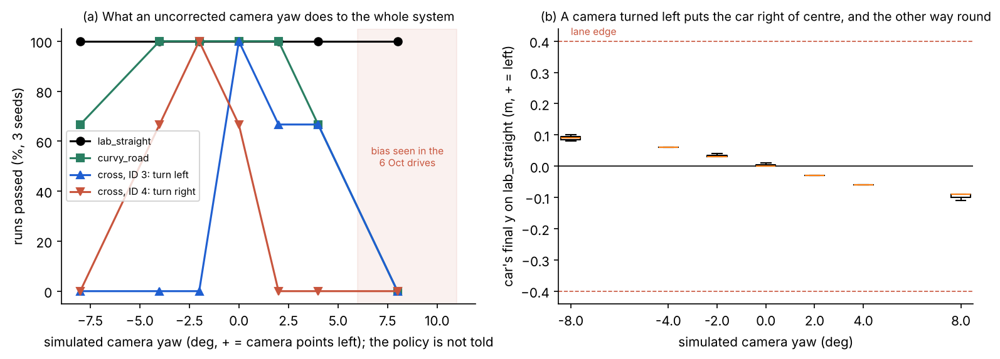

*(a) Look at how narrow the band is where both turns pass: only around 0°. The shaded band is the yaw the real drives
had. (b) On the straight lane the car still passes, but settles on the opposite side from where the camera points.*

- **Result:** lab_straight passes at every yaw, but the car settles off-centre by about 1.2 cm per degree
  (+8° → 0.09–0.11 m right), as 2.3 predicts.
- **Curves:** curvy_road fails all 3 runs at +8°: the turned lane puts the lane's own cones in the car's path, and the
  obstacle stop fires within 0.3 m. At +4° one run touched 7 cones.
- **Junctions:** turning left passes only from 0° to +4°, turning right only from −4° to 0°, and every junction run
  stops at ±8°. Toby found the same direction-dependence with his turner (his Section 3.5).
- **Answer:** with the 6–11° of the 6 Oct drives, curves and every junction would have failed. Holding the pan at 0
  is a precondition for the turns.

### 3.7 Does the simulated camera give the fit the same input as the real one?

- **Question:** the simulator is only useful if my block sees similar cones there and on the car.
- **Method:** both through the shipped cone filter and my straight fit: the four 6 Oct recordings against the
  simulated lab_straight run.

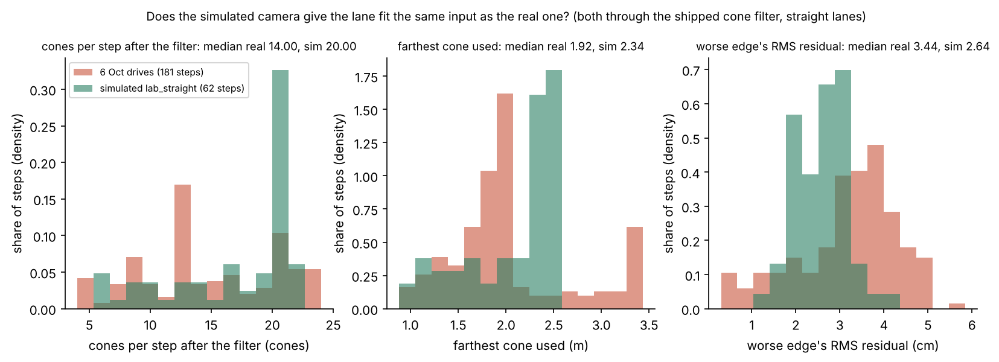

*Look at where the green (simulated) bars sit against the red (real) ones: the simulator gives more cones, further
away, with less scatter.*

- **Result:** in the real drives my fit got 14 cones per step (median) against 20 in simulation, the farthest cone
  used was 1.92 m against 2.34 m, and the worse edge's RMS residual was 3.4 cm against 2.6 cm.
- **Interpretation:** the simulated camera is optimistic, so simulated pass rates are an upper bound. The real drives
  look like a miss rate of about 30% (14 of 20) and noise nearer the 4 cm Toby measured than the 3 cm modelled.
- **Next step:** run the tracks again with `--miss 0.3` and 4 cm noise.

### What I can and can't conclude from simulation
- **Can:** say how accurate the fit is against a known truth, compare it with the alternative, find where it breaks
  (tight bends, short rows, a wrong-colour cone), check that the whole policy and the node's rules work together on
  each track before car time, and show what a calibration error does to the whole system.
- **Can't:** predict pass rates on the car. No camera pixels (the DREAM detector isn't run), no tyre slip, battery or
  floor effects, an unmeasured braking rate and ArUco viewing angle, ideal track geometry, and a camera that is
  optimistic (3.7). It was built on the 26 Oct policy, so it doesn't include the fixes merged on 2 Nov.

## 4. On the car and in real recordings (Standard 4)

The drives in 4.1–4.4 were recorded by Ciaran on 6 and 13 Oct (the car isn't named in the files). I designed the
analyses, ran my block on every step, and treat each drive as an experiment with its conditions stated.

### 4.1 What does lane estimation measure on real drives? (6 Oct)

- **Question:** on the real floor and detector, how stable and how far-seeing is my estimate?
- **Conditions:** four straight lab lanes, cones every 0.2 m; drive fixed at 0.55 and steering at 0 for the whole
  drive; camera pan never commanded; the cone filter's default settings; straight edges.

| Drive | Steps | Both edges found | Width (mean ± sd) | Worse edge RMS | Lane seen to | $e_y$ change step to step (median / p95) |
| --- | --- | --- | --- | --- | --- | --- |
| straight_even | 52 | 67% | 0.82 ± 0.02 m | 2.8 cm | 1.8 m | 1.3 / 5.3 cm |
| messy_cone | 53 | 72% | 0.84 ± 0.03 m | 4.5 cm | 1.8 m | 1.6 / 4.3 cm |
| outlier_cone | 102 | 63% | 0.80 ± 0.02 m | 2.8 cm | 1.7 m | 2.6 / 7.2 cm |
| long_track | 80 | 84% | 0.74 ± 0.03 m | 3.6 cm | 2.6 m | 1.3 / 5.4 cm |

- **Result:** both edges were found until only a few cones within about a metre remained, where `NO_LANE` is the right
  answer (the lane end). The width held to ±2–3 cm through each drive, and $e_y$ moved 1–3 cm between steps.
- **Interpretation:** the noise is well inside R1b's 0.10 m. The lane was seen to about 2 m, not the 4 m shared
  default, so I cut the cone range to 2.5 m for car 20 (`3319051`).
- **Limit:** no ground-truth pose: the lane widths weren't tape-measured, so 0.74–0.84 m is the estimate, not a check
  of it (4.8).

### 4.2 Why did the lane look turned? The camera pan (6 Oct drives; fix 10 Oct)

- **Question:** in every drive my fit gave a heading error of +6° to +11°. Was the car turned, or the cones?
- **Hypothesis test:** with steering held at 0 and a fixed drive, the car's real heading can't change. If an 8°
  heading were real, the car would drift sideways by distance × sin(heading); if the cones were rotated, it wouldn't.
- **Controlled:** steering, drive, the lane. **Measured:** distance (wheel speed × time), $e_\psi$, the change in $e_y$.

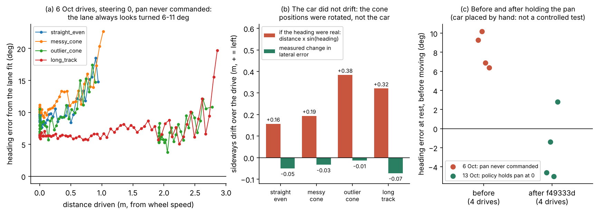

*(a) The heading error over each drive stays at 6–11° (it rises near the lane end, where only a few close cones
remain). (b) The key comparison: red is the drift a real heading would cause, green the drift measured. (c) The
heading error at rest before and after the pan hold.*

| Drive (6 Oct) | Driven with both edges | Median heading error | Drift if real | Measured drift |
| --- | --- | --- | --- | --- |
| straight_even | 0.94 m | +9.6° | +0.16 m | −0.05 m |
| messy_cone | 1.02 m | +10.9° | +0.19 m | −0.03 m |
| outlier_cone | 2.77 m | +8.0° | +0.38 m | −0.01 m |
| long_track | 2.86 m | +6.5° | +0.32 m | −0.07 m |

- **Result:** the car drifted 1–7 cm while a real heading would have moved it 16–38 cm. So the cone positions were
  rotated, not the car. The recorded actions never command the pan (`camera_pan_action` is empty in every step), so
  the servo stayed wherever it was, and the bias differed from drive to drive.
- **Decision (10 Oct, `f49333d`):** the policy holds the pan at 0 in every step, with a test that checks it
  (`tests/policy/test_lane_following.py`). I chose this over measuring and correcting the yaw because the bias changed
  between drives and DREAM's camera transform assumes zero pan. Toby measured the same yaw independently (7.3° on
  long_track) and credited this finding in `docs/mpc-lab-calibration.md`, so `camera_yaw_offset_deg` stays 0.
- **After the fix (13 Oct drives, pan 0 in every step):** the heading at rest is −5.0° to +2.8°, no longer always
  about +8°. The car was placed by hand, so this is consistent with the fix, not a controlled test.
- **It came back once:** `bf5e08c` (30 Oct) set the pan to 0.3 for a car test, and the pan test failed (the commit
  message notes it); PR #36 set it back to 0 on 2 Nov. Yuhao's 30 Oct log has the 0.3 command, so frame accuracy
  isn't established for that run (his Section 4.2).

### 4.3 Straight or curved edges for Stage 1? (6 Oct drives)

- **Question:** should the fit allow curvature on the lab's straight lanes?
- **Method:** the same four drives, fitted with curvature allowed (max 2.0 1/m) and with straight edges; the lever-arm
  relation of 2.1 checked against the result.

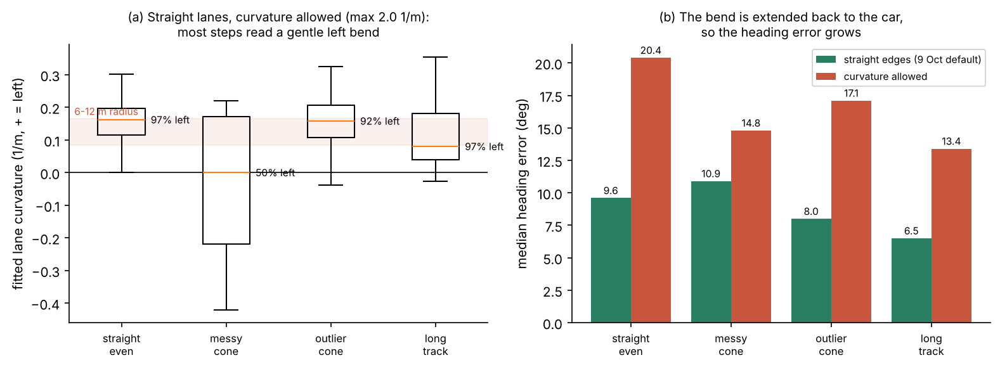

*(a) The boxes sit above zero: with curvature free, straight lanes read a gentle left bend in 92–97% of steps.
(b) The red bars show the heading error growing as that false bend is extended back to the car.*

| Drive | Median false curvature | Mean cone distance $\bar s$ | Predicted extra $e_\psi$ ($\kappa\bar s$) | Observed |
| --- | --- | --- | --- | --- |
| straight_even | 0.162 1/m | 1.09 m | +10.1° | +10.8° |
| outlier_cone | 0.158 1/m | 1.08 m | +9.8° | +9.1° |
| long_track | 0.080 1/m | 1.50 m | +6.9° | +6.9° |
| messy_cone | 0.000 1/m (bends both ways) | 1.12 m | 0° | +3.9° |

- **Result:** three drives read a 6–12 m radius bend, and the heading error grew by 4–11°. The lever arm predicts the
  growth within 1° on the three drives with a consistent bend; messy_cone's staggered cones bend both ways, so its
  median curvature is 0 and the prediction doesn't apply.
- **Decision (9 Oct):** straight edges by default for Stage 1, with curves as a setting for curved roads.
- **What happened next:** Zhenling turned curves on (2.0) on 15 Oct for curved roads. On an S-bend on 20 Oct my
  one-curvature arc flipped between left and right bends, and she added a 3.5 m range limit to the cone filter (her
  E1). One arc can't fit both halves of an S: a limit of my model.

### 4.4 A misplaced cone in a real drive (outlier_cone, 6 Oct)

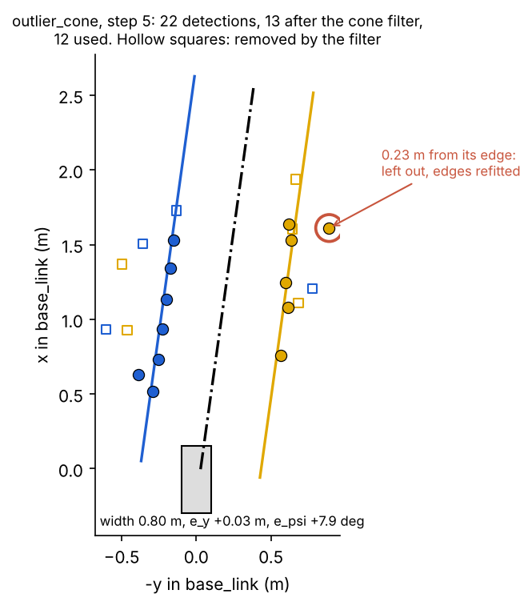

*Step 5 of outlier_cone: 22 detections, 13 after the cone filter, 12 used. Look at the circled yellow cone, 0.23 m
right of its row: it is left out and the edges refitted. The rows lean by the pan bias of 4.2.*

- **Result:** in 29 of the 64 steps with both edges, the outlier check left a cone out, and the width stayed at
  0.80 ± 0.02 m through the drive.

### 4.5 First lane following with my output (car 20, 9 Oct)

- **Question:** can the MPC follow `LaneDetection` on a real car?
- **Method (`f96ee66`):** the MPC follows my lane instead of its own cone fit, with cautious first-run settings:
  0.5 m/s (the speed Chris tuned car 20's PI at), wheel speed required, the MPC's curvature limited to 0.5 1/m (about
  car 20's left limit), data logging on.
- **On the floor:** my fit measured the lane at about 0.65 m, not the 1.0 m default, and the lab floor had had either
  colour on the left. So AUTO and width memory went in on 10 Oct, with the settings used at the track: heading weight
  5 and cones within 2.5 m (`3319051`).
- **Result:** car 20 was driven with this branch (`docs/mpc-lab-calibration.md`, 11 Oct: "the branch car 20 was
  driven with").
- **Limits:** no log or video of these runs is in the repository (logging went to `/home/ai4r/policy_logs` on the car),
  so there is no measured lateral error and I can't show how closely it followed the lane. Toby later showed in
  simulation that this run's settings (0.5 1/m both ways, heading weight 5) kept only 12 of 84 curved runs, and
  retuned them on 12 Oct (his Section 3.1).
- **Calculation time** (R6a): on the recorded drives `detect_lanes` takes 0.16 ms per step straight and 1.6 ms curved
  (median), 0.4 ms and 4.3 ms at the 99th percentile (12 ms worst of 861 curved steps), on the computer that made
  these figures. That is within the 20 ms step budget, but it hasn't been measured on the car computer, and the
  numbers vary a little from run to run (`long/data/recorded_drives.json`).

### 4.6 What the team's later car runs showed about my block

My block was in every team car run from 14 Oct, so teammates' sessions are also evidence about it:

| Date, car (who) | What was seen | Cause | What was done |
| --- | --- | --- | --- |
| 12 Oct, car 22 (Peiyu) | Standing still, the lane estimate flipped between two fits; while driving, the perceived heading stayed at about +0.22 rad | Not separated: camera yaw is one of the three causes she lists (car 22 ran before the pan hold reached `dev`) | Check perception against a known pose before floor runs (her 4.2) |
| 19 Oct, car 20 (Chris) | As the nearest blue cone left the camera view, the lane estimate jumped 0.35 m in 40 ms and put a board in the path: a false obstacle stop | One batch at a time: when a near cone drops out of a short row, the fit moves | The obstacle stop needs the lane frame and the lidar frame to agree (his 4.5) |
| 20 Oct, S-bend (Zhenling) | The fitted curvature flipped between left and right bends | One constant curvature can't fit an S | 3.5 m cone range limit (her E1) |
| 22 Oct, 4 drives (Zhenling) | The batch-only $e_y$ jumped by up to 0.57 m | As on 19 Oct | Recalled cones from the local map: the 95th-percentile jump halved or better (her E4) |

- **Interpretation:** these are the costs of two of my choices in 2.5: one batch at a time, and one curvature. On the
  6 Oct drives the $e_y$ jumps were small (p95 4–7 cm, 4.1), but in the team's later drives, with boxes hiding cones
  and longer, curving tracks, they reached 0.35–0.57 m.
- **What I'd change:** keep the fit stateless but check it against the previous step, so a new lane far from the
  predicted one must appear in two steps in a row before it's believed. The team added memory around my block instead
  (Zhenling's local map), which fixed the same problem from the input side.

### 4.7 Seeing what the car sees

- **Lane overlay node** (`scripts/lane_overlay_node.py`, 9 Oct): runs the shipped filter and my fit on each live cone
  batch and draws the edges, centre line and kept and removed cones in Foxglove's 3D panel, with $e_y$, $e_\psi$ and
  the width in the Plot panel. It's in the car upload filter, so it can run beside the policy.
- **Live viewer, on-car mode** (`--car HOST:1234`, 27 Oct): written against the car's Foxglove bridge topics. There is
  no recording of it connected to a car in the repository, so it counts as not shown on a car.

### 4.8 The experiments still needed (method ready, not run)

The camera-yaw check with the pan held at 0 is shared with Toby, Yuhao and Peiyu, so it is in the team table
(Team overview, 0.7), with my tape-centred-lane method. These are mine alone:

| Question | Method | Controlled | Decision it feeds |
| --- | --- | --- | --- |
| Is the measured width right? | Tape-measure each lane; compare with the fitted 0.74–0.84 m | the lane | `lane_width_m`, plausible width range |
| How far is $e_y$ from the truth? | Car on a stand at 0, ±0.1 and ±0.2 m from the centre, measured by tape; 20 steps each | car pose, pan 0 | Whether R1b can be met with this perception |
| A wrong-colour cone on the floor | One swapped cone in the near row, with 4, 7 and 10 cones per row in view, 5 runs each | cone spacing, speed | Whether the lone-cone rule of 3.4 is needed |
| Simulator against a logged drive | Drive the same track in simulation and on the car; compare the $e_y$ traces | track, speed | How far the simulated results can be trusted |

## 5. Lessons and limits
- **Check the frame before tuning.** One uncommanded servo put 6–11° into every drive, and in simulation that much
  yaw fails every junction. Toby's later MPC tuning could keep `camera_yaw_offset_deg` at 0 because the pan was held.
- **Write the assumption down as a test.** The pan hold was changed once for a car test; the test I added flagged it,
  and it was restored.
- **Use real recordings before choosing a default, and explain them with the model.** Allowing curves looked more
  general, but on the lab's straight lanes it added 4–11° of heading error, and the lever arm predicts how much.
- **Judgements that reversed:** straight edges by default, until curved tracks needed curves (15 Oct); stateless,
  until car runs showed jumps and the team added memory (23 Oct); my car 20 test settings, until Toby's sweep retuned
  them (12 Oct).
- **Test the whole system, not only units.** My unit tests passed while the camera, the node's rules and the car's
  response could still break a run; the simulator puts them together, though its camera is optimistic.
- **Limits:** one constant-curvature arc can't fit an S-bend; short rows can't reject a wrong-colour cone; one-edge
  AUTO assumes the car is inside the lane; no ground-truth check of $e_y$ on the car; and nothing of the simulator
  has been checked against a logged car run.

**AI assistance:** I used Claude (Claude Code) to help write the simulator (its branch has a `.claude/launch.json`)
and to draft this section and its figure scripts. I checked them by running the real policy code, the tests, the
headless runs on every track and the comparison with the recorded drives above; the oral discussion is my own
understanding.
