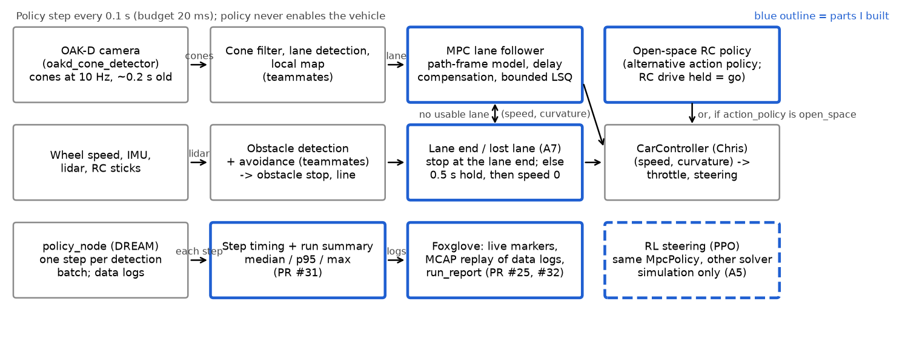
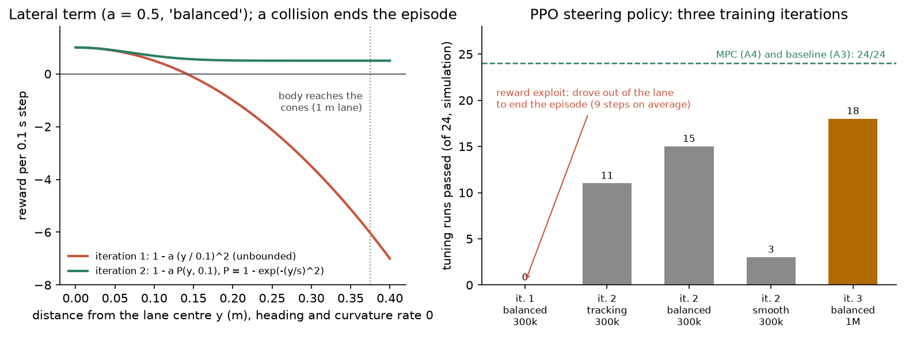
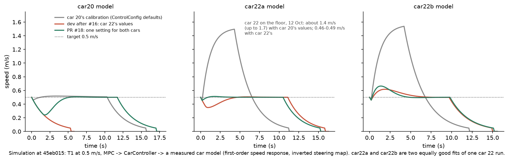
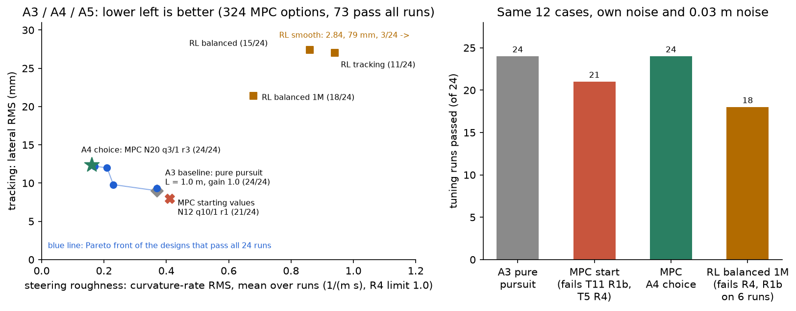
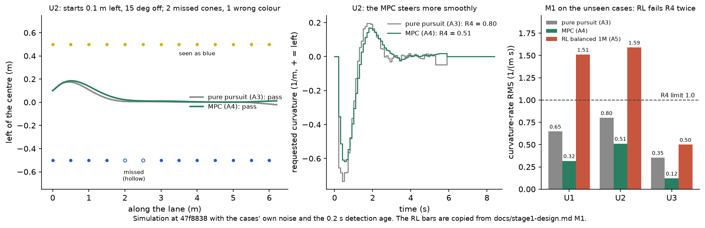
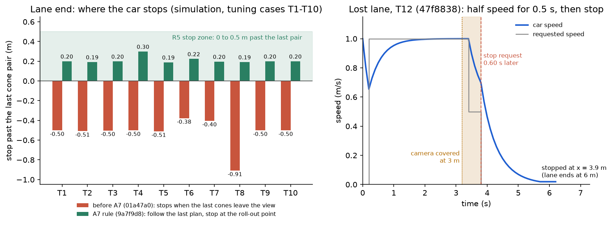
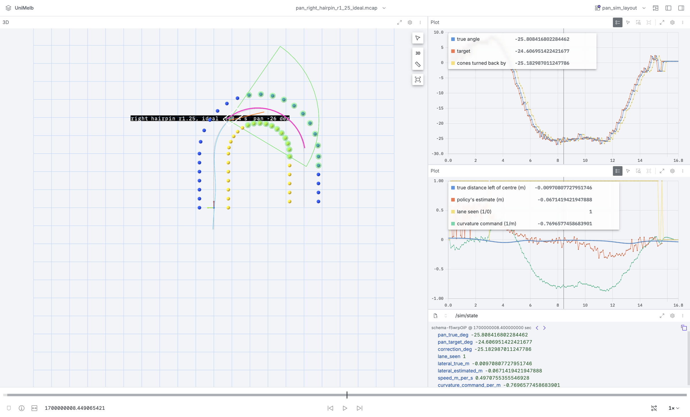
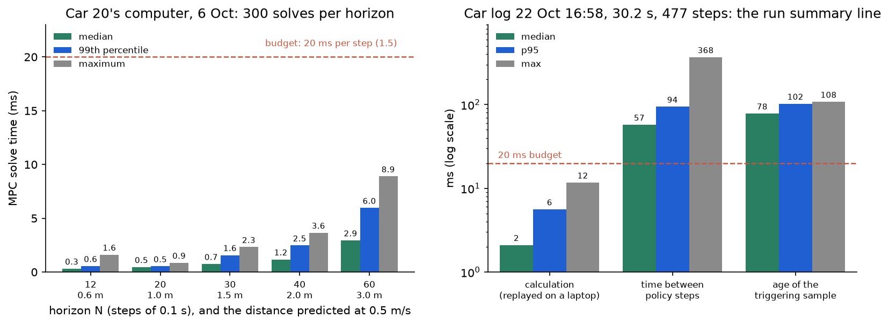
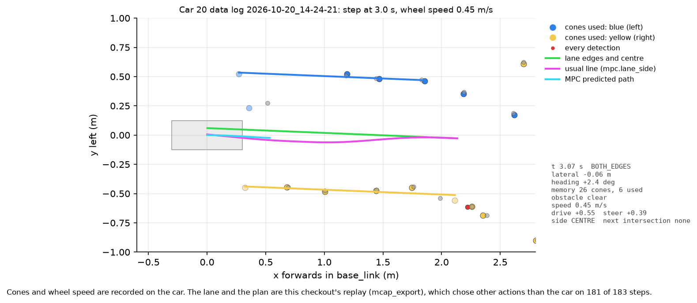

# Peiyu Wang: MPC sub-team, Stage 1 design and the tools to check car runs

[Back to the team logbook](README.md)

| | |
| --- | --- |
| Role | MPC sub-team. Stage 1 task list and Card 1, the MPC framework and the first car run, the Stage 1 design (baseline, MPC, RL, milestone M1), lane-end and lost-lane stops, car models and control settings, then tools to see and measure car runs |
| PRs | #1 (MPC framework), #8 (first car run), #16 (Stage 1 MPC with Chris's control and car models), #25 (Foxglove export and live markers), all merged into `dev` |
| Open work | #18 (one control setting for car 20 and car 22), #24 (cone detector RGB image off), #31 (step timing and run summary), #32 (`run_report`): pushed, not merged. #18, #24 and #31 need a human's recorded diff review |
| Built on teammates' work | Ciaran: repo, CI and the upload script. Toby: Card 2 test cases, the dream-gym harness and the lab calibration (#15). Chris: `CarController` and car 20's steering calibration (5 Oct). Yuhao: the MPC's measured-speed prediction and input validation. Thanh Long: lane estimation (`LaneDetection`). Zhenling: cone filter, obstacle detection and the local map |
| Figures | `peiyu/figures/`, made by `python3 docs/logbook/peiyu/make_figures.py --simulate` (see its docstring for the commits it simulates) |

**Summary: four pieces of work, in order** (the same as my slide):
1. **MPC lane follower and the first car run.** I built the first MPC and a temporary conversion to drive and
   steering. Then I measured the time budget on car 20 and the MPC's calculation time on its computer (Sections 2.1,
   2.2 and 4.1).
2. **Choosing MPC or RL for Stage 1.** I ran a pure pursuit baseline, a grid of 324 MPC options and a PPO steering
   policy on the same harness. On the unseen cases the MPC passed every case and RL didn't, so the MPC was chosen
   (Sections 2.4, 3.2–3.4).
3. **Lane end and lost lane.** The car now stops in the lane-end zone instead of short of it. If the lane is lost it
   slows for 0.5 s, then stops. I also made measured car models, so one control setting can be checked on every car
   (Sections 2.3, 3.1, 3.5 and 4.2).
4. **Seeing and measuring car runs.** Live markers and MCAP replay in Foxglove, a timing summary of every run, and
   `run_report` for each recorded drive. I also traced the cone detector crash on car 22 to OpenCV 5 (Sections 2.5,
   4.3–4.5).

On real cars: the time budget and the MPC's calculation time (car 20), and speed control and the lost-lane stop
(car 22). I also fixed the detector crash on car 22. Car 22's steering didn't work on 12 Oct, so my own car sessions
didn't show the full lane follower. The M1 choice and the lane-end stop distances are simulation only.

Alongside these, I kept the cars running through repeated crashes (detector, USB, CPU, battery) and resolved the
merge conflicts when four branches landed on `dev` together (Section 5).

## Timeline

| Week | What I did | Evidence |
| --- | --- | --- |
| 0 (27 Sep) | The Stage 1 movement-policy task list: Cards 1–3, shared defaults, milestones M1 and M2 | `46dc984`, `docs/movement-policy-tasks.md` |
| 1 (5–6 Oct) | MPC framework, a temporary drive/steering conversion, the first car run, a lane-loss hold. Card 1 and the time budget measured on car 20. Stage 1 design: A2–A7 and M1. Car 20 stand tests. RC-assisted open-space policy | PR #1, PR #8, `b0230ac`, `e7fc407`, `da0fd8c`, `15df539`, `9a7f9d8`, `47f8838`, `7e30078`, `docs/stage1-design.md` |
| 2 (12 Oct) | Merged Chris's control into the Stage 1 MPC. Measured car models. Car 22 floor run. One control setting for both cars. The OpenCV 5 detector crash | PR #16, `0f02b2a`, `350fa3b`, PR #18, PR #24 |
| 3 (19–20 Oct) | Foxglove live markers and MCAP export of data logs, deployed on car 20. Each run starts at `mpc.lane_side`. Camera-pan prototype simulation, exported to Foxglove | PR #25, `31b80f1` (in PR #27), `230c75b` |
| 4 (22 Oct) | Step timing and a run summary in `policy_node`. `run_report` measured the 22 Oct car logs | PR #31, PR #32 |

---

## 1. Where my parts fit (Standard 1)

*The MovementPolicy pipeline, run once per cone detection batch within a 20 ms budget. Blue boxes are the parts I
built. Grey boxes are teammates' parts that mine depend on. The dashed box ran in simulation only.*

**Purpose in the whole system.** Stage 1 asks the car to follow a lane of cones, hold its speed and stop at the lane
end. My parts turn the lane estimate into a speed and a curvature, and decide what to do when there's no lane. They
also record and show every step, so a car run can be checked afterwards.

| Interface | Direction | What it carries | Assumption or constraint |
| --- | --- | --- | --- |
| `LaneDetection` (teammates; `reference_from_cones` before it existed) | in | lateral error, heading error, path curvature, lane width | Measured when the image was taken, about 0.2 s before the step. The MPC predicts the car forwards by that age |
| Observation age (`sensor_age`) | in | seconds since the camera image | 0.197 s detector latency, measured on car 20 on 6 Oct |
| Wheel speed | in | m/s, unsigned | Encoder estimate at 44 Hz, with gaps of up to 0.32 s (car 20). The lost-lane distance uses the larger of it and the requested speed, so a stuck reading stops the car early, never late |
| (speed, curvature) to `CarController` (Chris) | out | m/s, never negative (0 asks for a stop); 1/m, left positive | One command per detection batch. Until Chris's controller was on `dev`, my temporary `CarControl` (PR #8) converted it |
| `debug1`, `debug2` | out | lateral error (m) and heading error (rad), positive left | Lets Foxglove plot the lane estimate, also while the car is stopped on a stand |
| Data logs and `policy_visualisation/markers` | out | every step's observations, actions and settings; the policy's cones, lane and plans | The offline tools replay a log through the current code, so a replay can choose other actions than the car did |

**Requirements my parts are judged by.** The Stage 1 requirements and their thresholds are in the team overview
(0.1). This is where each one depends on my parts:

| Id | What of mine it depends on |
| --- | --- |
| R1a | MPC weights and horizon (3.2); following the last plan while the lane is lost (2.3) |
| R1b | Lateral weight and delay compensation (2.1). T11 fails it because of the tyre model (3.1) |
| R2 | Horizon: 12 steps touched cones on T11 (3.2) |
| R3 | The temporary drive conversion (2.2), then the control setting checked on every car model (3.1) |
| R4 | Curvature-change weight (3.2). RL failed it on the unseen cases (3.4) |
| R5 | Lane-end rule and the roll-out setting (2.3, 3.5) |
| R6a | Bounded least squares with an iteration cap (2.1); measured on car 20 (4.1) |
| R6b | The fallback keeps the previous curvature and is counted (2.1) |
| R7 | The lost-lane bridge, 0.5 s (2.3). Mine: at most 0.6 s from the first batch without the lane (0.8 s counting the 0.2 s age) |

**Design goals and the choices they forced:**
- **One command per detection batch, well inside 20 ms.** Batches arrive every 0.1 s and the vehicle command times
  out after 0.5 s, so a step gets a fifth of the gap. The MPC is a small bounded least-squares problem with a fixed
  iteration limit, not a general solver.
- **Never move on a guess.** The car waits, stopped, until the first usable lane of a run. A lost lane gets a short
  bridge, then a stop that only a restart clears. The temporary controller gave zero drive without a wheel speed.
- **Compare designs on the same harness.** The baseline, the MPC and the RL policy all run inside `MpcPolicy`, with
  the same cone filter, reference and lane-end rule. Only the steering differs.
- **Record first, explain later.** Any car step can be replayed into Foxglove and measured with one command, so a
  car session's failure can be studied off the car.
- **System-level consequence:** the lane-end stop depends on the car's roll-out after a stop request
  (`stop_distance_per_speed_s`). That's a Car Control property. It is 0.6 s with the simulation's stand-in control,
  and 2.1 s for car 22, taken from its model's coast time constant because stops coast. Neither has been measured on
  a car yet (team table, 0.7), so my stop is only as good as that number.

## 2. How it works (Standard 2)

### 2.1 MPC lane follower (my framework, PR #1; tuned in Task A4)

A linear path-frame model, with lateral error $e$, heading error $\psi$ and commanded curvature $\kappa$. The car
drives a distance $d = v\,\Delta t$ each step, with $\Delta t = 0.1$ s, over $N = 20$ steps (1 m at 0.5 m/s):

$$e_{k+1} = e_k + d\,\psi_k + \tfrac{d^2}{2}(\kappa_k - \kappa^{path}_k), \qquad \psi_{k+1} = \psi_k + d\,(\kappa_k - \kappa^{path}_k)$$

$$\min_{\kappa_0..\kappa_{N-1}} \sum_k 3\,e_k^2 + 1\,\psi_k^2 + 0.1\,(\kappa_k - \kappa^{path}_k)^2 + 3\,(\kappa_k - \kappa_{k-1})^2 \quad\text{s.t.}\quad |\kappa_k| \le 3.0$$

- Solved as bounded-variable least squares (`scipy.optimize.lsq_linear`, `method="bvls"`, at most $4N$ iterations).
  On car 20's computer, a solve took 0.46 ms median and 0.53 ms at the 99th percentile for $N = 20$ (Section 4.1).
- **Delay compensation:** the observation is about 0.2 s old. So the state is first predicted forwards by
  $d_0 = v \cdot \text{age}$ with the previous command:
  $e \leftarrow e + d_0\psi + \tfrac{d_0^2}{2}(\kappa_{prev} - \kappa^{path})$ and
  $\psi \leftarrow \psi + d_0(\kappa_{prev} - \kappa^{path})$.
- Only the first curvature is sent. The problem is solved again with the next batch.
- The weights above are the Task A4 choice (Section 3.2). On `dev`, Toby's lab calibration (#15) later set them to
  10/1/0.1/2, with car 20's limits of 0.48 1/m left and 0.92 1/m right, to keep curves (his Section 2.1).
- **What the weights mean.** Only their ratios matter. Being 0.1 m off centre costs 3 × 0.1² = 0.03. That is the
  same as about 10° (0.17 rad) of heading error, or a 0.1 1/m change of curvature between two steps. The small
  curvature weight (0.1) keeps the best curvatures unique.

**As a least-squares problem.** Stack the predicted states after steps 1 to N as
$x = F x_0 + G\,(u - \kappa^{path}\mathbf{1})$, with $u = (\kappa_0, \dots, \kappa_{N-1})$. Every cost term is then a
squared linear function of $u$, so the cost is $\lVert M u - c \rVert^2$:

$$M = \begin{bmatrix} W^{1/2} G \\ \sqrt{0.1}\, I \\ \sqrt{3}\, D \end{bmatrix}, \qquad c = \begin{bmatrix} -W^{1/2}\,(F x_0 - G\,\kappa^{path}\mathbf{1}) \\ \sqrt{0.1}\,\kappa^{path}\mathbf{1} \\ \sqrt{3}\,\kappa_{prev}\,e_1 \end{bmatrix}$$

- $W = \mathrm{diag}(3, 1, 3, 1, \dots)$ holds the lateral and heading weights. $D$ takes the difference of consecutive
  curvatures, and its first row compares $\kappa_0$ with the previous command $\kappa_{prev}$.
- $M$ depends only on the settings, so `MpcController` builds it once. Each step only changes $c$: the
  delay-compensated state $x_0$, the path curvature and the previous command.
- **Why `bvls`:**
  - The only constraints are bounds on each $u_k$, which bounded-variable least squares solves exactly.
  - `max_iter` = $4N$ caps the calculation time per step (R6a).
  - SciPy is already on the car's computer.
- **If it doesn't converge**, the Stage 1 policy kept the previous curvature and counted a fallback (R6b). There were
  none in any A4 run. Yuhao later made a failed solve request a stop instead (his Section 2.1).

**Model assumptions, and where they break:**

| Assumption | Why it's reasonable | Where it breaks |
| --- | --- | --- |
| Small heading error: $\sin\psi \approx \psi$, $\cos\psi \approx 1$ | At 15° (U2's start) $\sin\psi$ is 1% below $\psi$ | Large heading errors, such as after a lost lane |
| Constant speed over the horizon, equal to the target speed | Car Control holds the speed (R3) | A car faster than the target travels further than predicted. Car 22 drove 1.4 m/s for 0.5 m/s (4.2). Yuhao later predicted with the measured speed |
| No slip: the car travels where its body points (kinematic) | A 3 kg car at 1 m/s on a dry floor | T11, wet floor: a steady 6° sideslip leaves the car 0.25 m off centre (3.1) |
| Path curvature constant over the horizon | Straight lanes and constant curves | A curve's start isn't anticipated; the plan uses today's curvature for all N steps |
| Each curvature is reached within its step | The only lag modelled is the 0.2 s detection age | A slow steering servo. R4's limit is about a fifth of the simulated servo's rate limit |

**Constraints: what is in and what is left out:**

| Item | How it's handled | Reason and effect |
| --- | --- | --- |
| Curvature limit | Hard bound, $\lvert\kappa_k\rvert \le \kappa_{max}$ | The steering can't turn further. A bound on each variable is all `bvls` takes, and the problem always has a solution. The default 3.0 1/m is tan 45° / 0.335 m. #15 replaced it with car 20's measured 0.48 left and 0.92 right |
| Steering rate | Cost (curvature-change weight), not a constraint | A rate limit constrains differences of the variables. `lsq_linear` takes only bounds, so it would need a general QP solver. The cost already keeps R4 well under 1.0 (0.16 mean for the A4 choice) |
| Lane edges ($\lvert e_k \rvert$ below half the free width) | Left out; the lateral weight pulls to the centre instead | A hard state limit makes the problem infeasible when a noisy or delayed observation already puts the car near an edge, and then there's no command. Without it the problem always has a solution |
| Speed | Not a variable of the MPC | Car Control holds the speed (R3), and only the A7 rule changes it. With speed as a variable, speed × heading would make the model bilinear, not linear |

### 2.2 From (speed, curvature) to drive and steering: the temporary conversion (PR #8)

Car Control's own conversion wasn't ready for the first car run, so `CarControl` stood in for it:

- **Steering:** a bicycle model, $\delta = \arctan(L\,\kappa)$, sent as $\delta / \delta_{max}$ clipped to $[-1, 1]$,
  with a sign setting (`positive_steering_turns_left`) to check on a stand.
- **Drive:** feedforward plus PI on the wheel speed, forwards only, capped at `max_drive_effort` (0.2 at first). It's
  zero when stopping and when the wheel speed is missing.
- On 12 Oct, Chris's measured `CarController` replaced it (PR #16). The stand tests that shaped it are in Section 4.1.

### 2.3 Lane end and lost lane (Task A7)

When the car sees no cones or only one side, `MpcPolicy._command_without_lane` applies these rules:

1. **One row visible:** carry on at full speed, with the lane centre half a lane width from that row.
2. **No usable lane, and the farthest cone last seen was at most 1.5 m ahead** (`lane_end_distance_m`): the rows have
   ended. Keep the speed, follow the last plan, and request the stop once the car is at its roll-out distance
   (`stop_distance_per_speed_s` × speed) from a point 0.25 m past that cone (`lane_end_stop_past_m`).
3. **No usable lane otherwise:** the lane was lost unexpectedly. Follow the last plan at half speed for at most 0.5 s
   (`lane_loss_timeout_s`). If the lane comes back, carry on; otherwise request the stop.
4. After a lost-lane stop, the car stays stopped until the policy is restarted. Distances are dead-reckoned from the
   larger of the wheel speed and the requested speed.

| Setting | Value | Why this value, or what it does |
| --- | --- | --- |
| `lane_end_distance_m` | 1.5 m | It must be above about 0.6 m, where the last pair leaves the 80° view (more on wider lanes). It must also be below the range the camera reliably sees cones at (4 m shared default; Task A1), so a loss with cones far ahead still counts as unexpected. `policy_runner` refuses a cone filter range at or below it |
| `lane_end_stop_past_m` | 0.25 m | The middle of R5's 0 to 0.5 m zone, so the stop has 0.25 m of margin for roll-out error either way |
| `stop_distance_per_speed_s` | 0.6 s in simulation, 2.1 s for car 22 (#16) | Roll-out distance per m/s after a stop request. 0.6 s matches the simulation's stand-in control. 2.1 s is car 22's coast time constant from its model, since stops coast. Not measured on a car yet (team table, 0.7) |
| `lane_loss_timeout_s` | 0.5 s | It counts up by the 0.1 s step from the first batch without a lane, so the stop is requested on the fifth such batch: 0.4 s after the first. With the 0.2 s age that's 0.6 s after the loss (T12), inside R7. A starting value, kept short because the followed plan only covers the horizon |
| `lane_loss_speed_fraction` | 0.5 | Halves the distance driven on a stale plan while waiting for the lane to come back. The plan is indexed by the distance driven, so it doesn't run out faster at half speed |

**R7 (my requirement):** the time from losing the lane to the stop request is at most 0.8 s, counting the 0.2 s
detection age (0.6 s from when the policy first receives a batch without the lane).

### 2.4 RL steering policy (Task A5)

A PPO policy (stable-baselines3) replaces only the MPC's solver inside `MpcPolicy`, so the cone filter, speed and
the A7 rule stay the same.

- **Observation:** lateral and heading error from the cones, whether the lane is usable, the last two curvature
  requests (so it can allow for the 0.2 s delay), the detection age and the requested speed. Nothing comes from the
  simulator's ground truth.
- **Action:** the curvature, up to ±1.5 1/m.
- **Reward per step** (ground truth, training only), with a bounded penalty $P(x, s) = 1 - e^{-(x/s)^2}$:
  $r = 1 - a\,P(y, 0.1) - b\,P(\psi, 0.1) - c\,P(\dot\kappa, 1.0)$. Touching a cone ends the episode with −20, and
  reaching the last pair gives +10. Since $a + b + c < 1$, every step in the lane earns a positive reward.

| Option | a (lateral) | b (heading) | c (curvature rate) |
| --- | --- | --- | --- |
| tracking | 0.6 | 0.2 | 0.05 |
| balanced | 0.5 | 0.2 | 0.2 |
| smooth | 0.35 | 0.2 | 0.4 |

- **Domain randomisation** every episode: lane width 0.8–1.2 m, cone spacing 0.5 or 0.75 m, start ±0.2 m and up to
  15°, speed 0.5–1.2 m/s, noise 0–0.03 m, extra delay 0–0.2 s, camera range 3–4 m, mass 2.5–3.6 kg, and the dynamic
  tyre model on a dry or wet floor in 2 episodes of 5.
- **Training:** two 64-unit hidden layers, 8 parallel environments, learning rate 3e-4, discount 0.98, 300,000 steps
  per option, seed 0.

*Left: the lateral term of the reward before and after the fix. Right: tuning runs passed after each training
iteration. Numbers from `docs/stage1-design.md`, A5.*

### 2.5 Seeing and measuring a drive (PR #25, #31 and #32)

- **One drawing for both live and replay.** `policy/visualisation.py` draws each step as plain shapes in `base_link`:
  detected and used cones, remembered cones, the lane, obstacles, the avoidance line, the MPC's predicted path,
  markers, and the car with a text summary.
  - `policy_node` publishes these shapes live on `policy_visualisation/markers`.
  - `scripts/mcap_export.py` replays a data log through a new `MovementPolicy` and writes the same layers to an MCAP
    file. It also writes `/policy/state` for plots, including the replayed and logged actions side by side.
  - The Foxglove layouts are in `docs/foxglove/`.
- **Run summary (PR #31).** `policy_node` times each step. When a run ends, it logs one line: the run's length, what
  ended it, the MPC's latched stop, and the median, p95 and max of the calculation time, the time between steps and
  the age of the triggering sample. The line is logged after the zero actions, and a failure only warns, so it
  can't delay a stop.
- **`run_report` (PR #32)** replays recorded drives and reports for each one:
  - the step interval;
  - lane errors while driving, with implausible headings and heading jumps;
  - side clearance to lidar returns beside the body;
  - whether obstacles were passed or the MPC stopped for one;
  - lane errors after the obstacles.

### 2.6 RC-assisted open-space policy (6 Oct)

An alternative action policy (`action_policy: open_space`, `policy/action_policy/open_space.py`). The operator holds
the RC drive forwards to let the car move, and the RC steering sets the preferred heading. The policy picks the
heading with the most clearance from the cones (seen, plus those remembered from the last `cone_memory_s`) and
steers along it with pure pursuit. With no open heading, it stops. It's covered by `tests/policy/test_open_space.py`;
no car run of it is recorded in the repository.

## 3. Simulation (Standard 3)

### 3.1 Making the simulation behave like our car (Task A2, 6 and 12 Oct)

- **Question:** what must the simulation match about our cars before its results can guide car settings?
- **Detection age.** Every batch now reaches the policy 0.2 s after it was taken, as measured on car 20. The tuning
  cases still pass, and the lane-end stop became more even (0.21 to 0.24 m past the last pair).
- **T11 explained.** On the wet floor, dream-gym's tyre model settles into a steady sideslip under the MPC: the body
  is turned 6° left while the car travels straight. The kinematic MPC takes the body heading as the direction of
  travel, so it keeps steering right and ends 0.25 m off centre. A 3 kg car at 1 m/s should need almost no slip, so
  the tyre presets are probably not scaled for a 1:10 car. T11 stays `xfail` until a real car is checked.
- **Measured car models (12 Oct).** The car responds to `CarController`'s actions as a measured car does: a
  first-order speed response, and the inverted steering map with each direction's limit.
  - car20 comes from Chris's 5 Oct calibration; its time constants aren't measured.
  - car22a and car22b are two equally good fits of one car 22 run, because its speed never settled.

*T1 at 0.5 m/s on each car model with three control settings (simulated at `45eb015`).*

- **Results:**
  - With car 20's calibration, both car 22 models drive about 1.4–1.5 m/s for a 0.5 m/s target, as car 22 did on
    the floor.
  - With the car-22 values that `dev` got from #16, the car20 model never reaches the target: 0 of 12 cases.
  - The PR #18 setting passes 10, 11 and 11 of 12 on car20, car22a and car22b. The misses are T11 (the tyre model)
    and T9 on car20, which only needs more than the 20 s simulation limit.
- **Decision:** one shared control setting, and a test that checks the yaml against every car model (in PR #18, not
  yet merged).

### 3.2 A3 baseline and A4 MPC: which settings? (6 Oct)

- **Question:** what are the best MPC settings, and does the MPC beat a simple tracker?
- **Baseline method:** a cone-only pure pursuit with the same reference and lane-end rule. It steers along the arc
  to the centre-line point a lookahead $L$ ahead:
  $\kappa = g\,\dfrac{2\,y_L}{L^2 + y_L^2} + \kappa^{path}$, where $y_L = -e - L\tan\psi$ is how far left of the car
  that point is, and $g$ is a gain. It ignores the detection age, as a simple tracker would. Lookahead 0.5–1.5 m,
  gain 0.5–1.5. Lookahead 1.0 m with gain 1.0 passes all 12 tuning cases, with and without 0.03 m of noise.
- **MPC method:** a grid of 324 options:
  - horizon 12, 20 or 30 steps;
  - lateral weight 3, 10 or 30;
  - heading weight 0.3, 1 or 3;
  - curvature-change weight 0.3, 1, 3 or 10;
  - curvature limit 3, 1 or 0.5 1/m.

  Each option ran the 12 tuning cases with their own noise and again with 0.03 m: 24 runs. 73 options pass all 24.

*Left: each design's tracking (lateral RMS) against its steering roughness (curvature-rate RMS), as the mean over
the 24 runs. Lower left is better. The blue line is the Pareto front of the MPC options that pass all 24 runs, and
the star is the A4 choice, the smoothest on it. The RL points are from Section 3.3. Right: tuning runs passed, of 24.*

- **Result:** the starting values failed T11 (R1b) and, with noise, T5 (R4: 1.02 against 1.0). I chose horizon 20
  and weights 3/1/0.1/3, the smoothest design on the front:
  - curvature-rate RMS 0.16 mean and 0.45 worst;
  - passes all 24 runs with no solver fallbacks.

  The baseline tracks about 3 mm better against a 375 mm margin to the cones, but steers 2.3 times more roughly.
- **What the grid showed:**
  - A lateral weight of 30 never passes: it amplifies the detector noise.
  - 12 steps can touch cones on T11; 20 and 30 behave the same.
  - The curvature limit hardly matters here (at most 0.51 1/m was used).
- **A judgement that reversed:** I expected the MPC to beat the baseline as it was. It lost on T11 and on noisy
  steering. The starting weights leaned too hard on the lateral error for a small car with noisy, delayed cones.
  Lowering it and raising the curvature-change weight fixed both.

### 3.3 A5 RL steering: can a learned policy do better? (6 Oct)

- **Iteration 1 found a reward exploit.** With unbounded penalties, the `balanced` policy steered out of the lane on
  purpose. Training episodes lasted 9 steps on average and none reached the end, and it failed all 24 tuning runs.
  Away from the centre, a step cost more than the single collision penalty (the curvature-rate term alone reached −22
  a step), so ending the episode early gave the best return. Bounded penalties fixed it (Section 2.4, figure 02).
- **Iterations 2 and 3:** all three options now drive the lane: 35, 35 and 27 of 40 random training episodes reach
  the end. `balanced` trained for 1,000,000 steps is the best, with 18 of 24 tuning runs. It still fails R4 on T5 and
  T11, and R1b on T2, T5, T7 and T11.
- **Exploits checked:** stopping is impossible (the speed is fixed), and hugging an edge wasn't seen. Weaving remains:
  every option changes its curvature far more than the MPC, which is why they fail R4.

### 3.4 Milestone M1: MPC or RL? (6 Oct)

- **Method:** the unseen cases U1–U3 were opened only here. They add a 0.1–0.2 s extra delay, noise, missed cones and
  a wrong colour. The Card 1.3 rule makes a design eligible only if it passes every unseen case. Among eligible
  designs, the winner must be on the Pareto front of the worst R1b, R3 and R4.

*Left and middle: U2, with a 15° start, two missed cones and one wrong colour. Both designs pass, and the MPC
steers more smoothly (R4 0.51 against 0.80). Right: R4 on each unseen case. RL is above the 1.0 limit on U1 and U2,
so it isn't eligible.*

- **Result:** the MPC passed all three, with a worst R4 of 0.51. The RL policy failed R4 on U1 (1.51) and U2 (1.59),
  so it wasn't eligible. **The MPC was chosen for Stage 1.** The baseline also passed and is on the front: it ends
  5 mm closer to the centre but steers more roughly (0.80).
- **Checked for this logbook:** I re-ran the baseline and the MPC on U1–U3 at `47f8838`. Every R4, R1b and stop value
  matches `docs/stage1-design.md` to the printed precision.

### 3.5 Lane end and lost lane: where does the car stop? (Task A7, 6 Oct)

- **Question:** before A7, the MPC stopped short of the lane end on every case. Why, and how can it stop in the 0 to
  0.5 m zone (R5)?
- **Cause:** a row needs two cones to be fitted, and the camera's 80° view can't see a cone beside the car. So the
  last cone pair leaves the view about 0.6 m before the car reaches it, and the lane counted as "lost" early.

*Left: where T1–T10 stop before the A7 rule (red) and with it (green), both without the detection age. The shaded
band is R5's zone. Right: T12, camera covered at 3 m. The requested speed halves 0.2 s later (the detection age),
and the stop request (dashed) comes 0.60 s after the cover. The car then rolls to a stop inside the lane.*

- **Result:** without the detection age, T1–T10 stopped 0.38–0.91 m short before the rule (`01a47a0`), and 0.19–0.30
  m past the last pair with it (`9a7f9d8`). With the 0.2 s age (final table in `docs/stage1-design.md`), they stop
  0.21–0.24 m past.
- **T12, camera covered from 3 m:** the stop request came 0.60 s after the loss (0.2 s of it the detection age). The
  car rolled to a stop 0.9 m after the loss, inside the lane.
- **A judgement that reversed:** my first version slowed along a constant-deceleration ramp. The simulated speed
  controller lags the request, so the car rolled 0.64–0.75 m past the last pair and failed R5. Requesting the stop
  at the roll-out distance fixed it.

### 3.6 Can panning the camera keep tight curves in view? (20 Oct, `230c75b`)

- **Question:** the camera sees 86° and 2.5 m, so on tight curves and loops the lane leaves the view. If the policy
  aims the camera along the lane, does the MPC keep the lane? And how much do the servo facts nobody has measured
  matter: the angle per unit, its speed, and the angle at the moment each image is taken?
- **Method:** `tests/policy/prototype_camera_pan.py` (a throwaway prototype), on Toby's curved lanes, kinematic car
  and measured camera. DREAM's camera TF is fixed at zero pan, so the policy turns the detected cones back by the
  angle it believes the camera had. Four modes:
  - fixed: the pan held at 0, as on `dev`;
  - ideal: the true angle at the image's time, as an encoder would give;
  - modelled: a servo model of the commands, while the real servo turns 10% further and slower;
  - naive: the latest command, not the angle at the image's time.

  `--export` writes chosen runs to MCAP with a layout, so each run can be stepped through in Foxglove.

*Foxglove showing the exported hairpin run with the ideal pan, at 8.4 s. Left: the camera's view (green) has
turned into the bend, the cones it sees are ringed, the pink line is the lane centre the policy found, and the blue
line is the car's trail. Right: the pan angle over the run, and the true and estimated distance from the centre.*

- **What the exported runs show** (one seed each):
  - 1.5 m loop: with the pan fixed, the lane left the view after 8.6 s and the car stopped off the track. With the
    ideal pan, the lane stayed in view all the way round. The car still swung wide, because the loop is tighter
    than car 20's left reach: the curvature command sat at its 0.48 1/m limit.
  - Oval: the naive pan lost the lane after 11.1 s, while the fixed camera finished.
- **What I take from it:** panning helps only when the angle at the image's time is known (an encoder, or a measured
  servo model). Without it, panning can be worse than not panning. And on loops the steering reach, not the camera,
  is the next limit. The team kept the pan at 0 (Thanh Long 2.3).
- **Limit:** a prototype with assumed servo values. The rates over several seeds come from running the script; they
  aren't recorded here.

### What I can and can't conclude from simulation
- **Can:**
  - compare designs on identical cases with identical noise;
  - find design mistakes (a reward exploit, the early lane-end stop) before car time;
  - check that a control setting works on every car model before it ships.
- **Can't:** predict the car.
  - dream-gym's tyres aren't scaled for a 1:10 car (T11).
  - The roll-out after a stop request hasn't been measured on a car. 0.6 s is the stand-in control's, and car 22's
    2.1 s comes from its model.
  - The car models come from one calibration or one run each.
  - The lanes are perfect straight rows.
  - RL was trained with one seed.

## 4. On the car (Standard 4)

### 4.1 The time budget and the first car run (car 20, 6 Oct)

- **Question:** how long may a policy step take, and does the MPC fit on the car's computer?
- **Measured on car 20:**

| Quantity | Value | Used for |
| --- | --- | --- |
| Cone detection rate | 10.0 per second, gaps 0.09–0.11 s (standard deviation 6.5 ms) | One policy step per batch |
| Detector latency | 0.197 s | The 0.2 s detection age in the harness and the MPC's delay compensation |
| Vehicle command timeout | 0.5 s, five detection gaps | |
| Allowed calculation per step | **20 ms at the 99th percentile**, a fifth of the gap | The `TIME_BUDGET_S` in the harness; R6a |
| Cone colours on the lab lane | yellow on the left, blue on the right | The harness's `LEFT_COLOUR` at the time |

*Left: 300 solves per horizon on car 20's computer (aarch64, SciPy 1.11.4). Right: the run summary of a 22 Oct car
log (Section 4.5).*

- **Result:** every horizon up to 60 steps fits the budget with a wide margin (60 steps: 5.96 ms at the 99th
  percentile). So the horizon is limited by how far the camera sees, not by the computer.
- **Stand tests of the temporary controller (wheels off the ground):**
  - At `max_drive_effort` 0.2, the applied drive peaked at 0.168 (about 1542 µs) and the wheels didn't turn: it was
    inside the ESC's deadband. I raised it to 0.3 (the wheels still didn't turn), then the operator asked for 0.55 and
    then no limit.
  - With feedforward 0.1 and ki 0.1, the effort rose only 0.05 a second (0.47 after 8 s), so the stand tests used
    feedforward 1.0 and ki 0.3.
- **Decision:** treat the temporary controller as a stand-test tool, and use Chris's measured `CarController` for
  driving (PR #16). I added the lane state on `debug1`/`debug2` so the lane estimate could be plotted during these
  tests.

### 4.2 Car 22 on the floor (12 Oct)

- **Question:** does the Stage 1 MPC with Chris's control drive car 22?
- **Method:** car 22 at `350fa3b`, 0.5 m/s, horizon 30, with the speed settings I chose in simulation for car 22's
  models. The results come from the policy logs.

| What | Result | Decision |
| --- | --- | --- |
| Speed | With car 20's control values, about 1.4 m/s (up to 1.7) for 0.5 m/s. With the car 22 settings, it held 0.46–0.49 m/s at a drive of about 0.33 | Car models (Section 3.1), then one setting for both cars (#18) |
| Lost-lane stop | Stopped 0.8 s after losing the lane, then coasted | The A7 rule works on a car |
| Steering | The MPC asked for more and more right steering (+0.06 to +0.36), but the perceived heading stayed at about +0.22 rad. The car drifted left and lost the lane after 3.4 s | Not solved. Three possible causes: inverted steering, an offset steering centre, or camera yaw |
| Standing still, vehicle disabled | The lane estimate flipped between two fits | Check perception with `debug1`/`debug2` against a known pose before floor runs |

- **Limit:** one session. The logs can't tell the three steering causes apart.

### 4.3 The cone detector crash with OpenCV 5 (car 22, 12 Oct)

- **Symptom:** the cone detector exited about 13 s after every start, so there were no detections and the policy
  refused to start.
- **Cause:** OpenCV 5.0 is in car 22's DREAM venv (installed with ultralytics on 8 Oct). OpenCV 5 changed `CV_8UC3`
  from 16 to 64, so `cv_bridge.cv2_to_imgmsg` raises `KeyError 16` on the RGB image. I reproduced the traceback on
  car 22.
- **Fix:** `publish_rgb_image: false`. Car 22 drove again, with cone detections at 10 Hz (PR #24, split out of #18).
- **Cost:** the ArUco detector and RGB logging get no image until the venv has OpenCV 4. That's a DREAM environment
  fix for the teaching staff. It conflicts with the markers' `--aruco` start, which needs the RGB image (Toby's
  4.3). So on a car with OpenCV 5 in its venv, the cone detector and the markers can't both run until the venv is
  fixed.

### 4.4 Seeing car runs in Foxglove (car 20, 19–20 Oct)

- **Question:** when a car run goes wrong, can we see off the car what the policy saw and planned at each step? And
  how far can a replay be trusted as a record of the run?
- **Method:**
  - I deployed the live markers to car 20 on 19 Oct (PR #25).
  - I replayed the data logs recorded on car 20 on 19–20 Oct into MCAP with `scripts/mcap_export.py`.
  - `/policy/state` puts the replayed actions beside the logged ones (`actions_match`).

*One step (3.0 s, 0.45 m/s) of car 20's log 2026-10-20_14-24-21, replayed and drawn with the same layers as
Foxglove: the cones used, the lane, the usual line and the MPC's predicted path, beside the step's summary. The grey
box is the car.*

- **Result:** yes for the inputs. Any recorded step shows the cones the car recorded, and the lane, usual line and
  MPC path the policy computes from them, with the step's summary.
- **Limit:** a replay runs today's code. On this log it chose other actions than the car on 181 of 183 steps. So it
  shows what the current policy would do with the recorded inputs, not what the car did. The lane state recorded in
  these 20 Oct logs is noisy (median heading error 30–60° while moving in several drives), and I haven't found why,
  so I draw no conclusion about lane following from them.
- **Decision:** to judge a car run, use its logged actions, and use the replay to ask "what would the current code
  do". PR #31's run summary is logged on the car itself, so it doesn't depend on a replay.

### 4.5 How fast does the policy really step? (22 Oct car logs)

- **Question:** does the calculation keep up with the detections on the car?
- **Method:** I replayed the two 22 Oct car logs through PR #31's run summary and PR #32's `run_report`. The car ran
  `feature/obstacle-detection` and the replay ran `dev`, so mismatches are expected.
- **Result** (figure 07, right):
  - Steps were 57.4 ms apart (median), 94.1 ms at p95 and up to 367.8 ms, while detections arrived about every 38 ms.
  - The triggering sample was 78 ms old (median).
  - Replayed on a laptop, the calculation took 2.1 ms median and 11.7 ms max, and the avoidance planner was 10–30
    times costlier than plain lane following.
- **`run_report`:**
  - 16:58 drive: lateral error median 0.05 m, RMS 0.07 m; side clearance at least 0.31 m; the MPC stopped 0.47 m
    before the obstacle.
  - 16:59 drive: passed the obstacles with at least 0.13 m side clearance; lateral RMS 0.10 m afterwards.
- **A judgement that reversed:** counting the steps after the MPC's latched stop as "driving" gave 25% of steps under
  5 cm of side clearance. Those were fixed-position returns while the wheel speed still read about 0.1 m/s near
  standstill. Excluding them gave the numbers above.
- **Limit:** the calculation times are from a laptop. PR #31 hasn't been run on a car yet.

### 4.6 Simulation against the car

| What | Simulation | Car | What it means |
| --- | --- | --- | --- |
| Speed with car 20's control values, 0.5 m/s target | car22a and car22b models: about 1.4–1.5 m/s (3.1) | Car 22, 12 Oct: about 1.4 m/s, up to 1.7 (4.2) | They agree. But the car 22 models were fitted to a car 22 run, so this is a consistency check, not an independent test |
| Speed with the car 22 settings | Chosen in simulation to hold 0.5 m/s on car22a and car22b | Car 22 held 0.46–0.49 m/s at a drive of about 0.33 (4.2) | Settings chosen on the models held the speed on the car, within R3's 0.10 m/s |
| Lost-lane stop | T12: stop request 0.60 s after the camera was covered (3.5) | Car 22 stopped 0.8 s after losing the lane, from the policy log (4.2) | The rule works on a car. The car's time has no known cover moment, so it isn't measured the same way and doesn't check R7's timing |
| Time between policy steps | 0.1 s: one step per batch, from car 20's 10 Hz on 6 Oct (4.1) | 22 Oct logs: 57 ms median, up to 368 ms; detections about every 38 ms (4.5) | That car ran another branch with obstacle detection, so the step isn't what the harness assumes. The budget needs re-measuring for that setup |
| Steering | Car models use the measured steering map | Car 22 didn't steer as asked (4.2) | Unexplained. The models can't predict car 22's steering until its sign, centre and camera yaw are checked |
| Roll-out after a stop request | 0.6 s (stand-in control) | Not measured | The lane-end stop distances (3.5) aren't proven on a car until it is measured (team table, 0.7) |

### 4.7 The experiments still needed (method ready, not run)

The roll-out after a stop request and car 22's steering and camera yaw are shared with Chris, Yuhao, Toby and
Thanh Long, so they are in the team table (Team overview, 0.7). These two are mine alone:

| Question | Method | Controlled | Decision it feeds |
| --- | --- | --- | --- |
| Calculation time with avoidance on the car | Upload #31, do one run, read the `Run summary` line | track, obstacle placement | Whether avoidance must get cheaper to keep a step under 20 ms |
| Lane-end stop on the car | A 6 m × 1 m lane at 0.5 m/s, 5 runs, measure the stop past the last pair | speed, lane | R5 on a car, not only in simulation |

## 5. Keeping the cars running and the branches merged (Standards 1 and 4)

The cars crashed or stopped again and again, and most failures first looked like policy bugs ("cone detections
missing or stale"). Every time I checked the car read-only first: `dream runtime status` and `logs`, `top`, the
kernel's USB events and `ros2 topic hz /car/cone_detections`. Only after finding the cause did I restart or change
anything, because car 20 was shared with other teams.

### 5.1 Car and runtime faults

| Date, car | Symptom | Cause found | What I did | Still open |
| --- | --- | --- | --- | --- |
| 5 Oct | The first car run couldn't start the policy | The installed node couldn't import `policy/`, and the v0.3.0 merge left a removed lidar variable: a `NameError` on every step | Installed the package with `ament_python_install_package`, declared numpy and scipy, passed `lidar_scan` (`27ee6fe`) | — |
| 6 Oct | `upload_to_car.sh` failed on macOS | bash 3.2 treats an empty array as unbound under `set -u` | Fixed the script, the same fix as the copy on car 20 (`db6dafc`) | — |
| 12 Oct, car 22 | The cone detector exited about 13 s after every start | OpenCV 5 in the venv: `KeyError 16` publishing the RGB image | `publish_rgb_image: false` (#24); detections back at 10 Hz (4.3) | The DREAM venv needs OpenCV 4 |
| 12–13 Oct, cars 22 and 20 | No cones; the detector dead | The OAK-D dropped off USB and stayed unbooted. The GPU detector logged "first result did not arrive", a segfault in `readCalibration`, or depthai "Device has crashed" | Restarting only the detector unit recovered it (20 Oct). A few disconnect cycles at start are normal depthai booting, so they aren't the fault | On car 22 a stop and start ended in a hard reboot; the cause is unknown and the car keeps no journal |
| 12–13 Oct, cars 22 and 20 | Almost no CPU left for the policy | Each DREAM `runtime_runner` used 70–80% CPU, polling `/proc` every 0.05 s; six of them left 1–5% idle on the 6-core Jetson | Measured with `top`; a DREAM issue, so reported, not edited | Upstream |
| 19 Oct, car 20 | Deploying the live markers could have overwritten other people's work | The car's policy folder held another team's clone with our files copied over it, plus an obstacle fix edited on the car that morning; the upload's rsync overwrites without warning | Backed up the car's source first (`~/ai4r_policy_backups/src_ai4r_policy_20261019_120724.tar.gz`), then deployed around the uncommitted fix | — |
| 20 Oct, car 20 | The policy dropped to zero actions mid-drive, twice | Once someone restarted the detector (cones stale); once `lidar_cartesian` went stale after 9 s, with CPU idle about 0.3% | Zero actions on stale sensors is the intended safety response, so no change | CPU starvation suspected, not verified |
| 20 Oct, car 20 | The policy ran but the car never moved | Yellow cones on the car's left with `left_colour: BLUE` give no lane; stray blue cones also broke the fit | Replayed the car's cone detections through the car's own `detect_lanes`; moved the cones rather than the setting | — |
| 26 Oct, car 20 | "It won't run": drive 0.61 sent, 0.59 applied, wheel speed 0 | A flat motor battery | If the applied drive is above 0 and the wheel speed is 0, the software path works: check the battery and ESC first | — |

### 5.2 Merge conflicts I resolved

Four branches had to land on `dev` together around 12 Oct: Chris's `CarController` (#17), Toby's lab calibration
(#15), my first car run (#8) and the Stage 1 design (#16). I resolved each conflict with `dev` as the base: keep the
newer shared code, port my features onto it, then re-run the tests. Conflict hunks are where the merge result differs
from both parents (`git show --cc`).

| Date | Merge | Conflict hunks | How it was resolved |
| --- | --- | --- | --- |
| 6 Oct | `dev` into the first car run (`6032bbd`) | 7, in CMake, the yaml, `policy_runner`, `policy_node`, the control tests | Kept `CarControl`; took `dev`'s lidar handling over the branch's one-line fix; `MovementPolicy` takes the MPC, cone filter and control settings; the yaml keeps both sections |
| 12 Oct | Chris's control into the MPC policy for car 20 (`96b6030`) | 5 | The control settings and `policy_runner` wiring for both |
| 12 Oct | `dev` into #16 (`e8edafb`) | 16, in `mpc.py`, `policy.py`, `policy_runner`, the yaml and tests | `dev`'s controller (speed-scheduled prediction, strict solver checks) with the A4 defaults and A7 lane-end settings; `dev`'s `MpcPolicy` plus the A7 stop and the lane state for `debug1`/`debug2` |
| 12 Oct | `dev` again, after #15 and #8 (`fb2442b`) | 22 | Took the lab weights 10/1/0.1/2, because A4's 3/1/0.1/3 with #15's change weight left a 3 m radius curve; kept the 20-step horizon; #15's camera yaw correction and lane offset with the A7 stop. Every Stage 1 tuning case still passed except T11 |
| 12 Oct | #17 on `dev` (`a5a62b0`) | 1 | The control settings |
| 20 Oct | `dev` into Toby's lane-side branch (`010939f`) | 11 | `MpcPolicy` keeps the lane side and its rate-limited offset beside `dev`'s avoidance path; re-ran the wide-track results on the merged code. I then merged #27; Toby reverted and re-landed it the same day (#29, #30) |

- **Limit:** the faults in 5.1 come from my notes of the car sessions and the car's logs at the time; the cars keep
  no persistent journal, so most can't be shown again now.

## 6. Lessons and limits
- **Measure the inputs before tuning.** The 0.2 s detection age and the 20 ms budget came from car 20's logs on 6 Oct,
  and every later design was tuned against them.
- **A simple baseline keeps the MPC honest.** The first MPC lost to pure pursuit, and that's how its weights were
  found to be wrong.
- **Check a reward for exploits before long training.** Unbounded penalties made leaving the lane the best return.
- **A setting must work on every car.** Car 22's control values reached `dev` and the car 20 model never reached
  its speed. PR #18 adds a test of the yaml against every car model.
- **Record every run.** Data logs and a replay turned "it didn't work" into numbers (timing, clearance) off the car.
- **Limits:**
  - Car 22's steering didn't work on 12 Oct, so my own car sessions show timing, speed and the lost-lane stop, but
    not lane following. Lane following on car 20 is in the team runs (Toby's section).
  - The M1 choice and the lane-end stop distances are simulation only.
