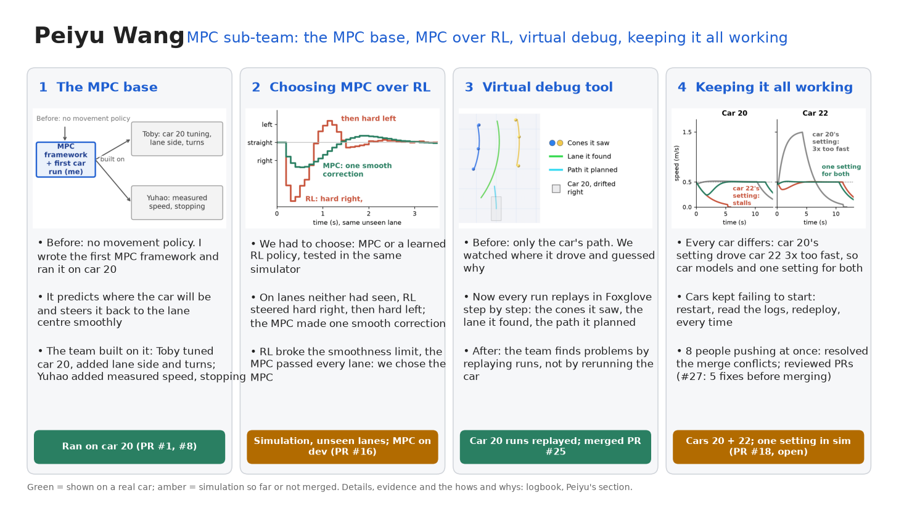

# Peiyu Wang: slide script

About 280 words, two minutes. Each part is one step of the work: what it was like before, why it was done, and what
changed after. The same text is in the slide's speaker notes, and the submission logbook (3.2) follows the same
four steps.

## Script

*[Headline]*

I'm Peiyu, from the MPC sub-team.

*[Card 1: The MPC base]*

When we started, there was no movement policy. I wrote the first MPC framework and got it running on car 20: it
predicts where the car will be and picks steering that brings it back to the lane centre smoothly. That became the
base. Toby then tuned it for car 20 and added lane side and turns; Yuhao added measured speed and stopping.

*[Card 2: Choosing MPC over RL]*

Then we had to decide: MPC, or a learned RL policy. I tested both in the same simulator, on lanes neither had seen.
RL turned the wheel hard right, then hard left; the MPC made one smooth correction. RL broke our smoothness limit and
the MPC passed every lane, so we chose the MPC.

*[Card 3: Virtual debug tool]*

Next was debugging. Before, when a run went wrong, all we had was the car's path: we watched where it drove and
guessed why. So I built a virtual debug tool: every run is logged and replayed in Foxglove, step by step, with the
cones the car saw, the lane it found and the path it planned. Here car 20 has drifted right, and you can see its plan
steering back. After that, the team found problems by replaying runs instead of rerunning the car.

*[Card 4: Keeping it all working]*

Last, keeping it all working. Every car was different: car 20's setting drove car 22 three times too fast, so I made
car models and one setting for both. The cars kept failing to start, and each time meant restarting, reading logs
and redeploying. And with eight people pushing at once, branches collided: I resolved the merge conflicts and
reviewed pull requests, like Toby's lane side, where I fixed five problems before merging.

## If they ask

| Question | Answer | Logbook |
| --- | --- | --- |
| What exactly is yours in the MPC? | The path-frame model, delay compensation and bounded least squares (PR #1), the first car run (#8) and the Stage 1 design (#16). Car 20's weights 10/1/0.1/2 are Toby's (#15); measured-speed prediction and solver-failure stops are Yuhao's (#14) | 3.1, 3.2 |
| Why MPC and not RL? | On the unseen lanes (extra 0.1–0.2 s delay, noise, missed cones) RL's steering roughness was 1.51 and 1.59 against a limit of 1.0; the MPC's worst was 0.51. The rule (pass every unseen lane) was fixed before the unseen lanes were opened | 3.2 (M1) |
| Why did RL steer like that? | Its first reward was exploited (leaving the lane ended the penalties); with bounded penalties it drove the lane but still weaved | 3.2 |
| How was debugging done before? | By watching the car drive and reading text logs. Now each data log replays through the policy into Foxglove (`mcap_export`), and the car publishes the same drawings live (#25) | 3.2 |
| Is the replay what the car did? | Only if the code matches the car's: on the run shown, the replay chose the car's own actions on every step. On other logs it differed, so car runs are judged by their logged actions | 3.2 |
| How different are the cars? | With car 20's control values, car 22 drove about 1.4 m/s for a 0.5 m/s target; car 22's values stall the car 20 model. #18 checks one setting against every car model (pushed, waiting for review) | 3.2 |
| What stopped the cars starting? | The detector crashing under OpenCV 5 (#24), the camera dropping off USB, DREAM's processes at 70–80% CPU, the cone colour setting, a flat battery. Car 20 was shared, so every check was read-only first | 3.2 |
| What merge conflicts? | Chris's controller, Toby's calibration, the first car run and the Stage 1 design landed on `dev` together: six merges, the largest with 22 conflicting hunks | 3.2 |
| What did the review of #27 find? | A duplicate setting, a reset that kept the last run's lane side, a first step planning from the previous run's line, no test with avoidance, and a stale docstring. I fixed them, merged `dev` in, re-ran the wide-track results, then merged | 3.2 |
