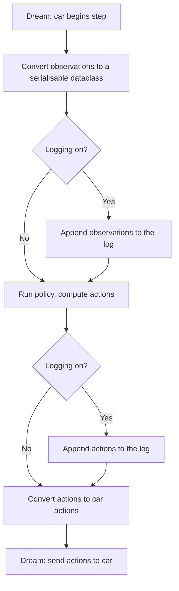
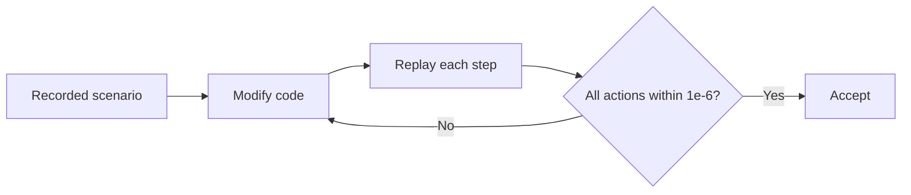

## Part 1: Ciaran Gruber — interfaces, observation model and logged-data simulation

**Role.** The interface between DREAM and the policy: the observation/action data model, data logging, scenarios
from logs and their renderer, and `CarMemory`. Also the repo, CI and the car upload script everyone used.
**PRs** #3 #7 (DREAM v0.3.0), #4 (upload), #5 (CI), #13 (logging, scenarios, renderer), #20 (lidar scenarios, Git
LFS), #22 (`CarMemory`). **Used by:** the four recorded 6 Oct drives (2.4, 5.4) and every car log.

### 1.1 Where it fits (S1)

- My blocks are "Dream Input" and "Dream Output" in the team diagram (0.3), the data model they convert to, and
  `CarMemory`, which carries state between steps (lane side, marker command, stops, local map).
- **Design goal:** every step's observations and actions are serialisable, so any car run can be logged, turned into
  a scenario and replayed off the car.

### 1.2 How it works (S2)

**Logging in each step.**

**Concurrent policy design (attempted).** Separate tracks so camera panning could run beside the main algorithm.

*Modified block diagram for concurrent execution of policy nodes.*

### 1.3 Simulation: changing the architecture without changing the car's output (S3)

- **Objective:** restructure the code for later features (e.g. adding `CarMemory`) without changing what the car does.
- **Method:** replay recorded scenarios step by step through the modified code and compare every action with the
  baseline. Accept only if all actions match within $1\times10^{-6}$ (floating-point noise, no behaviour change).

- **Why:** fast, repeatable checks without needing a controlled physical track for every refactor.

### 1.4 On the car: why did the car veer into cones on curves? (S4, 26 Oct)

- **Question:** simulation and unit tests passed, but on the real curvy track the car veered into the cones.
- **Variables:** course curvature (straight courses had no issue), gaps between cones, obstacles hiding cones (the
  obstacle was removed for this experiment to remove that factor).
- **Method:** drive with logging on → convert the log to a scenario → replay `fail_curvy_road` with the 26 Oct policy
  (`d1d8096`) and that day's config → overlay the lane edges and centre line `MovementPolicy` produced.

*Frame 60 of the failing run: distant blue cones conflict with the near yellow row and the detector reports
`NO_LANE`.*

- **Result:** the lane fit couldn't find a centre line when far blue cones conflicted with near yellow ones.
- **Decision:** Thanh Long and others made lane keeping follow the yellow row when the blue row is missing (2.2);
  gentler curvature also helped, which showed the car's limits.
