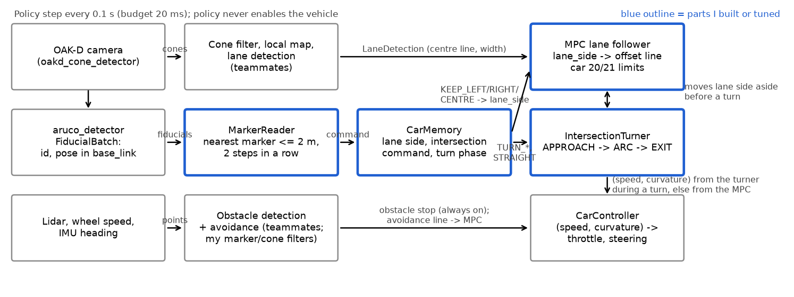
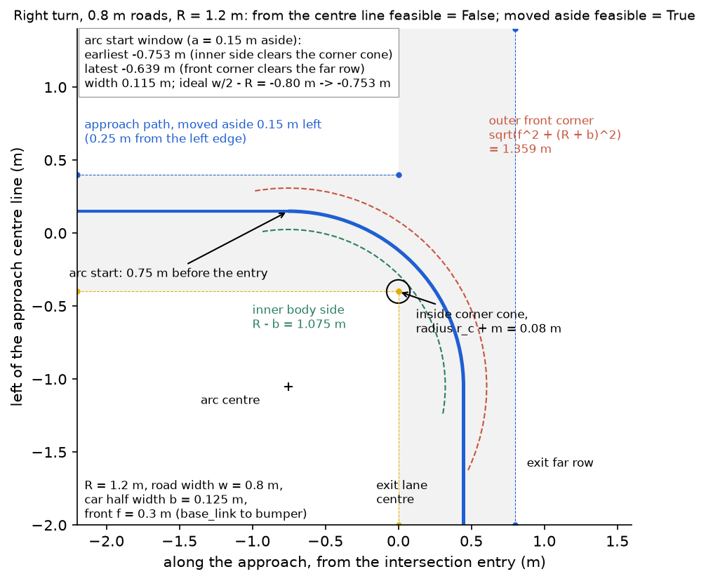
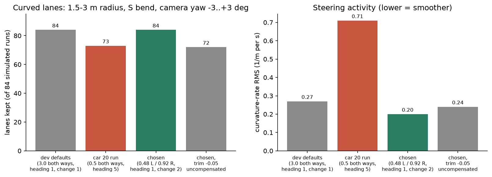
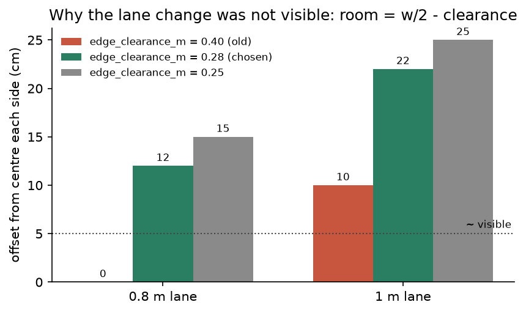
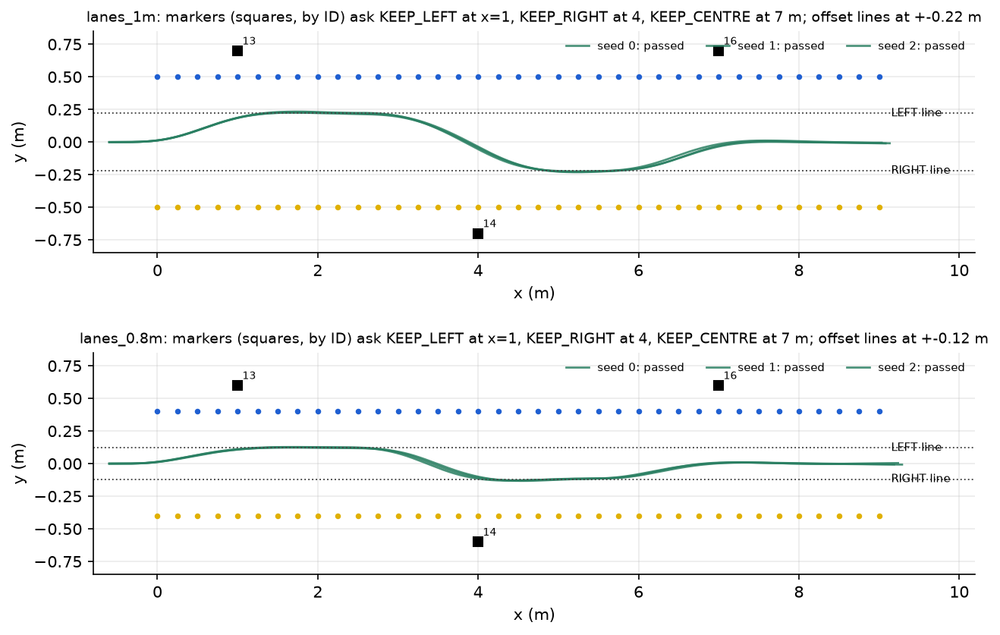
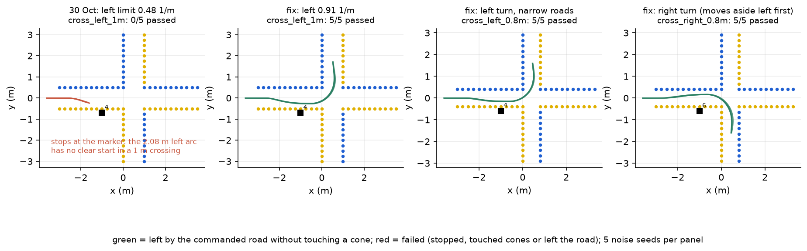
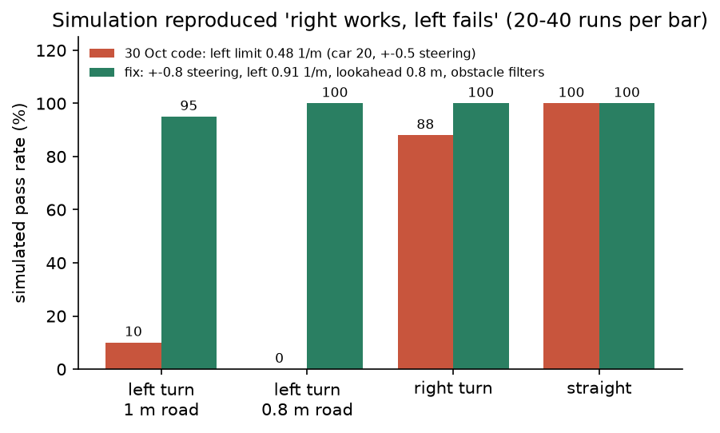
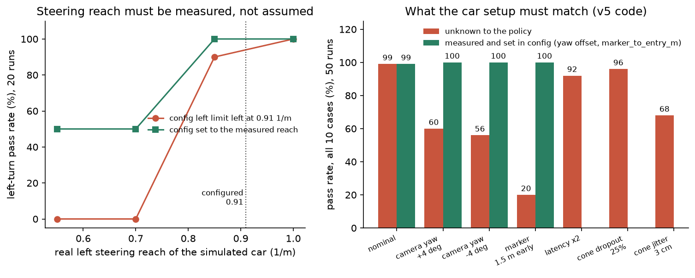
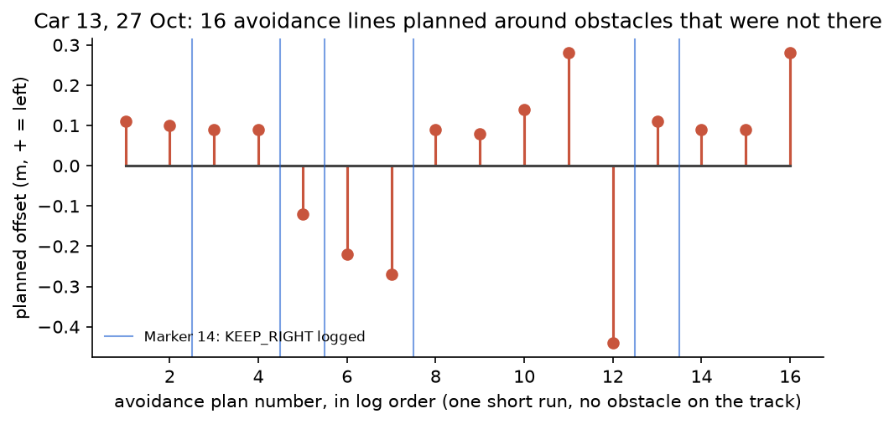

# Toby Lee: MPC sub-team, marker commands and intersection turns

[Back to the team logbook](README.md)

| | |
| --- | --- |
| Role | MPC sub-team. Card 2 test cases, then MPC tuning for the lab car, then ArUco marker actions and intersection turns |
| PRs | #6 and #10 (Stage 1 tests), #15 (MPC calibration), #27 and #30 (lane side), #35 (markers and intersections, merged into `dev` on 2 Nov) |
| Open work | `fix/left-turn-steering-and-obstacles`: 6 commits, pushed, no PR yet (waiting for review by Yuhao and Chris) |
| Built on teammates' work | Ciaran: repo, CI and the upload script. Peiyu: MPC framework, Foxglove export. Thanh Long: lane estimation (`LaneDetection`). Zhenling Zhang: obstacle detection and the local map. Chris: steering calibration and the ±0.8 interval. Yuhao: system ID, grouped marker IDs, left-turn preparation |
| Figures | `toby/figures/`, made by `python3 docs/logbook/toby/make_figures.py` (see its docstring for the two checkouts it simulates) |

**Summary: four pieces of work, in order** (the same as my slide):
1. **MPC lane following.** With the MPC sub-team, I helped build the first lane follower and wrote the Card 2 test
   cases it was tuned on. Then I tuned it to car 20's measured steering (Sections 2.1, 3.1 and 4.1).
2. **Lane shifting from left to right.** The MPC keeps to the left, centre or right of the lane and can shift
   mid-run. On car 20 on 20 Oct, it kept to the left lane (Sections 2.1, 3.2 and 4.2).
3. **Mapping policy actions to ArUco markers.** Markers choose keep left, right or centre, or turn left, turn right
   or go straight at the intersection the marker stands at. This includes the intersection manoeuvre (Sections 2.2,
   2.3 and 3.3).
4. **Fine-tuning and testing on the real robot.** I tuned and tested lane shifting, sharper 90° turns and their
   interaction with obstacle detection over four car sessions. Simulation was used to explain each car result
   (Sections 3.4, 3.5 and 4.3–4.5).

Lane shifting and marker commands worked on real cars. A full intersection turn wasn't shown on a car before access
ended on 2 Nov, so the turn results are simulation only.

## Timeline

| Week | What I did | Evidence |
| --- | --- | --- |
| 1 (5–6 Oct) | Card 2 test cases T1–T11, unseen cases U1–U3, a dream-gym closed-loop harness with disturbances, and printable floor layouts | `1f7f1eb`, `eef5589`, PR #6 and #10, `docs/stage1-test-cases.md` |
| 2 (12 Oct) | Tuned the MPC to car 20: separate left and right limits, a smoother steering weight, measured simulation parameters from Ciaran's real recordings, a curved-lane simulator | `03239b1`, PR #15, `docs/mpc-lab-calibration.md` |
| 3 (16–23 Oct) | MPC lane side (LEFT/CENTRE/RIGHT); car 20 kept left on 20 Oct. First ArUco test on car 21. Marker commands mapped to policy actions | `d78289e`, `81b2105`, `docs/mpc-lane-side.md` |
| 4 (26–30 Oct) | Lane-change retune, `IntersectionTurner`, full-policy marker simulation, `car_management.sh --aruco`. Car 13 test | `3ab7ac9`, PR #35, `logs/car13/policy.log` |
| 5 (1–2 Nov) | Reproduced "left fails, right works", a robustness matrix of about 10,000 simulated runs, phantom-obstacle fixes, a car 14 session | `fix/left-turn-steering-and-obstacles`, `logs/sim-2026-11-02/RESULTS.md` |

---

## 1. Where my parts fit (Standard 1)

*The MovementPolicy pipeline, run every 0.1 s within a 20 ms budget. Blue boxes are the parts I built or tuned. Grey
boxes are teammates' parts that mine depend on.*

**Purpose in the whole system.** Stage 2 asks the car to obey road signs. My parts turn a printed marker into a
driving behaviour, while lane following, obstacle stopping and the safety rules keep working.

| Interface | Direction | What it carries | Assumption or constraint |
| --- | --- | --- | --- |
| `FiducialBatch` from `aruco_detector` | in | marker id, and its pose in `base_link` | Needs the RGB image, which only `oakd_cone_detector` publishes, so the runtime must start with `--aruco`. The distance is right only if `default_marker_size_m` is the printed size (0.081 m) |
| `LaneDetection` (Thanh Long) | in | the lane's centre line and width | The cross road's cones bend the fitted lane near an intersection. So during the approach, the turner keeps only the approach corridor's cones |
| Local map pose: dead reckoning with the IMU heading | in | where the car is relative to the planned entry | Drifts over metres. The turn is about 3 m long, so the drift is small |
| Lidar obstacles | in | points ahead | Marker stands and the lane's own cones show up as obstacles (seen on car 13) |
| `CarMemory` | state | lane side, intersection command, turn phase | A new run (explicit resume) clears it |
| (speed, curvature) to `CarController` (Chris) | out | the command | Curvature must stay within what the car can steer (car 20: 0.48 1/m left and 0.92 1/m right at ±0.5) |

**Design goals and the choices they forced:**
- **Only the nearest marker counts**, within 2 m and for 2 steps in a row. A marker further down the road must not
  take over, and one noisy frame must not give a command.
- **The lane side stays set until another side marker**, so the car holds the side through gaps between markers.
- **The turn is a separate manoeuvre, not a different MPC.** The MPC follows a lane, but in the middle of an
  intersection there's no lane to follow. So the turner drives a planned arc and hands back to the MPC when it sees
  the exit lane.
- **The obstacle stop always stays on**, during the turn too, and it's checked along the path the car is actually
  driving.
- **System-level consequence:** what limits a turn is the car's steering reach. A 0.48 1/m limit means a 2.08 m
  radius, and that arc can't fit a 1 m crossing at all. So the steering calibration, a control-team value, decides
  whether my subsystem works.

## 2. How it works (Standard 2)

### 2.1 MPC lane follower (framework by Peiyu and Yuhao; I tuned it and added the lane side)

The path-frame model, its least-squares form and the delay compensation are in Peiyu's Section 2.1. The version I
tuned for car 20 (on `dev`) predicts $N = 12$ steps of 0.1 s (about 0.6 m at 0.5 m/s) and adds the lane-side line
$e^{line}_k$:

$$\min_{\kappa_0..\kappa_{N-1}} \sum_k 10\,(e_k - e^{line}_k)^2 + 1\,\psi_k^2 + 0.1\,(\kappa_k - \kappa^{path}_k)^2 + 2\,(\kappa_k - \kappa_{k-1})^2 \quad\text{s.t.}\quad -0.92 \le \kappa_k \le 0.48$$

- Solved as bounded least squares (`scipy.optimize.lsq_linear`); a whole policy step took 5 ms median and 15 ms at the 99th percentile on a laptop. The bounds are the only constraints,
  because they're the car's real limit. A soft lane-edge constraint isn't needed, since the cost already tracks a
  line inside the lane.
- **Delay compensation:** as in Peiyu's 2.1, with the 0.2 s age measured from real recordings (Section 4.1).
- **Lane side:** $e^{line}$ is the line `edge_clearance_m` in from the chosen edge, so the offset is
  $w/2 - c$. It moves at most `offset_change_per_m` per metre driven, which keeps the change smooth.
- **My tuning (car 20):** asymmetric limits from Chris's measurement, and `curvature_change_weight` 1 → 2 (Section 3.1).

### 2.2 From marker to action

| ID on `dev` (Yuhao's grouping) | Command | Effect |
| --- | --- | --- |
| 1–4 | `TURN_LEFT` | Plan a left turn at the intersection the marker stands at |
| 5–6 | `TURN_RIGHT` | Plan a right turn |
| 7–8 | `STRAIGHT` | Hold the approach line across the intersection |
| (27 Oct mapping) | `KEEP_LEFT/RIGHT/CENTRE` | Set the MPC `lane_side` until another side marker |
| any other | stop | Stop the run (Yuhao's safety choice) |

`MarkerReader` counts a marker when its pose is ahead, at most 2 m away, and it's the nearest marker for 2 steps in
a row. The command is given once and stored in `CarMemory`.

### 2.3 Intersection turn: APPROACH → ARC → EXIT

*A right turn in 0.8 m roads with R = 1.2 m. From the lane centre, no start point clears both the inside corner and
the far row. After moving 0.15 m to the outside (a hook turn), one does.*

1. **APPROACH.** The marker stands 1 m before the entry (`marker_to_entry_m`), so the entry is placed from the
   marker's pose plus the car's pose. For a turn, the MPC moves to the outside of the lane, 0.25 m from its edge.
   From 0.8 m before the entry, the car holds the approach heading at 0.3 m/s.
2. **ARC.** The arc starts at $s$ and is followed with pure pursuit, with the curvature capped at $1.2/R$. The start
   is chosen so the arc ends on the exit lane's centre ($s^* = w_{cross}/2 - R$), then clamped into the window where
   the body clears both obstacles. Here $b$ is the car's half width (0.125 m), $f$ the distance from `base_link` to
   the front bumper (0.30 m), $r_c$ the cone radius (0.05 m), $m$ the margin (0.03 m) and $a$ how far the car has
   moved aside:
   - **inside corner** (the inner side at $R-b$ from the centre): $s \ge -\sqrt{(R-b-r_c-m)^2 - (R-a-w/2)^2}$
   - **far row** (the outer front corner at $\sqrt{f^2+(R+b)^2}$): $s \le w_{cross} - r_c - m - \sqrt{f^2+(R+b)^2}$
   - if the window is empty, the car stops ("no clear start") rather than touching cones.
3. **EXIT.** Lane following takes over once the car has turned 60° and sees a lane lined up with it. If no exit lane
   appears within 1.5 m, it stops.

## 3. Simulation (Standard 3)

### 3.1 Which MPC settings suit car 20? (12 Oct)

- **Question:** car 20 drifted into the cones on curves. Was that the MPC settings or the car?
- **Method:** `curved_lanes.py` simulates 1.5–3 m curves and an S bend, with -3 to +3° of camera yaw, the measured
  noise and delay, and 4 seeds: 84 runs per setting.
- **Result:** the settings used on car 20 (0.5 limit both ways, heading weight 5) kept 12 of 84 curved runs with
  straight lane edges, and 73 of 84 with curved edges. The chosen settings kept 84 of 84 and steered about a quarter
  less.

- **A judgement that reversed:** my first draft used heading 3 and change 3, chosen from a smaller sweep. The larger
  sweep showed the missing right limit, not the heading weight, was losing curves, so I changed it.
- **Limit:** the "dev defaults" bar also scores 84 only because the simulator clips its impossible 3.0 1/m command.
  The chosen settings plan within what the car can steer.

### 3.2 Why wasn't the lane change visible? (26 Oct)

- **Question:** on car 21, "keep left" was hard to see. How much room did the settings leave?
- **Analysis:** the offset available is $w/2 - c$. With the old $c = 0.40$ m, there's 0 cm of offset in a 0.8 m
  lane and 10 cm in a 1 m lane.

- **Sweep** in the full-policy simulation over 0.40, 0.28 and 0.25 m, at a rate of 0.2 or 0.3 per metre. I chose
  0.28 m at 0.3 per metre: 40 of 40 runs passed, with a worst side error of 0.017 m and the body at least 0.13 m
  inside the lane. 0.25 m left only 0.10 m of body margin.

### 3.3 The marker simulation: does the whole policy turn correctly? (27 Oct)

- `marker_simulation.py` runs the real MovementPolicy closed loop. The car is a kinematic model with lagged speed and
  steering. Cones and markers are seen only in the camera's view, 0.3–2.5 m away, with 3 cm noise, 10% missed and a
  0.2 s delay. The lidar sees the cones (and, with `--marker-stands`, the marker posts). The car also gets wheel speed
  and IMU heading.
- **A pass:** the car leaves by the commanded road, touches no cone and keeps its body on the road.
- **Tuning made in simulation before going on the car:**
  - The marker was moved 1 m before the entry. Beside the last cones it was confirmed too late.
  - Moving aside was added. Without it, right turns in 0.8 m roads were geometrically impossible.
  - Corner clearance 0.03 m passed 59 of 60 runs, against 53 of 60 at 0.05 m.
  - Curvature is capped at 1.2/R, and obstacles are checked along the arc. Both fixed false obstacle stops.
- **Result (20 seeds, with car 21's provisional 1.0 1/m left limit):** every turn and straight-on in 1 m roads
  passed, 100/100. In 0.8 m roads, 97/100 passed; the misses were right turns clipping the first cone of the far row.

### 3.4 Reproducing the car's failure: "right turns work, left turns don't" (1–2 Nov)

- **Question:** Yuhao saw this on the car. Was it the code or the car?
- **Method:** I ran his exact commit `bf5e08c` in the marker simulation with car 20's left reach, over 10 cases and
  10 seeds. Left turns passed 2 of 40 (2 of 20 in 1 m roads, 0 of 20 in 0.8 m roads) and right turns 35 of 40, the
  same pattern as the car. With marker stands added to the lidar, left turns passed 0 of 40 and right turns 40 of 40.
- **Cause:** a 0.48 1/m left limit makes the arc 2.08 m. That has about 2 cm of room in a 1 m crossing and none in
  0.8 m, so the car either stops ("no clear start") or swings into the cones.

- **The fix,** tested on 7 variant branches with 10 seeds and 10 cases each:
  - Chris's ±0.8 steering interval, with the left limit set to 0.91 1/m.
  - Lookahead 0.8 m. The stronger steering made the move-aside before a right turn swing too sharply, which in turn
    made right turns clip cones.
  - Phantom-obstacle filters (Section 4.4).
- **Result:** 57% → 99% of nominal cases, and left turns 2/40 → 39/40 on the pushed branch.

### 3.5 What must the car's setup match? (2 Nov)

- **Steering reach.** If the config says 0.91 but the car reaches only 0.55–0.7 1/m, every left turn fails. Setting
  the config to the measured value recovers 1 m crossings, but 0.8 m crossings still fail.
- **Camera yaw.** 4° of yaw costs a whole turn direction: +4° gives left 0% and right 100%, the same pattern as on
  the car. Setting `camera_yaw_offset_deg` to the measured yaw restores 100%.
- **Marker distance.** With the marker 1.5 m before the entry when the config says 1.0 m, 20% pass. With
  `marker_to_entry_m` set to match, 100% pass.
- **Robust to:** doubled latency (92%), 25% cone dropout (96%) and a speed overshoot of ×1.3. It's sensitive to 3 cm
  of cone misplacement (68%).

### What I can and can't conclude from simulation
- **Can:** rank settings against each other, reproduce a failure mechanism, check the geometry is feasible before
  car time, and find which calibrations matter most.
- **Can't:** predict car pass rates. The model has no tyre slip and no servo nonlinearity. The marker noise is a
  guess, not a measurement. The steering reach is set directly rather than through the servo map. The camera pan
  isn't modelled. The roads are ideal straight crossings.

## 4. On the car (Standard 4)

### 4.1 Measuring the simulator's parameters from real recordings (12 Oct)

- **Question:** what values should the simulated camera and car use?
- **Method:** `real_car_measurements.py` measures Ciaran's four recorded drives (fixed drive effort 0.55, steering
  centred).

| Quantity | Assumed before | Measured | Used in the simulation |
| --- | --- | --- | --- |
| Lane width | 1.0 m | 0.77 m | 0.8 m |
| Cone position noise | 0.01 m | 0.040 m (row residual) | 0.03 m |
| Detection latency | 0 s | 0.21 s | 0.2 s |
| Range / nearest detection | 4 m / 0 m | 2.54 m (95%) / 0.41 m | 2.5 / 0.4 m |
| Camera yaw | 0° | 7.3° left, with the pan never commanded | held at 0, swept ±3° |

- **Interpretation:** the cone rows looked turned 6–10°, but the car's lateral position drifted only 3 cm over
  2.5 m. So the detections were rotated, not the car, and the cause was the camera pan. The team now holds the pan
  at 0.
- **Limit:** we don't know which car Ciaran recorded with, and all the recordings are straight.

### 4.2 Lane shifting on the car (20 Oct car 20, 21 Oct car 21)

- **Question:** does the car actually hold the side that `mpc.lane_side` asks for?
- **Method:** I changed only `lane_side` in the yaml on car 20 (CENTRE → LEFT, then
  `dream runtime restart ai4r_policy`) and kept the same track and speed.
- **Result (20 Oct, by eye, no log recorded):** the car kept to the left side of the lane.
- **21 Oct, car 21, with markers:** the shift was hard to see. The analysis in Section 3.2 showed why: the 0.40 m
  clearance left 0 cm of room in an 0.8 m lane and 10 cm in a 1 m lane. I retuned it to 0.28 m at 0.3 per metre. The
  logs that day also showed that no marker batches reached the policy (Section 4.3), so I added `--aruco`.
- **Limit:** the result was judged by eye, without a measured offset. The next test should log the offset in
  Foxglove and compare it with the simulated ±0.12 m (0.8 m lane) or ±0.22 m (1 m lane).

### 4.3 Is each link of the marker chain working? (21 Oct car 21, 27 Oct car 13, 2 Nov car 14)

The symptom "the car doesn't turn" has several independent causes, so I tested each link from the bottom up and
controlled one variable at a time:

| Link | Check on the car | Result | Decision |
| --- | --- | --- | --- |
| Camera image | `dream runtime status`, and the `/car/camera/rgb/image_rect` topic | 21 Oct: 0 detections in 9 runs. The GPU detector publishes no RGB image | Added `car_management.sh --aruco` |
| Detection and distance | Hold the marker 1.5 m ahead; `ros2 topic echo /car/fiducial_detections` | The size must match the print (0.081 m). On 30 Oct the detector still had a 0.25 m snapshot (Yuhao) | Fixed in `aruco_detector.yaml` |
| Command | `dream runtime logs ai4r_policy` | 27 Oct, car 13: "Marker 14: KEEP_RIGHT, lane side RIGHT", 6 times | Commands work on a real car |
| Manoeuvre | Foxglove `/plan/intersection` and the turn logs | 2 Nov: the wrong branch was uploaded first, and then no `--aruco`. Time ran out | Not shown on a car |

### 4.4 Phantom obstacles: turns combined with obstacle detection (27 Oct, car 13)

- **Observation:** in one short run with no obstacle on the track, avoidance planned 16 lines, flipping between
  -0.44 m and +0.28 m. A real box gives a steady offset, so these were marker stands and the lane's own cones.
- **Checked in simulation:** I added marker stands to the simulated lidar. Phantom avoidance appeared in 29% of runs,
  mostly from the lane's own cones.
- **Fix:**
  - ignore lidar returns within 0.15 m of a seen marker
  - plan avoidance only after 3 sightings in 5 steps
  - ignore known cones while turning
- **Result:** 29% → 4% of runs, and the obstacle simulation with real boxes still passes 12 of 12. Not yet tested on
  a car.

### 4.5 The experiments still needed (method ready, not run)

All three are shared with teammates, so they are in the team table (Team overview, 0.7), with my methods kept:
- the real left and right steering reach at ±0.8 (with Chris and Yuhao);
- the camera yaw with the pan at 0 (with Thanh Long, Yuhao and Peiyu);
- a left turn on the car compared with simulation (with Yuhao).

## 5. Lessons and limits
- **Measure before you tune.** The 0.48/0.92 asymmetry I recorded on 12 Oct explained the 1 Nov failure. A 10-minute
  stand test would have saved most of a car session.
- **Reproduce the car's failure in simulation first.** It turned "the code is wrong" into a measured cause.
- **Deployment discipline matters as much as code.** Check the branch, `CAR_NUM` and `--aruco` before each upload.
- **Limits:** left and right turns at an intersection haven't been shown on a car. All the pass rates above come from
  simulation.
