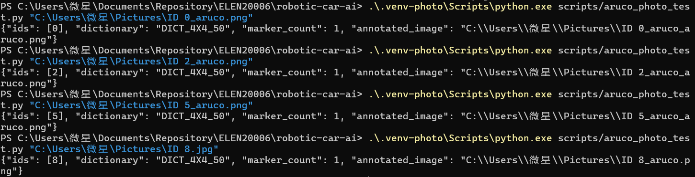
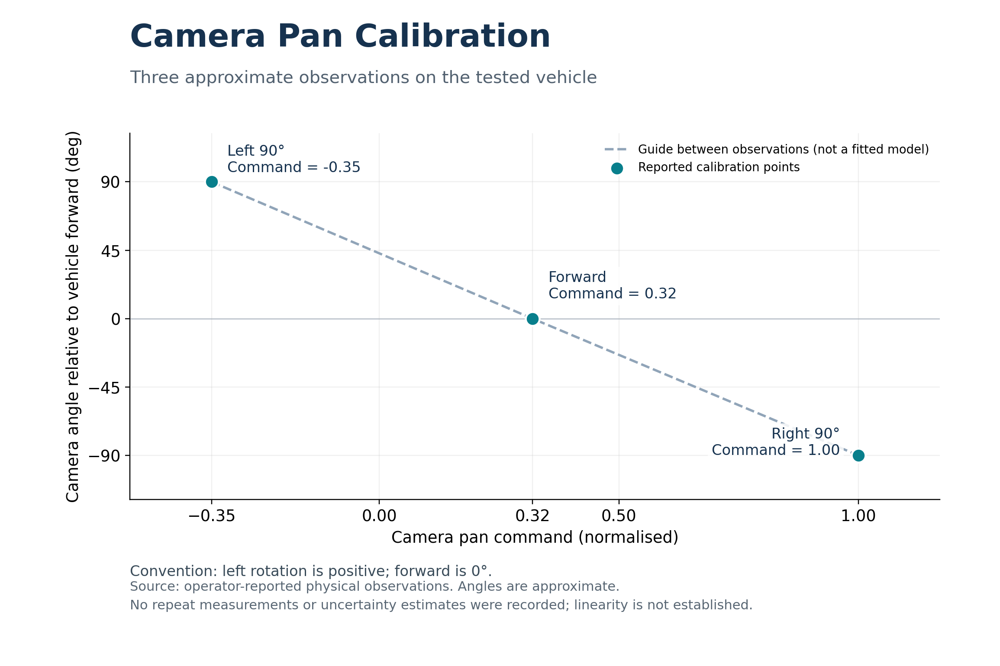

# Yifei Xia: car control testing, marker recognition and camera investigations

[Back to the team logbook](README.md)

| | |
| --- | --- |
| Role | Car control sub-team with Chris (Chuhan Wang): speed-control testing, steering measurements and actuator calibration. Additional investigations into ArUco ID detection, battery monitoring and camera heading compensation |
| Shared work | Chris: PI speed-control loop and vehicle tests, steering-map runs and motor calibration. Chris's section records the controller implementation, fitted models and subsequent fixes; these are not claimed here as my independent work |
| Individual work | Camera pan calibration, marker-ID testing and troubleshooting, battery-monitoring feasibility investigation, and an interactive camera-compensation simulation developed with AI assistance |
| Evidence | Shared car-control results in [Chris's section](chris-wang.md); figures in `Yifei/figure/`; [camera simulation and instructions](Yifei/yifei/camera-game/README.md) |
| Status | Shared speed and steering work supported the team's vehicle control. Marker-ID output was demonstrated. Battery-charge measurement was not implemented; physical camera stabilisation was not conclusively validated. Simulation comparison results remain to be documented |

**Summary: four pieces of work**

1. **Speed and steering tests with Chris.** Helped investigate drive-to-speed behaviour, develop and test a PI speed-control loop, and measure steering response (Sections 2.1 and 4.1).
2. **ArUco marker recognition.** Tested ID output on the vehicle and from stored images, and diagnosed a missing camera-image input (Sections 2.2, 3.2 and 4.2).
3. **Camera calibration and compensation.** Recorded three camera-pan calibration points, investigated counter-rotation, and developed a simulation using the existing compensation controller (Sections 2.3, 3.1 and 4.3).
4. **Battery-monitoring feasibility.** Identified the separate power supplies and the additional sensing hardware needed under the no-modification constraint (Section 4.4).

Real-car observations and offline results are separated below. Successful software execution does not establish physical tracking accuracy or autonomous junction-turning performance.

## Timeline

| Date / period | My work | Evidence and qualification |
| --- | --- | --- |
| Early control work; 27–29 Sep is Chris's recorded initial phase | Worked with Chris on drive/speed testing and an initial PI control loop | Our discussion records the collaboration; Chris dates the initial car 8 system-ID/PI phase. My attendance at every individual run is not independently recorded |
| 5 Oct | Shared car 20 calibration and speed/steering testing with Chris | Chris explicitly identifies the steering-map session as work with Yifei; his Sections 4.1–4.3 document the procedure and results |
| 12–13 Oct | Shared calibration work became supporting evidence for team controller integration | Chris records PR #17 and the Progress Assessment in this period. The implementation and merge are Chris's work, not an additional personal implementation claim |
| 19 Oct | ArUco detection tests and diagnosis of the missing image stream; successful ID output | Terminal screenshots show dated logs, including `aruco-test-20261019-131746-299125.jsonl`; the raw log is not currently attached here |
| 30 Oct–2 Nov | Battery-monitoring feasibility, camera-pan calibration and compensation troubleshooting | Discussion and vehicle-session context place this work in this period; exact dates for each calibration observation were not separately recorded |
| 7 Nov | Developed and checked the interactive camera-compensation simulation | Local simulation/controller checks and GUI/CSV checks; see Section 3.1 |
| 9 Nov | Organised logbook evidence, prepared the calibration figure, and ran stored-image ArUco tests | Figures below: calibration observations and terminal outputs for IDs 0, 2, 5 and 8 |

The shared speed/steering chronology follows Chris's logbook. Other dates follow the discussion and dated terminal evidence. A date range is used where the exact experiment date is not available. Chris's 26 October speed fix and later avoidance studies are not presented as my own work.

---

## 1. Where my parts fit (Standard 1)

My work connected vehicle-control commands to observed physical response and checked the perception outputs available to higher-level decision-making.

| Interface / subsystem | Input | Output or contribution | Assumption or constraint |
| --- | --- | --- | --- |
| Speed control, with Chris | Target speed and measured wheel speed | Adjusted normalised drive command; shared tests for calibration and tuning | Reliable feedback is needed; a fixed drive command is not a fixed speed |
| Steering calibration, with Chris | Normalised steering command | Observed steering response and shared steering-map measurements | Steering angle and path curvature are different quantities; Chris documents the curvature map used by the controller |
| ArUco detection test | `/car/fiducial_detections`, or a stored image for the separate offline tool | Detected marker IDs for handover to decision-making code | The live detector needs an active image source and the correct dictionary |
| Camera compensation experiment | Vehicle heading and a selected reference direction | Camera pan command | Calibration is vehicle-specific; IMU freshness, command range and rate are constrained |
| Battery-monitoring investigation | Motor-battery and computer-supply arrangement | Feasibility assessment | No vehicle hardware modifications permitted; no accessible battery measurement source established |

**Design choices and system consequences:**

- Wheel-speed feedback addresses changes in vehicle response without requiring a battery-charge estimate.
- My marker task was to verify ID output. Assigning IDs to manoeuvres and executing turns belonged to the team's subsequent decision and control work.
- Camera panning changes the camera-to-vehicle relationship. Perception using vehicle-frame geometry would need a measured dynamic camera transform; a fixed zero-pan transform is insufficient when the camera physically rotates.
- The compensation experiment remains separate from the final driving system; simulation success is not evidence that moving-camera perception was integrated.

## 2. How it works (Standard 2)

### 2.1 Speed feedback and steering calibration with Chris

The conceptual PI speed-control relationship is:

$$e_k = v_{ref} - v_k, \qquad I_k = I_{k-1} + e_k\Delta t, \qquad u_k = u_{ff} + K_p e_k + K_i I_k.$$

- **Meaning:** the proportional term reacts to current speed error; the integral term removes a persistent offset. Feedforward provides an initial command estimate. The deployed controller also has limits and conditional integration; the expression above is explanatory, not a complete implementation specification.
- **My contribution:** I helped Chris with the initial control loop and physical speed/steering tests. Chris documents the final feedforward-plus-PI implementation, anti-windup choices, parameter values and later integral-rule fixes in [his technical section](chris-wang.md#2-how-it-works-standard-2).
- **Steering distinction:** steering angle is measured in radians, while path curvature is measured in inverse metres. For the shared car 20 steering-map tests, Chris reports curvature calculated from yaw rate divided by speed, rather than treating normalised steer as a physical angle.
- **Reasoning:** observed variation between runs and vehicles means calibration cannot be assumed transferable. We suspected battery condition as one influence, but did not measure charge sufficiently to establish it as the sole cause.

### 2.2 Marker ID extraction

- The printed markers are **ArUco markers**, not conventional text/URL QR codes. The selected dictionary was `DICT_4X4_50`.
- On the vehicle, the read-only test subscribed to the existing detector's results and displayed IDs. It did not directly acquire the camera or command vehicle motion.
- The separate stored-image tool uses OpenCV's ArUco detector, returns the detected IDs, and saves a copy with detection outlines. Printed text such as “ID 2” is not the decoding input.
- A detected ID is an input to subsequent decision logic, not a turn command by itself. Pose output and low reprojection error also do not establish ground-truth distance accuracy.

### 2.3 Camera calibration and heading compensation

Let $\psi_v$ be vehicle heading and $\psi_t$ the selected world-frame camera heading. Leftward rotation is positive:

$$\theta_{pan}^{*}=w(\psi_t-\psi_v), \qquad u_{pan}^{*}=c+g\theta_{pan}^{*}.$$

Here, $w$ (the `wrap` function) selects the shortest signed angle, $c=0.32$ is the forward-facing command, and $g\approx-0.43$ is the estimated command change per radian of leftward camera rotation.

| Parameter | Value used | Basis / implication |
| --- | --- | --- |
| Centre command | 0.32 | Approximate physical forward alignment |
| Signed gain | −0.43 command units/rad | Approximation from the reported left/forward/right observations |
| Command range about centre | ±0.15 | Approximately ±20° compensation; exceeding the range latches a fault rather than continuing at a clipped target |
| Command-rate limit | 0.1 units/s | Restricts how quickly the camera command changes |
| Simulation timestep | 0.02 s | Fixed model timestep; not a measured physical loop guarantee |
| Simulated servo time constant | 0.15 s | Assumed, not measured on the vehicle |
| IMU stale-data threshold in the simulation | 0.5 s | After receiving data, stale input causes a latched hold; recovery needs explicit reset |

The simulation computes camera world heading as vehicle heading plus relative camera angle. Its project mode reuses `pan_stabilisation.step`; target selection is provided by a simulation adapter rather than an implemented absolute-heading interface on the real car.

## 3. Simulation and offline investigation (Standard 3)

### 3.1 How does the camera maintain a world-frame direction?

- **Question:** under the same vehicle rotation, how do compensation, command limits, actuator response and IMU delay affect camera heading error?
- **Implementation:** the [interactive camera laboratory](Yifei/yifei/camera-game/README.md) provides ideal compensation, no compensation, and the project controller with a first-order simulated servo and delayed heading measurements.
- **Repeatable method:** the fixed-trajectory option uses $\psi_v(t)=15\sin(2\pi t/10)$ degrees with a zero-degree target for 20 simulation seconds. CSV export supports maximum absolute error, mean absolute error and time-series comparisons.
- **Verification completed:** 11 controller/model checks passed during development. GUI checks covered heading selection, mode changes, range faults and reset. The fixed trajectory paused after 20 simulation seconds and exported 1,000 samples successfully.
- **Performance evidence still missing:** no comparative error curves or measured performance improvement are claimed here. The proposed experiment compares the three modes, then changes only IMU delay from 0 to 0.2 s in project mode.
- **Can't conclude:** the assumed servo dynamics, simplified sensor model and absence of the complete ROS/TF pipeline prevent treating the simulation as proof of physical stabilisation accuracy. Software tests check implementation behaviour, not model fidelity.

### 3.2 Can stored images be decoded without vehicle access?

- **Question:** can the image detector extract the expected IDs from existing images after access to the cars has ended?
- **Method:** run the stored-image test separately on four files, using the same `DICT_4X4_50` dictionary, and inspect the returned IDs and marker counts.

*Figure 1. Terminal results for four stored-image inputs. The detector returned IDs 0, 2, 5 and 8, with one marker in each input. These are example decoding results, not a recognition-accuracy benchmark.*

| Input shown in terminal | Returned ID | Marker count |
| --- | --- | --- |
| `ID 0_aruco.png` | 0 | 1 |
| `ID 2_aruco.png` | 2 | 1 |
| `ID 5_aruco.png` | 5 | 1 |
| `ID 8.jpg` | 8 | 1 |

- **Result:** four selected inputs produced the expected IDs.
- **Limitations:** the provenance of the first three `_aruco` files should be confirmed before describing them as unannotated originals. No systematic distance, lighting, blur or false-positive study was performed. This is offline image testing, not a vehicle-dynamics simulation or a live-camera benchmark.

## 4. On the car (Standard 4)

### 4.1 Speed and steering testing with Chris (5 Oct car 20 session)

- **Question:** how do normalised drive and steering commands relate to the vehicle's measured motion, and how can speed feedback make the commanded speed more consistent?
- **My contribution:** I worked with **Chris (Chuhan Wang)** on vehicle calibration and testing, including steering-map runs, and helped with the earlier PI control-loop work. Chris's logbook explicitly credits the shared steering measurements and motor calibration.
- **Shared method, as documented by Chris:** drive levels were held for individual runs; wheel-speed feedback supported speed control. For the 5 October steering map, PI held a 0.5 m/s target while each steering level was tested, and curvature was averaged over the final three seconds. His record includes trim adjustment and repeated measurements after reboot.
- **Evidence and attribution:** [Chris's Sections 4.1–4.3](chris-wang.md#4-on-the-car-standard-4) contain the shared procedure and resulting calibration/PI plots. His model fits, controller implementation and quantitative tuning results remain attributed to him; they are not reproduced here as independently analysed results.
- **Observation and limitation:** fixed commands did not guarantee identical motion across testing conditions. Battery condition was a possible explanation, but no charge measurement established a causal relationship. Earlier tests on a different car also required recalibration rather than direct parameter transfer.
- **Troubleshooting contribution:** I supported team testing and investigated cases involving stale required sensors, unexpected active policy settings and multiple drive-command publishers. A controller must receive valid inputs and be the intended command source before its physical behaviour can be evaluated.

### 4.2 Live ArUco ID detection (19 Oct)

- **Question:** can the vehicle's existing camera/detector pipeline provide usable marker IDs to the policy team?
- **Method:** use a read-only subscriber, present markers to the camera and inspect IDs and detection status. Check detector subscriptions and image publishers when results are absent.
- **Failure found:** the detector process existed, but its subscribed image topic had zero publishers. This separated an unavailable upstream image source from a failure to decode the marker.
- **Observed result:** after the image pipeline became available, the test displayed `ids=[2]` and `TARGET_SEEN_POSE_OK`; other IDs were also observed during testing. The discussion contains terminal screenshots, but the raw JSONL log is not attached to this section.
- **Integration lesson:** switching camera/cone-detection services affected the setup teammates expected. Service coordination matters when several perception components depend on the same camera.
- **Can't conclude:** these observations do not establish detection accuracy across operating conditions, ground-truth pose accuracy or successful autonomous intersection turns. My output for the team was the recognised ID; manoeuvre selection and execution were subsequent team work.

### 4.3 Camera pan calibration and compensation attempt (30 Oct–2 Nov period)

- **Question:** which camera command points forwards, and can heading-based counter-rotation keep the camera directed towards a fixed reference?
- **Method:** command the pan actuator and compare its direction with vehicle forward, left and right. Record three approximate reference positions; then investigate heading-based compensation by turning the vehicle body.

*Figure 2. Three operator-reported calibration points. Leftward camera rotation is positive. The dashed segments guide the eye; they are not an independently validated linear model. No repeat-measurement uncertainty was recorded.*

| Observed direction | Relative angle | Pan command |
| --- | --- | --- |
| Left | Approximately +90° | −0.35 |
| Forward | Approximately 0° | 0.32 |
| Right | Approximately −90° | 1.00 |

- **Result:** the forward-facing command differed substantially from zero. The three observations supported using an approximate signed calibration for the compensation experiment.
- **Failure / unresolved behaviour:** the camera initially centred but did not visibly compensate as expected. Sensor freshness, controller state and compensation limits required investigation. Centring alone did not establish stabilisation success.
- **Limitations:** there is no dense calibration sweep, repeated-angle uncertainty estimate or measured servo dynamic response. Vehicle access ended before further physical validation; the later interactive simulation cannot replace it.

### 4.4 Battery-monitoring feasibility (30 Oct period)

- **Question:** can remaining motor-battery charge be measured to help explain changes in speed response?
- **Hardware observation:** the motor power system used an 8.4 V, 5000 mAh NiMH battery. The onboard computer had a separate 5 V power bank, so computer-supply information would not automatically describe the motor battery.
- **Constraint:** no hardware modification was permitted. No accessible motor-battery voltage/current measurement source was established; the battery could not be connected directly to a low-voltage GPIO input for measurement.
- **Required addition:** a suitable sensing module and analogue-to-digital interface would be needed unless equivalent accessible hardware already existed. Remaining-charge estimation would require a further model or measurement method; voltage alone is not a direct charge-percentage reading.
- **Decision:** I did not implement a remaining-charge estimator because the required hardware addition was outside the permitted scope. Wheel-speed feedback remained a practical means of adjusting drive output without first estimating charge.

## 5. Lessons and limits

- **Calibration comes before interpretation.** A normalised command is not a physical speed, steering angle or camera orientation. The measured camera centre of 0.32 made this particularly clear.
- **Diagnose the complete data path.** A running detector without image input cannot produce useful results; missing or stale sensors and conflicting command publishers can also invalidate a control test.
- **Keep shared credit explicit.** Chris was my collaborator on the speed/steering work. His final controller, numerical analysis and later fixes are documented in his own section.
- **Keep different evidence levels separate.** Four successfully decoded images do not establish general recognition accuracy. Passing software checks do not establish physical stabilisation, and a simulation's assumed actuator response is not a measured car model.
- **Unsuccessful investigations still inform decisions.** The battery task identified a hardware constraint; the camera task identified calibration, sensor and frame-transform dependencies.
- **Remaining work:** analyse the repeatable camera simulations and attach error curves; retain original image inputs where possible; clearly label missing physical validation. Further vehicle experiments were unavailable once car access ended.

**AI assistance:** AI tools supported code development, troubleshooting, figure preparation and organisation of this logbook. Physical observations and shared-test contributions are identified separately from generated software and simulated results.
