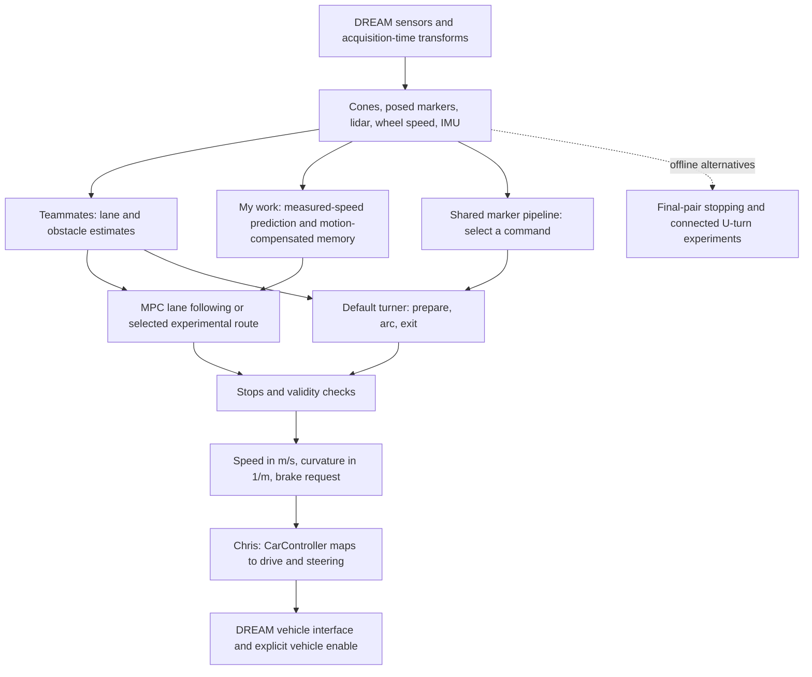
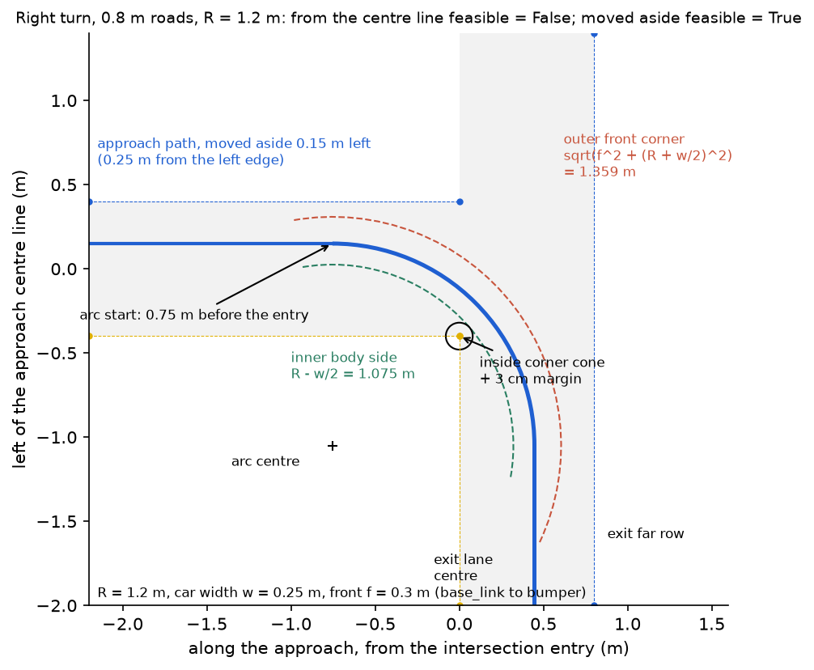
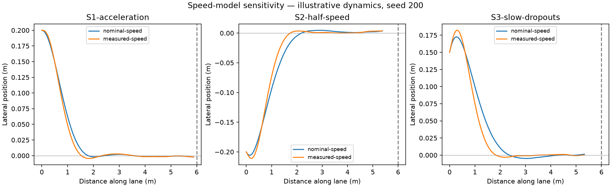
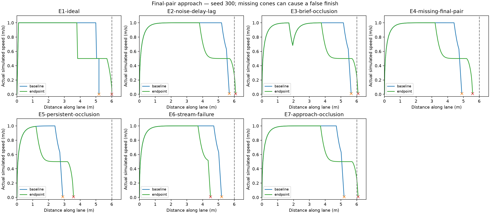
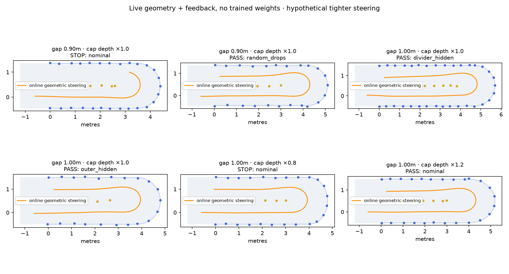
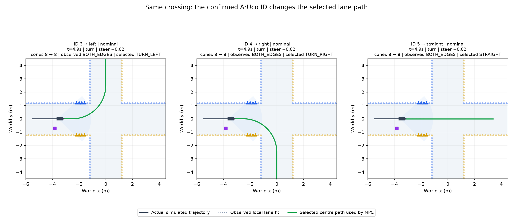
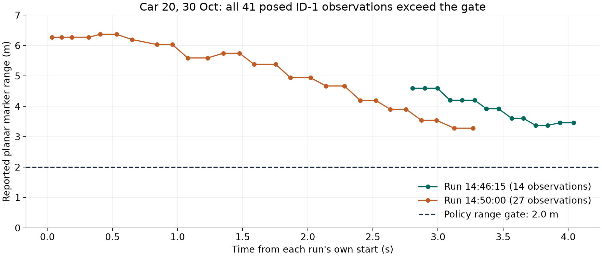
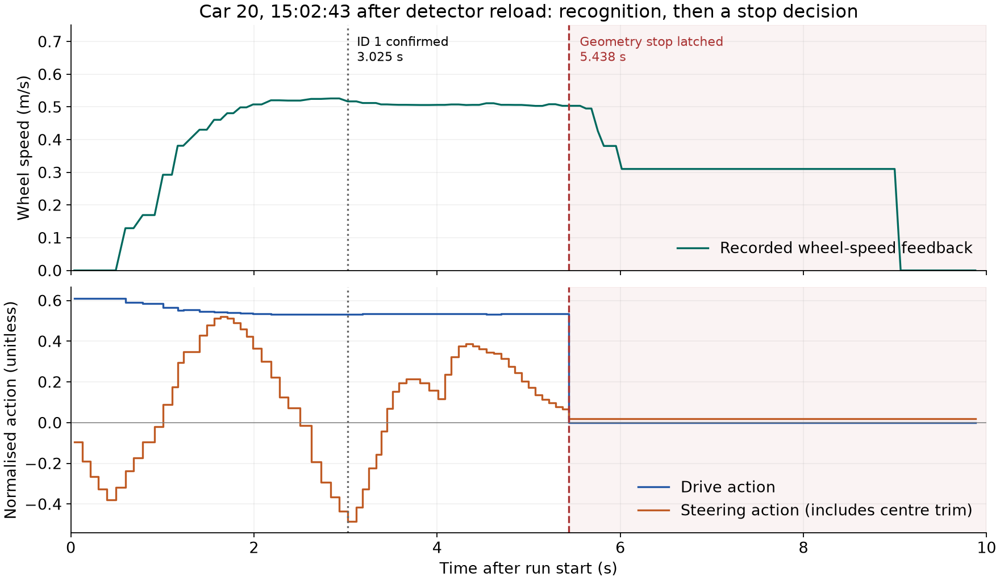

# Yuhao Liu: measured-speed MPC, cone memory and intersection stopping

[Back to the team logbook](README.md)

| | |
| --- | --- |
| Role | MPC sub-team. Measured-speed prediction and solver-failure handling, offline final-pair stopping, cone-memory manoeuvres, experimental junction navigation, grouped marker commands and left-turn diagnosis |
| Contribution period | 6 Oct–2 Nov 2026. Prepared for the interactive oral on 9 Nov 2026 |
| Main changes | [PR #14](https://github.com/CiaranGruber/robotic-car-ai/pull/14), integration repair `32723db`, branch experiments `e908d73` / `fd01806`, junction work `d59e812`, shared [PR #35](https://github.com/CiaranGruber/robotic-car-ai/pull/35), [PR #36](https://github.com/CiaranGruber/robotic-car-ai/pull/36) |
| Built on teammates' work | Peiyu: original MPC framework, Stage 1 design, lane-end work and Foxglove tools. Toby: test harness, car-calibrated MPC tuning, marker reader, default intersection turner and marker simulator. Chris: CarController and measured steering/control data. Ciaran: DREAM integration, repository and recorded drives. Lane, obstacle and local-map work came from the perception team |
| Status | Measured-speed and marker/stop changes integrated. Final-pair estimator and connected U-turn are separate offline experiments. The experimental junction navigator is disabled by default. No complete physical left intersection turn established by my records |
| Figures and data | [Figure index](#5-figures-and-evidence-standard-5), with source hashes and small result extracts in [yuhao/data/](yuhao/data/) |

**Summary: four pieces of work, in order**

1. **Measured-speed MPC.** I changed the prediction and delayed-state propagation to use wheel speed, and kept invalid or exhausted plans from producing continued motion. Tracking error improved modestly in a controlled simulation comparison.
2. **What missing cones mean.** I investigated final-pair stopping and motion-compensated cone memory. The endpoint experiment exposed an ambiguity under persistent hiding. A separate geometric U-turn completed 10/12 varied simulated layouts, using hypothetical tighter steering.
3. **Junction routes and marker commands.** I developed the experimental route selector and T-junction evidence checks, then contributed grouped IDs, earlier preparation and heading-aware turn admission to Toby's marker-turn implementation.
4. **Diagnosis and persistent stops.** I separated a stale detector-size snapshot from a later turn-geometry failure on car 20, then fixed stop persistence after turn rejection or exit timeout.

This is discussion material. The assessed talk allows **one personal slide for 1–2 minutes**. Simulation figures below are supporting evidence, and are not real-car submission videos.

## Timeline

| Date | What I changed or investigated | Evidence |
| --- | --- | --- |
| 6 Oct | Compared MPC horizons/weights, added measured-speed prediction and bounded failure behaviour, investigated final-pair stopping | [`f7052b2`](https://github.com/CiaranGruber/robotic-car-ai/commit/f7052b2), [MPC evaluation](../mpc-simulation-evaluation.md) |
| 12 Oct | Repaired integration with the calibrated MPC, preserving measured speed, asymmetric bounds and stopping behaviour | [`32723db`](https://github.com/CiaranGruber/robotic-car-ai/commit/32723db). This was integration work, not my own steering calibration |
| 20–23 Oct | Explored turn continuity and a connected U-turn using remembered cones and feedback steering | [`e908d73`](https://github.com/CiaranGruber/robotic-car-ai/commit/e908d73), [`fd01806`](https://github.com/CiaranGruber/robotic-car-ai/commit/fd01806), separate `feature/cone-memory-continuity` work |
| 26 Oct | Experimental cross/T identification, command-selected routes, cone association and finite approach while exit evidence is unknown | [`d59e812`](https://github.com/CiaranGruber/robotic-car-ai/commit/d59e812), [historical acceptance](https://github.com/CiaranGruber/robotic-car-ai/blob/d59e812/docs/acceptance.md) |
| 30 Oct | Grouped direction IDs, unsupported-ID stop, detector snapshot diagnosis, earlier outside-lane preparation and tangent admission | [`bf5e08c`](https://github.com/CiaranGruber/robotic-car-ai/commit/bf5e08c), [car investigations](#4-on-the-car-standard-4) |
| 2 Nov | Turn-stop persistence, bounded braking request, experimental approach speed budget and policy-suite repairs | [`488ec30`](https://github.com/CiaranGruber/robotic-car-ai/commit/488ec30), PR #36 |

## 1. Where my parts fit (Standard 1)

*Figure 1. Where prediction, route selection and stop decisions sit in the shared pipeline. The default marker turner and the experimental MPC junction route are alternative paths. The dashed branch identifies experiments that should not be mistaken for the deployed controller.*

**Purpose.** Follow the observed lane, interpret the selected road sign and avoid continuing on a plan whose evidence or geometry is no longer usable.

| Interface | What I use or produce | Constraint and system consequence |
| --- | --- | --- |
| Cone rows and observation age | Positions in metres, colour and acquisition time | Old measurements describe an earlier vehicle pose. Delay and dropouts affect both tracking and route admission |
| Wheel speed and IMU | Forward speed in m/s, heading/yaw motion | Wheel speed is unsigned. Prediction assumes forward travel. Motion-compensated memory still drifts and needs expiry |
| Posed ArUco detections | ID, position and freshness | Pose scale depends on the detector's admitted marker size. A source YAML edit alone does not reload a running component |
| Lidar and boundary evidence | Current clearances, closing rows and support for an outgoing road | Missing returns mean unknown space. They cannot by themselves establish a free exit |
| `CarMemory` | Cached plan, pending command, manoeuvre phase and stop reason | An explicit new run clears relevant latched state. Losing a manoeuvre object must not erase a stop |
| `CarController` | Requested speed, signed curvature and bounded brake request | Controller limits, steering calibration and brake response belong to the control/hardware integration. A zero action is not a measured stopping distance |
| DREAM runtime | Admitted parameters, TF and vehicle services | The policy never enables the vehicle. The camera TF describes zero pan, so unmeasured physical panning invalidates frame assumptions |

**Requirements and trade-offs**

- **Track within the car's steering reach.** A requested curve outside the measured left/right limits is not made feasible by increasing an MPC weight.
- **Keep short gaps bounded.** Retaining a plan avoids an immediate discontinuity, but its usable distance, age and sensor requirements must limit continued motion.
- **Obey the requested exit.** A closed or unsupported left exit must not silently become straight travel.
- **Keep stopping separate from successful navigation.** A guarded stop can be correct fault handling while still failing the requested task.

## 2. How it works (Standard 2)

### 2.1 Measured-speed MPC

Let $e$ be lateral error in m, $\psi$ heading error in rad, $v$ wheel speed in m/s, and $\kappa$ commanded curvature in m⁻¹. Positive lateral error and curvature are leftward. With $d=v\Delta t$, a small-error path-frame approximation near the reference gives the following discretisation, holding speed and curvature over each step. It neglects higher-order lateral-offset/path-curvature coupling.

$$e_{k+1}=e_k+d\psi_k+\frac{d^2}{2}(\kappa_k-\kappa_k^{path}),\qquad
\psi_{k+1}=\psi_k+d(\kappa_k-\kappa_k^{path}).$$

The MPC chooses the curvature sequence $u=(\kappa_0,\ldots,\kappa_{N-1})$:

$$\min_u\sum_k q_e(e_k-e_k^{ref})^2+q_\psi(\psi_k-\psi_k^{ref})^2
+r_\kappa(\kappa_k-\kappa_k^{ref})^2+r_\Delta(\kappa_k-\kappa_{k-1})^2,
\quad -\kappa_{right}\leq\kappa_k\leq\kappa_{left}.$$

| Term | Meaning | Trade-off |
| --- | --- | --- |
| $q_e$ | Lateral tracking penalty | Larger values prioritise position error |
| $q_\psi$ | Heading penalty | Aligns with the reference before lateral drift grows |
| $r_\kappa$ | Curvature deviation penalty | Discourages steering beyond what the reference needs |
| $r_\Delta$ | Change from the previous curvature | Reduces abrupt steering at a possible cost in tracking |
| $N,\Delta t$ | Horizon steps and time per step | Predicted distance is $Nv\Delta t$, so speed changes what the horizon covers |

- **Implementation:** stacking the linear prediction and weighted errors gives bounded least squares $\|Mu-c\|^2$. The existing SciPy solver uses `bvls`. Only the first curvature is applied, then the policy solves again.
- **My change:** rebuild the motion matrices using fresh measured speed, holding it constant across this horizon. The delay projection also uses $d_\tau=v\tau$ and the previous requested curvature, not reconstructed motion history. The solver API uses nominal speed when feedback is omitted, while a measured zero remains zero. Required missing/stale wheel data still stops the ROS policy through its sensor checks.
- **Why:** acceleration or under-speed makes a nominal-speed model predict the wrong travelled distance. Changing the model input addresses that mismatch directly.
- **Constraints kept:** separate left/right curvature bounds. **Not represented:** tyre slip, steering slew, a complete vehicle dynamics model, or a hard lane/obstacle constraint inside the least-squares problem. Other policy guards check obstacles and stopping; the cost alone is not a containment proof.
- **Failure handling:** finite inputs, solver status, vector shape and curvature bounds must all be valid. A failed solve requests a stop. Cached-plan progress uses measured travel and stops at plan exhaustion instead of repeating its last steering indefinitely.

The **6 Oct comparison** uses $N=12$, $\Delta t=0.1$ s, target 1 m/s, symmetric 3 m⁻¹ limits and weights **10/1/0.1/1**. It does not test the later car-20 configuration: target 0.5 m/s, **0.48 left / 0.92 right m⁻¹** and curvature-change weight **2**. [Sources: evaluation](../mpc-simulation-evaluation.md), [calibration by Toby/Chris](../mpc-lab-calibration.md), [MPC code](../../policy/action_policy/mpc.py).

### 2.2 Final-pair stopping and the visibility assumption

- Compare each colour's farthest cone on a usable straight lane. Both rows need at least two cones, final distances must agree within 0.15 m, and the candidate must be within 2.5 m.
- Confirm across three distinct increasing acquisition times, compensating for travelled distance and observation age. Repeated stamps, stale data or one-sided rows cannot add confirmation.
- Once confirmed, cap speed at 0.5 m/s and enforce the assumed envelope

$$v t_r+\frac{v^2}{2a}\leq d_{usable},\qquad t_r=0.3\ \mathrm{s},\ a=0.5\ \mathrm{m/s^2}.$$

- $d_{usable}$ is the remaining distance after the target, uncertainty and stop-tolerance allowances. The target centre is 0.15 m beyond the final pair before those deductions.
- **Decision:** retain this as an offline experiment. Temporal agreement can show a consistent visible pair, but cannot prove that hidden cones do not continue the lane. The deceleration and uncertainty growth are assumptions, not identified vehicle properties.

### 2.3 Cone memory and geometric steering

- Convert observed cones into a remembered frame using acquisition-time wheel/gyro odometry. Propagate them into the current body frame when the camera briefly loses a row.
- Fit connected boundary geometry and choose a turn path. At commitment, retain the turn frame/path so a short occlusion does not move the target. Supported fresh return geometry can replace the return route.
- Recompute lookahead steering from the estimated current pose. For a target $(x_L,y_L)$ in the body frame,

$$\kappa=\frac{2y_L}{x_L^2+y_L^2}.$$

- **Trade-off:** memory provides continuity, but pose drift and incorrect associations can preserve a wrong path. Bound its age/travel and keep fresh lidar/braking-footprint checks.
- This is a geometric feedback controller with **no trained model or online learning**. Recomputing steering each tick is not continuous route replanning.

### 2.4 Experimental junction navigator and shared default turner

| Design | How it chooses motion | Status |
| --- | --- | --- |
| Experimental cross/T navigator | Queue command, infer incoming frame, require positive outgoing-row support, select a centre path for MPC, hand off to a fresh exit lane | My 26 Oct experiment, disabled by default |
| Default marker turner | Prepare on the outside of the lane, admit a feasible circular arc, follow it with bounded pursuit, search from the planned arc endpoint | Toby's implementation with my grouped IDs, preparation/admission and stop contributions in PR #35/#36 |

The experimental navigator assumes equal-width perpendicular roads. Current near/far boundary evidence supports an exit; an interior closing row vetoes it. An unknown exit permits only a finite approach whose endpoint and stopping budget remain before the junction mouth. Old evidence cannot authorise an indefinitely moving endpoint.

**Grouped commands after PR #35:** IDs **1–4 left, 5–6 right, 7–8 straight**. Other confirmed IDs stop the run. The nearest eligible posed marker ahead must be within 2 m and appear in two policy steps. These are policy checks in addition to the detector's own image confirmation. The 26 Oct figures instead use the historical **3/4/5 left/right/straight** mapping.

**Why heading-aware admission matters.** $R=1/|\kappa_{max}|$, so the 0.48 m⁻¹ left limit gives $R=2.083$ m. A left-turn arc must start tangent to the **actual** heading and clear the inside corner and far row. My change prepares earlier and rejects an infeasible start rather than relaxing clearance. These checks do not prove the entire outside-row body sweep from every heading.

*Figure 2. Toby's right-turn geometry illustration, R=1.2 m in 0.8 m roads. Moving to the outside changes the feasible start window. This explains the shared geometric constraint, not a measured car trajectory or my independent calibration.*

## 3. Simulation (Standard 3)

### 3.1 Could weight tuning solve the initial failure?

- **Question:** was the early stop caused by an MPC horizon/weight choice?
- **Method:** 60 tuning runs compared baseline, a longer horizon and smoother steering, followed by 10 separate-seed diagnostic validation runs. Score tracking, curvature-rate RMS, fallbacks, clearance and endpoint completion.
- **Result:** all tuning candidates passed **0/20 completion cases**. The smoother candidate reduced curvature-rate RMS about **32%** but increased lateral RMS about **12%**. All stopped before the 6 m finish because finite camera visibility lost usable rows.
- **Decision:** do not promote a weight setting as an endpoint solution. Investigate missing-lane evidence and final-pair inference separately. Separate seeds here are not blinded unseen final validation.

### 3.2 Does measured speed improve prediction?

- **Question:** isolate the prediction input while holding the controller implementation fixed.
- **Method:** three scenarios × two speed inputs × five seeds (200–204) = **30 runs**. All use 0.2 s delay and 0.01 m cone noise. Illustrative speed lag is 0.5 s in S1/S2 and 0.3 s in S3; achieved-speed ratios are 1, 0.5 and 0.6. S3 drops every third detection batch.
- **Metric:** $e_{RMS}=\sqrt{L^{-1}\int_0^L e(s)^2 ds}$, with the same first **4.5 m** in every run. Distance weighting prevents slow travel or a stationary tail from improving the score artificially.

| Scenario | Nominal-speed RMS (m) | Measured-speed RMS (m) | Reduction |
| --- | ---: | ---: | ---: |
| Acceleration | 0.07158 | 0.07072 | 1.2% |
| Half achieved speed | 0.08314 | 0.08173 | 1.7% |
| Slow with dropouts | 0.07532 | 0.07265 | 3.5% |

*Figure 3. Representative seed 200, lateral position against distance in metres. Orange uses measured speed and blue nominal speed. The table averages all five seeds. Both modes stop short of the dashed 6 m finish.*

- **Conclusion:** a small consistent benefit under these sensitivity conditions, with zero solver fallbacks. **Limit:** uncalibrated longitudinal dynamics and ideal curvature response, without CarController or DREAMGym. These are development cases, not physical pass-rate predictions. [Metrics](yuhao/data/mpc-speed-metrics.csv), [settings and source hashes](yuhao/data/mpc-speed-summary.json).

### 3.3 Can a final cone pair reliably identify the finish?

- **Method:** seven scenarios × measured-speed `MpcPolicy` baseline / `EndpointMpcPolicy` prototype × five seeds (300–304) = **70 runs**. Hold settings fixed, score the finish only in the evaluator, and integrate residual speed after zero command. Here the baseline already uses measured speed, unlike the nominal-input comparator in Section 3.2.

| Scenario | Baseline passes | Prototype passes | Prototype interpretation |
| --- | ---: | ---: | --- |
| Four cases where the final pair becomes visible | 0/20 | 20/20 | Centre stops in the 6.0–6.5 m gate with the other provisional checks satisfied |
| Final pair hidden | 0/5 | 0/5 | 5/5 false endpoints, stop x=5.583 m |
| All cones from x=4 m hidden | 0/5 | 0/5 | 5/5 false endpoints, stop x=3.583 m |
| Detection stream fails at t=5 s | 0/5 | 0/5 | 5/5 aborts, expected fault handling |

*Figure 4. Actual simulated speed (m/s) against distance (m), seed 300. Green is the prototype, blue baseline and the dashed line the true 6 m finish. E4/E5 show that a previous visible pair can look like the endpoint. All panels retain the same meaning of the scorer's finish.*

- **Judgement:** three observations reduce transient inconsistency, not persistent visibility ambiguity. Keep the prototype offline rather than claim robust lane-end detection. Noiseless seeds repeat deterministic behaviour and add no independent statistical evidence. [Metrics](yuhao/data/endpoint-metrics.csv), [settings](yuhao/data/endpoint-summary.json).

### 3.4 Can cone memory carry a U-turn through occlusion?

- **Method:** 12 varied layouts changing row/cone spacing, jitter, initial pose and missing cones/detections. Run online geometric steering with remembered observations, lidar and braking-footprint guards.
- **Result:** **10/12** complete, **2 guarded stops**, **0 cone contacts**, **0 recorded body excursions**. A separate noncircular-cap probe is **3/4** and is not part of 10/12.

*Figure 5. Six illustrative cases from the varied-layout and separate shape-probe batches. Orange is the simulated vehicle path, dots mark cone rows and both axes are metres. The 0.9 m nominal case and compressed-cap probe show stopped paths. The headline 10/12 uses only the varied-layout batch.*

- **Critical assumption:** 0.50 m planned radius and **2.2 m⁻¹ left capability**, with 0.30/0.15 m/s approach/turn speeds. This is tighter than the measured car-20 left reach. Success here cannot establish a feasible physical U-turn.
- **Decision:** keep the experiment separate from the calibrated intersection controller. [Saved report](yuhao/data/uturn-summary.json), [historical source](https://github.com/CiaranGruber/robotic-car-ai/tree/fd01806).

### 3.5 Does positive exit evidence select the requested junction road?

*Figure 6. The same simulated cross at t=4.9 s with historical IDs 3/4/5. Green is the centre path selected for MPC, grey the simulated approach and dotted lines local lane fits. This frame shows route selection before completion, not three completed turns.*

| 26 Oct experiment | Outcome | What the failures mean |
| --- | --- | --- |
| Cross, 0.2/0.4 m cone spacing | 20/22 completed navigation/handoff | Two noisy 0.4 m approaches stopped before route admission |
| Dense T, requested exit available | 22/24 completed navigation/handoff | Includes one correct exit without completed handoff at the scoring gate |
| Dense T, requested exit closed | 6/6 stopped | Closing-road evidence prevented the requested blocked exit |
| Sparse T, 0.5/0.6 m spacing | 18/18 stopped, 0/18 navigation passes | Approach lane loss, before T/exit admission. This does not establish blocked-exit detection |

- **Judgement:** keep an unknown exit unknown and bound the approach instead of substituting another road. Sparse incoming evidence remained a failure mode.
- **Limits:** decoded detections, idealised lidar and an equal-width orthogonal-road prior. These runs do not test image recognition, physical stopping or frame accuracy. Counts are historical, before PR #36's approach-budget repairs. [Cross report](yuhao/data/cross-summary.json), [T report](yuhao/data/t-summary.json).

### 3.6 Does stopping survive a rejected manoeuvre?

- **Failure:** clearing a rejected turn object could allow ordinary lane following to resume. I kept the stop reason outside that object's lifetime and requested the existing bounded brake pulse.
- **Comparison at the 0.48 m⁻¹ left limit:** delayed-confirmation cross/T cases, seeds 0–2. All **6/6 at 1.0 m width** stop without contact/body departure; all **6/6 at 1.5 m** complete the left exit. Every case requires a recognised left command.
- **Interpretation:** these sampled narrow starts reject, not a proof that every possible 1 m turn is impossible. Width alone does not capture heading, start position or full body sweep.
- **Software evidence at `488ec30`:** **837 passed, 5 skipped, 1 expected failure, 6 subtests passed** on macOS/Python 3.12, pytest 9.2. The existing wet-floor expected failure remains. This is a historical local policy-suite result, not a new ROS or physical acceptance result. [Acceptance record](https://github.com/CiaranGruber/robotic-car-ai/blob/488ec30/docs/acceptance.md#pr-35-policy-test-repairs-2026-11-02).

## 4. On the car (Standard 4)

### 4.1 Why did ID 1 never request a turn? (30 Oct, car 20)

- **Question:** was the policy ignoring a recognised left marker, or did recognition fail the command gate?
- **Method:** compare the 14:46:15 and 14:50:00 recordings, policy settings, source/installed hashes and the detector's **active runtime snapshot**. Count posed ID-1 observations against the unchanged 2 m range gate and two-step confirmation requirement.
- **Controlled boundary:** diagnose the existing deployment before tuning a trajectory. Do not rescale saved poses or widen the gate to force confirmation.

| Run | Policy steps | Posed ID-1 observations | Reported range (m) | Within 2 m | New turn states |
| --- | ---: | ---: | --- | ---: | ---: |
| 14:46:15 | 157 | 14 | 3.373–4.594 | 0 | 0 |
| 14:50:00 | 62 | 27 | 3.279–6.369 | 0 | 0 |

*Figure 7. All 41 posed ID-1 observations exceed the unchanged 2 m gate. Time is relative to each run's own start. Repeated points can reuse the same detector acquisition, so 41 policy observations do not mean 41 independent camera frames.*

- **Finding:** the active 14:29:56 detector snapshot used **0.250 m**, although the printed outer black square and uploaded YAML used **0.081 m**. Restarting the policy at 14:45 had not reloaded the detector. Pose-scale reasoning predicts an approximately $0.250/0.081=3.09$ scale mismatch for the same image, but these runs have no independent ground-truth range measurement.
- **Intervention:** once the operator confirmed stationary/Policy ZERO, restart **only the detector** at 14:59:32. Verify both the new admitted snapshot and live parameter readback are **0.081 m**. Keep the policy's range gate unchanged.
- **Result:** verified the detector's effective setting. This isolates a configuration-lifecycle fault; it does not measure detection accuracy or prove that a turn will complete. [Observation extract](yuhao/data/marker-range.csv), [source record](https://github.com/CiaranGruber/robotic-car-ai/blob/bf5e08c/docs/acceptance.md#left-turn-retest-stale-aruco-size-snapshot-2026-10-30).

### 4.2 Why did the left turn still stop after the detector reload?

- **Method:** align actions $i$ with post-step memory $i+1$ in the **15:02:43** recording. Decode complete prefix records only because the snapshot caught active log writing. **705 aligned records** are available. Separate recognition, preparation and the stop reason rather than judging only the path by eye.

| Event | Time after run start | Recorded evidence |
| --- | ---: | --- |
| ID 1 confirmed | 3.025 s | `TURN_LEFT`, `APPROACH`; entry 2.483 m ahead, estimated lane width 1.013 m |
| Geometry stop | 5.438 s | `LANE_LOSS` latch; configured left radius 2.083 m; drive action zero, wheel feedback still 0.503 m/s |
| Internal ARC state | 6.017 s | Stop latch and zero drive remain; wheel feedback is 0.310 m/s. A phase name alone does not show the planned arc was driven |

*Figure 8. Recorded wheel speed and normalised drive/steering actions during the first 10 s of the post-reload run. Vertical lines identify confirmation and the geometry stop. Motion after a zero command must be assessed from measurements; the command trace alone is not a physical stopping-distance test.*

- **Geometry at rejection:** estimated width **1.037 m**, outside offset **0.1738 m** versus **0.1823 m** required by the aligned-arc model. Heading was **4.61° outward**, and the car was **26.5 mm past** that model's latest clear start.
- **Decision:** prepare immediately after confirmation, admit a circle tangent to actual heading, and measure exit-search distance from the arc endpoint. Do not relax steering limits or clearance to turn this failed start into a pass.
- **What this establishes:** the post-reload run reaches recognition, then rejects geometry. The size-snapshot fault is no longer the immediate cause.
- **Limits of the experiment:** the two drives are not a randomised matched trial. Approach pose, cones and motion differ. No external pose/stop-distance ground truth was recorded. The old log also contains a **0.3 camera-pan command against a fixed-zero camera TF**, so frame accuracy is not established. PR #36 restores zero camera command.
- **Replay boundary:** replaying old observations checks what new code would command at those old poses. It cannot show the different physical trajectory caused by earlier preparation. Two short idealised mirrored feedback simulations reached EXIT, but physical left-turn success remains unverified. [Trace extract](yuhao/data/post-reload-trace.csv), [source record](https://github.com/CiaranGruber/robotic-car-ai/blob/bf5e08c/docs/acceptance.md#left-turn-preparation-tangent-admission-and-exit-search-2026-10-30).

### 4.3 How the car evidence changed my engineering decisions

| Simulation assumption or proposal | Car evidence | Decision |
| --- | --- | --- |
| A posed marker in the log should reach the command selector | Every reported ID-1 range was outside the gate under the stale detector snapshot | Verify the component's admitted runtime settings before changing policy logic |
| A feasible aligned arc is enough | The later run arrived late and 4.61° outward | Use actual-heading tangent admission and earlier preparation |
| A phase transition indicates motion | `ARC` appears after the stop, while drive action remains zero | Inspect actions and stop latch alongside phase names |
| A zero command is an adequate stop metric | Wheel/pose evidence and calibrated braking are needed to assess residual motion | Keep software stop evidence separate from physical stopping acceptance |

### 4.4 Experiments still needed (method proposed, not run)

| Question | Proposed method and controlled variables | Measurements / decision |
| --- | --- | --- |
| What radius can car 20 sustain at the widened steering interval? | Same floor, battery band and target speed; repeat left/right circles at each admitted setting | Measured radius and variability, not just a configured 0.91 m⁻¹ limit. Update calibrated bounds through the hardware/control owner |
| Is the cone/marker frame correct with zero pan? | Fix car pose and pan; use surveyed targets at multiple ranges; repeat after component restart | Lateral/range error and yaw bias. A constant yaw offset cannot justify physical panning |
| Does earlier preparation improve the physical left turn? | Fix road width, marker-to-entry distance and start pose; repeat old/new approved revisions under the same conditions | Recognition distance, tangent start, body clearance, exit completion and stop distance |
| Do brake settings bound residual travel? | Several measured speeds under a controlled surface/battery condition, with safe stopping space | Reaction delay and stopping-distance distribution. Replace assumed stopping envelopes with measured evidence |

## 5. Figures and evidence (Standard 5)

| Figure | What to explain during discussion | Evidence |
| --- | --- | --- |
| 1 System diagram | Which interfaces I changed, shared dependencies and which experiments stayed offline | Section 1 and linked implementation commits |
| 2 Turn geometry, Toby's figure | Why outside preparation and heading alter the feasible start | Shared attribution and geometry in Section 2.4 |
| 3 MPC trajectories | Nominal versus measured speed, distance-weighted metric and small effect size | 30 per-run metric rows and original summary |
| 4 Endpoint profiles | Completion versus false endpoint versus expected stream-failure abort | 70 per-run metric rows and original summary |
| 5 U-turn paths | Distinguish varied-layout results from separate shape probes and hypothetical steering | Preserved result/configuration/source-hash extract |
| 6 Junction selection | Path selection precedes completed handoff; historical ID mapping | Cross/T result/configuration/source-hash extracts |
| 7 Marker ranges | Runtime snapshot fault before the detector-only intervention | 41 recorded policy-observation rows, with timestamps and units |
| 8 Post-reload trace | Confirmed command, stop latch, actual wheel feedback and commands as distinct signals | 705 aligned scalar records, including old camera-pan command |

**Provenance.** [sources.json](yuhao/data/sources.json) records the original ignored-build paths and SHA-256 hashes. Figures 3–6 are preserved historical simulation plots, not reruns on today's defaults. The small saved extracts make the displayed counts and car traces available with this logbook. Raw car captures remain outside the submission. [make_figures.py](yuhao/make_figures.py) redraws Figures 7–8 from the committed CSV files without a car connection. The original simulation evaluators are named in the manifest and must be run at their matching source revision for comparison.

**Lessons and remaining limits**

- A modest tracking improvement does not solve endpoint perception. Compare the model input separately from task completion.
- A negative simulation result can reject an unsafe inference. Persistent occlusion defeated the final-pair hypothesis even after temporal confirmation.
- Keep a controller's geometric assumptions consistent with the measured actuator reach. The hypothetical U-turn is not evidence for car 20's calibrated turning capability.
- Diagnose each link before retuning the next: detector admission, command recognition, feasible preparation, actuation and measured motion.
- The team has useful software and physical diagnostic evidence. My records do not establish complete physical intersection turning, calibrated braking or frame accuracy.

**Preparation note:** AI assisted drafting and organising the linked evidence. The individual oral discussion must reflect my own understanding of these models, decisions and limitations.
