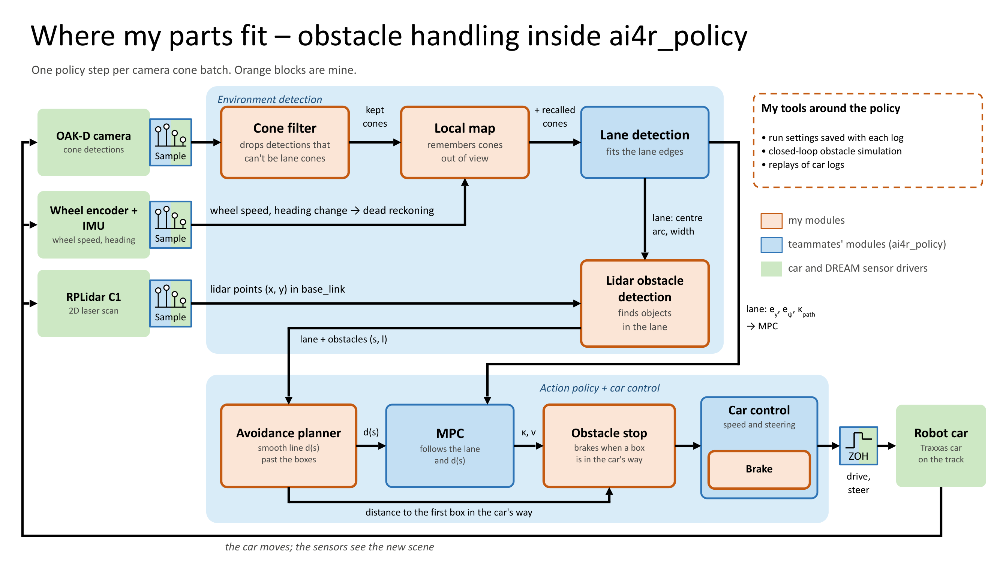
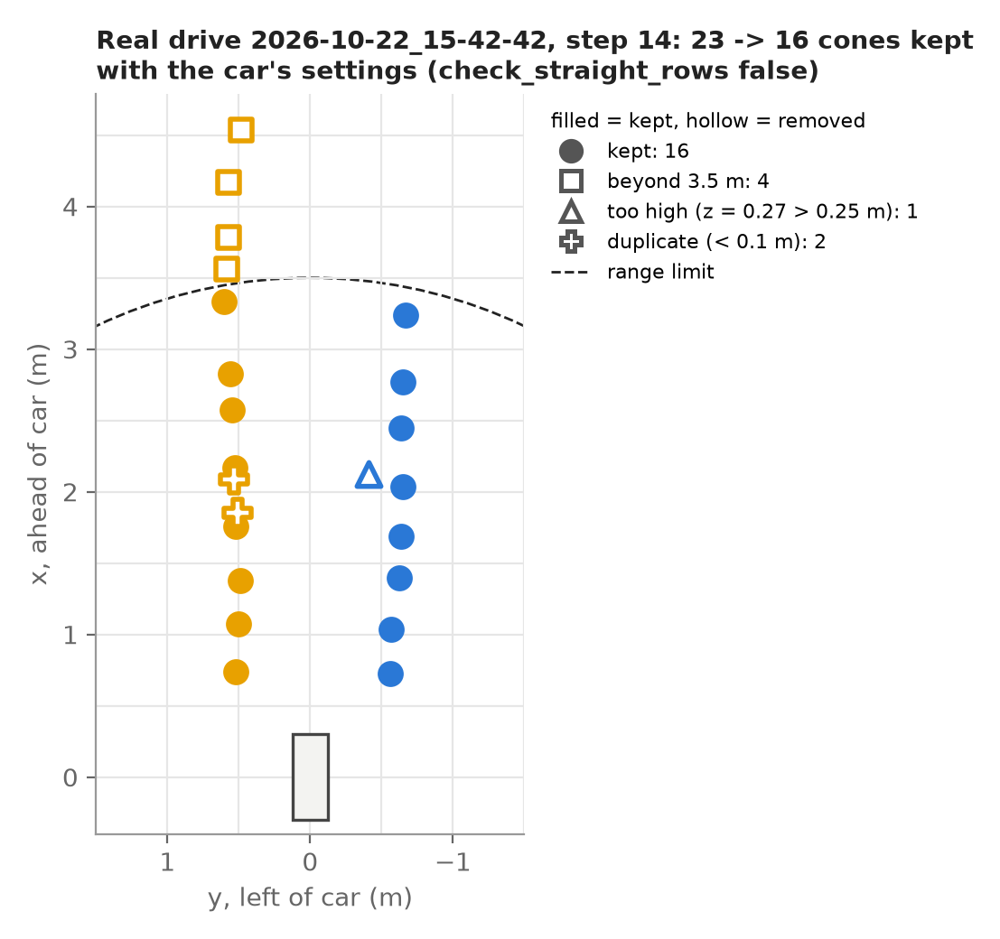
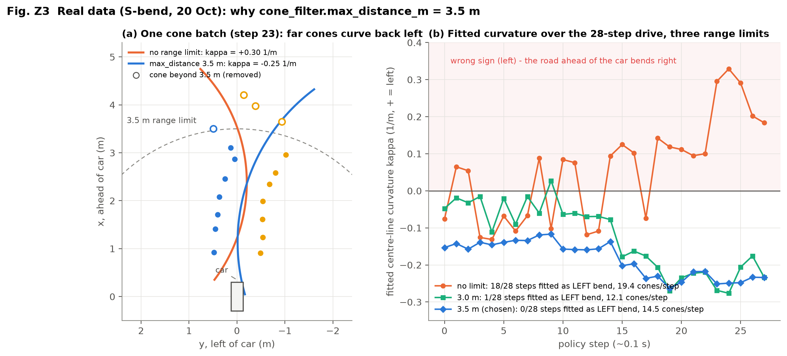
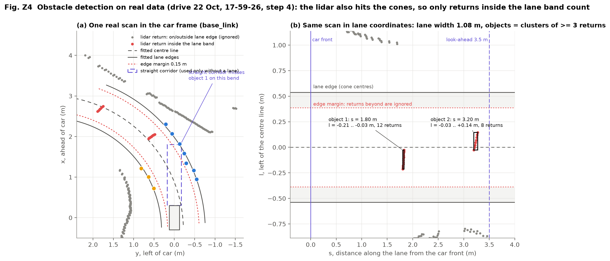
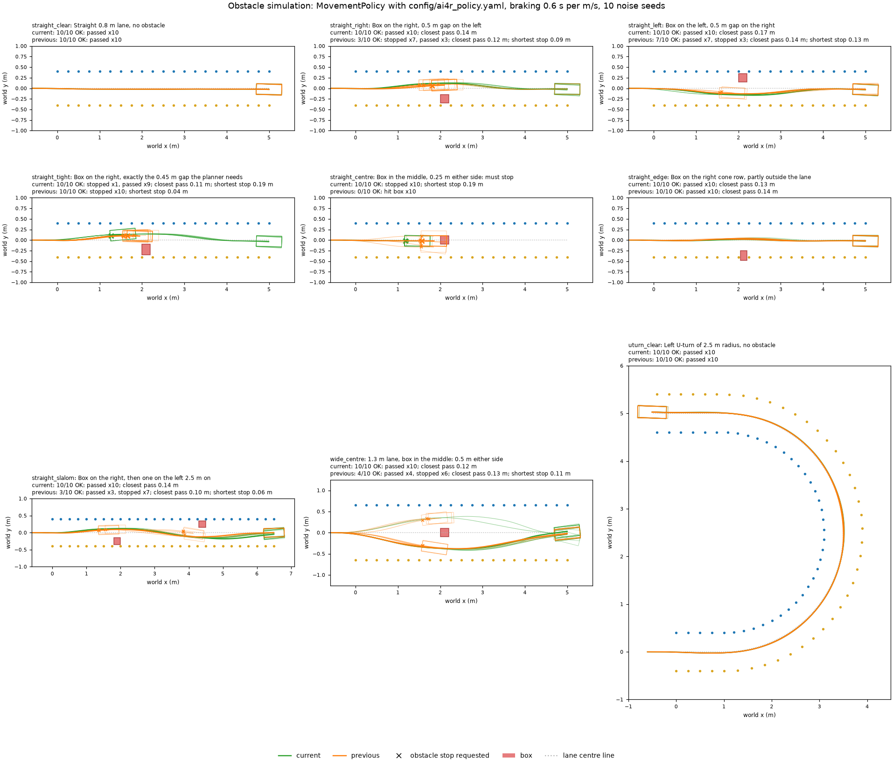
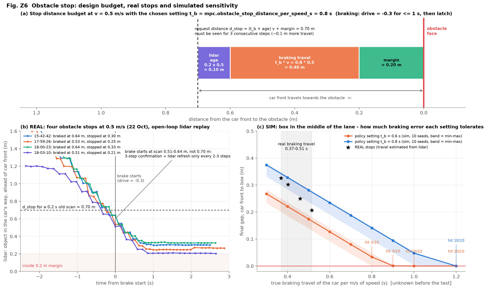
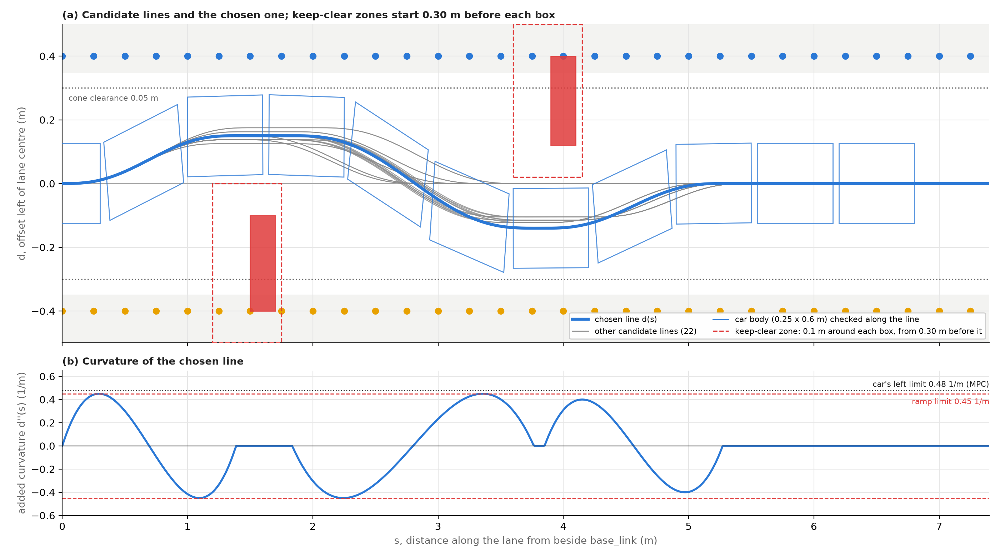
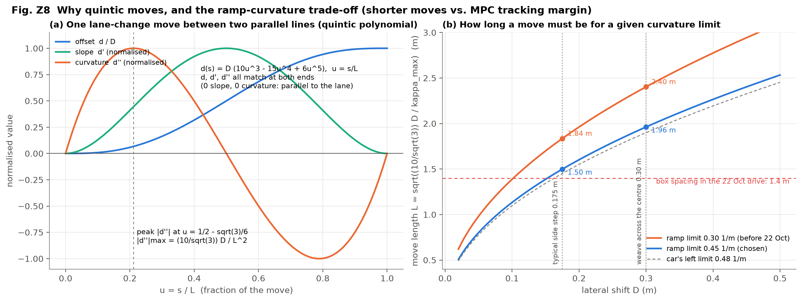
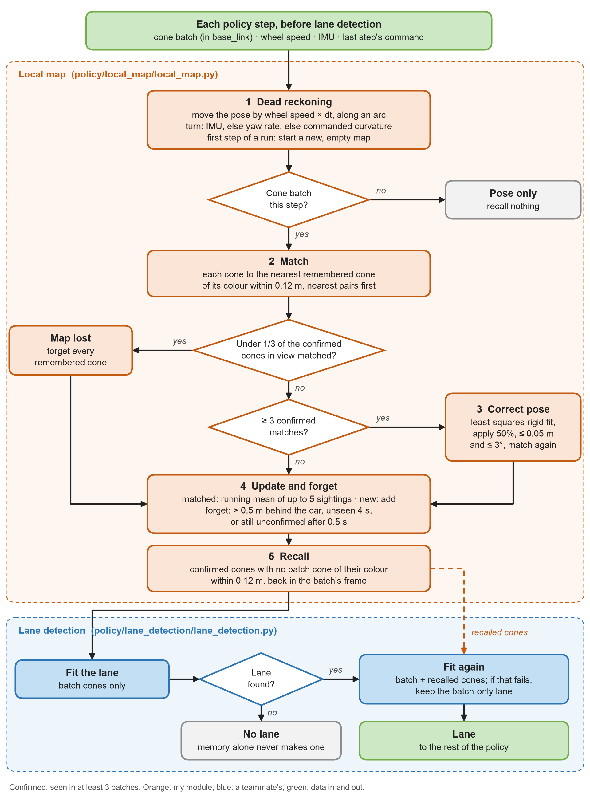
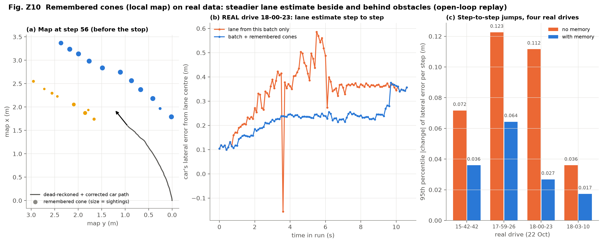

# Zhenling Zhang: obstacle handling, cone filter and local map

[Back to the team logbook](README.md)

|                          |                                                                                                                                                                                                                                                                                                                                                                                                                                                                                                              |
| ------------------------ | ------------------------------------------------------------------------------------------------------------------------------------------------------------------------------------------------------------------------------------------------------------------------------------------------------------------------------------------------------------------------------------------------------------------------------------------------------------------------------------------------------------ |
| Role                     | Everything between the sensors and the MPC that keeps the car from hitting things: the cone filter, lidar obstacle detection in the lane, the obstacle stop and brake, the avoidance planner and the local map. Plus the tools to test them: each run's settings saved with its log, a closed-loop obstacle simulation and replays of car logs                                                                                                                                                               |
| PRs                      | #11 (cone filter), #19 (obstacle detection, stop, brake, first avoidance, run settings in the logs), #21 (avoidance v1), #28 (multi-obstacle planner; RANSAC lane fit tried and reverted), #33 (obstacle simulation and retune, local map), #34 (26 Oct speed offset). All merged into `dev`                                                                                                                                                                                                               |
| Code                     | `policy/cone_filter/`, `policy/obstacle_detection/`, `policy/action_policy/avoidance.py` and `lane_path.py`, the obstacle-stop parts of `mpc.py`, `policy.py` and `policy/control/`, `policy/local_map/`, `tests/policy/obstacle_simulation.py`                                                                                                                                                                                                                                            |
| Built on teammates' work | Thanh Long: the lane fit (concentric arcs) that my detection and planner work in. Peiyu: the MPC framework; my planned line is its reference and my stop runs inside it. Chris: `CarController`, which I added the brake to, and PR #23, which passes two obstacles on one line. Ciaran: repo, CI, upload script and `CarMemory`, where the stop and the map are kept. Toby: `curved_lanes.py`, the measured lab-car model that my simulation drives                                                   |
| Figures                  | `zhenling/figures/`. Z1 is drawn in the style of the team's block diagrams by `logs/logbook/block_diagrams/make_block_diagrams.js` (local, not in git). Z5 is drawn by `tests/policy/obstacle_simulation.py`, Z2, Z7 and Z9 by `zhenling/make_Z2_cone_filter_real_drive.py`, `zhenling/make_Z7_avoidance_planner.py --approach-m 0.3` and `zhenling/make_Z9_local_map_flowchart.py`. Z3, Z4, Z6, Z8 and Z10 were made on 24 Oct from the same logs and code; their plotting scripts weren't kept |
| Data                     | Car logs in `scenarios/data/original_data/` (local, not in git): observations, actions, memory and `_config.json` for each run. The four drives that ran with the local map replay exactly only with `99c12ef` (PR #34), the code that drove them                                                                                                                                                                                                                                                      |

**Summary: five pieces of work, in order**:

1. **Cone filter.** Removes detections that can't belong to the lane (too far, floating, duplicated) before
   lane detection uses them (Section 3.1).
2. **Lidar obstacle detection in lane coordinates.** The lidar also hits the cones, and a straight box misses
   obstacles on bends, so each return is placed along and across the lane (Section 3.2).
3. **Avoidance planner.** One smooth path, a chain of quintics, past several boxes, checked with the car's whole body
   (Section 3.4).
4. **Obstacle stop.** When no path leaves the 0.40 m gap the car needs, the car brakes and stays stopped until a
   person restarts it (Section 3.3).
5. **Local map.** Remembers cones and boxes after they leave the sensors' view (Section 3.5).

All five ran on a real car. In the final real drive, the car passed two obstacles placed on the left and right sides
of the road, and stopped in front of one placed in the middle.

## Timeline

Weeks run Monday to Sunday. Week 1 is the week of 5 Oct, as in Toby's section. The numbers in "Evidence" match the
numbered items in "What I did".

| Week                | What I did                                                                                                                                                                                                                                                                                                                                                                                                     | Evidence                                                                                                                            |
| ------------------- | -------------------------------------------------------------------------------------------------------------------------------------------------------------------------------------------------------------------------------------------------------------------------------------------------------------------------------------------------------------------------------------------------------------- | ----------------------------------------------------------------------------------------------------------------------------------- |
| 0 (28 Sep – 4 Oct) | 1. Cone filter: first version, inside `policy_node.py`: range, height and confidence limits, duplicate merging, straight-row RANSAC                                                                                                                                                                                                                                                                          | 1. `1b259a6` (branch `feature/cone-outlier-filter`)                                                                             |
| 1 (5–11 Oct)       | 1. Cone filter: moved into its own module, `policy/cone_filter/`, with unit tests 2. Plots of real detections before and after filtering                                                                                                                                                                                                                                                                      | 1. `0c12bce`, PR #11 2. `9dc1c07`                                                                                                |
| 2 (12–18 Oct)      | 1. Obstacle detection: lidar obstacles, first in a straight corridor, then in lane coordinates 2. Obstacle stop: stop and stay stopped; the lidar becomes a required sensor 3. Brake: active braking instead of coasting (13 Oct) 4. Avoidance: v0 moves to the nearest clear offset (12 Oct); v1 adds half-cosine ramps and obstacle memory (15 Oct) 5. Tools: logs named to the second, with each run's settings | 1. `fb27a2b`, `ea1c5cf`; car 9 logs (12 Oct) 2. `ea1c5cf` 3. `c9ee129` 4. `54a182c`, `ac70eb6` 5. `86e5263` PR #19 and #21 |
| 3 (19–25 Oct)      | 1. Cone filter: range limit 3.5 m, and lidar timeout 0.8 s, from the 20 Oct drives 2. Avoidance: v2, one quintic path past several boxes (20 Oct); ramp 0.45 and look-ahead 3.5 m after the 22 Oct drives 3. Simulation: closed-loop obstacle simulation, 5 parameters retuned (21 Oct) 4. Local map: remembers cones and obstacles (23 Oct)                                                                      | 1. `a005ef9` 2. `9cd72c0`, `be0fa3a`, `c09de2e` 3. `83b53cc` 4. `d807929` PR #28 and #33                                    |
| 4 (26 Oct – 1 Nov) | 1. Final real drive: passed the boxes on the right and left, stopped for the one in the middle (26 Oct) 2. Car control: car 20's speed feed-forward offset 0.48 → 0.15 (26 Oct)                                                                                                                                                                                                                                | 1. run `2026-10-26_14-10-54` 2. `76c157d`, PR #34                                                                                |
| 5 (2–8 Nov)        | 1. Recorded a video of the real-car demo                                                                                                                                                                                                                                                                                                                                                                       | 1. demo video                                                                                                                       |
| 6 (9–15 Nov)       | 1. This logbook section                                                                                                                                                                                                                                                                                                                                                                                        | 1. this file                                                                                                                        |

---

## 1. My parts in the system (Standard 1)

*The policy, one step per camera cone batch (about 10 Hz), drawn like the team's block diagrams: green is the car and
its sensors, blue is teammates' modules, orange is mine. Look at the lidar: its points only become obstacles once lane
detection has fitted the lane, so obstacle handling depends on a teammate's module. And every output of mine reaches
the car through the MPC and car control.*

**Purpose in the whole system.** The team's goal is to drive the cone lanes on its own and deal with obstacles in
them. Lane following (lane detection → MPC → low-level control) belongs to teammates. My job is to make sure that:

1. the lane fit only uses cones that can belong to the lane;
2. any object in the car's way is seen early;
3. the car drives around it when there's room;
4. otherwise the car stops before it, every time.

| Interface                                                  | Direction                         | What it carries                                                         | Assumption or constraint                                                                                                                                      |
| ---------------------------------------------------------- | --------------------------------- | ----------------------------------------------------------------------- | ------------------------------------------------------------------------------------------------------------------------------------------------------------- |
| `ConeBatch` from `oakd_cone_detector`                  | in                                | cone position in `base_link`, colour, confidence                      | About 10 Hz and 0.2 s late. Duplicated, floating and wrong-colour detections happen (Fig. Z2 shows the first two)                                             |
| `lidar_cartesian` (DREAM lidar TF)                       | in                                | points in `base_link`                                                 | A new scan reaches the policy only every 0.2–0.3 s and is 0.15–0.3 s old. The scan plane is about 0.12 m up, so it hits the cones and misses anything lower |
| Wheel speed                                                | in                                | m/s, for the stop distance, obstacle memory and map                     | Holds its last value near standstill, so it can't measure how far the car rolled when stopping                                                                |
| `LaneDetection` (Thanh Long; I added the recalled cones) | in                                | centre arc, width, lateral and heading error                            | Concentric arcs. The estimate jumps about 0.1 m from step to step                                                                                             |
| `LaneObstacle`                                           | between my parts                  | near and far distance $s$ along the lane, right and left offset $l$ | Lane frame. Static obstacles only                                                                                                                             |
| `LanePath` $d(s)$                                      | out, to the MPC                   | the line to follow, as an offset from the lane centre                   | A chain of quintics, so its curvature is continuous                                                                                                           |
| Obstacle distance                                          | out, to the MPC's stop logic      | metres from the car's front to the first object in its way              | The front is taken as 0.30 m ahead of `base_link` (notebook car, not measured)                                                                              |
| `DriveCommand(0, 0, brake=True)`                         | out, to `CarController` (Chris) | brake request                                                           | Drive −0.3 for at most 1 s, only straight after forward drive                                                                                                |

## 2. Test methods (Standards 3 and 4)

Each module in Section 3 ends with the simulation experiments (Standard 3) and the real-car experiments (Standard 4)
that set or checked its parameters. They use the two tools below.

### 2.1 Simulation

**The tool I built:** `tests/policy/obstacle_simulation.py` (`83b53cc`). It runs the **whole** `MovementPolicy` with
the real config, in closed loop:

- the measured lab car from `curved_lanes.py` (car 20's steering limits and trim, speed dead time and lag);
- the camera's view, noise and 0.2 s delay, with boxes hiding cones from the camera;
- a simulated 2D lidar (0.5° beams, 0.01 m noise, 0.2 s old) that hits cones and boxes;
- active braking whose travel is a setting (`--brake-s`).

12 cases, with every obstacle on a straight, and N noise seeds each. Each case is scored as pass, stop or either, and
touching a box or a cone fails it.

**Purpose:** replays of recorded drives can't show whether the policy *would have* got past, or where it would have
stopped.

**Scope of the simulation:**

- **Can:** compare settings against each other, find where the boundaries are (the 0.40 m gap, the braking
  tolerance), and catch failures before car time (a zero braking setting hit every blocking box).
- **Can't:** predict absolute gaps or pass rates. The model is kinematic (no tyre slip), the lidar is ideal (no missing
  or extra returns), and the car size and braking aren't measured. So the absolute numbers were checked on real data
  (the "On the car" parts of Section 3).

### 2.2 On the car

**Method:** every run logs its observations, actions, memory and exact settings (`_config.json`, from my logging
change `86e5263`), so any real run can be replayed open loop through any version of the policy. The lidar measures
the distance to the box directly, so it's the measuring instrument for the stops. The obstacles were the lab's thin
sheets, at a 0.5 m/s target speed.

## 3. Working principles and experiments

Each module is split the same way: working principle, then its simulation experiment (S1, Standard 3), then its
real-car experiments (E1–E4, Standard 4).

| Module                 | Simulation (Standard 3)                               | On the car (Standard 4)                                                   |
| ---------------------- | ----------------------------------------------------- | ------------------------------------------------------------------------- |
| 3.1 Cone filter        | —                                                    | E1: on an S-bend the lane fit flips between left and right bends (20 Oct) |
| 3.2 Obstacle detection | edge margin and corridor, retuned in S1 (Section 3.3) | —                                                                        |
| 3.3 Obstacle stop      | S1: retune against needless stops and hits (21 Oct)   | E2: braking travel (22 and 26 Oct)                                        |
| 3.4 Avoidance planner  | —                                                    | E3: passing boxes on the real track (26 Oct)                              |
| 3.5 Local map          | —                                                    | E4: a steadier lane estimate (22 Oct)                                     |

### 3.1 Cone filter (no state, every batch)

#### Working principle

*A frame from the real drive of 22 Oct (15-42-42, step 14), filtered with the settings the car used (straight rows
off): 23 detections in, 16 kept. Hollow markers were removed: squares lie beyond the 3.5 m range limit, the triangle is
0.27 m up (above the 0.25 m height limit), and plus signs are duplicates less than 0.10 m from a kept cone.*

1. **Plausible space:** $0 < x$, $|y| \le 2.0$ m, $\sqrt{x^2+y^2} \le 3.5$ m, $-0.15 \le z \le 0.25$ m, confidence ≥ 0.5. The range limit comes from the S-bend drive
   (E1 below).
2. **Merge duplicates:** two cones of the same colour closer than 0.10 m → keep the more confident one.

#### On the car (Standard 4)

##### E1: on an S-bend the lane fit flips between left and right bends (20 Oct)

- **Problem on the car:** on the S-bend (run 14-11-49, before the cone filter had a range limit), the lane fit
  (Thanh Long's concentric arcs) jumped back and forth between a left and a right bend, and the car ran off the
  track.
- **Method:** replayed the 28 steps of that run with cone range limits of ∞, 3.0 and 3.5 m.
- **Result:** with no limit the fitted curvature has the wrong sign (left) in **18/28** steps and keeps flipping
  between left and right (Fig. Z3b); with 3.5 m in **0/28**.
  3.0 m gave 1/28 but only about 12 cones per step, and next to a box the lane fit jumped and stopped the car
  (`obstacle_track_expands`).
- **Reason:** one constant-curvature arc can't fit both halves of an S, so only the next 3.5 m or so is kept.

### 3.2 Obstacle detection in lane coordinates

#### Working principle

*One real scan (22 Oct, 17-59-26, step 4)*

- Each lidar point is placed on the fitted centre arc: $s$ is the distance along the lane from the car's front and $l$
  the signed offset from the centre line (closed form for concentric arcs).
- Keep $0 < s \le 3.5$ m and $|l| < w/2 - 0.15$ m. The 0.15 m edge margin covers the cone's radius at scan height plus
  about 0.1 m of edge-fit error.
- Cluster consecutive returns (in scan order) closer than 0.15 m. An object needs at least 3 returns: about 720 rays
  give about 7 returns on a 0.1 m object at 1.5 m. The first and last groups are joined, because the scan wraps
  straight ahead.
- Output for each object: near and far $s$, right and left $l$. Without a lane, a straight corridor ±0.175 m wide and
  1.5 m long is used instead, with its 3rd-nearest return.

### 3.3 Obstacle stop

#### Working principle

A stop is requested when an object is in the car's way within

$$
d_{stop} = (t_b + t_{scan})\,\max(v_{target}, v_{measured}) + m
$$

with $t_b = 0.8$ s and $m = 0.2$ m. For a 0.2 s old scan at 0.5 m/s, that's $(0.8 + 0.2)(0.5) + 0.2 = 0.70$ m
(Fig. Z6a, E2 below).

| Term                                            | Value                    | What it covers                                        | Where the value comes from                                           |
| ----------------------------------------------- | ------------------------ | ----------------------------------------------------- | -------------------------------------------------------------------- |
| $m$, `obstacle_stop_margin_m`               | 0.2 m                    | the gap left after stopping                           | target gap. Simulation stopped 0.19 m short; real stops 0.21–0.33 m |
| $t_{scan}$                                    | each scan's age          | the car has moved $v\,t_{scan}$ since the scan      | measured: scans reached the policy only every 0.2–0.3 s (20 Oct)    |
| $\max(v_{target}, v_{measured})$              | —                       | a car going too fast still stops in time              | the 26 Oct drive reached 0.61 m/s against a 0.5 m/s target           |
| $t_b$, `obstacle_stop_distance_per_speed_s` | 0.8 s                    | braking travel per m/s of speed                       | chosen in simulation; real values vary, 0.37–0.53 s                 |
| `obstacle_confirm_steps`                      | 3                        | steps in a row the object must be inside $d_{stop}$ | the lane estimate jumps about 0.1 m per step                         |
| `brake_action`, `brake_max_s`               | drive −0.3, at most 1 s | active brake                                          | coasting needs about 1.3 m at 0.5 m/s                                |

- **The stop latches:** once the car has stopped for an obstacle, the stop is latched and the car doesn't start
  again until a person requests zero state, then state 3. Close to a box the lidar's view is poor and the box can
  drop out of it, so restarting must be a human decision.

#### Simulation (Standard 3)

##### S1: obstacle settings retuned against needless stops and hits (21 Oct)

- **Problem:** the previous settings led to early stops.
- **Method:** the previous settings against the retuned ones, 10 noise seeds per case, braking 0.6 s per m/s.
- **The five settings changed** (`83b53cc`):

| Setting                                      | Before | After   | Problem it fixes                                                                                                |
| -------------------------------------------- | ------ | ------- | --------------------------------------------------------------------------------------------------------------- |
| `obstacle_detection.corridor_half_width_m` | 0.20 m | 0.175 m | needless stops: the lane estimate jumps about 0.1 m per step, so boxes the car had room to pass entered its way |
| `obstacle_detection.lane_edge_margin_m`    | 0.10 m | 0.15 m  | needless stops: when the fitted edges jump, cone returns near an edge counted as objects in the lane            |
| `mpc.obstacle_confirm_steps`               | 2      | 3       | needless stops: two jumpy steps in a row were enough to stop the car                                            |
| `avoidance.cone_clearance_m`               | 0.10 m | 0.05 m  | needless stops: the free gap the car needs beside a box falls from 0.45 m to 0.40 m                             |
| `mpc.obstacle_stop_distance_per_speed_s`   | 0.0 s  | 0.8 s   | hitting a blocking box: the stop distance had no braking travel in it                                           |

- **Result:**

| Case (10 seeds, braking 0.6 s per m/s) | Previous                               | Retuned                     |
| -------------------------------------- | -------------------------------------- | --------------------------- |
| Box on the right, 0.5 m gap            | 3/10 OK (7 needless stops)             | 10/10 passed                |
| Box on the left, 0.5 m gap             | 7/10                                   | 10/10                       |
| Box in the middle (must stop)          | **0/10: hit the box every time** | 10/10 stopped, 0.19 m short |
| Slalom (2 boxes 2.5 m apart)           | 3/10                                   | 10/10                       |
| 1.3 m lane, box in the middle          | 4/10                                   | 10/10                       |

*Each panel is one case seen from above: orange = previous settings, green = retuned, × = stop requested. Look at
`straight_centre` (middle row): the previous settings hit the box in all 10 runs, and the retuned ones stopped 0.19 m
short. In `straight_right`, 7 needless stops became none.*

#### On the car (Standard 4)

##### E2: real braking travel, measured and checked

*(a) The stop distance at 0.5 m/s has three parts: the scan's age, the braking travel and the margin, 0.70 m in all.
(b) Four real stops, read from the lidar: the brake started at readings of 0.51–0.64 m, all below 0.70 m, and the car
stopped 0.21–0.33 m short. (c) Simulation, box in the middle: how much braking error each setting can take. The stars
are the real stops, on the line for the 0.8 setting.*

###### 1. Stop distance and how braking is measured

The stop distance $d_{stop}$ has three parts: the distance driven during the scan's age, the braking travel and the
margin:

$$
d_{stop} = (t_b + t_{scan})\,v + m
$$

where $v$ is the larger of the target and the measured speed (Working principle, above). With $v = 0.5$ m/s,
$t_b = 0.8$ s, a 0.2 s scan age and $m = 0.2$ m, it is 0.70 m.

To compare stops at different speeds, braking is given **per m/s of speed** (braking travel ÷ speed, in seconds, i.e.
s per m/s):

$$
t_b = \frac{d_{brake}}{v} = \frac{(d_{scan} - v\,t_{scan}) - d_{final}}{v}
$$

- **Symbols:**
  - $d_{scan}$: the lidar reading at the brake command.
  - $t_{scan}$: that scan's age (the time from the scan to the policy using it).
  - $d_{scan} - v\,t_{scan}$: the real distance from the car's front to the box, after removing the scan's age.
  - $d_{final}$: the gap between the car's front and the box once stopped.
  - $d_{brake}$: the braking travel, the difference of the two distances above.
- *Note: ignoring the scan's age (taking $d_{scan} - d_{final}$) would count the sensor's lag as braking travel.
  On 26 Oct, for example, the front was really 0.69 − 0.60 × 0.23 ≈ 0.55 m from the box and rolled
  0.55 − 0.23 = 0.32 m (0.53 s per m/s); ignoring the scan's age would give 0.77 s per m/s.*

###### 2. Measured stops

| Drive                     | Speed at the brake $v$ | Lidar reading at the brake $d_{scan}$ | Scan age $t_{scan}$ | Final gap $d_{final}$ | Measured braking per m/s $t_b$ |
| ------------------------- | ------------------------ | --------------------------------------- | --------------------- | ----------------------- | -------------------------------- |
| **22 Oct 15-42-42** | 0.50 m/s                 | 0.64 m                                  | 0.27 s                | 0.30 m                  | 0.40 s                           |
| **22 Oct 17-59-26** | 0.50 m/s                 | 0.53 m                                  | 0.11 s                | 0.25 m                  | 0.46 s                           |
| **22 Oct 18-00-23** | 0.50 m/s                 | 0.64 m                                  | 0.26 s                | 0.33 m                  | 0.37 s                           |
| **22 Oct 18-03-10** | 0.45 m/s                 | 0.51 m                                  | 0.17 s                | 0.21 m                  | 0.51 s                           |
| **26 Oct 14-10-54** | 0.60 m/s                 | 0.69 m                                  | 0.23 s                | 0.23 m (0.21–0.26)     | 0.53 s (0.48–0.56)              |

###### 3. Analysis

- **The setting checked:** all five stops measured $t_b$ = 0.37–0.53 s, well below the cautious 0.8 s, so the car
  always stopped with 0.21–0.33 m left.
- **The brake comes late:**
  - In every stop the lidar reading at the brake was below the computed threshold (on 26 Oct the threshold was about
    0.84 m, but the brake came at 0.69 m).
  - **Main cause:** the stop needs 3 policy steps in a row, and the lidar updates only about every second policy step.
    So the brake came the equivalent of 0.1–0.2 m late, which the 0.2 m margin absorbed.

###### 4. Limits and next steps

$t_b = 0.8$ s is safe for now. Later, from the real-car data, $t_b$ could come down to about 0.6 s, to cut
early stops.

### 3.4 Avoidance planner (a local planner in the lane's Frenet frame)

#### Working principle

*The real planner and config in an 0.8 m lane, with a box on the right, then one on the left. (a) Grey: the 22 other
candidate lines. Blue: the chosen one, with the car's body (0.25 × 0.60 m) checked along it. Red dashes: the keep-clear
zones. (b) The chosen line's curvature is continuous and stays inside the 0.45 1/m ramp limit, below the car's 0.48 1/m
left limit.*

1. **Keep-clear stretches.** Each obstacle gets a stretch from $\max(\text{pass distance}, d_{stop})$ before it to
   0.05 m after it. Inside it, the body keeps 0.10 m from the obstacle and 0.05 m from the cones.
2. **Candidate held offsets** in each free gap: its middle, the point nearest the usual line, 5 spread points and the
   previous step's line. Obstacles whose stretches overlap are passed on one offset.
3. **Quintic moves** join the holds, matching offset, slope and curvature at both ends:

   $$
   d(u) = D\,(10u^3 - 15u^4 + 6u^5),\quad u = s/L,\qquad \max|d''| = \frac{10}{\sqrt3}\,\frac{D}{L^2}\ \Rightarrow\ L = \sqrt{\frac{10}{\sqrt3}\,\frac{D}{\kappa_{max}}}
   $$

   The half-cosine ramp of v1 had curvature $D\pi^2/(2L^2)$ at its ends, so the steering jumped at every join. The
   quintic doesn't (Fig. Z7b).
4. **Polynomial coefficients.** A move of length $L$ goes from the start state $(d_0, d_0', d_0'')$ (offset, slope,
   curvature) to the end state $(d_1, d_1', d_1'')$, with $t = s - s_i$. The six end conditions fix the six
   coefficients, and they give the one quintic that does this.
5. **Building the candidates:** each candidate is one `LanePath` of holds and quintic moves, built group by group of
   obstacles, nearest first.

   - **First group:** hold the current line, then take the shortest move to one of the candidate offsets from item 2,
     arriving just as the car's front reaches the keep-clear stretch.
   - **Each later group:** from the previous group's offset to this group's, in 4 ways: keep holding if the offset is
     the same; a compressed move for the quickest change; a move stretched over the whole gap; or back to the usual
     line and out again.
   - **After the last group:** one move back to the usual line, at the earliest point where the body already keeps
     its clearances.
6. **Ranking**, in this order: obstacles passed (nearest first) → how close it comes to passing the next one → already
   beside the obstacle before the stop distance → lowest cost

   $$
   J = \Delta s \sum \Big[w_{dev}(d - d_{usual})^2 + w_{smooth}\,\kappa_{add}^2 + w_{change}(d - d_{prev})^2\Big] - w_{clear}\cdot\text{room}
   $$

   with weights 1, 1, 1 and 5.
7. **Output: one line $d(s)$ per step, in lane coordinates.** The planner returns a `LanePath`: the usual offset, and
   the segments that leave it. Segment $i$ runs from $s_i$ to $e_i$ and is a quintic in the distance from its start
   (a hold keeps only $c_{i0}$):

   $$
   d(s) = \begin{cases} \sum_{j=0}^{5} c_{ij}\,(s - s_i)^j, & s_i \le s \le e_i \\ d_{usual}, & \text{elsewhere} \end{cases}
   $$

   $s$ runs along the centre arc from beside `base_link` and $d$ is left of the centre line, so the same $d(s)$
   describes the line on a straight or a curve, and nothing is turned back into $(x, y)$.

*(a) One quintic move: its curvature (orange) starts and ends at zero, so the steering doesn't jump at the joins.
(b) How long a move must be for a given curvature limit. Crossing the centre (0.30 m) takes 2.40 m at 0.30 1/m but
1.96 m at 0.45 1/m; both are longer than the 1.4 m between the boxes on 22 Oct.*

#### On the car (Standard 4)

##### E3: passing boxes on the real track (26 Oct, run `2026-10-26_14-10-54`, see the video)

- The car passed two boxes, on the right and then on the left (1.4 m apart), without stopping, then stopped for a
  third. The third box was in the middle of the lane, with free gaps of 0.31 m and 0.12 m on its two sides, both below
  the 0.40 m the car needs, so no line could pass it. The stop logic braked at a lidar reading of 0.69 m, and the car
  stopped 0.23 m short of the box (E2 in Section 3.3).

### 3.5 Local map (memory)

#### Working principle

*The local map at each policy step (orange), and how lane detection uses the cones it recalls (blue). The values
are the ones in `local_map.py` and `config/ai4r_policy.yaml`.*

- **Dead reckoning:** pose += wheel speed × dt along the heading.
- **Matching:** each new cone matches the nearest remembered cone of its colour within 0.12 m (less than half the cone
  spacing).
- **Correction:** with at least 3 confirmed matches (each cone seen at least 3 times), a least-squares rigid fit
  (rotation + shift) of the batch onto the memory. Half of it is applied each step, capped at 0.05 m and 3°, so
  detector noise is averaged and odometry drift doesn't build up while cones are in view.
- **Recall and forget:** confirmed cones not in the batch (beside the car, or hidden behind boxes) are recalled for lane
  detection. A cone is forgotten 0.5 m behind the car, after 4 s unseen, or if it's still unconfirmed after 0.5 s. If
  fewer than a third of the expected cones match, the map resets.
- **Use in lane detection:** it first fits the batch alone. Only if that gives a lane does it fit again with the
  recalled cones added, and it keeps the batch's own lane if the second fit fails. So a lane is never made from memory
  alone, and the end of the cone rows is still seen. With one edge in view, recalled cones of the other colour can
  complete the second edge. An edge whose colour has never been confirmed can't be filled.

#### On the car (Standard 4)

##### E4: the local map steadies the lane estimate, and the car used it

*(a) The map at step 56 of drive 18-00-23: remembered cones (size = sightings) and the dead-reckoned path. (b) The
lateral error from the batch alone (orange) jumps by up to 0.57 m; with remembered cones (blue) it's steady.
(c) The 95th-percentile step-to-step jump falls by half or more in all four 22 Oct drives.*

## 4. Lessons and limits

**Lessons:**

- **Build the safe fallback first.** The stop came before avoidance, so every later feature had something safe to fall
  back on.
- **Use the sensor that measures what you need.** Wheel speed holds its last value near standstill, so odometry said
  the car travelled 1.1–1.25 m while braking. The lidar showed 0.32 m.
- **Account for the data's age.** The 26 Oct brake came at a 0.69 m lidar reading, but that scan was 0.23 s old: the
  front was really about 0.55 m from the box.
- **Replay with the code that drove.** Only `99c12ef` reproduces the October drives step for step; later `dev`
  gives different lane and obstacle values.
- **Simulate before car time.** The closed-loop simulation showed that a zero braking setting hits every blocking box
  before any car time was spent on it.

**Limits and next steps:**

- The car's size, its steering limits after the trim change, and braking on a stand are still **not measured**. →
  measure them, then re-run the simulation with the measured values.
- Static obstacles only. After an obstacle is removed, the car stays stopped until a person restarts it.
- Two boxes on opposite sides less than about 1.2 m apart in a 0.8–1.1 m lane need more curvature than the car has, so
  it stops.
