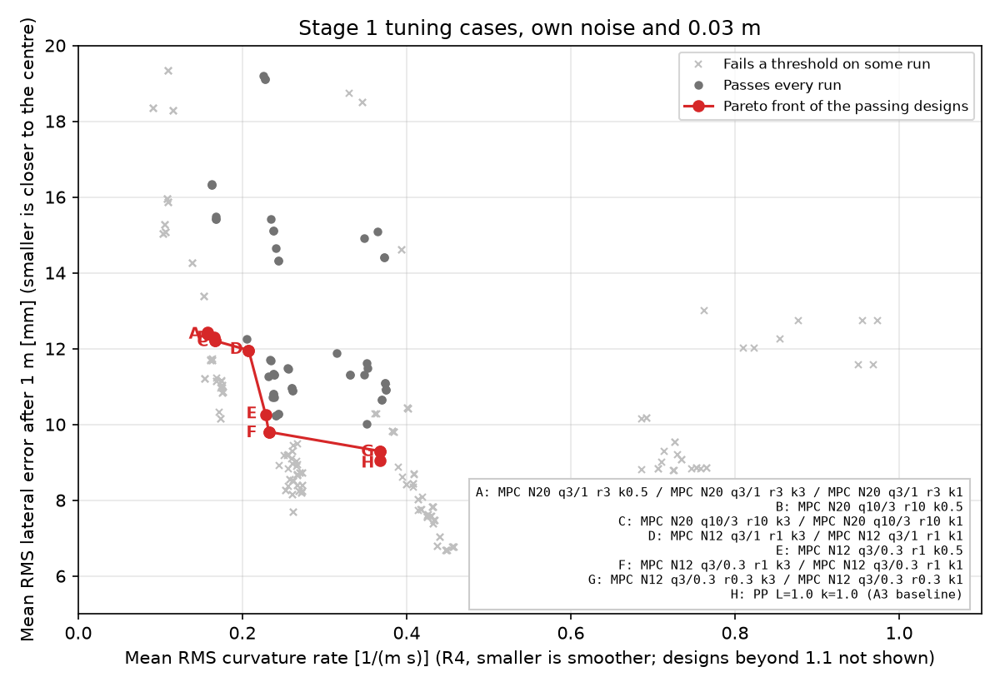
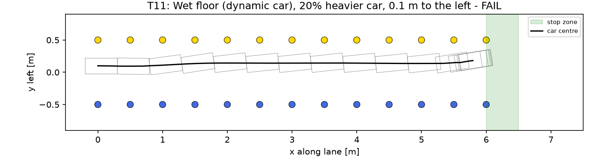
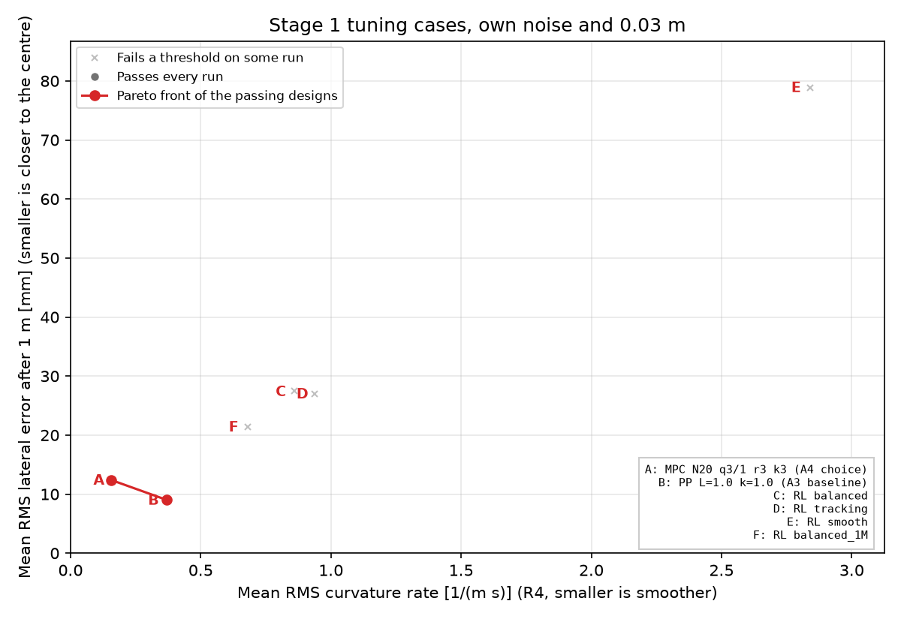
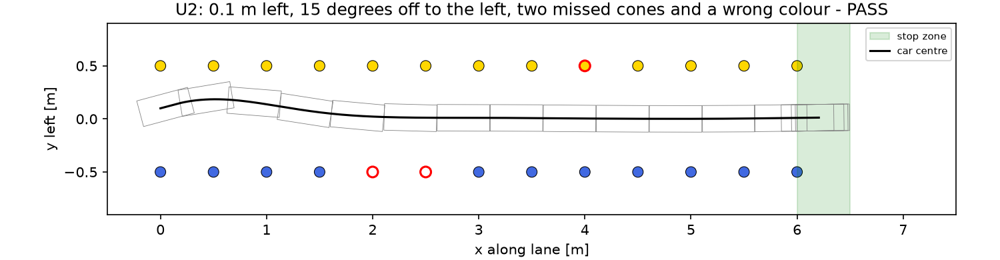

# Stage 1 design: simulation, baseline, MPC and RL

The algorithm tasks of Card 3 and milestone M1 in [movement-policy-tasks.md](movement-policy-tasks.md). The requirements and
metrics (R1a-R7) are in [stage1-approach.md](stage1-approach.md), and the test cases, thresholds and harness in
[stage1-test-cases.md](stage1-test-cases.md). Everything here was run with the harness in
`tests/policy/stage1_scenarios.py` on the **tuning cases only**, except M1, the only place the unseen cases were used.

## A2 A simulation that behaves like our car

The harness (Card 2.3) already starts from dream-gym's cone-following car, uses the shared detector view, range and
noise, runs the policy once per 0.1 s detection batch, and converts speed and curvature with a stand-in for Car
Control (wheel angle = atan(wheelbase x curvature), drag feed-forward plus proportional speed control). A2 adds:

- **Detection age.** Every batch now reaches the policy 0.2 s after it was taken (`DETECTION_AGE_S`), the age
  measured on car 20 (the detector's 0.197 s latency); the delay disturbance adds to it, so T6 has 0.4 s in all.
  The task asked for a delay equal to the detection gap (0.1 s), but the measured age is twice that, mostly the
  detector's own latency. The tuning cases still pass with it, and the lane-end stop became more even (0.21 to 0.24
  m past the last pair, from 0.19 to 0.30 m).
- **T11 explained.** With zero steering, dream-gym's dynamic model drives straight on both floors. Under the MPC it
  settles into a steady sideslip instead: the car travels straight along the lane with its body turned 6 degrees
  left on the wet floor (2.5 degrees dry) and the wheels steered about 14 degrees right. The MPC's kinematic model
  takes the body heading as the direction of travel, so it keeps steering right and ends 0.25 m off centre. A 3 kg
  car at 1 m/s should need almost no slip, so the tyre presets are probably not scaled for a 1:10 car. T11 stays
  `xfail` until the real car is checked: drive it straight on the lab floor and compare its heading with its path.
  A steering trim error on the real car gives the same symptom (a steady offset), which A4 can address with
  integral action.

**Where the simulation and the car still differ** (to measure, then set in the harness and the `control` settings):

| Item | Simulation | Car | How to measure |
| --- | --- | --- | --- |
| Maximum wheel angle | 45 degrees at full steering | Unknown; autonomous steering is limited to half the servo range in `traxxas_vehicle_interface.yaml` | Full steering on a stand, measure the wheel angle (Chris) |
| Steering direction | Positive curvature turns left | Unverified (`positive_steering_turns_left`) | On a stand, car left of the lane centre: wheels must turn right |
| Steering rate | 90 degrees/s, no lag | Unknown servo speed | Step the steering on a stand and film it |
| Stopping | The stand-in brakes in proportion to the speed error; 0.6 s roll-out per m/s | The temporary `CarControl` only coasts | Drive at a known speed, request a stop, measure the roll-out |
| Drive effort for a speed | Drag 1.0 kg/m x v^2, 10 N per unit drive | Unknown; `max_drive_effort` 0.2 (1550 us) may not move the car | Ramp the effort on the floor, read the wheel speed |
| Wheel speed | True speed, no noise | Encoder estimate at 44 Hz, gaps up to 0.32 s | Already measured on car 20 |
| Camera range | 4 m | Unknown; the lab lane's cones were seen to 1.7 m | Task A1 |

## A3 First baseline: pure pursuit on the cones

dream-gym's cone detection notebook is not part of the installed package, and its own baselines (PID and the
built-in lane keeper) steer from the simulator's ground-truth road, so they cannot be used. The baseline is
therefore a cone-only **pure pursuit** (`PurePursuitController` in `tests/policy/stage1_design.py`): it fits the lane
centre from the cones exactly as the MPC does, and steers along the arc through the centre-line point a lookahead
distance L ahead, curvature = k x 2y / (L^2 + y^2). It runs inside `MpcPolicy`, so it shares the cone filter, the
lane-loss and lane-end rule (A7) and the speed; only the steering differs. It ignores the 0.2 s detection age.

Lookahead 0.5 to 1.5 m and gain 0.5 to 1.5 on the twelve tuning cases, without detector noise and with 0.03 m on
every cone (`python3 tests/policy/stage1_design.py baseline`):

| Lookahead, gain | No noise: passed | Tracking RMS [mm] | Curv. rate RMS mean / worst | 0.03 m noise: passed | Tracking RMS [mm] | Curv. rate RMS mean / worst |
| --- | --- | --- | --- | --- | --- | --- |
| 0.5 m, 0.5 | 10/12 (T5 R4, T11 R1b) | 6.7 | 0.34 / 1.05 | 1/12 (R4 on 10 cases) | 25.2 | 1.21 / 1.68 |
| 0.5 m, 1.0 | 5/12 | 156.9 | 2.50 / 5.46 | 0/12 | 297.0 | 4.28 / 5.96 |
| 0.75 m, 0.5 | 12/12 | 9.3 | 0.16 / 0.52 | 12/12 | 13.6 | 0.43 / 0.65 |
| **1.0 m, 1.0** | **12/12** | **5.8** | **0.21 / 0.71** | **12/12** | **10.4** | **0.45 / 0.85** |
| 1.5 m, 1.5 | 12/12 | 11.9 | 0.17 / 0.61 | 12/12 | 15.7 | 0.30 / 0.67 |

The other grid points are in the script's output. Short lookaheads oscillate with the 0.2 s detection age and
noise (0.5 m with gain 1.0 leaves the lane on seven cases); 1.0 m or more is stable. **The baseline is plain
geometric pure pursuit with a 1.0 m lookahead (gain 1.0)**: it passes every tuning case with and without noise, and
has the best tracking of the designs that do. MPC and RL must beat it: 9.0 mm tracking RMS and 0.37 / 0.85 1/(m s)
curvature rate, over the cases' own noise and 0.03 m together (A4 table). It even passes T11, which the first MPC
did not.

## A4 MPC design (log-book)

**Starting values** (the MPC from the first car run, `policy/action_policy/mpc.py`): a kinematic path-tracking MPC
on lateral and heading error, linearised for small heading errors, solved as bounded least squares.

| Setting | Start | Reason |
| --- | --- | --- |
| Horizon | 12 steps of 0.1 s (1.2 m at 1 m/s) | Well inside the 4 m camera range |
| Lateral / heading error weight | 10 / 1 | Favour the lane centre (R1) |
| Curvature / curvature-change weight | 0.1 / 1 | A little smoothing (R4); the curvature weight keeps the solution unique |
| Curvature limit | 3.0 1/m | tan(45 degrees) / 0.335 m, the shared steering default |
| Delay compensation | Predict forwards by the detection age | 0.2 s measured (1.5) |

**Iteration 1: the starting values.** They pass every tuning case at the nominal noise except T11 (0.25 m off
centre at the end, R1b), and with 0.03 m noise T5 also fails R4 (1.02 against 1.0 1/(m s)). The A3 baseline passes
both, so the MPC was retuned.

**Iteration 2: a grid over every setting.** 324 options: horizon 12, 20 or 30 steps (1.2 to 3 m at 1 m/s, within the
camera range; at most 1.6 ms on the car, A6), lateral weight 3, 10 or 30, heading weight 0.3, 1 or 3,
curvature-change weight 0.3, 1, 3 or 10 and curvature limit 3, 1 or 0.5 1/m, each on the twelve tuning cases with
their own noise and with 0.03 m (24 runs each; `python3 tests/policy/stage1_design.py mpc`). 73 options pass all 24
runs. What was observed:

- A lateral weight of 30 never passes all runs: it steers hard, which amplifies the detector noise (R4) and drives
  the simulated tyres into the sideslip of T11 (A2). A weight of 3 relative to the other terms works best.
- A 12-step horizon can touch cones on T11 (R1a, R2) with low weights; 20 and 30 steps behave the same, so the
  plan only needs to look about 2 s ahead.
- More curvature-change weight trades a little tracking for much smoother steering, the trade-off on the front.
- The curvature limit hardly matters here: the chosen design never asks for more than 0.51 1/m on these cases.
  It will matter on the real car if its steering is much weaker than 45 degrees, so it stays a setting for Chris's
  measured value.

**Pareto front** of the options that pass every run (tracking against smoothness; R3 is left out because every
design holds the speed within 0.01 m/s, since steering does not change it):

| Design | Passed | Failed | Tracking RMS [m] | Worst lat. err. at end [m] | Outside lane [m] | Touched | Curv. rate RMS mean / worst [1/(m s)] | Fallbacks |
| --- | --- | --- | --- | --- | --- | --- | --- | --- |
| PP L=1.0 k=1.0 (A3 baseline) | 24/24 | - | 0.0090 | 0.023 | 0.000 | 0 | 0.37 / 0.85 | 0 |
| MPC N12 q3/0.3 r0.3 k3 | 24/24 | - | 0.0093 | 0.078 | 0.000 | 0 | 0.37 / 0.90 | 0 |
| MPC N12 q3/0.3 r1 k3 | 24/24 | - | 0.0098 | 0.073 | 0.000 | 0 | 0.23 / 0.61 | 0 |
| MPC N12 q3/1 r1 k3 | 24/24 | - | 0.0120 | 0.047 | 0.000 | 0 | 0.21 / 0.58 | 0 |
| MPC N20 q10/3 r10 k3 | 24/24 | - | 0.0122 | 0.052 | 0.000 | 0 | 0.17 / 0.46 | 0 |
| MPC N20 q3/1 r3 k3 | 24/24 | - | 0.0124 | 0.043 | 0.000 | 0 | 0.16 / 0.45 | 0 |
| MPC N12 q10/1 r1 k3 | 21/24 | T11 (R1b), T5 (R4), T11 (R1b) | 0.0080 | 0.055 | 0.000 | 0 | 0.41 / 1.02 | 0 |

`N` is the horizon, `q` the lateral/heading weights, `r` the curvature-change weight and `k` the curvature limit
(1/m); options that differ only in an inactive curvature limit share a point. The last row, the starting values, is
not on the front. The baseline (H) has the best tracking, and the MPC options trade 1 to 3 mm of it, against a 375 mm
margin to the cones, for steering up to 2.3 times smoother.

**Choice: horizon 20, weights 3 / 1 / 0.1 / 3 (point A), curvature limit 3.0 1/m until measured.** It is the
smoothest design on the front (0.16 mean, 0.45 worst against the 1.0 limit, half the baseline's), has the largest
margin on the end-of-lane centring (0.043 m against 0.10 m) of the MPC options, passes every run including T11, and
needs no fallback. These are now the `MpcConfig` defaults and the `mpc` weights in `config/ai4r_policy.yaml`; the
car keeps 30 steps there (1.5 m at its 0.5 m/s), which performs the same as 20.

**Final metrics** on the tuning cases (the cases' own noise and the nominal 0.2 s detection age; trajectories in
`docs/figures/stage1_T*.png`):

| Case | Lane | Touched | Outside lane [m] | Lat. err. at end [m] | Speed err. [m/s] | Curv. rate RMS [1/(m s)] | Stop past last cone [m] | Lane lost to stop [s] | Fallbacks | p99 calc [ms] | Result |
| --- | --- | --- | --- | --- | --- | --- | --- | --- | --- | --- | --- |
| T1 | 6x1m_0.5 | 0 | 0.000 | 0.002 | 0.003 | 0.03 | 0.22 |  | 0 | 9.3 | PASS |
| T2 | 6x1m_0.5 | 0 | 0.000 | 0.003 | 0.003 | 0.17 | 0.22 |  | 0 | 6.7 | PASS |
| T3 | 6x1m_0.5 | 0 | 0.000 | 0.006 | 0.003 | 0.26 | 0.22 |  | 0 | 4.3 | PASS |
| T4 | 6x1m_0.5 | 0 | 0.000 | 0.003 | 0.003 | 0.10 | 0.22 |  | 0 | 0.7 | PASS |
| T5 | 6x1m_0.5 | 0 | 0.000 | 0.006 | 0.003 | 0.43 | 0.21 |  | 0 | 2.1 | PASS |
| T6 | 6x1m_0.5 | 0 | 0.000 | 0.002 | 0.006 | 0.03 | 0.24 |  | 0 | 0.7 | PASS |
| T7 | 6x0.8m_0.5 | 0 | 0.000 | 0.001 | 0.003 | 0.11 | 0.22 |  | 0 | 13.6 | PASS |
| T8 | 6x1.2m_0.75 | 0 | 0.000 | 0.011 | 0.003 | 0.17 | 0.22 |  | 0 | 0.3 | PASS |
| T9 | 8x1m_0.5 | 0 | 0.000 | 0.010 | 0.002 | 0.13 | 0.22 |  | 0 | 4.6 | PASS |
| T10 | 6x1m_0.5 | 0 | 0.000 | 0.014 | 0.003 | 0.05 | 0.22 |  | 0 | 0.8 | PASS |
| T11 | 6x1m_0.5 | 0 | 0.000 | 0.042 | 0.008 | 0.17 | 0.32 |  | 0 | 5.6 | PASS |
| T12 | 6x1m_0.5 | 0 | 0.000 | 0.002 | 0.033 | 0.03 | -2.09 | 0.60 | 0 | 0.7 | PASS |

**Unexpected results.** The first MPC lost to the simple baseline on T11 and on noisy steering; lowering the
lateral weight and raising the curvature-change weight fixed both, which suggests the starting weights were tuned
for a full-size car's assignment rather than a 1:10 car with noisy, delayed cones. The calculation times printed in
simulation (up to 43 ms) come from running many cases in parallel on a laptop; the car computer takes at most 2.3
ms (A6).

**Still open.** The design was tuned in simulation only:
the steering angle, roll-out and camera range still need measuring on the car (A2).

## A5 RL design (log-book)

**Set-up** (`tests/policy/stage1_rl.py`). dream-gym's own training pipeline builds a full-size car and always
observes the simulator's ground-truth lane errors, so it cannot be used as it is. Instead a Gymnasium environment
runs the harness's detection pipeline one policy step (0.1 s detection batch) at a time: the dream-gym car of the
test cases, detections with the case's noise, view and 0.2 s age, the shipped cone filter and the lane reference
fitted from the cones.

- **Observation** (the 1.2 table, nothing from ground truth): lateral and heading error from the cones, whether the
  lane is usable at this step, the last two curvature requests (which let the policy allow for the 0.2 s delay, as
  the MPC's prediction does), the detection age and the requested speed.
- **Action**: the curvature, up to +-1.5 1/m. The speed, the cone filter and the lane-loss and lane-end rule (A7)
  are the MPC's: the trained policy runs as `RlController` inside `MpcPolicy`, in place of the MPC's solver, so MPC
  and RL differ only in the steering.
- **Reward** per step, from ground truth (training only): 1 - a P(y, 0.1 m) - b P(psi, 0.1 rad) - c P(rate of change
  of curvature, 1.0 1/(m s)), with P(x, s) = 1 - exp(-(x/s)^2) a penalty bounded by 1, y the distance from the lane
  centre (R1b), psi the heading relative to the lane, and the curvature rate for smoothness (R4, whose threshold is
  1.0). a + b + c < 1, so every step in the lane earns a positive reward. Touching a cone or a body corner past a
  cone row (R1a, R2) ends the episode with -20, reaching the last cone pair with +10. Speed (R3) is held by the speed
  controller and stopping is impossible, so neither is rewarded. (Iteration 2; iteration 1 below.)

| Reward option | a (lateral) | b (heading) | c (curvature rate) | Intent |
| --- | --- | --- | --- | --- |
| tracking | 0.6 | 0.2 | 0.05 | Centre the car; little smoothing |
| balanced | 0.5 | 0.2 | 0.2 | Between the two |
| smooth | 0.35 | 0.2 | 0.4 | Smooth steering first |

- **Domain randomisation** every episode, drawn from ranges rather than the cases: lane width 0.8 to 1.2 m, cone
  spacing 0.5 or 0.75 m, start 0.2 m either side and up to 15 degrees off, speed 0.5 to 1.2 m/s, detector noise 0
  to 0.03 m, extra delay 0 to 0.2 s, camera range 3 to 4 m, car mass 2.5 to 3.6 kg, and the dynamic tyre model on a
  dry or wet floor in two episodes out of five.
- **Training**: PPO (stable-baselines3 2.9), two 64-unit hidden layers, 8 parallel environments, 512 steps each per
  update, batch 256, learning rate 3e-4, discount 0.98, 300 000 steps per option, seed 0.

**Iteration 1: unbounded penalties.** The first rewards were 1 - a (y / 0.1)^2 - b (psi / 0.1)^2 - c (curvature
rate)^2 with a collision penalty of -50. After 300 000 steps the `balanced` policy steered out of the lane on purpose:
episodes in training lasted 9 steps on average and none reached the end, and it failed all 24 tuning runs. This is a
reward exploit. Away from the centre each step cost more than the single collision penalty (the curvature-rate term
alone reached -22 a step), so ending the episode early maximised the return. The rewards were rescaled to the bounded
form above so that every step in the lane is worth a positive amount; the other two options, still training, were
stopped.

**Iteration 2: bounded penalties, 300 000 steps each.** All three now drive the lane in training (35, 35 and 27 of 40
random episodes reach the end), but on the tuning cases they steer much more roughly than the MPC (curvature-rate RMS
0.9 to 2.8 against 0.16) and leave the car further from the centre.

**Iteration 3: longer training.** The best option, `balanced`, was trained for 1 000 000 steps
(`tests/policy/rl_models/balanced_1M.zip`): 18 of 24 runs pass, tracking improves from 27 to 21 mm and the steering
from 0.86 to 0.68, but it still fails R4 on T5 and T11 and R1b on T2, T5, T7 and T11.

Over the same 24 tuning runs as A4 (`python3 tests/policy/stage1_design.py rl --models ...`):

| Design | Passed | Tracking RMS [m] | Worst lat. err. at end [m] | Outside lane [m] | Touched | Curv. rate RMS mean / worst [1/(m s)] | Fallbacks |
| --- | --- | --- | --- | --- | --- | --- | --- |
| PP L=1.0 k=1.0 (A3 baseline) | 24/24 | 0.0090 | 0.023 | 0.000 | 0 | 0.37 / 0.85 | 0 |
| MPC N20 q3/1 r3 k3 (A4 choice) | 24/24 | 0.0124 | 0.043 | 0.000 | 0 | 0.16 / 0.45 | 0 |
| RL balanced_1M | 18/24 | 0.0214 | 0.140 | 0.000 | 0 | 0.68 / 1.92 | 0 |
| RL balanced | 15/24 | 0.0274 | 0.247 | 0.000 | 0 | 0.86 / 2.15 | 0 |
| RL tracking | 11/24 | 0.0270 | 0.240 | 0.000 | 0 | 0.94 / 2.08 | 0 |
| RL smooth | 3/24 | 0.0789 | 0.733 | 0.551 | 8 | 2.84 / 8.18 | 0 |

**Reward exploits watched for.** Stopping is impossible (the speed is fixed). Leaving the lane to end the episode
was found and removed in iteration 1. Hugging an edge was not seen: no option touches a cone or leaves the lane
except `smooth`, whose small lateral weight lets it drift into the cones on 8 runs. Weaving remains: every option
changes its curvature far more than the MPC, which is why they fail R4.

**Choice: `balanced` trained for 1 000 000 steps.** It is the best RL option on every metric, but it meets the
thresholds on only 18 of 24 tuning runs and is dominated by both the MPC and the baseline, so it is not on the Pareto
front of passing designs. It goes to milestone M1 as the RL design. Likely next steps if RL is pursued: train longer
and with several seeds, penalise the curvature rate inside the policy (for example by acting on the curvature change
rather than the curvature), and give it the previous lateral errors so it can estimate the drift itself.

## A6 Calculation time on the car computer

`MpcController.solve` (the MPC in `policy/action_policy/mpc.py`) on car 20's computer (aarch64, Python 3.12.3,
NumPy 1.26.4, SciPy 1.11.4) on 2026-10-06: 300 solves per horizon from random states within the lane (lateral
error within 0.4 m, heading error within 0.5 rad), 0.5 m/s, 0.1 s steps, 0.2 s detection age.

| Horizon (steps) | Distance predicted at 0.5 m/s | Median | 99th percentile | Maximum |
| --- | --- | --- | --- | --- |
| 12 | 0.6 m | 0.31 ms | 0.55 ms | 1.61 ms |
| 20 | 1.0 m | 0.46 ms | 0.53 ms | 0.86 ms |
| 30 | 1.5 m | 0.74 ms | 1.57 ms | 2.32 ms |
| 40 | 2.0 m | 1.17 ms | 2.47 ms | 3.65 ms |
| 60 | 3.0 m | 2.94 ms | 5.96 ms | 8.89 ms |

Every horizon measured fits the 20 ms budget (Task 1.5) with a wide margin, so the horizon is limited by the camera,
not the computer: the predicted distance (speed x step x horizon) should stay within the range the camera reliably
sees cones at, 4 m by the shared default and still to be measured in Task A1. At 1 m/s with 0.1 s steps that is at
most 40 steps.

## A7 Lane end and lost cones

**When the car sees no cones or only one side:**

- Lane end: the last cone pair leaves the camera's view about 0.6 m before the car reaches it (more on wider
  lanes), because a row needs two cones to be fitted and the 80 degree view cannot see a cone beside the lane closer.
- Missed cones: a fallen or missing cone, or a missed detection, in one row (the other row still gives the lane) or
  in both rows for a batch or two.
- Glare or poor light: a shorter view, part of a row or the whole view lost.
- Camera covered, detector stopped or delayed: no cones at all, unexpectedly.
- Only one side visible: the start of a turn, a wide lane or a cone row at the edge of the view.

**Rule** (`MpcPolicy._command_without_lane` in `policy/action_policy/policy.py`; the numbers are the
`mpc` parameters in `config/ai4r_policy.yaml`):

1. One row visible: carry on at full speed, with the lane centre half a lane width from that row.
2. No usable lane, and the farthest cone last seen was at most 1.5 m ahead: the rows have ended. Keep the speed and
   follow the last plan, and request the stop once the car is 0.6 s x speed (its roll-out) from the point 0.25 m
   past that cone, so it stops in the 0.0 to 0.5 m zone (R5).
3. No usable lane otherwise: the lane was lost unexpectedly. Follow the last plan at half speed for at most 0.5 s;
   if the lane returns, carry on, otherwise request the stop (R7: within 0.8 s of the loss, counting the 0.2 s
   detection age).
4. After a stop for a lost lane the car stays stopped until the policy is restarted (zero state, then state 3).
   Distances are dead-reckoned from the larger of the wheel speed and the requested speed, so a missing or stuck
   wheel speed makes the car stop early, never late.

**Result in simulation** (with the nominal 0.2 s detection age from A2). Before the rule the MPC stopped 0.4 to
0.9 m before the last cone pair on every tuning case. With it, T1-T10 stop 0.21 to 0.24 m past the last pair and
pass; T11 stops in the zone but fails R1b for an unrelated reason (A2). T12, the camera covered from 3 m, requests
the stop 0.60 s after the loss (0.2 s of it the detection age) and rolls to a stop 0.9 m after it, inside the lane. The first version slowed along a constant-deceleration ramp instead, but the simulated
speed controller lags the request, so the car rolled 0.64 to 0.75 m past the last pair and failed R5; requesting
the stop at the roll-out distance fixed it.

**To measure on the car.** The roll-out after a stop request (`stop_distance_per_speed_s`): the temporary Car
Control only coasts, so it is likely longer than the 0.6 s of the simulation. The camera's reliable range (Task
A1), which `lane_end_distance_m` must stay below.

## M1 Choose MPC or RL

Run once the A4 and A5 designs were fixed and committed; the unseen cases (`tests/policy/unseen/`) were opened for
the first time here. Both designs and the A3 baseline (for reference) ran on the three unseen cases with their own
disturbances and the nominal 0.2 s detection age (`python3 tests/policy/stage1_design.py m1 --models
tests/policy/rl_models/balanced_1M.zip --figures docs/figures`):

- U1: 0.2 m right, 5 degrees off to the right, 0.7 m/s, 0.03 m noise, 0.1 s extra delay.
- U2: 0.1 m left, 15 degrees off to the left, two missed blue cones and a yellow cone seen as blue.
- U3: a 7 m x 0.9 m lane, 0.1 m right, 0.8 m/s, 0.02 m noise, 0.2 s extra delay, a missed cone near the end.

The extra delays add to the nominal 0.2 s since A2, so U1 and U3 have 0.3 and 0.4 s in all, harder than when the
cases were written.

| Design | Every unseen case passes | Failed | Worst R1b [m] | Worst R3 [m/s] | Worst R4 [1/(m s)] | Cones touched | Worst outside lane [m] | Pareto front |
| --- | --- | --- | --- | --- | --- | --- | --- | --- |
| PP L=1.0 k=1.0 (A3 baseline) | yes | - | 0.023 | 0.003 | 0.80 | 0 | 0.000 | yes |
| MPC N20 q3/1 r3 k3 (A4 choice) | yes | - | 0.028 | 0.003 | 0.51 | 0 | 0.000 | yes |
| RL balanced_1M (A5 choice) | no | U1 (R4), U2 (R4) | 0.040 | 0.003 | 1.59 | 0 | 0.000 |  |

**Baseline: PP L=1.0 k=1.0 (A3 baseline)**

| Case | Lane | Touched | Outside lane [m] | Lat. err. at end [m] | Speed err. [m/s] | Curv. rate RMS [1/(m s)] | Stop past last cone [m] | Lane lost to stop [s] | Fallbacks | p99 calc [ms] | Result |
| --- | --- | --- | --- | --- | --- | --- | --- | --- | --- | --- | --- |
| U1 | 6x1m_0.5 | 0 | 0.000 | 0.002 | 0.001 | 0.65 | 0.31 |  | 0 | 1.6 | PASS |
| U2 | 6x1m_0.5 | 0 | 0.000 | 0.016 | 0.003 | 0.80 | 0.21 |  | 0 | 7.3 | PASS |
| U3 | 7x0.9m_0.5 | 0 | 0.000 | 0.023 | 0.002 | 0.35 | 0.23 |  | 0 | 6.8 | PASS |

**MPC: N20 q3/1 r3 k3 (A4 choice)**

| Case | Lane | Touched | Outside lane [m] | Lat. err. at end [m] | Speed err. [m/s] | Curv. rate RMS [1/(m s)] | Stop past last cone [m] | Lane lost to stop [s] | Fallbacks | p99 calc [ms] | Result |
| --- | --- | --- | --- | --- | --- | --- | --- | --- | --- | --- | --- |
| U1 | 6x1m_0.5 | 0 | 0.000 | 0.028 | 0.001 | 0.32 | 0.17 |  | 0 | 5.6 | PASS |
| U2 | 6x1m_0.5 | 0 | 0.000 | 0.010 | 0.003 | 0.51 | 0.21 |  | 0 | 6.3 | PASS |
| U3 | 7x0.9m_0.5 | 0 | 0.000 | 0.012 | 0.002 | 0.12 | 0.23 |  | 0 | 4.2 | PASS |

**RL: balanced_1M (A5 choice)**

| Case | Lane | Touched | Outside lane [m] | Lat. err. at end [m] | Speed err. [m/s] | Curv. rate RMS [1/(m s)] | Stop past last cone [m] | Lane lost to stop [s] | Fallbacks | p99 calc [ms] | Result |
| --- | --- | --- | --- | --- | --- | --- | --- | --- | --- | --- | --- |
| U1 | 6x1m_0.5 | 0 | 0.000 | 0.020 | 0.001 | 1.51 | 0.25 |  | 0 | 4.0 | FAIL: rms_curvature_rate_per_m_s = 1.51 > 1 |
| U2 | 6x1m_0.5 | 0 | 0.000 | 0.013 | 0.003 | 1.59 | 0.21 |  | 0 | 2.5 | FAIL: rms_curvature_rate_per_m_s = 1.59 > 1 |
| U3 | 7x0.9m_0.5 | 0 | 0.000 | 0.040 | 0.002 | 0.50 | 0.23 |  | 0 | 16.3 | PASS |

**Decision (Card 1.3 rule).** A design is eligible only if every unseen case passes: the MPC is, the RL policy is
not (its steering fails R4 on U1 and U2, 1.51 and 1.59 against 1.0). The MPC is on the Pareto front of the worst
cases of R1b, R3 and R4, so **the MPC is chosen for Stage 1** and goes to milestone M2 on the car. For reference,
the A3 baseline also passes every unseen case and is on the front too: it ends 5 mm closer to the centre but steers
less smoothly (0.80 against 0.51), as on the tuning cases.

The other trajectories are `docs/figures/stage1_M1_<design>_<case>.png`.
